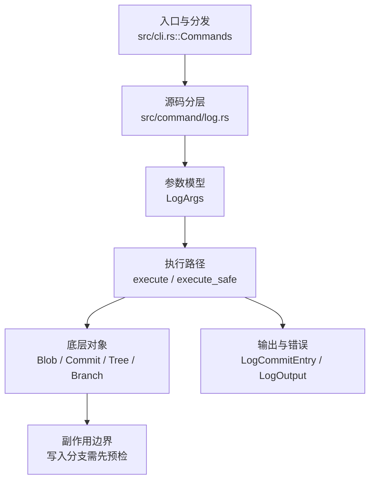

# `libra log` 开发设计

## 命令实现目标

`libra log` 的目标是展示提交历史，并支持数量、时间、作者、graph、format、颜色、revision range（位置性 `A..B`/`A...B`/`^A` 及 `--range`）、`--all`、`--reverse`、`--follow`、`-L` 和 `--parents`/`--children` 等常用查看能力。实现需要在 Git 兼容历史查看和 Libra 结构化输出之间保持一致，并把尚未覆盖的复杂格式能力列为后续工作。

## 对比 Git 与兼容性

- 兼容级别：`partial`。

- 当前矩阵承诺常用 Git log 子集已支持；`--range`（revision ranges）、Git 位置性 revision range（`A..B`/`A...B`/`^A` 位置参数）、`--all`、`--reverse`、`--follow`、`-L`、`--parents`/`--children`、`-i`/`--regexp-ignore-case`、`--invert-grep` 已补齐，仅复杂 rename follow 和精确行级归属仍为 partial。新增语义必须同步矩阵、用户文档和测试。

## 设计方案

- 入口与分发：已公开接入 `src/cli.rs::Commands`；已由 `src/command/mod.rs` 导出。CLI 层在 `src/cli.rs` 把解析后的参数交给命令模块，命令模块负责把领域错误转换为 `CliError` / `CliResult`。
- 源码分层：主要实现文件为 `src/command/log.rs`；P1-05 展示默认值集中在 `src/command/log/config.rs`。参数/子命令类型包括：`LogArgs`；输出、错误或状态类型包括：`LogCommitEntry`、`LogOutput`；主要执行函数包括：`execute`、`execute_safe`。
- 执行路径：`execute_safe` 负责 CLI 安全包装、错误映射和输出配置；对象路径会解析 revision 并读写 blob/tree/commit/tag 等对象；引用路径会读取或更新 SQLite refs、HEAD 与 reflog。默认排序与 `--date-order` 走 `walk_date_priority`（`pub(crate)`，供 BRL-04 的 `rev-list` 复用）。`--author-date-order` 仍走 `get_reachable_commits_excluding` 加作者时间全局排序。

## 日期优先 walker（ADR-BRL-02 / ADR-BRL-03）

父提交在入队时加载，排序键用其 committer 时间。队列按（committer 时间降序、发现序号升序）出队。`seen` 集合保证同一提交只加载一次。`--first-parent` 与 shallow 边界沿用 `history_parents`。`--date-order` 与默认使用同一 committer 键，是 parity no-op。

合格的 `-n` / `--max-count`（含 `--skip`）在产出 `skip + number` 笔后停止；停止前会把这些提交的父提交载入队列前沿。无限额与不合格但仍是默认排序的调用走同一 walker，只是不提前终止。`--author-date-order` 不走 walker。

不合格（提前终止关闭，默认排序仍走 walker）的条件：`--reverse`、`--graph`、`--children`、`--follow` 或 `configured_follow_path` 为 `Some`、`-L`、pathspec、`--author` / `--committer` / `--grep` / `--since` / `--until`、pickaxe、`--merges` / `--no-merges` / `--min-parents` / `--max-parents`、`--trailer`、带排除端的范围、`--all`、多个修订起点。判定用解析后的有效值：没有 pathspec 时 `log.follow=true` 仍合格。

`A..B` 会先加载排除端的祖先闭包，再遍历展示集合。debug 计数钩子 `LIBRA_TEST_LOG_COMMITS_LOADED_PATH`（`#[cfg(debug_assertions)]`）统计这次历史遍历解析过的提交对象数，含闭包与入队父提交，因此大于 `rev-list A..B --count`，差额是闭包大小。单一正向修订上，该数等于 `rev-list --count`。`LIBRA_TEST_LOG_ABBREV_BASIS_COUNT_PATH` 记下缩写长度的输入提交数：合格限额用已打印集合（下限 7），其余调用用全部可达提交。

与 `rev-list` 不对称：`log` 的不合格默认排序仍走 walker；`rev-list` 仅白名单合格调用（单一正向 tip，选项 ⊆ `max_count`/`skip`/`first_parent`/`date_order`）走 walker，过滤与其它全量选项仍用 `sort_rev_list_commits` 全局排序。带过滤的 `log` 与带过滤的 `rev-list` 在偏斜历史上的顺序可能不同。`get_reachable_commits` 保持集合语义，不计入该钩子。

- 流程图：以下流程图按当前源码分层展示主路径和底层对象边界，便于维护者把代码入口、执行函数和副作用范围对应起来。

- 底层操作对象：`Blob`（文件内容或 LFS pointer 写入对象库后的 blob 对象）；`Commit`（提交对象、父提交关系和提交消息载荷）；`Tree`（由索引或对象遍历生成的目录树对象）；`Branch` / branch store（SQLite refs 上的分支读写、过滤和上游关系）；`Head`（SQLite 中的 HEAD 指向、当前分支和 detached 状态）；`ObjectHash`（SHA-1/SHA-256 对象 ID 和 revision 解析结果）；`ConfigKv`（配置键值持久化行）
- 输出与错误契约：人类输出、`--json` / `--machine` 输出和 quiet/verbose 分支必须继续走现有 `OutputConfig` / `emit_json_data` / `CliError` 路径；新增失败模式要补稳定错误码、用户提示和回归测试。
- 副作用边界：凡是写入索引、对象库、refs/HEAD、reflog、SQLite/D1、工作树或远端的路径，都必须先完成参数校验和 dry-run/预检分支，再执行持久化，避免部分写入后静默成功。

## 实现历史

- 2026-11-20（LS-01 / #949）：`create_reference_commit_map` 对附注 tag 由单层解引用改为沿整条 tag 链迭代剥皮（`util::peel_to_non_tag_typed`），嵌套 tag 的每一层都装饰目标提交；显式 `--format`/`--pretty` 含 `%D`/`%d` 时在无终端也请求装饰（short，除非 `--decorate=full`/`log.decorate=full` 选择 full），且不受 `--decorate=no`/`--no-decorate` 影响（与 Git 一致）；配置 `format.pretty` 中的 `%D`/`%d` 请求不在本卡范围。回归：`command::log_test::decorate_nested_annotated_tags`（含 200 层链）。

- 本节依据本地 main 分支提交历史重写，筛选与该命令实现、测试或文档路径直接相关的提交；以下是归纳后的实现脉络。
- 2025-12-19 `d45bec8c`（`feat(log): add --abbrev-commit/--abbrev/--no-abbrev-commit for commit… (#93)`）：基础实现节点：add --abbrev-commit/--abbrev/--no-abbrev-commit for commit… (#93)；当前实现的主要轮廓可追溯到该提交。
- 2026-06-06 `f95b80df`（`feat(log): colorize graph columns and align compatibility matrix`）：功能演进：colorize graph columns and align compatibility matrix；该节点扩展了当前命令可用的参数或行为。
- 2026-06-06 `89045f35`（`feat(log): support revision ranges (A..B, A...B, ^A B)`）：通过 `--range <SPEC>` 引入 revision range 入口。**后续已补齐 Git 位置性 `git log A..B`/`A...B`/`^A` 语法**（`split_log_positionals` 把前导 positional 按解析结果分流到 revision 或 pathspec，rev/path 同名歧义报错并提示 `--range`）；`--range` 作为显式入口保留。
- 2026-06-07 `155a430a`（`fix(log): close compatibility plan gaps`）：实现修正：close compatibility plan gaps；该节点把边界行为、错误处理或兼容差异纳入当前实现约束。
- 2026-07-09（plan-20260708 P0-05）：orphan root 语义验收要求 `log --pretty=%P -1` 能稳定显示父提交列表；当前 `CommitFormatter` 补齐 `%P`（完整 parent OID 列表）与 `%p`（缩写 parent OID 列表），root commit 输出空字符串。回归覆盖：`compat_switch_orphan_root` 与 formatter 单测。
- 2026-07-09（plan-20260708 P0-06）：stdout 下游提前关闭时经全局入口与 `Pager`/输出层静默正常终止，不打印 panic/backtrace/`Broken pipe` 诊断。回归覆盖：`compat_broken_pipe_output`。
- 2026-07-09（plan-20260708 P1-04）：`CommitFormatter` 的自定义模板从链式 `replace` 改为单次扫描 renderer，补齐 `%b`/`%B`/`%n`/ASCII/control `%xNN`/`%%`/`%aI`/`%cI`/`%at`/`%ct`/`%D`/`%m`/常见 `%C...` color placeholders，并按 Git 规则保留未知占位符字面量；`log -z` 支持 NUL 记录与 `--name-only`/`--name-status` 路径字段，`--name-only --format=%s` 的提交文本与路径区块分隔对齐 Git。回归覆盖：`compat_pretty_format_placeholders`。
- 2026-07-11（plan-20260708 P1-05d，log 展示默认片）：`format.pretty`、`log.date`、`log.follow` 接入严格 local→global→system 级联；CLI `--oneline`/`--pretty`/`--format`、`--date`、`--follow`/`--no-follow` 分别优先。`format.pretty` 同步作用于 `show`；`log.follow=true` 仅在恰好一个位置路径时自动启用，human/JSON 选择一致，子目录路径先规范化到仓库根。核对既有实现时发现 `--follow` 在重命名提交未切换父路径，现改为反向 exact-blob 状态机：只选当前 tree 已消失的父路径、稳定排序候选，不会把保留源文件的 copy 误判为 rename；每个提交携带的历史路径同步驱动 name-status、stat/shortstat、patch、quiet 验证与 JSON。可跨纯重命名但仍不承诺内容变化/复杂非线性重命名。空值、未知裸 pretty 名、未支持 date mode、无效布尔与 local/global 读取失败均在输出前 fail-closed；system scope 保持既有跳过契约。回归覆盖：`compat_config_defaults_semantics::log_defaults` / `log_default_errors` / `log_follow_defaults`。
- 历史结论：当前文档应以这些提交之后的代码、测试和兼容矩阵为准；更早的迁移式文档只保留为背景，不再作为事实来源。

## 当前状态

- `-s`/`--no-patch` 可重复；每次出现只清除其前面的 `-p`/`--patch`、`--stat`、`--shortstat`、`--patch-with-stat`、`--name-only` 和 `--name-status`，之后给出的格式仍生效。只有 `-s` 仍处于生效状态时，生效中的 name 输出选项才与之冲突；两个 name 选项若处理后仍同时生效也会以 `LBR-CLI-002`（退出码 129）拒绝。后续 `--stat` 等 diff 格式会清除 `-s`， name 输出可正常显示；后续 `-s` 清除的 name 选项不构成冲突。
- 新增的筛选参数为可重复的 `--grep <PATTERN>` 与 `--all-match`；后者要求所有模式命中，重复开关不改变结果，无模式时不筛选。
- `--grep` 可重复指定，默认任一模式命中即可；空模式匹配任何消息；`--invert-grep` 保留没有任何模式命中的提交，并优先于 `--all-match`。每个模式在遍历前按 argv 顺序编译，非法模式返回 `LBR-CLI-002`/129，多个非法模式时报告第一个。`CommitFilter::passes_non_path_filters` 复用现有 `parse_commit_msg` 识别签名，再按借用签名切片末端恢复未 trim 的正文；仅查询真实 subject/body/trailer，不搜索 `Commit.message` 中嵌入的 PGP/SSH 签名头（含 `gpgsig-sha256`）。大小写选项作用于所有 grep 模式；human/JSON/machine 共享选择逻辑，输出 schema 不变。未签名消息里长得像签名头的字面量仍是消息。实际消息开头的空格、tab 和空行保留，unsigned 只剥离存储分隔换行。每个有 grep 模式的提交增加既有 parser 的线性扫描；消息为原 `String` 的借用切片，不分配新的消息 `String`，不改变对象、签名验证或提交写入。
- 回归证据入口：lib `command::log::tests::log_grep_ignores_embedded_signature_headers` 与 `command_test::command::log_test::log_grep_signed_commit_uses_message_only`；后者通过真实hash-object/update-ref/log覆盖四类签名头组合及unsigned×三种输出×七种查询，共105次（含前导空白）。签名载荷为不做密码学验证的确定性fixture；原 `log_grep_ignore_case_and_invert_grep` 保留。此专项是Cargo门，非场景runner新增覆盖。

- 公开状态：已公开；模块状态：已导出。
- 路径匹配（**FIX-AD-01**，取代旧 AU-05 审计行）：位置 pathspec 经共享 `PathspecSet` 引擎匹配——`CommitFilter.path_specs`（`with_pathspec`）+ `changed_files_for` 在两条遍历循环（主循环与 `select_log_commits`）统一走 `get_changed_files_for_commit_matching_pathspec`，`log_pathspec_set` 从 raw specs 构建；支持 plain prefix、wildcard 与 `:(top)`/`:(glob)`/`:(literal)`/`:(icase)`/`:(exclude)`；`--follow` 激活时该集合置空（follow 自行走路径）；全局 `--literal-pathspecs` 下按字面。回归 `test_log_pathspec_globs_match_via_shared_engine`。
- 用户文档：`docs/commands/log.md`。
- Synopsis：`libra log [OPTIONS] [<revision-range>...] [[--] <path>...]`。
- 公开参数/子命令包括：`-n, --number <NUMBER>`（Git 别名 `--max-count`）、`--oneline`、`--abbrev-commit`、`--abbrev <N>`、`--no-abbrev`（显示完整对象名；与 `--abbrev=<N>` 后者生效，不改变 JSON `short_hash`）、`--no-abbrev-commit`、`-p, --patch`、`-s, --no-patch`、`--name-only`、`--name-status`、`-z, --null`（NUL 终止 log record 和 name-only/name-status 路径字段）、可重复的 `--author <PATTERN>` 与 `--committer <PATTERN>`（同字段内 OR，字段之间和与消息过滤 AND，不受 `--all-match` 影响）、`--since <DATE>`、`--until <DATE>`、`--merges`、`--no-merges`、`--min-parents <N>`、`--max-parents <N>`、`--first-parent`、`-S <STRING>`、`-G <REGEX>`、`--skip <N>`、`--pretty <FORMAT>`、`--format <FORMAT>`（`--pretty` 的 Git 别名）、`--date <FORMAT>`、`--decorate[=<MODE>]`（人读路径的装饰按完整引用名逆序、`HEAD` 最前且只标在 HEAD 指向的提交）、可重复的 `--decorate-refs <PATTERN>`/`--decorate-refs-exclude <PATTERN>`（每个值一个完整模式，隐式 `refs/` 前缀、只匹配完整引用名；含 `*`/`?`/`[` 为通配，否则精确或 `/` 组件边界前缀；排除优先；`HEAD` 作为字面名参与同一过滤，箭头仅在 `HEAD` 与分支都保留时出现；不再拆逗号、不再匹配短名）、`--no-decorate`、`--graph`、`--stat`、`--shortstat`（仅 diffstat 摘要行）、`--patch-with-stat`（Git 中 `-p --stat` 的同义词：先输出 diffstat 块再输出完整 patch；复用既有 `--stat`/`-p` 渲染器，按 stat→空行→patch 顺序组合，同时让显式的 `-p --stat` 组合也输出两者，此前仅显示 patch；stat/patch 块本身沿用 Libra 既有渲染，故不复刻 Git 的 `---` 分隔符与 stat 间距，属既有 intentionally-different）、`--grep <PATTERN>`、`-i, --regexp-ignore-case`、`--invert-grep`、`--reverse`、`--author-date-order`（按作者日期而非提交者日期排序，newest-first；经 `sort_commits_newest_first` 仅按时间戳排序，无 Git 的拓扑约束）、`--date-order`（接受式 no-op，显式选择默认的提交者日期顺序，与 `--author-date-order` 互斥）、`--no-expand-tabs`（接受式 no-op：Libra 从不在提交消息中展开 tab，逐字打印，故已是默认行为；字段 `no_expand_tabs` 解析后不被读取。Git 的反向 `--expand-tabs[=<n>]` 未实现）、`--no-notes`（接受式 no-op：Libra 的 log 从不内联显示 notes，故已是默认行为；字段 `no_notes` 解析后不被读取。Git 的反向 `--notes[=<ref>]` 未实现，读 note 用 `libra notes show <commit>`）、`--no-mailmap`（接受式 no-op：Libra 的 log 从不应用 mailmap，直接显示记录的原始身份；字段 `no_mailmap` 解析后不被读取。Git 的反向 `--mailmap` 未实现）、`--no-show-signature`（接受式 no-op：Libra 的 log 从不内联显示提交签名，故已是默认行为；字段 `no_show_signature` 解析后不被读取。Git 的反向 `--show-signature` 未实现）、`--all`、`--follow <FILE>`、`-L <RANGE:FILE>`、`--parents`、`--children`、`--range <SPEC>`、位置参数 `[<revision>...] [<path>...]`（前导可解析为 revision 的 token 经 `split_log_positionals` 分流为 revision range，其余为 pathspec；rev 与 path 同名时报歧义并提示 `--range`）等。`-i`/`--regexp-ignore-case` 让 `--grep` 大小写不敏感（author/committer 在 Libra 中本就大小写不敏感，故 `-i` 仅作用于 `--grep`）；`--invert-grep` 保留消息**不**匹配 `--grep` 的提交（在 `CommitFilter::with_grep_options` 中按 `matches == invert_grep` 排除）。`--parents`/`--children`（互斥）在每个提交哈希后追加缩写后的父/子提交 id：父来自 `commit.parent_commit_ids`，子在所展示提交（已渲染集合）范围内反向计算（与 rev-list 的子映射同算法，但作用于 log 的渲染集，不含范围外的子提交），经 `FormatContext.extra_hashes` 进入 full / oneline 格式。
- 人类可读的 `--decorate`、`%d` 与 `%D` 按完整引用名降序列出装饰，并将 `HEAD` 放在最前；`--json` 的 `refs` 顺序保持不变（LO-05）。
- `--no-abbrev` 设置统一的完整对象名长度：覆盖提交号、`%h`/`%p`、`--parents` 和范围内 `--children` ID；`--abbrev=<N>` 与它按 argv 顺序后者生效，`--abbrev-commit`/`--oneline` 不改变长度，JSON `short_hash` 仍固定为 7 位。
- grep 参数：`--grep <PATTERN>` 可重复，默认任一模式命中；`--all-match` 不接受值，要求所有 grep 模式命中；`--invert-grep` 保留未命中任何模式的提交。
- P1-05 展示配置：`format.pretty` 仅在没有 `--oneline`/`--pretty`/`--format`/`--only-trailers` 时生效，其 `medium` 值保持默认渲染器与完整 commit id；`log.date` 让位于 `--date`，`--only-trailers` 不读取无关的格式/日期默认；`log.follow` 让位于显式 `--follow <FILE>`/`--no-follow`，并仅为单一现存文件 path 自动启用，单目录仍走普通 path 过滤。三键均在任何 commit 输出前解析；format/date 不改变 JSON schema，follow 会改变 human/JSON 的选择集合。
- `--committer <PATTERN>`：按 committer name/email 的大小写不敏感子串过滤（对照 `--author`）。`--merges`/`--no-merges` 和 `--min-parents`/`--max-parents <N>`：按父提交数过滤（merges=≥2，no-merges=≤1，显式 min/max 优先）。`--first-parent`：遍历时只跟随合并提交的第一个父提交，折叠被并入的侧分支历史。`-S <STRING>`：pickaxe，仅显示改变了 STRING 出现次数的提交（对每个被改动文件比较其在该提交与第一父提交中的内容出现次数，总数变化即匹配；大小写敏感字面匹配）。`-G <REGEX>`：pickaxe，仅显示 diff 的新增/删除行中存在匹配该正则的提交（基于 `compute_diff`；与 `-S` 互斥）。`--skip <N>`：在输出前跳过前 N 个匹配提交（在过滤之后、`-n` 限制之前，对人类与 JSON 两条输出路径一致）。`--date=<mode>`：作者/提交日期渲染模式（`default`/`short`/`iso`/`iso-strict`/`rfc`/`unix`/`raw`/`format:<strftime>`），作用于人类输出（Full 与 `--pretty` 的 `%ad`/`%cd`）；时间以 UTC 渲染（时区 `+0000`），JSON 输出仍用规范日期。`log.date` 在 CLI 未显式指定时提供同一默认并同步供 `show` 使用；`relative`/`human`/`local`/`auto:*` 暂未实现，配置值会明确失败而不静默回退。
- `--graph`（ADR-LG-05 第 4 条，LG-07）：移植 Git `graph.c` 的列分配状态机（commit/post-merge/collapsing/pre-commit 行），分叉 `|/`、双亲 `|\`、octopus `*-.` 与展开行逐字节对齐；`--graph` 隐含拓扑（图）顺序：以 `graph_topo_order` 对已选提交做 indegree + LIFO 栈排序，`--reverse` 之后翻转；`--all` 按引用名排序列出 `refs/heads/*`、`refs/remotes/*`、`refs/tags/*`、`refs/notes/*` 与 `HEAD`（Libra notes 为 SQLite 表，只有导入的 notes 引用贡献提交）。`--date-order`/`--author-date-order` 暂复用图顺序（DEFER-10）。
- 默认布局（ADR-LG-05，LG-05）：`medium`/`short`/`full`/`fuller`/`raw` 记录之间输出**一个**空行且最后一个记录后无空行；`Date:` 使用 Git 默认形式且月内日期不补零（`Fri Jan 2 00:00:00 2026 +0000`）；`oneline`/`reference`/自定义 `--format`/`--pretty` 记录之间仅一个换行、无空行。`--oneline`/`--pretty`/`--format` 由 clap 互覆写（`overrides_with_all`），按 argv 顺序后者生效，不再互斥。`show` 复用同一 formatter，并在 `Date:` 与缩进消息之间保留空行。
- `--date=format:<strftime>` 使用 `strftime` 指令自定义人类输出中的作者与提交者日期。
- `--pretty=<value>`：识别命名预设（`oneline`/`medium`/`short`/`full`/`fuller`/`reference`/`raw`）与 `format:<tmpl>`/`tformat:<tmpl>` 前缀（自定义模板）；其它值按裸自定义模板处理。`medium`（及空值）映射默认 Full（Git 默认）。`short`/`full`/`fuller`/`reference`/`raw` 经 `FormatType::Preset(LogPreset)` 单独渲染：`short`=commit+Author+缩进 subject（无 Date/Commit/body）；`full`=+Commit 行（无 Date）+完整消息；`fuller`=Author/AuthorDate/Commit/CommitDate 四行对齐+完整消息；`reference`=单行 `<abbrev> (<subject>, <short-date>)`；`raw`=tree/parent/author/committer 原始头（含可选 gpgsig，space-续行）+缩进消息（全 hash、原始时间戳）。自定义模板当前支持 `%H`/`%h`、`%P`/`%p`、`%s`/`%f`、`%b`/`%B`、`%n`、ASCII/control `%xNN`、`%%`、`%an`/`%ae`/`%ad`/`%aI`/`%at`、`%cn`/`%ce`/`%cd`/`%cI`/`%ct`、`%d`/`%D`、`%m` 和常见 `%C...` 颜色占位符；未知占位符按 Git 规则原样保留。其中 `%P` 是完整 parent OID 空格列表，root commit 输出空字符串；`%aI`/`%cI` 使用提交记录的原始 timezone 渲染 strict ISO；高位 `%x80..%xff` 原始字节输出仍不是本 UTF-8 文本 renderer 的兼容承诺；`%C(always,...)`/`%Creset` 按 Git color policy 处理，普通颜色关闭时 `%C(always,...)` 仍可发色、`%Creset` 不强制复位，需用 `%C(always,reset)` 强制 reset。预设继承 libra log 既有惯例（时间戳渲染 UTC `+0000`、`--pretty` 隐含缩写哈希、提交消息体空行在存储时已折叠），故在这些既有维度上与 git 非逐字节相同。`show` 与 `shortlog --format` 复用同一 `parse_pretty_format`/`CommitFormatter`，并按各自 human 输出路径的 `OutputConfig` 颜色策略启用 `%C...`。

- trailer 支持（`lore.md` §1.9）：共享 Git-faithful 解析器 `internal::log::trailer`（`parse_trailers`/`parse_trailers_with_recognized`/`trailer_block`/`ends_with_trailer_block`）——末段块定位（注释行在定位与分类中均透明）、首段（标题）排除、key 字符集仅 ASCII 字母数字+`-`（git `find_separator` 语义，`Change_Id:`/非 ASCII key 不是 trailer）、key 与 `:` 间容忍空白、空值合法、续行 RFC-822 折叠且在 25% 算术中记双非（孤儿续行记非 trailer 行）、可识别前缀 `Signed-off-by: `/`(cherry picked from commit `（后者仅入 raw 块，不作为结构化 Trailer）、合格判定 `全 trailer 或（含可识别且 trailer*3>=非)`。有意简化（不实现）：`trailer.separators`/`trailer.<token>.*` 配置、自定义注释字符、`---` divider。CLI：`--trailer KEY[=VALUE]`（AND 过滤，key 大小写不敏感、value 精确；`CommitFilter.trailer_filters` 同时接入 human 与 `--json` 两条构造路径）与 `--only-trailers`（`CommitFormatter::with_only_trailers`，与 oneline/pretty/format 互斥）为 Libra 扩展；`--json` 增量 `trailers` 字段。`%(trailers[:opts])` pretty 占位符为后续项（复用本解析器）。shortlog `--group=trailer:` 已改走本解析器（请求的 key 作为 recognized 强化，混合块可合格）。写侧三修复见 commit.md。

## 还未实现的功能

| 类别 | 未完成项 | 当前处理 |
|---|---|---|
| 兼容矩阵说明 | common Git log surface plus `--range` AND positional (`A..B`/`A...B`/`^A`) revision expressions, `--all`, `--reverse`, `--follow`, `-L`, and `--parents`/`--children` supported | 按当前兼容矩阵保留；实现状态变化时同步 `_compatibility.md` 和测试证据。 |
| ✅ 已实现 | Git 原生位置性 revision range 语法（`A..B`、`A...B`、`^A` 位置参数）| `split_log_positionals` 把前导 positional 按解析结果分流为 revision range 或 pathspec：range 语法（`A..B`/`A...B`/`^`）能解析→revision，不解析但命中现有 path（如 `../file`、名为 `foo..bar` 的文件）→pathspec，否则报错（未知 revision/path——typo guard）；bare token 解析成功且不与现有 path 同名才作 revision（同名报歧义提示 `--range`），否则进入 path 模式（保留 `--` 路由的历史 path）。`A...B` 用 `reachable_commit_ids(left)∩reachable(right)` 做真对称差（处理 criss-cross 多 merge-base 与无公共祖先），`get_reachable_commits_excluding` 对 exclude tips 做祖先闭包（修了 `A..B`/`^A` 只排除精确 commit 的旧 bug）。`--range` 作为显式入口保留。带测试 `test_log_positional_revision_range` / `test_log_positional_ambiguous_rev_and_path_errors`。 |
| 功能缺口 | `--follow` 重命名跟踪基于 best-effort blob 匹配，不保证复杂重命名场景 | 后续实现时需要同步源码、测试和兼容矩阵。 |
| 功能缺口 | `-L` 行级历史跟踪为 best-effort，尚未实现精确 blame 级行归属 | 后续实现时需要同步源码、测试和兼容矩阵。 |

## 维护要求

- 改进本命令前，必须先阅读并遵循 [docs/development/commands/_general.md](_general.md)；这是命令设计、实现、测试和文档同步的强制要求。
- 任何行为变更都要先核对实现源码，再同步 `COMPATIBILITY.md`、`docs/commands/<cmd>.md` 和相关测试。
- 新增 Git 兼容参数时必须明确 tier、错误码、JSON/机器输出契约和回归测试。

**`--separate-git-dir` 指针布局（2026-11-20，CL-23）：** `<worktree>/.libra` 为 `gitdir: <dir>` 指针文件时，`util::resolve_dot_libra_pointer` 解析真实元数据目录，仓库发现（`try_get_paths_full_with_storage_lookup`）、`info/*` 候选与 `alternates` 的 objects 解析都改读 `<dir>`。会写 ref 的子命令仍由 `CL-28` 默认拒绝。

- 2026-11-21（LS-02 / #950）：`log.decorate` 现在接受 Git 布尔值（真值→`short`、假值→`no`）且非法值等同关闭但不报错；命令行 `--pretty=raw`/`--format=raw` 抑制配置装饰（显式 `--decorate` 优先，`format.pretty=raw` 不抑制）。回归：`command::log_test::test_log_decorate_config_boolean_and_raw_suppression`。

- 2026-11-21（LS-03 / #951）：`log.excludeDecoration` 多值配置参与装饰过滤（显式 `--decorate-refs` 覆盖配置）；空串值按 Git 空排除模式处理，`HEAD` 标记保留；Libra 配置无「无值键」形态，缺值诊断登记为有意差异。回归：`command::log_test::log_exclude_decoration_config`。

- 2026-11-21（LS-05 / #953）：新增 `--simplify-by-decoration`——保留经装饰过滤后的被引用提交与仓库根提交，其余丢弃；与本机 `git 2.56.0` 同夹具输出逐字一致（线性、分支、合并与 `--decorate-refs`/`--decorate-refs-exclude` 过滤）。回归：`command::log_test::simplify_by_decoration`。

- 2026-11-21（LS-06 / #954）：新增 `--clear-decorations`（清除此前 `--decorate-refs*` 并放开默认命名空间过滤）与 `log.initialDecorationSet=all`；`refs/notes/*` 行按 notes 命名空间装饰（`notes/<name>`）且默认隐藏。回归：`command::log_test::log_clear_decorations_and_initial_decoration_set`。

- 2026-11-21（LS-07 / #959）：装饰与 `commit <id>` 着色改为显式 SGR，读取 `color.decorate.{HEAD,branch,remoteBranch,tag}` 与 `color.diff.commit`（含旧名 `diff.color.commit`），默认调色板与 Git 实测一致；分隔符按 commit 色分段着色；`%d` 与 `%D` 分别使用带括号着色与纯文本形式。回归：`command::log_test::log_colour_decorate_slots_match_git_bytes`。

- 2026-11-21（LS-09 / #958）：核实 `--no-abbrev` 在 `%h`、`%p`、`--parents`、`--children` 及与 `--abbrev=<N>` 的先后覆盖关系上已全部输出 40 位 OID（LO-09 已修复，本卡补回归）：新增 `command::log_test::no_abbrev_issue_958_remaining`（AC1–AC6，含 E() 展开对照）。

- 2026-11-21（LS-10 / #956）：新增 `--no-walk[=sorted|unsorted]`（只展示指定提交；`sorted` 按提交时间、`unsorted` 按命令行顺序；未知模式 `LBR-CLI-002`）与 `--tags[=<glob>]`（以匹配 `refs/tags/` 的标签所指提交为起点，无显式修订时取代隐式 `HEAD`）。回归：`command::log_test::no_walk_and_tags`（AC1–AC6）。

- 2026-11-21（LS-11 / #965）：`--since`/`--until` 增加可见别名 `--after`/`--before`（同解析、同错误文本、`LBR-CLI-002`/129），`--help` 中显示别名。回归：`command::log_test::before_and_after_aliases`（AC1–AC7）。

- 2026-11-21（LS-12 / #969）：新增 `-R`/`--reverse-diff`，以 log 专用 `reverse_patch` 交换 diff 的标签、index 哈希、hunk 范围与 +/- 内容行（`generate_diff`/`CommitDiffOptions` 签名不变，提交顺序不变）；澄清 #969 标题所称「`--reverse` 短别名」不符 Git 语义，按 Git `-R` 实现。回归：`command::log_test::diff_reverse_flag_r`（AC1–AC3）。

- 2026-11-21（LS-14 / #972）：`--format=`/`--pretty=`/`--format=tformat:` 改为 `FormatType::Silent`（0 字节），`--format=format:` 为 `FormatType::Separator`（仅提交间换行）；有内容时不再追加多余换行，静默头下 `--stat`/`-p` 不再注入前置空行；同步更新 `test_parse_pretty_format_presets` 断言。回归：`command::log_test::empty_format_or_pretty_omits_header`。

- 2026-11-21（LS-15 / #963）：新增 `--output=<file>`（`LogSink` 分流 pager/文件）：逐级解析符号链接取最终目标、`create_new` 独占创建、已存在目标与 `.libra/` 内目标以 `LBR-IO-002` 拒绝、`--json` 组合以 `LBR-CLI-002` 拒绝；pager 策略不变（启动时收空输出）。回归：`command::log_test::output_to_file`（AC1–AC8，含 `.libra` 清单不变断言）。

- 2026-11-21（LS-37 / #963）：`--output` 开放既有目标原地覆盖——以「只写、不创建、不截断」打开，`fstat` 取 `(dev,inode,nlink)` 与预检 `stat` 比对（检查后被替换即拒绝），`nlink>1` 时遍历 `.libra/` 比对 inode（含硬链接/符号链接触及仓库文件），核验通过后才经同一描述符截断；目录目标以 `LBR-IO-002` 失败。同步按协议删除 `output_to_file` 中 LS-15 的「既有目标拒绝」断言。回归：`command::log_test::output_overwrite_and_protection`（AC1–AC8）。

- 2026-11-21（LS-36 / #963）：开放 `--json` 与 `--output` 组合——新增 `utils::output::json_command_envelope_bytes`（`emit_json_data` 复用之），JSON 信封经 `LogSink` 写入目标文件、stdout 为空，`.libra/` 与失败诊断沿用 LS-15/LS-37；按协议删除 `output_to_file` 中 LS-15 的「`--json --output` 拒绝」断言。回归：`command::log_test::output_json_to_file`（AC1–AC2）。

- 2026-11-21（LS-16 / #962）：`--follow` 改为无值布尔标志（`num_args=0..=1` + `default_missing_value=""` + `require_equals`），由唯一位置 pathspec 决定跟踪文件；0/多路径以 `LBR-CLI-002` 拒绝并输出 Git 同文 `--follow requires exactly one pathspec`；旧写法 `--follow=<FILE>` 保留（等价 `--follow -- <FILE>`）并登记为有意差异。回归：`command::log_test::follow_boolean_flag_single_pathspec`（AC1–AC7）。

- 2026-11-21（LS-17 / #961）：`-L` 由「仅路径过滤」改为真正的行级历史——按 hunk 变更行判定范围、`-L` 隐含 `-p`、`filter_patch_to_ranges` 收窄 hunk（Git 头部/尾随上下文/创建 hunk 0 基）、`:<funcname>:` 由定义解析（`resolve_line_ranges`）、`patch_hunk_spans` + `remap_ranges_to_parent` 把范围回推到父提交编号；未知函数名 → `LBR-CLI-003` + Git 同文诊断。回归：`line_history_emits_range_hunks`、`line_history_function_name_ranges`、`line_history_maps_range_through_parents`。

- 2026-11-21（LS-18 / #968）：新增 `--find-object=<object>`（可重复）——按提交相对首个父提交的递归 diff 匹配：变更文件对的旧/新 blob 或仅出现在一侧的树（`collect_tree_ids` 枚举子树 ID，`commit_touches_objects` 比对），多值并集；不可解析对象 → `LBR-CLI-003`。回归：`command::log_test::find_object_filter`（AC1–AC4）。

- 2026-11-21（LS-32 / #961）：新增 `validate_line_range_args`——`-L` 与位置 pathspec 同用 → `LBR-CLI-002` + `-L<range>:<file> cannot be used with pathspec`；与 `--follow` 同用 → `LBR-CLI-002` + `--follow requires exactly one pathspec`；被跟踪文件不存在 → `LBR-CLI-003` + `There is no path <file> in the commit`；非法语法仍为 `LBR-CLI-002`。回归：`command::log_test::line_range_argument_diagnostics`（AC1–AC4）。

- 2026-11-21（LS-08 / #960）：`log` 对 replace 引用显示 `replaced` 装饰——`load_history_commit` 在内容被替换后恢复**原始 oid**（`commit.id = commit_id`），`has_replace_ref` 读取 `GIT_REPLACE_REF_BASE`（默认 `refs/replace/`）判断标记，调色板新增 `color.decorate.replaced`（默认 `1;34`），标记追加在其它装饰之后。回归：`command::log_test::decorate_replaced_and_env_base`（AC1–AC2）。

- 2026-11-21（LS-14 收尾 / #972）：`format_stat_output` 与 Git 对齐——变更列宽取本块最宽计数（原固定 `{:>3}`），汇总行省略为零的 insertion/deletion 子句，使 `--format= --stat` 与 `git log --format= --stat` 逐字一致（解除该卡 AC5 的阻塞）。回归：`empty_format_or_pretty_omits_header` 的 AC5 改为逐字断言；`log_test` 276/276、`show_test` 42/42。

- 2026-11-21（LS-19 / #833 第一段）：新增 `--cc`（隐含 `-p`）——合并提交输出稠密组合差异（`generate_cc_diff`：仅保留对**每个**父提交都变更的路径，输出 `diff --cc`、`index <p1>,<p2>..<merge>`、`---/+++` 与 `@@@` 组合 hunk，正文按父提交分列）；非合并提交走普通 `generate_diff`，实测与 `-p` 逐字节相同。回归：`command::log_test::log_cc_merge_combined_diff`（AC2/AC3 + AC1 形状）。

- 2026-11-21（LS-19 / #833 第三段）：`--cc` 组合 hunk 采用 **LCS 对齐**（`lcs_alignment`）逐父提交对齐合并结果，正文按合并行顺序交错输出（上下文 ` `、父提交被替换行按列 `-`、合并新增行按列 `+`），插入槽位取「最后匹配行 + 1」，因此既有单条冲突夹具**保持逐字节一致**，新增「同文件两处冲突」夹具也与 `git log --cc` 逐字节一致。回归：`log_test` 278/278、严格 Clippy exit 0。

- 2026-11-21（LS-19 / #833 第四段）：`--cc` 组合 hunk **按上下文 3 行拆分**——`changed[]` 由「父侧缺行」与「父侧插入槽」推导，重叠区域合并；每条 `@@@` 的父侧起始偏移 = 已输出父行数 + 1；同一插入槽内**多个父提交删除同一行时合并为一行**（各父列同时标 `-`，与 Git `--24` 行为一致）。三类夹具（单冲突、同文件两处相邻冲突、相距 26 行的两处冲突）均与 `git log --cc -1` 的 `diff --cc` 段**逐字节一致**。回归：`log_test` 278/278、严格 Clippy exit 0。

- 2026-11-21（LS-13 / #955）：按实测证据改判 AC 并落地回归——非 TTY 无 `\r`/`ESC[K`；PTY 输出 = 管道输出 + ONLCR（用例内以 `env!("CARGO_BIN_EXE_libra")` 绝对路径经 `script -qec` 断言，`--decorate=short` 固定装饰）；`--color=always` 保留 SGR 不新增擦除序列。

- 2026-11-23（LS-20 / #964）：新增 `log --raw` 与 `log --numstat`（`commit_diff_output` 经 clap 构造 `DiffArgs` 调 `run_diff_for_service`；`render::format_diff_raw`/`format_numstat_output` 复用）；`DiffFormatPositions`/`ResolvedDiffFormats` 增加 raw/numstat，`-s`/`--no-patch` 按位置清除；`--dirstat` 与 Git 逐字一致。回归：`raw_numstat_dirstat_formats`（AC1–AC6）。
