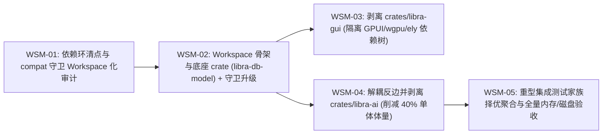

# Libra Cargo Workspace 多 Crate 拆分与编译内存上限治理计划（2026-11-22）

**模板版本:** `v2.16`

**状态:** 设计计划（草案）。全部 5 张任务卡 `WSM-01`..`WSM-05` 均为 `pending` / 验收空；本文件仅用于架构规划与任务分解，**不构成实现授权**，需经维护者评审接受后按卡序推进。

**卡 ID 前缀说明:** 使用 `WSM-`（Workspace Split & Memory Limits），与现有计划无冲突。

**关联前置工作:** PR [#1066](https://github.com/libra-tools/libra/pull/1066)（`perf(cargo): align dev/test hybrid debuginfo to prevent full-test OOM`）已落地 `[profile.dev]` / `[profile.test]` 的 Hybrid debuginfo 对齐配置，将单个重型测试目标的 `rust-lld` RSS 从 `8.936 GiB` 降至 `1.777 GiB`（-80.1%）、ELF 从 `2.001 GiB` 降至 `195.14 MiB`（-90.5%），使全量 180 个测试二进制可在 `CPUQuota=400%`、`MemoryHigh=14G`、`MemoryMax=18G` 下无 OOM 完成。

---

## 一、 文档职责与问题背景

PR #1066 解决了外部依赖 DWARF 导致的链接器内存与磁盘爆炸后，2026-11-21..22 的受控实测揭示了全仓剩余的两大结构性资源瓶颈：

1. **单体 `libra` crate 编译峰值高达 `9.845 GiB`（`rustc` 单进程 `9.640 GiB RssAnon`）**：
   - 在 `src/` 760,764 行代码中，生产库 `cargo build --lib`（Hybrid）单进程 `rustc` 峰值达 **`6.592 GiB RssAnon`**（`debug=0` 为 `6.448 GiB`）；
   - `cargo test --lib --no-run`（Hybrid）单进程 `rustc` 峰值达 **`9.640 GiB RssAnon`**（cgroup `max anon` **`9.845 GiB`**，wall time `183.62s`，`debug=0` 仍高达 `9.313 GiB`）；
   - 2×2 归因矩阵证明：**`+2.87–3.05 GiB` 的测试增量来自单体 crate 内 5,075 条内联 `#[cfg(test)]` 单元测试与生产代码同编，而非 DWARF 行表**（`line-tables-only` 仅贡献 `0.14–0.33 GiB`）。
   - 同时，8 文件纯黑盒测试迁出试点已实证：**在不拆分生产 crate 的前提下，全仓真正无私有耦合的纯黑盒单元测试仅占 ~1%（2,679 行 / 97 个测试），搬迁至 `tests/` 对 `9.845 GiB` 峰值几乎零改善（`-0.032 GiB`），且反增 `190 MiB` 测试二进制**。99% 的重型单元测试依赖 `use super::*` 与 `#[cfg(test)]` fault hooks，必须随实现代码一起拆分到独立子 crate。
2. **全量 180 个测试二进制的磁盘与链接冗余**：
   - 在 Hybrid 模式下，全量 `cargo nextest run --all` 仍需链接 180 个二进制，带来 **`17.65 GiB`** `target/debug` 净增（其中 352 个变更产物占 **`13.27 GiB`**），且单个 `command_test` 外仍有数十个各自携带 ~195 MiB workspace 行表信息的重型同领域集成测试。

### 适用范围
- `Cargo.toml`（演进为 Cargo Workspace，新增 `crates/*` 成员）
- `src/` 内部无环/可解耦领域模块及其内联 `#[cfg(test)]` 单元测试迁移
- `tests/compat/*` 源码扫描类守卫升级为 workspace-aware（同时覆盖 `src/` 与 `crates/*/src/`）
- 重型同领域集成测试 target 的受控聚合试点与 `tests/INDEX.md` / `tests/SERIAL_REGISTRY.tsv` / `.config/nextest.toml` 同步
- `AGENTS.md` / `docs/development/` 中关于“单 package”与构建资源边界的文档同步

### 非目标
- **禁止为迁测试而扩大生产 `pub` API 或暴露 `#[cfg(test)]` fault hooks**（私有单元测试必须随其生产模块一起留在对应子 crate 内）。
- **不改变任何用户可见 CLI 行为、错误码、SQLite schema、测试断言或发布产物功能**。
- **不合并 81 个仅 1~4 MiB 的轻量 `compat_*` 静态守卫、全局 tracing subscriber 专项（`*_span_test`）或 9 个 `required-features` target**。

### 成功定义
1. 单进程 `rustc` 最大 `RssAnon` 峰值从 **`9.640 GiB`（cgroup `max anon` `9.845 GiB`）显著下降至 `<= 6.5 GiB`**，使受控全量测试可在更低内存软阈值（目标 `MemoryHigh=10G`，具体以实测为准）下 0 OOM / 0 swap 运行。
2. 零测试丢失（`cargo nextest list` 全仓测试总数与 ID 映射守恒）、零 `pub` API 泄漏、所有 `compat_*` 守卫（覆盖 `src/` + `crates/*/src/`）全绿。
3. 重型同领域集成测试聚合后，全量构建的 `target/debug` 磁盘增量与总链接耗时均有可量化下降。

---

## 二、 事实基线（2026-11-22 静态依赖矩阵与 2×2 实测）

### 1. 编译内存 2×2 归因基线（`--jobs 1`，`CPUQuota=400%`，`MemoryHigh=14G`，`MemoryMax=18G`）

| 基线项 | 命令 | 耗时 | Cgroup `max anon` | `rustc` `peak RssAnon` | 产物大小 |
| :--- | :--- | ---: | ---: | ---: | :--- |
| **Attr-1** | `cargo build --lib` (Hybrid) | `133.91s` | `6.808 GiB` | `6.592 GiB` | `liblibra.rlib` `709.75 MiB` |
| **Attr-4** | `CARGO_PROFILE_DEV_DEBUG=0 cargo build --lib` | `116.83s` | `6.631 GiB` | `6.448 GiB` | `liblibra.rlib` `555.80 MiB` |
| **Attr-2** | `cargo test --lib --no-run` (Hybrid) | `183.62s` | `9.845 GiB` | `9.640 GiB` | `libra` unit-test ELF `414.54 MiB` |
| **Attr-3** | `CARGO_PROFILE_TEST_DEBUG=0 cargo test --lib --no-run` | `163.35s` | `9.520 GiB` | `9.313 GiB` | `libra` unit-test ELF `273.37 MiB` |

### 2. `src/` 域体量与跨域 `crate::` 引用矩阵（静态扫描，HEAD `5b20730`）

| 域 | 文件数 | 总行数 | 对外 `crate::` 引用（出度） | 架构定位分析 |
| :--- | ---: | ---: | :--- | :--- |
| **`internal/ai`** | `217` | **`307,634`** | `internal/core:383`, `utils:343`, `internal/db_model:222`, `command/vcs:26`, `command/agent:5` | **全仓最大单体（占 40.4% 行数、51.4% 单元测试）**；需先解耦对 `command/vcs`（26 处）与 `command/agent`（5 处）的反向引用 |
| **`command/vcs`** | `194` | `222,893` | `utils:644`, `internal/core:627`, `internal/protocol:78`, `internal/db_model:67`, `internal/ai:64`, `root:24`, `command/agent:3` | CLI 命令实现主体，依赖底座与 AI |
| **`internal/core`** | `123` | `74,992` | `utils:252`, `internal/db_model:83`, `command/vcs:26`, `internal/ai:23`, `root:3`, `internal/protocol:1` | 核心存储/索引/操作日志；存在对 `command/vcs`（26）和 `internal/ai`（23）的回边需清零 |
| **`utils`** | `68` | `60,793` | `internal/core:89`, `command/vcs:18`, `root:1`, `internal/db_model:1`, `internal/protocol:1` | 公共工具层；与 `internal/core` 互引，且有 18 处反引 `command/vcs` |
| **`command/agent`** | `21` | `32,077` | `internal/ai:221`, `utils:79`, `internal/core:57`, `internal/db_model:37`, `internal/protocol:4`, `command/vcs:4` | Agent 子命令层 |
| **`command/cloud`** | `7` | `20,714` | `utils:150`, `internal/db_model:41`, `internal/core:39`, `internal/ai:27` | Cloud 子命令层 |
| **`internal/protocol`** | `22` | `18,475` | `internal/core:28`, `root:25`, `utils:24`, `command/vcs:4`, `internal/db_model:1` | 网络协议客户端 |
| **`gui`** | `38` | `7,396` | `internal/core:6`, `utils:6`, `internal/db_model:2` | **最干净的顶层叶子节点（仅 14 处出度，0 被引用）**，但拖入了整个 `gpui`/`wgpu`/`ely-*` 巨型依赖树！ |
| **`internal/db_model`** | `55` | `7,377` | **`command/vcs:1`** | **最干净的底层底座（仅 1 处反向引用 `command/vcs`）** |

---

## 三、 跨计划与外部依赖（`DEP-*`）

| ID | 依赖对象 | 所有者 | 可用判据 | 阻塞条件 |
| :--- | :--- | :--- | :--- | :--- |
| `DEP-WSM-01` | PR #1066（Hybrid debuginfo 配置）合入 `main` | 维护者 | `Cargo.toml` 在 `main` 上已含 `[profile.dev]` / `[profile.test]` Hybrid 配置 | 阻塞 `WSM-02`..`WSM-05` 的统一资源对比基线；不阻塞 `WSM-01` 只读审计 |
| `DEP-WSM-02` | `plan-20261120-ui-real-data.md`（`UID-01`..`UID-07`）写集协调 | 维护者 | 确认 `src/gui/**` 迁入 `crates/libra-gui` 时无进行中的 `UID-*` 写冲突 | 阻塞 `WSM-03`（`libra-gui` 拆分） |
| `DEP-WSM-03` | `tests/compat/*` 守卫与 CI/Release 打包脚本维护者评审 | 维护者 | 确认 Cargo Workspace 布局与现有 `release.yml`、`install.sh`、Homebrew formula 兼容 | 阻塞 `WSM-02` 开工 |

---

## 四、 任务卡分解（DAG：`WSM-01 -> WSM-02 -> {WSM-03, WSM-04} -> WSM-05`）

---

### `WSM-01`: 跨模块反边清点、SCC 切分设计 & `tests/compat/*` 路径耦合审计（Audit / Design Card）
- **Lifecycle:** `pending` | **Acceptance:** `unverified`
- **Dependencies:** 无（只读审计与设计，可立即执行）
- **Scope:** 只读分析 `src/` 模块依赖图与 `tests/compat/*`、`Cargo.toml`、`.github/workflows/*` 对单 package 路径的硬编码假设。
- **Deliverables:**
  1. 精确列出 `internal/db_model -> command/vcs`（1 处）、`internal/ai -> command/{vcs,agent}`（31 处）、`internal/core -> {command/vcs, internal/ai}`（49 处）及 `utils -> command/vcs`（18 处）的逐行反边清单与最小 trait/数据下沉解耦方案。
  2. 逐文件盘点 `tests/compat/*.rs` 中硬编码 `src/` 路径的守卫清单（如 `all_production_unwrap_guard`、`extra_production_unwrap_guard`、`agent_architecture_guard`、`error_codes_doc_sync`），给出 workspace-aware 扫描改造设计。
  3. 验证 `.github/workflows/base.yml`、release workflow 及 `cargo nextest` 对 workspace 成员的命令兼容性。
- **Acceptance Criteria:**
  - 产出经评审通过的解耦清单与守卫改造方案，无未识别的循环依赖或打包破坏点。
- **Verification:** 只读脚本复核 + 维护者 / 独立评审 PASS。

---

### `WSM-02`: Cargo Workspace 骨架搭建、底座 `crates/libra-db-model` 剥离与 `compat` 守卫 Workspace 化
- **Lifecycle:** `pending` | **Acceptance:** `unverified`
- **Dependencies:** `WSM-01`, `DEP-WSM-01`, `DEP-WSM-03`
- **Write Set:** 根 `Cargo.toml`、`crates/libra-db-model/**`、`src/internal/{db,model}/**`、`tests/compat/*_guard.rs`、`AGENTS.md`
- **Deliverables:**
  1. 消除 `internal/db_model -> command/vcs` 的 1 处反边，将根 `Cargo.toml` 升级为 `[workspace]`（保留根包 `libra` 名称、版本号与 `target/debug/libra` 产物路径不变），抽离首个子 crate `crates/libra-db-model`。
  2. 将 `tests/compat/*` 中的生产代码静态守卫升级为同时扫描 `src/` 与 `crates/*/src/`，确保拆分后对 `unwrap()`/`expect()` 与架构边界的守卫力度不降反升。
- **Acceptance Criteria:**
  - `cargo +nightly fmt --all --check` 与 `cargo clippy --workspace --all-targets --all-features -- -D warnings` 通过。
  - 所有 `compat_*` 守卫测试通过，全量测试总数与基线一致（零丢失）。
- **Verification:**
  - `cargo nextest run --workspace --locked --offline --build-jobs 2 --test-threads 4 --test compat_all_production_unwrap_guard --test compat_agent_architecture_guard --test compat_serial_registry`
  - 完整 workspace 构建与 `libra` 二进制打包烟测。

---

### `WSM-03`: 剥离 `crates/libra-gui`（彻底隔离 `gpui` / `wgpu` / `ely-*` 重型桌面依赖树）
- **Lifecycle:** `pending` | **Acceptance:** `unverified`
- **Dependencies:** `WSM-02`, `DEP-WSM-02`
- **Write Set:** `Cargo.toml`、`crates/libra-gui/**`、`src/gui/**`、`src/main.rs`、`tests/INDEX.md`
- **Deliverables:**
  1. 将 `src/gui/`（38 文件、7,396 行，仅 14 处出度依赖）连同其 `gpui` / `gpui_platform` / `ely-gpui-component` 依赖抽离为独立子 crate `crates/libra-gui`。
  2. 保持 `libra ui` 顶层 CLI 入口与所有行为 100% 不变（默认仍编入 `libra` 二进制，同时让非 GUI 测试 target 与库内单元测试不再被迫链接/重编 `gpui`/`ely-*`）。
- **Acceptance Criteria:**
  - `libra ui --help` 与 `tests/command/ui_test.rs` 行为 100% 不变。
  - 实测非 GUI 集成测试与 `libra --lib` 的链接体积、冷编译依赖数与内存峰值显著下降。
- **Verification:**
  - `cargo nextest run -p libra-gui` + `cargo nextest run --test command_test ui_test`
  - `libra_resource_measure_v2.py` 测量拆分前后 `libra --lib --test` 与代表重型集成测试的 `rustc`/`rust-lld` 峰值与 ELF 体积对比。

---

### `WSM-04`: 解耦反向引用并剥离 `crates/libra-ai`（根治 `9.845 GiB` 单进程 `rustc` 峰值）
- **Lifecycle:** `pending` | **Acceptance:** `unverified`
- **Dependencies:** `WSM-02`
- **Write Set:** `Cargo.toml`、`crates/libra-ai/**`、`src/internal/ai/**`、`src/internal/core/**`（反边解耦 trait）、`tests/compat/agent_architecture_guard.rs`、`tests/INDEX.md`
- **Deliverables:**
  1. 按 `WSM-01` 清单消除 `internal/ai -> command/{vcs,agent}`（31 处）及 `internal/core -> internal/ai`（23 处）的循环依赖（通过 trait/port 反转，不改变业务语义）。
  2. 将 `src/internal/ai/`（217 文件、307,634 行，含 2,329 条私有单元测试与 `#[cfg(test)]` fault hooks）完整迁入 `crates/libra-ai`，所有白盒单元测试继续留在 `crates/libra-ai` 内部，**零 `pub` API 泄漏**。
  3. 同步更新 `compat_agent_architecture_guard` 的路径锚点，保持所有架构不变量 100% 生效。
- **Acceptance Criteria:**
  - `libra` 与 `libra-ai` 各自 `cargo test --lib --no-run --jobs 1` 的单进程 `rustc peak RssAnon` 均较原 `9.640 GiB`（cgroup `9.845 GiB`）出现实质性大幅下降（目标单 crate `<= 6.5 GiB RssAnon`）。
  - `cargo nextest list --workspace` 1-to-1 测试身份双射守恒（零测试丢失）。
  - `compat_agent_architecture_guard`、`compat_all_production_unwrap_guard`、`compat_serial_registry` 全绿。
- **Verification:**
  - `libra_resource_measure_v2.py` 在相同 cgroup 下分别测量 `libra --lib --test` 与 `libra-ai --lib --test` 的 `rustc RssAnon`、耗时与 ELF 大小。
  - `cargo nextest run --workspace --locked --offline --build-jobs 2 --test-threads 4 --no-fail-fast --retries 2` 全量验收。

---

### `WSM-05`: 重型同领域集成测试家族择优聚合与全量资源回归验收
- **Lifecycle:** `pending` | **Acceptance:** `unverified`
- **Dependencies:** `WSM-04`
- **Write Set:** `Cargo.toml`、`tests/agent_bridge_*.rs` / `tests/agent_mcp_*.rs` / `tests/operation_*.rs`（不含 `*_span_test`、不含 `required-features` target、不动轻量 `compat_*`）、`tests/INDEX.md`、`tests/SERIAL_REGISTRY.tsv`、`.config/nextest.toml`
- **Deliverables:**
  1. 按 `WSM-04` 完成后的实际 ELF 大小排行，将前 20~30 个各自复制 ~195 MiB workspace 行表的重型纯存储/协议集成测试按领域聚合为 2~3 个测试二进制（如 `agent_bridge_core_test`、`agent_mcp_core_test`、`operation_core_test`）。
  2. 同步 `tests/INDEX.md`、`tests/SERIAL_REGISTRY.tsv`、运行 `sh tests/NEXTEST_GROUPS.sh` 生成 `.config/nextest.toml`，确保 `compat_serial_registry` 通过。
  3. 在 `umask 0022` 下执行最终受控全量测试验收，验证全量 `target/debug` 磁盘增量、构建时间及 `MemoryHigh` 可下调的安全下界。
- **Acceptance Criteria:**
  - 1-to-1 测试身份双射守恒，nextest 与直接 `cargo test --test <aggregate>` 均通过。
  - 全量测试 `target/debug` 净增磁盘体积与全量构建耗时较 PR #1066 基线（`17.65 GiB` / `5m 29s`）进一步显著下降。
- **Verification:**
  - `cargo +nightly fmt --all --check`
  - `cargo clippy --workspace --all-targets --all-features -- -D warnings`
  - `umask 0022 && systemd-run --user --scope -p CPUQuota=400% -p MemoryHigh=10G -p MemoryMax=14G -p MemorySwapMax=1G cargo nextest run --workspace --locked --offline --build-jobs 2 --test-threads 4 --no-fail-fast --retries 2`
