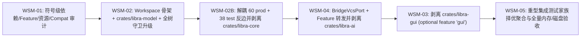

# Libra Cargo Workspace 多 Crate 拆分与编译内存上限治理计划（2026-11-22）

**模板版本:** `v2.16`

**状态:** 设计计划（`WSM-01` 已完成并通过独立评审 `verified`；`WSM-02`..`WSM-05` 均为 `pending` / 验收空）。本文件仅用于架构规划与任务分解，**除已显式授权执行的卡片外不构成后续实现授权**，需按卡序推进。

**卡 ID 前缀说明:** 使用 `WSM-`（Workspace Split & Memory Limits），与现有计划无冲突。

**关联前置工作:**
- PR [#1066](https://github.com/libra-tools/libra/pull/1066)（`perf(cargo): align dev/test hybrid debuginfo to prevent full-test OOM`，已合入 `main` `0888c48`）：落地 `[profile.dev]` / `[profile.test]` Hybrid debuginfo 对齐，将单重型测试目标 `rust-lld` RSS 从 `8.936 GiB` 降至 `1.777 GiB`（-80.1%）、ELF 从 `2.001 GiB` 降至 `195.14 MiB`（-90.5%）。
- **`WSM-01` 符号级依赖与兼容性审计报告:** [`plan-20261122-wsm01-audit.md`](plan-20261122-wsm01-audit.md)（基于 `main` `76d2fde` 全量 754 个 `.rs` 文件三轴扫描，已确定严格无环 4 层 Package DAG，并新增前置底座卡 `WSM-02B`，全部任务卡更新为 **6 张：`WSM-01`, `WSM-02`, `WSM-02B`, `WSM-04`, `WSM-03`, `WSM-05`**）。

---

## 一、 文档职责与问题背景

PR #1066 解决了外部依赖 DWARF 导致的链接器内存与磁盘爆炸后，2026-11-21..22 的受控实测揭示了全仓剩余的两大结构性资源瓶颈：

1. **单体 `libra` crate 编译峰值高达 `9.845 GiB`（`rustc` 单进程 `9.640 GiB RssAnon`）**：
   - 生产库 `cargo build --lib`（Hybrid）单进程 `rustc` 峰值达 **`6.592 GiB RssAnon`**（`debug=0` 为 `6.448 GiB`）；
   - `cargo test --lib --no-run`（Hybrid）单进程 `rustc` 峰值达 **`9.640 GiB RssAnon`**（cgroup `max anon` **`9.845 GiB`**，wall time `183.62s`，`debug=0` 仍高达 `9.313 GiB`）；
   - 2×2 归因矩阵证明：**`+2.87–3.05 GiB` 的测试增量来自单体 crate 内 5,075 条内联 `#[cfg(test)]` 单元测试与生产代码同编**；8 文件纯黑盒迁出试点已实证不拆生产 crate 仅降 `-0.032 GiB` 且反增 `190 MiB` ELF。
2. **全量 180 个测试二进制的磁盘与链接冗余**：
   - Hybrid 模式下全量 `cargo nextest run --all` 仍需链接 180 个二进制，带来 **`17.65 GiB`** `target/debug` 净增（其中 352 个变更产物占 **`13.27 GiB`**）。

### 适用范围
- 根 `Cargo.toml`（演进为 Cargo Workspace，保留根包 `[package] name = "libra"`、`src/main.rs`、所有根集成测试及发布路径不变，新增 `crates/libra-{model,core,ai,gui}` 内部子 crate）
- `src/` 内部无环/可解耦领域模块及其内联 `#[cfg(test)]` 单元测试迁移（含 `LIBRA_WORKSPACE_ROOT` 编译/运行期资源根策略与 doctest 更新）
- `tests/compat/*` 全树 walker 与固定路径守卫、`tests/SRC_SERIAL_{REGISTRY,CENSUS}.tsv`、`tests/SERIAL_CLASSIFY.sh` 的 workspace-aware 升级
- 重型同领域集成测试 target 的受控聚合试点与 `tests/INDEX.md` / `tests/SERIAL_REGISTRY.tsv` / `.config/nextest.toml` 同步
- `AGENTS.md` / `docs/development/` 文档同步

### 非目标与可见性口径（2026-11-22 维护者审批修订）
- **根包对外公共 API 严格零新增泄漏**：根包 `libra` 的对外稳定嵌入 API（`exec`、`exec_async`、`CliError*` 及既有公开导出）保持 100% 不变，绝不将内部 port 重导出为根包新增公共 API。
- **绝不为迁测试而放宽可见性**：所有白盒单元测试继续留在原模块所属子 crate 内部（通过 `use super::*` 访问私有实现），禁止暴露私有实现或 `#[cfg(test)]` fault hooks 来搬迁单测。
- **有界内部 Workspace Crate Port**：因 Rust 无 `pub(workspace)` 修饰符，内部子 crate `crates/libra-{model,core,ai,gui}` 强制声明 **`publish = false`**，跨 crate 反转接口（`CoreLazyFetchPort`、`BridgeVcsPort`）与下沉共享 DTO 标注 **`#[doc(hidden)]`**，且严格限定在 [`plan-20261122-wsm01-audit.md`](plan-20261122-wsm01-audit.md) 第 2 节登记的白名单内。
- **不改变任何用户可见 CLI 行为、错误码、SQLite schema、测试断言或发布产物功能**。
- **不合并 81 个仅 1~4 MiB 的轻量 `compat_*` 静态守卫、全局 tracing subscriber 专项（`*_span_test`）或 9 个 `required-features` target**。

### 成功定义
1. 单进程 `rustc` 最大 `RssAnon` 峰值从 **`9.640 GiB`（cgroup `max anon` `9.845 GiB`）显著下降至 `<= 6.5 GiB`**，使受控全量测试可在更低内存软阈值（目标 `MemoryHigh=10G`，具体以实测为准）下 0 OOM / 0 swap 运行。
2. 零测试丢失（每张迁移卡执行旧/新 `(binary_id, test_name)` 1-to-1 双射核验与 `.config/nextest.toml` drift 检查）、根包零新增公共 API 泄漏、所有 `compat_*` 守卫（覆盖 `src/` + `crates/*/src/`）与 `cargo test --doc` / `cargo doc --no-deps --all-features` 全绿。
3. 重型同领域集成测试聚合后，全量构建的 `target/debug` 磁盘增量与总链接耗时均有可量化下降。

---

## 二、 事实基线（2026-11-22 2×2 实测与 `WSM-01` v4 符号级三轴扫描）

### 1. 编译内存 2×2 归因基线（`--jobs 1`，`CPUQuota=400%`，`MemoryHigh=14G`，`MemoryMax=18G`）

| 基线项 | 命令 | 耗时 | Cgroup `max anon` | `rustc` `peak RssAnon` | 产物大小 |
| :--- | :--- | ---: | ---: | ---: | :--- |
| **Attr-1** | `cargo build --lib` (Hybrid) | `133.91s` | `6.808 GiB` | `6.592 GiB` | `liblibra.rlib` `709.75 MiB` |
| **Attr-4** | `CARGO_PROFILE_DEV_DEBUG=0 cargo build --lib` | `116.83s` | `6.631 GiB` | `6.448 GiB` | `liblibra.rlib` `555.80 MiB` |
| **Attr-2** | `cargo test --lib --no-run` (Hybrid) | `183.62s` | `9.845 GiB` | `9.640 GiB` | `libra` unit-test ELF `414.54 MiB` |
| **Attr-3** | `CARGO_PROFILE_TEST_DEBUG=0 cargo test --lib --no-run` | `163.35s` | `9.520 GiB` | `9.313 GiB` | `libra` unit-test ELF `273.37 MiB` |

### 2. 目标 Crate 符号级三轴跨包边汇总（HEAD `76d2fde`，详见 [`plan-20261122-wsm01-audit.md`](plan-20261122-wsm01-audit.md)）

| 目标 Crate | 归属源码（`publish = false`） | `prod` 反边 | `feature_lib` 反边 | `test` 反边 |
| :--- | :--- | :---: | :---: | :---: |
| **`libra-model`** (Tier 0) | `src/internal/model/**` | **0**（4 处 rustdoc 链接） | **0** | **0** |
| **`libra-core`** (Tier 1) | `src/internal/{db,core}/**`, `src/utils/**`（`convert.rs` 与 `repo_hooks.rs` 留在根包） | **60**（47→root, 13→ai） | **0** | **38**（25→root, 13→ai） |
| **`libra-ai`** (Tier 2) | `src/internal/ai/**` | **57**（→root） | **11**（`test-bridge-hooks`） | **23**（→root） |
| **`libra-gui`** (Tier 3, optional `gui`) | `src/gui/**` | **5**（→root） | **0** | **21**（→root） |

---

## 三、 跨计划与外部依赖（`DEP-*`）

| ID | 依赖对象 | 所有者 | 可用判据 | 阻塞条件 |
| :--- | :--- | :--- | :--- | :--- |
| `DEP-WSM-01` | PR #1066（Hybrid debuginfo 配置）合入 `main` | 维护者 | 已满足（`0888c48` 已合入 `main`） | — |
| `DEP-WSM-02` | `plan-20261120-ui-real-data.md`（`UID-01`..`UID-07`）写集协调 | 维护者 | 确认 `src/gui/**` 迁入 `crates/libra-gui` 时无进行中的 `UID-*` 写冲突 | 阻塞 `WSM-03`（`libra-gui` 拆分） |
| `DEP-WSM-03` | `WSM-01` 审计报告与可见性口径修订评审通过 | 维护者 | 已满足（2026-11-22 维护者批准可见性口径，独立评审 `pi-wsm01-r4` + `pi-wsm01-r5` 签发【通过 Go】） | — |

---

## 四、 任务卡分解（严格无环 6 卡 DAG：`WSM-01 → WSM-02 → WSM-02B → WSM-04 → WSM-03 → WSM-05`）

---

### `WSM-01`: 符号级反边清点、无环 Package DAG、Feature/资源/Compat 全量审计（Audit / Design Card）
- **Lifecycle:** `done` | **Acceptance:** `verified`（2026-11-22 独立评审 `pi-wsm01-r4` + `pi-wsm01-r5` 签发【通过 Go】）
- **Dependencies:** 无（只读审计与计划修订）
- **Deliverables:**
  1. 产出符号级三轴扫描器（递归展开 `use` 树 + 真实分类断言）与正式审计文档 [`plan-20261122-wsm01-audit.md`](plan-20261122-wsm01-audit.md)，覆盖 `libra-model`、`libra-core`（60 prod + 38 test）、`libra-ai`（57 prod + 11 feature_lib + 23 test）及 `libra-gui`（5 prod + 21 test）。
  2. 产出全仓 Per-Crate Feature 转发矩阵、GUI 精确命令矩阵、`CARGO_MANIFEST_DIR`/`include_str!`/doctest 守恒清单、逐卡 `tests/compat/*` 与 `SRC_SERIAL_*` 写集，并将本计划同步为 6 卡严格无环 DAG 与已批准的可见性口径。
- **Acceptance Criteria:** 独立评审（Pi）签发【通过 Go】，无未识别的循环依赖、feature 转发缺口、资源/doctest 断裂或打包破坏点。

---

### `WSM-02`: Cargo Workspace 骨架搭建、`crates/libra-model` 剥离与全树 `compat` 守卫升级
- **Lifecycle:** `pending` | **Acceptance:** `unverified`
- **Dependencies:** `WSM-01`, `DEP-WSM-03`
- **Write Set:** 根 `Cargo.toml`、`Cargo.lock`、`crates/libra-model/**`、`src/internal/mod.rs`（`pub use libra_model as model;`）、`src/internal/model/**`（移出）、5 个全树 `tests/compat/*` walker（`all_production_unwrap_guard.rs`、`branch_lossy_wrapper_guard.rs`、`compat_object_hash_parsing_guard.rs`、`agent_architecture_guard.rs`、`serial_registry.rs` 含 SH-02 L2225/2369）、`tests/SERIAL_CLASSIFY.sh`、`tests/SRC_SERIAL_CENSUS.tsv`（1 条：`reference_test.rs`）、`AGENTS.md`
- **Deliverables:**
  1. 根 `Cargo.toml` 升级为 `[workspace]`（`default-members = [".", "crates/*"]`，保留根包 `libra`、版本号、`src/main.rs` 及 `target/debug/libra` 路径不变），抽离首个 `publish = false` 零反边底座 crate `crates/libra-model`，修复 4 处 rustdoc 链接并更新 `Cargo.lock`。
  2. 升级全部 5 个全树 `tests/compat/*` walker 与 `tests/SERIAL_CLASSIFY.sh` 同时扫描 `src/` 与 `crates/*/src/`。
- **Acceptance Criteria:**
  - `cargo clippy --all-targets --all-features -- -D warnings`、`cargo doc --no-deps --all-features`、`cargo test --doc` 通过（不破坏 `matrix_alignment.rs:231`）。
  - `cargo build --locked --release --features keyring` 烟测通过。
  - 旧/新 `(binary_id, test_name)` 1-to-1 双射守恒与 `.config/nextest.toml` drift 检查通过；所有 `compat_*` 守卫全绿。

---

### `WSM-02B`: 解耦 `libra-core` 60 `prod` + 38 `test` 反边并剥离 `crates/libra-core`（`WSM-04` 必须前置底座）
- **Lifecycle:** `pending` | **Acceptance:** `unverified`
- **Dependencies:** `WSM-02`
- **Write Set:** 根 `Cargo.toml`、`Cargo.lock`、`crates/libra-core/**`（含 `build.rs` 导出 `LIBRA_WORKSPACE_ROOT`）、`src/internal/{db,core}/**`（`repo_hooks.rs` 留在根包）、`src/utils/**`（`convert.rs` 留在根包）、`src/common_utils.rs`、`src/internal/protocol/https_client.rs`、`src/command/{index_pack,replace,status,status_probe,status_io_worker,worktree,config,mod}.rs`（原语下沉与 re-export）、**13 个固定路径 `tests/compat/*` 文件**（见审计第 6 节，含 `compat_object_hash_parsing_guard.rs:50,55,65`）、`tests/SRC_SERIAL_REGISTRY.tsv`（37 条）、`tests/SRC_SERIAL_CENSUS.tsv`（126 条）、2 处 `libra::` doctest（`utils/{telemetry,worktree}.rs`）
- **Deliverables:**
  1. 按审计第 2.1 节消除全部 60 `prod` + 38 `test` 反边（含 `build_index_v1/v2`、`parse_commit_msg`、`no_downgrade_redirect_policy`、`io_op_timeout`/`with_io_deadline*`、`Changes`/`WorktreeStamps`/`ObservedPath` 及 11 个 `test-bridge-hooks` seam 槽），抽离 `crates/libra-core`（`publish = false`，仅依赖 `libra-model`）。
  2. 完成全部 67 处 `CARGO_MANIFEST_DIR`（6 prod + 61 test）及 `sql/`、`install.{sh,ps1}`、`docs/`、`tests/data/` 的 `LIBRA_WORKSPACE_ROOT` 迁移；配置根 `Cargo.toml` 对 `keyring`/`fastcdc`/`otlp`/`worktree-fuse`/`test-upgrade`/`test-bridge-hooks`/`test-live-agent` 的转发。
- **Acceptance Criteria:**
  - `cargo clippy --all-targets --all-features -- -D warnings`、`cargo doc --no-deps --all-features`、`cargo test --doc`、`cargo build --locked --release --features keyring`、`cargo check -p libra-core --features fastcdc,otlp,keyring,test-upgrade,test-bridge-hooks` 全部通过。
  - 13 个固定路径 `compat` 守卫与 `compat_serial_registry` 全绿；nextest 旧/新 `(binary_id, test_name)` 1-to-1 双射守恒。

---

### `WSM-04`: 实现 `BridgeVcsPort`、Feature 转发并剥离 `crates/libra-ai`（根治 `9.845 GiB` 单进程 `rustc` 峰值）
- **Lifecycle:** `pending` | **Acceptance:** `unverified`
- **Dependencies:** `WSM-02B`
- **Write Set:** 根 `Cargo.toml`、`Cargo.lock`、`crates/libra-ai/**`（含 `build.rs` 导出 `LIBRA_WORKSPACE_ROOT` 与 `test-bridge-hooks = ["libra-core/test-bridge-hooks"]`、`test-live-agent = ["libra-core/test-live-agent"]`）、`src/internal/ai/**`、`src/command/agent/bridge_adapter.rs`（根拥有 `RootBridgeVcsAdapter`）、5 个固定路径 `tests/compat/*` 文件（`agent_architecture_guard.rs`、`agent_run_non_exhaustive_guard.rs`、`agent_docs_contract.rs`、`compat_object_hash_parsing_guard.rs:60`、`matrix_alignment.rs:247-266`）、`tests/SRC_SERIAL_REGISTRY.tsv`（19 条）、`tests/SRC_SERIAL_CENSUS.tsv`（101 条）、12 处 `libra::` doctest（含 `redaction.rs:58,66` `compile_fail` 语义保持）、`tests/INDEX.md`
- **Deliverables:**
  1. 按审计第 2.2 节定义 `BridgeVcsPort`（精确对齐 `status.rs`/`diff`/`commit`/`log::get_reachable_commits`/`restore`/`checkpoint` 真实签名）与 `RootBridgeVcsAdapter`，将 `src/internal/ai/**`（217 文件、307,634 行、2,329 条私有单元测试）完整迁入 `crates/libra-ai`（`publish = false`，仅依赖 `libra-core` 与 `libra-model`）。
  2. 迁移 16 处 `CARGO_MANIFEST_DIR`、生产资源 `sandbox/seccomp_compile.rs:43`（`template/seccomp-default.json`）与 26 处测试 `include_str!`/`include_bytes!`；更新 12 处 doctest 为 `libra_ai::...`。
- **Acceptance Criteria:**
  - `libra` 与 `libra-ai` 各自 `cargo test --lib --no-run --jobs 1` 的单进程 `rustc peak RssAnon` 均较原 `9.640 GiB`（cgroup `9.845 GiB`）出现实质性大幅下降（目标单 crate `<= 6.5 GiB RssAnon`）。
  - 直接测试 `cargo test -p libra-ai --features test-bridge-hooks --no-run`、根转发 `--features test-bridge-hooks`、`cargo test --doc`、`cargo doc --no-deps --all-features`、`compat_agent_architecture_guard`、`compat_serial_registry` 全绿；nextest 1-to-1 双射守恒。

---

### `WSM-03`: 剥离 `crates/libra-gui`（通过根包 `gui` 可选 feature 隔离 `gpui` / `wgpu` / `ely-*` 依赖树）
- **Lifecycle:** `pending` | **Acceptance:** `unverified`
- **Dependencies:** `WSM-04`, `DEP-WSM-02`
- **Write Set:** 根 `Cargo.toml`（`default = ["gui"]`, `gui = ["dep:libra-gui"]`）、`Cargo.lock`、`crates/libra-gui/**`、`src/gui/**`、`src/lib.rs:24`、`src/main.rs:549`、`tests/command/mod.rs:1154`（`#[cfg(feature = "gui")] mod ui_test;`）、`tests/command/ui_test.rs`、`tests/INDEX.md`
- **Deliverables:**
  1. 按审计第 2.3 节消除 5 `prod` + 21 `test` 反边，将 `src/gui/**` 连同 `gpui` / `gpui_platform` / `ely-gpui-component` 抽离为 `crates/libra-gui`（`publish = false`，依赖 `libra-ai` + `libra-core` + `libra-model`）。
  2. 保留根 `src/main.rs` 与默认 `gui` feature（确保 `libra ui` 与 `release.yml` 行为 100% 不变），同时支持显式非 GUI 命令 `cargo nextest run -p libra -p libra-model -p libra-core -p libra-ai --no-default-features ...` 彻底零 GPUI 编译链接。
- **Acceptance Criteria:**
  - 默认构建下 `libra ui --help` 与 `tests/command/ui_test.rs` 行为 100% 不变；`--no-default-features` 下非 GUI `-p` 命令 0 GPUI 依赖且 `libra ui` 给出清晰提示。
  - `cargo build --locked --release --features keyring` 与 nextest 1-to-1 双射守恒通过。

---

### `WSM-05`: 重型同领域集成测试家族择优聚合与全量资源回归验收
- **Lifecycle:** `pending` | **Acceptance:** `unverified`
- **Dependencies:** `WSM-03`
- **Write Set:** `Cargo.toml`、`tests/agent_bridge_*.rs` / `tests/agent_mcp_*.rs` / `tests/operation_*.rs`（不含 `*_span_test`、不含 `required-features` target、不动轻量 `compat_*`）、`tests/INDEX.md`、`tests/SERIAL_REGISTRY.tsv`、`.config/nextest.toml`
- **Deliverables:**
  1. 按 `WSM-03`/`WSM-04` 完成后的实际 ELF 大小排行，将前 20~30 个重型纯存储/协议集成测试按领域聚合为 2~3 个测试二进制。
  2. 同步 `tests/INDEX.md`、`tests/SERIAL_REGISTRY.tsv`、运行 `sh tests/NEXTEST_GROUPS.sh` 生成 `.config/nextest.toml`，确保 `compat_serial_registry` 通过。
  3. 在 `umask 0022` 下执行最终受控全量测试验收，验证全量 `target/debug` 磁盘增量、构建时间及 `MemoryHigh` 可下调的安全下界。
- **Acceptance Criteria:**
  - 旧/新 `(binary_id, test_name)` 1-to-1 双射守恒，nextest 与直接 `cargo test --test <aggregate>` 均通过。
  - 全量测试 `target/debug` 净增磁盘体积与全量构建耗时较 PR #1066 基线（`17.65 GiB` / `5m 29s`）进一步显著下降。
- **Verification:**
  - `cargo +nightly fmt --all --check`（或环境可用 rustfmt 检查）
  - `cargo clippy --all-targets --all-features -- -D warnings`
  - `umask 0022 && systemd-run --user --scope -p CPUQuota=400% -p MemoryHigh=10G -p MemoryMax=14G -p MemorySwapMax=1G cargo nextest run --workspace --locked --offline --build-jobs 2 --test-threads 4 --no-fail-fast --retries 2`
