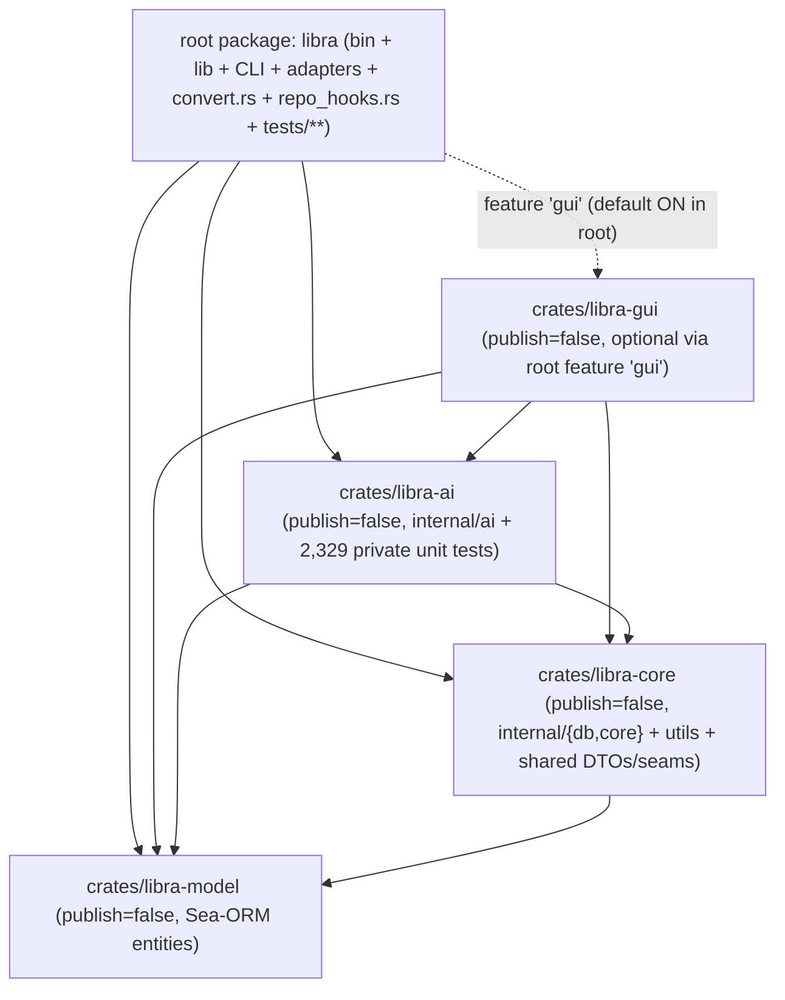

# WSM-01 Audit Report (v4): Symbol-Level Dependency, Feature, Resource, Compat & Visibility Audit

> **Card:** `WSM-01` ([`plan-20261122-workspace-crate-split.md`](plan-20261122-workspace-crate-split.md))
> **Branch:** `feat/wsm-01-dependency-audit` (based on `main` `76d2fde`, 2026-11-22)
> **Scanner & Raw Data:** `/tmp/opencode/wsm01_scan_v4.py` → `/tmp/opencode/wsm01-v4-audit-data.json`
> **Scanner Guarantees (Verified by Automated `self_test()` + Repo Assertions):**
> - Full Rust lexer handling nested `/* */` block comments, `//` comments, raw strings `r#"..."#` / `br#"..."#` / `cr#"..."#`, char/byte literals vs lifetimes.
> - **Recursive `use`-tree expansion**: `use crate::command::{diff::{DiffArgs, run_diff_for_service}, load_object, log::get_reachable_commits};` emits one edge per imported symbol rather than collapsing to `crate::command`.
> - **Three-axis `#[cfg(...)]` AST classification**: separates `prod` (incl. `#[cfg(not(test))]`), `feature_lib` (positive feature gates compiled as library code), and `test` (`cfg(test)` + test-only files).
> - **Real assertions passing on every run**: `pending.rs:6960,7406` → `test`; `#[cfg(not(test))]` → `prod`; `#[cfg(all(feature = "test-bridge-hooks", debug_assertions))]` → `feature_lib`; `mutable_state_ownership.rs:1001` string-literal fixture ignored; nested `use`-tree symbols expanded individually.

---

## 1. Authoritative Symbol-Level Three-Axis Cross-Crate Matrix (`HEAD 76d2fde`)

### 1.1 Target Crate Mapping & Root-Stay Command Helpers
- **`crates/libra-model`** (Tier 0, `publish = false`): `src/internal/model/**`
- **`crates/libra-core`** (Tier 1, `publish = false`): `src/internal/db.rs`, `src/internal/db/**`, `src/internal/**` (excluding `model/`, `ai/`, `protocol/`, `repo_hooks.rs`), `src/utils/**` (excluding `convert.rs`)
- **`crates/libra-ai`** (Tier 2, `publish = false`): `src/internal/ai/**`
- **`crates/libra-gui`** (Tier 3, `publish = false`, optional via root feature `gui`): `src/gui/**`
- **`libra` (root package)** (Tier 3/4): `src/main.rs`, `src/lib.rs`, `src/cli.rs`, `src/common_utils.rs`, `src/git_protocol.rs`, `src/lfs_structs.rs`, `src/internal/protocol/**`, `src/command/**`, all root integration/compat tests (`tests/**`), plus two root-only command helpers explicitly kept in root `libra`:
  - **`src/utils/convert.rs`** — verified via repo-wide `rg` to be called **exclusively by `src/command/init.rs`**. Keeping it in root `libra` avoids any `CoreConvertPort` for `fetch::fetch_repository_safe` (`:153`) and `clone::setup_repository` (`:176`).
  - **`src/internal/repo_hooks.rs`** — verified via repo-wide `rg` to be called **exclusively by `src/command/{am,checkout,commit,merge,rebase,switch}`**. Keeping it in root `libra` (which depends on both `libra-core` and `libra-ai`) avoids any `RepoHookSandboxPort` for `CommandSpec`/`ToolSandboxContext`/`SandboxRuntimeConfig`/`run_command_spec` (`:270-299`) and keeps `include_bytes!("../../template/pre-commit.{sh,ps1}")` untouched.

### 1.2 Exact Non-Self Cross-Crate Edge Counts (Symbol-Level Expanded, 3 Axes)

| Source Crate | **`prod`** Outgoing Edges | **`feature_lib`** Outgoing Edges | **`test`** Outgoing Edges |
| :--- | :--- | :--- | :--- |
| **`libra-model`** | **0** (4 rustdoc `crate::` links only) | **0** | **0** |
| **`libra-core`** | `libra-model:16`, **`libra-root:47`**, **`libra-ai:13`** (**60 back-edges**) | **0** | `libra-model:17`, **`libra-root:25`**, **`libra-ai:13`** (**38 test back-edges**) |
| **`libra-ai`** | `libra-core:530`, `libra-model:10`, **`libra-root:57`** (**57 back-edges**) | **`libra-root:11`** (`test-bridge-hooks`) | `libra-core:574`, **`libra-root:23`** (**23 test back-edges**) |
| **`libra-gui`** | `libra-core:35`, `libra-ai:22`, **`libra-root:5`** (**5 back-edges**) | **0** | `libra-core:54`, `libra-ai:12`, **`libra-root:21`** (**21 test back-edges**) |
| **`libra` (root)** | `libra-core:3184`, `libra-ai:581`, `libra-model:29` | `libra-core:4` | `libra-core:718`, `libra-ai:141`, `libra-model:23` |

### 1.3 Strictly Acyclic Package DAG & Execution Order



**Mandatory Acyclic Card Order (synchronized in `plan-20261122-workspace-crate-split.md`):**
**`WSM-01` → `WSM-02` (`libra-model`) → `WSM-02B` (`libra-core`) → `WSM-04` (`libra-ai`) → `WSM-03` (`libra-gui`, gated on `DEP-WSM-02` / `UID-*`) → `WSM-05` (test aggregation & acceptance)**.

---

## 2. Complete Symbol-Level Back-Edge Decoupling Specifications (100% Count Conservation)

### 2.1 `WSM-02B` (`libra-core`): Exact 60 `prod` + 38 `test` Back-Edges (`0 feature_lib`)

Every single one of the 60 `prod` edges (47 → `libra-root`, 13 → `libra-ai`) and 38 `test` edges (25 → `libra-root`, 13 → `libra-ai`) is conserved below:

| Group | Exact Files, Lines & Symbols | Count (`prod` / `test`) | Resolution (Zero Cycle + Transitive Closure Proof) |
| :--- | :--- | :---: | :--- |
| **A. `common_utils::parse_commit_msg`** | `internal/log/formatter.rs:11`, `internal/log/trailer.rs:37`, `utils/grep_pattern.rs:306` | `3 / 0` | Sink pure function `parse_commit_msg` (0 root deps) into `libra-core::utils::commit_msg`; re-export in `src/common_utils.rs`. |
| **B. HTTPS redirect policy** | `utils/media/capability.rs:96` (`internal::protocol::https_client::no_downgrade_redirect_policy`) | `1 / 0` | Sink pure `reqwest::redirect::Policy` builder `no_downgrade_redirect_policy()` into `libra-core::utils::http_policy`; re-export in `src/internal/protocol/https_client.rs`. |
| **C. AI metadata constants, enums & `AI_REF`** | `internal/metadata.rs` (11 prod + 13 test: `REASONING_ARTIFACT_MANIFEST_MAX_BYTES`, `ReasoningIdentityMacPurpose`, `CaptureScope`, plus 3 test-only reasoning helpers at `:1701,1702,1706`), `internal/operation/restore.rs:39` (`AI_REF`) | `12 / 13` | Sink pure data constants/enums (`REASONING_ARTIFACT_MANIFEST_MAX_BYTES`, `ReasoningIdentityMacPurpose`, `CaptureScope`, `AI_REF`) into `libra-core::internal::metadata_types`; relocate the 3 AI-capture-specific schema/MAC tests in `metadata.rs:1701-1706` to `libra-ai` (or root integration tests) with 1-to-1 nextest identity conservation. |
| **D. `storage_ext` → `HistoryManager`** | `utils/storage_ext.rs:32` (`internal::ai::history::HistoryManager`) | `1 / 0` | Move the `HistoryManager` extension methods out of `utils/storage_ext.rs` into `libra-ai::history` (only AI/commands call them). |
| **E. Pure VCS / pack / IO-deadline primitives** | `db/migration.rs:1834` (`WorktreeState::parse`), `internal/{deps/mod.rs:152,revision_ordinal.rs:65,tag.rs:21}` + `utils/{client_storage.rs:55,util.rs:32}` (`load_object`, `get_target_commit`), `internal/{change/import.rs:459,revision_ordinal.rs:49,106,107,123,165,166,169}` (`replace::*`), `internal/pack_writer.rs:47` (`build_index_v1`, `build_index_v2`) + `utils/storage/local.rs:29` (calls `build_index_v1`/`build_index_v2` at `:1296-1298,1376-1378` and 12 test sites) + `pack_writer.rs:685` + `storage/{load_cost/pack.rs,tiered.rs}` (9 tests), `utils/ignore/bounded.rs:14` + `utils/util.rs:3432,3451,3504` + `operation/snapshot/tests/ignore_tests/*` (2 tests: `status_probe::with_io_deadline*`), `utils/text.rs:286` (`status::quote_pathname`), `utils/util.rs:4457` (`load_object`, `save_object`) | `21 / 14` | Sink all pure primitives into `libra-core` and re-export from `src/command/*`: `WorktreeState::parse`, `load_object`/`save_object`, `get_target_commit`, `replace::{snapshot,signature_of,effective_replace_signature,with_pinned_snapshot_sync}`, `index_pack::{build_index_v1,build_index_v2}`, `status_probe::{io_op_timeout,with_io_deadline,with_io_deadline_bounded}` (including `io_op_timeout()` to satisfy `status_io_worker` transitive closure!), and `quote_pathname`. |
| **F. Command-level state queries & config/test helpers** | `internal/{account.rs:12,auth.rs:26}` + `utils/client_storage.rs:55` (`command::config::{ConfigScope,ScopedConfig}` — 5 refs), `internal/head.rs:186` (`registry_knows_linked_worktree`), `internal/pseudo_ref.rs:125,214,221,228,236,251,265,284,338` (9 pseudo-ref state queries), `internal/sequencer/mod.rs:1133,1178,1189` (`repository_had_linked_worktrees`), `utils/util.rs:964,1073` (`registered_fuse_worktree_at`), `utils/util.rs:2176` (`try_lazy_fetch_object`), `utils/test.rs:45` (calls `command::init::{InitArgs,init}` at `:428,443`) | `22 / 0` | Sink pure disk/DB state readers (`ConfigScope`/`ScopedConfig`, worktree registry readers, pseudo-ref file readers) into `libra-core`; inject `try_lazy_fetch_object` via a 1-method `CoreLazyFetchPort` registered by root `libra`; split `setup_with_new_libra_in` (`utils/test.rs:428-443`) so `libra-core` provides a pure low-level repo bootstrap fixture while root `src/utils/test.rs` keeps the CLI `command::init::init` wrapper. |
| **G. CLI `add`/`commit`/`status` tests in `utils/{ignore,util}`** | `utils/ignore.rs:352,353,546,651,694` (7 refs), `utils/util.rs:4455,4456` (4 refs) | `0 / 11` | Move these CLI-command integration tests from `utils/{ignore,util}.rs` into root integration tests with 1-to-1 nextest identity conservation. |
| **Total (Exact Sum)** | `3+1+12+1+21+22 = 60 prod`; `13+14+11 = 38 test` | **`60 / 38`** | **0 remaining `libra-core -> {libra-root, libra-ai}` edges.** |

### 2.2 `WSM-04` (`libra-ai`): `BridgeVcsPort` Real Signatures, DTO Ownership & Exact 57 `prod` + 11 `feature_lib` + 23 `test` Back-Edges

Every single one of the `57 prod` + `11 feature_lib` + `23 test` edges is conserved below:

#### A. Shared Primitives & Test Seams Sunk to `libra-core` (Eliminates `31 prod` + `11 feature_lib` + `6 test`)
1. **Group A1 — Status Observation DTOs & Index-Entry Helpers (`25 prod` + `6 test`):**
   - `Changes`, `WorktreeStamps`, `ObservedPath`, `capture_worktree_entry`, `capture_worktree_stamp` (`src/command/status.rs`), `is_gitlink_index_entry` (`src/command/status/output.rs`), `selected_index_oid`, `index_has_text_crlf` (`src/command/status_io_worker.rs`), `verified_index_entry` (`src/command/mod.rs`).
   - **Transitive closure verified:** `status_io_worker.rs:369-380` (`index_has_text_crlf` and siblings) calls `crate::command::status_probe::io_op_timeout()`, which is sunk to `libra-core` alongside `with_io_deadline*` in `WSM-02B` Group E — **zero new `libra-core -> libra-root` transitive edges!**
   - Exact lines eliminated: `vcs_read.rs:531,532,552` (3), `vcs_write.rs:577-579,620,623,670,680,681,688,1038,1478,1999,2004,2141,2553,2554,2601,2604,2611,2612,2627,2638` (22) → **`25 prod`**; plus `vcs_write.rs:2902,2905,2908,2910,2949,2985` → **`6 test`**.
2. **Group A2 — Core Primitives Already Sunk in `WSM-02B` (`6 prod`):**
   - `vcs_read.rs:35` (`load_object`), `automation/runtime.rs:44` (`registry_knows_linked_worktree_in_storage`), `commit_recovery.rs:20` (`parse_commit_msg`), `history.rs:1232` (`WorktreeState::parse`), `memory/derive_commit.rs:100` (`load_object`), `sandbox/policy.rs:707` (`registered_fuse_worktree_paths`) → **`6 prod`**.
3. **Group A3 — 11 `feature_lib` Test Seams (`11 feature_lib`):**
   - `vcs_write.rs:380,386,408,414,420,426,432,438,444,450,456` (`#[cfg(all(feature = "test-bridge-hooks", debug_assertions))]`).
   - Sink the 11 process-wide `Mutex<Option<PathBuf>>` / `AtomicBool` seam slots and setter/reader functions into `libra-core::internal::bridge_test_seams` (gated on `libra-core`'s `test-bridge-hooks` feature).
   - **Mandatory Cargo feature forwarding:** `crates/libra-ai/Cargo.toml` MUST declare `test-bridge-hooks = ["libra-core/test-bridge-hooks"]` so standalone `cargo test -p libra-ai --features test-bridge-hooks` compiles and links the exact same seam slots!

#### B. `BridgeVcsPort` Trait Contract (Eliminates Remaining `26 prod` Edges — Exact Real Signatures)
Defined in `crates/libra-ai/src/agent_bridge/vcs_port.rs` (`#[doc(hidden)] pub trait`), implemented by root-owned `RootBridgeVcsAdapter` in `src/command/agent/bridge_adapter.rs`:

```rust
#[async_trait::async_trait]
pub trait BridgeVcsPort: Send + Sync {
    // 1. Commit & Prepared Recovery (6 prod refs: mutations.rs:1006,1022,1027; vcs.rs:608 x3)
    async fn run_commit(&self, req: BridgeCommitRequest) -> Result<BridgeCommitOutcome, BridgeCommitError>;
    async fn ensure_prepared_recovery_has_no_sequences(&self, repo_root: &Path) -> Result<(), BridgeCommitError>;
    async fn resume_prepared_bridge_commit(&self, req: BridgeResumeRequest) -> Result<BridgeCommitOutcome, BridgeCommitError>;

    // 2. Status Observation Queries (10 prod refs: vcs_read.rs:120,124,128,130,137,170,173; vcs_write.rs:17 x2,1148)
    //    Exact real signatures from src/command/status.rs:1025-1085,1147,1280,1962-1968
    //    (RootBridgeVcsAdapter implements sync methods synchronously; AI call sites do NOT add `.await` on sync methods):
    fn load_head_tree_snapshot(&self, head_oid: &ObjectHash) -> Result<HeadTreeSnapshot, BridgeStatusError>;
    fn changes_to_be_committed_with_head(
        &self, index: &Index, head_tree: Option<&HeadTreeSnapshot>,
    ) -> Changes;
    async fn changes_to_be_committed_safe(&self) -> Result<Changes, BridgeStatusError>;
    fn changes_to_be_staged(&self) -> Result<Changes, BridgeStatusError>;
    fn changes_to_be_staged_split_with_index_observation(
        &self,
        workdir: &PathBuf,
        index: &Index,
        ignore_case: bool,
        file_mode: bool,
        staged: &Changes,
    ) -> Result<(Changes, Changes, Option<WorktreeStamps>), BridgeStatusError>;
    fn effective_ignore_case_for_workdir(&self, workdir: &Path) -> Result<bool, BridgeStatusError>;
    fn default_core_file_mode(&self) -> bool;

    // 3. History, Diff, Restore & Checkpoint Rewind (10 prod refs: vcs.rs:38 x3,684,685 x2,914; vcs_read.rs:34 x2,36)
    async fn get_reachable_commits(&self, head_oid: String, max_depth: Option<usize>) -> anyhow::Result<Vec<Commit>>;
    async fn run_diff_for_service(&self, req: BridgeDiffRequest) -> Result<BridgeDiffOutput, BridgeDiffError>;
    async fn run_restore_checked(&self, req: BridgeRestoreRequest) -> anyhow::Result<()>;
    async fn build_rewind_plan(&self, req: BridgeRewindRequest) -> anyhow::Result<BridgeRewindPlan>;
    async fn resolve_checkpoint_input_spec(&self, spec: &str) -> anyhow::Result<String>;
}
```
- **Exact DTO Ownership:**
  - `Changes`, `WorktreeStamps`, `ObservedPath`, `HeadTreeSnapshot` (`Vec<(PathBuf, ObjectHash, TreeItemMode)>`) → owned by **`libra-core`** (shared directly, zero conversion).
  - `BridgeCommitRequest`, `BridgeCommitOutcome`, `BridgeCommitError` (including `BridgeCommitError::BridgeFenceChanged`), `BridgeStatusError`, `BridgeDiffRequest/Output/Error`, `BridgeRestoreRequest`, `BridgeRewindRequest/Plan` → owned by **`libra-ai`**, converted to/from root `CommitArgs`/`CommitError`/`StatusError`/`DiffArgs`/`DiffError`/`RestoreArgs` inside `RootBridgeVcsAdapter`.
- **Remaining `17 test` Edges in `libra-ai` (`23 - 6 = 17`):**
  - **T1 (`5 test`):** `agent_import.rs:6518,6521,7229,7229,7230` (`IMPORT_PREPARATION_*` constants) → sink into `libra-ai::agent_import` and re-export in `src/command/agent`.
  - **T2 (`12 test`):** `capture/{drain.rs:256,276, live_pipeline_tests.rs:6727, pending.rs:6960,7406, scope_binding.rs:2137,2157,2546 x3}` (10 refs) + `checkpoint_reader.rs:2967,2978` (2 refs: `command::init`) → use `libra-core` low-level repo bootstrap for `checkpoint_reader.rs`, and relocate the 10 `command::{hooks,agent,maintenance}` integration-style tests to root integration tests with 1-to-1 nextest identity conservation.
- **Exact Sum Check:** `25 (A1) + 6 (A2) + 26 (B) = 57 prod`; `11 (A3) = 11 feature_lib`; `6 (A1) + 5 (T1) + 12 (T2) = 23 test`. **0 remaining `libra-ai -> libra-root` edges.**

### 2.3 `WSM-03` (`libra-gui`): Exact `5 prod` + `21 test` Back-Edges
- **5 `prod`:** `history.rs:217` (`load_object`, already in `libra-core`); `operations.rs:109` (`operation_snapshot_rows` + 4 test refs to `OPERATION_SNAPSHOT_CAP` → sink to `libra-core::internal::operation`); `history.rs:137,167` (`CommitAttribution`, `commit_attribution_batch` + 4 test refs) & `sessions.rs:163` (`SESSION_PAGE_COLUMNS` + 1 test ref) → sink to `libra-ai`.
- **12 remaining `test`:** `gui/data/tests.rs:502,748,779,834,867,901` (`command::commit::{execute,CommitArgs}`) → replace with `libra-core` low-level commit builder test fixture (or root GUI integration test).

---

## 3. Complete Per-Crate Feature Ownership, Forwarding & Verification Matrix

| Feature | Root `Cargo.toml` | `libra-core` | `libra-ai` | `libra-gui` | Optional Deps & Verification Requirement |
| :--- | :--- | :--- | :--- | :--- | :--- |
| **`default`** | `default = ["gui"]` | `[]` | `[]` | `[]` | Default root binary includes `libra ui`. |
| **`gui`** *(WSM-03)* | `gui = ["dep:libra-gui"]` | — | — | owns `gpui`, `gpui_platform`, `ely-gpui-component` | `#[cfg(not(feature = "gui"))]` in `src/main.rs:549` returns actionable error; Release uses `default` (`gui` ON). |
| **`keyring`** | `keyring = ["libra-core/keyring"]` | `keyring = ["dep:keyring"]` (`auth.rs`, 21 sites) | — | — | **Release-critical:** verify `cargo build --locked --release --features keyring`. |
| **`fastcdc`** | `fastcdc = ["dep:fastcdc", "libra-core/fastcdc"]` | `fastcdc = ["dep:fastcdc"]` (5 sites) | — | — | Verify `cargo check --features fastcdc` + `cargo check -p libra-core --features fastcdc`. |
| **`otlp`** | `otlp = ["dep:opentelemetry", ..., "libra-core/otlp"]` | `otlp = ["dep:opentelemetry", ..., "dep:tracing-opentelemetry"]` (1 site) | — | — | Verify `cargo check --features otlp` + `cargo check -p libra-core --features otlp`. |
| **`worktree-fuse`** | `worktree-fuse = ["libra-core/worktree-fuse"]` | `worktree-fuse = []` (`utils/fuse.rs`, 1 site) | — | — | Verify `cargo check --features worktree-fuse` (Unix). |
| **`test-upgrade`** | `test-upgrade = ["libra-core/test-upgrade"]` | `test-upgrade = []` (5 sites) | — | — | Verify `cargo test -p libra-core --features test-upgrade --no-run`. **Release NEVER enables.** |
| **`test-bridge-hooks`** | `test-bridge-hooks = ["libra-core/test-bridge-hooks", "libra-ai/test-bridge-hooks"]` | `test-bridge-hooks = []` (3 + 11 sunk seams) | **`test-bridge-hooks = ["libra-core/test-bridge-hooks"]`** (100 sites) | — | **Direct & root forwarding verified:** `cargo test -p libra-ai --features test-bridge-hooks --no-run` AND `cargo test --features test-bridge-hooks --no-run`. **Release NEVER enables.** |
| **`test-live-agent`** | `test-live-agent = ["libra-core/test-live-agent", "libra-ai/test-live-agent"]` | `test-live-agent = []` (2 sites) | **`test-live-agent = ["libra-core/test-live-agent"]`** (66 sites) | — | Verify both `-p libra-ai --features test-live-agent` and root `--features test-live-agent`. **Release NEVER enables.** |
| **`test-network` / `test-live-ai` / `test-live-cloud` / `subagent-scaffold`** | Root-only (`[]`) | — | — | — | Root tests/CLI only. |

---

## 4. `WSM-03` GUI Topology & CI/Release Command Matrix

- **Cargo Fact:** Cargo has no profile-specific feature toggle, and with `default-members = [".", "crates/*"]`, running `cargo test --no-default-features` at workspace root still selects `crates/libra-gui`.
- **Root Gating Write Set (`WSM-03`):** `src/lib.rs:24` (`#[cfg(feature = "gui")] pub use libra_gui as gui;`), `src/main.rs:549` (`#[cfg(feature = "gui")]` + `#[cfg(not(feature = "gui"))]` diagnostic), `tests/command/mod.rs:1154` (`#[cfg(feature = "gui")] mod ui_test;`).
- **Command Matrix:**
  - **CI Clippy / Doc / Doctest (`base.yml`):** `cargo clippy --all-targets --all-features -- -D warnings`, `cargo doc --no-deps --all-features`, `cargo test --doc` → covers all workspace crates via `default-members`, preserving `tests/compat/matrix_alignment.rs:231` verbatim.
  - **Release (`release.yml`):** `cargo build --locked --release --features keyring --target <triple>` → `default = ["gui"]` keeps `libra ui` + `keyring` at `target/<triple>/release/libra`.
  - **Fast Non-GUI Dev/Test (0 `gpui`/`wgpu`/`ely-*`):** `cargo nextest run -p libra -p libra-model -p libra-core -p libra-ai --no-default-features --locked --offline ...` or single-crate `cargo test -p libra-ai --lib` / `cargo test -p libra-core --lib`.

---

## 5. Non-Code Resources (`CARGO_MANIFEST_DIR`, `include_str!`/`include_bytes!`) & Doctest Conservation Inventory

**Workspace-Root Resource Strategy:** Each sub-crate (`libra-core`, `libra-ai`) adds a 4-line `build.rs` exporting `LIBRA_WORKSPACE_ROOT` (repo root). Compile-time repo-root `include_str!`/`include_bytes!` switch to `concat!(env!("LIBRA_WORKSPACE_ROOT"), "/...")`; runtime test fixtures switch to `libra_core::utils::test::workspace_root()`.

**Exact JSON-Verified Conservation Table:**

| Target Crate | `CARGO_MANIFEST_DIR` Sites (`prod` / `test`) | Repo-Root `include_str!` / `include_bytes!` (`prod` / `test`) | Doctest `libra::` / Rustdoc `crate::` Updates |
| :--- | :---: | :--- | :--- |
| **`libra-model`** (`WSM-02`) | **`0`** (`0 / 0`) | **`0`** (`0 / 0`) | 4 `crate::` rustdoc links (`schema_version.rs:2,15,19`, `source_call_log.rs:6`). |
| **`libra-core`** (`WSM-02B`) | **`67`** (`6 prod` + `61 test`):<br>- `prod` (6): `source_scan.rs:290` (1), `utils/test.rs:18,350,354,369,496` (5)<br>- `test` (61): `vault.rs` (16), `storage/local.rs` (17), `storage/load_cost/pack.rs` (5), `storage/tiered.rs` (2), `config_ownership.rs` (5), `upgrade/trusted_keys.rs` (4), `upgrade/manifest.rs` (2), `mutable_state_ownership.rs` (3), `util.rs` (3), `patch_mode/{apply,model}.rs` (2), `media/chunker.rs` (1), `object.rs` (1) | - `prod`: `db.rs:917,920`, `db/schema.rs:78,94`, `db/migration.rs` (all `sql/migrations/*.sql`), `db/migration/operation_v2_branch_convergence.rs:13`<br>- `test`: `db/migration/operation_v2_*.rs` (3), `upgrade/manifest.rs:751-752` (`install.{sh,ps1}`), `upgrade/trusted_keys.rs:128,161,182,193` (`install.{sh,ps1}`, `docs/...`, `tests/data/...`)<br>*(Note: `repo_hooks.rs` stays in root, so `template/pre-commit.*` is untouched.)* | **2 `libra::` doctests:** `utils/telemetry.rs:6`, `utils/worktree.rs:114` → update to `libra_core::...`. |
| **`libra-ai`** (`WSM-04`) | **`16`** (`0 prod` + `16 test`): `agent_import.rs` (1), `capture/{catalog,pending}` (3), `hooks/providers/hermes/scope.rs` (1), `observed_agents/{coverage (4), opencode_reasoning (2)}`, `sandbox/{mod,runtime}` (2), `session/store.rs` (1), `traces.rs` (2) | - **`prod` (1 — CRITICAL):** **`src/internal/ai/sandbox/seccomp_compile.rs:43`** (`include_str!("../../../../template/seccomp-default.json")`)<br>- `test` (26): `capture/{catalog,checkpoint x2,extraction,live_oracle_tests,live_pipeline_tests,pending,summary}`, `history.rs` (6), `memory/projection.rs` (2), `observed_agents/{coverage x2,opencode_reasoning x2,reasoning,native_origin/{approved_build,codec x2,verify}}` *(intra-crate `libra-hooks.ts`, `store.rs`, `verify.rs`, `hooks/providers/opencode/settings.rs` move untouched)* | **12 `libra::` doctests (3 files):** `observed_agents/reasoning.rs` (9), `observed_agents/redaction.rs` (2: L58,66 — MUST update to `libra_ai::...` to preserve `compile_fail` visibility semantics!), `session/mod.rs:10` (1). |
| **`libra-gui`** (`WSM-03`) | **`0`** (`0 / 0`) | **`0`** repo-root (`assets/libra-logo.svg` & `sessions.json` are intra-crate relative) | `0`. |

---

## 6. Per-Card `tests/compat/*`, `SRC_SERIAL_*` & Nextest Write-Set Matrix

| Card | Full-Tree Walkers & Classifiers | Fixed-Path `tests/compat/*` & `include_str!` Guards | `SRC_SERIAL_REGISTRY.tsv` / `SRC_SERIAL_CENSUS.tsv` | Rustdoc / Doctest, `Cargo.lock` & Nextest Bijection |
| :--- | :--- | :--- | :--- | :--- |
| **`WSM-02`** (`libra-model`) | Upgrade all **5** full-tree walkers (`all_production_unwrap_guard.rs`, `branch_lossy_wrapper_guard.rs`, `compat_object_hash_parsing_guard.rs`, `agent_architecture_guard.rs`, `serial_registry.rs` incl. SH-02 L2225/2369) + **`tests/SERIAL_CLASSIFY.sh`** to scan `src/` + `crates/*/src/`. | `0` fixed anchors. | Registry: `0`.<br>Census: **`1`** (`src/internal/model/reference_test.rs`). | 4 rustdoc links; `Cargo.lock`; old/new `(binary_id, test_name)` 1-to-1 bijection + `.config/nextest.toml` drift check. |
| **`WSM-02B`** (`libra-core`) | Already workspace-aware from `WSM-02`. | **13 fixed-path files:** `error_codes_doc_sync.rs:21`, `global_config_schema_future_test.rs:2302,2310`, `util_production_unwrap_guard.rs:17`, `client_storage_production_unwrap_guard.rs:18`, `extra_production_unwrap_guard.rs:26-30,34`, `config_production_unwrap_guard.rs:22`, `head_production_unwrap_guard.rs:17`, `compat_shallow_walk_helper.rs:64`, `pseudo_ref_surface.rs:79`, `fastcdc_feature_gate_guard.rs:40`, `otlp_feature_gate_guard.rs:40`, `keyring_feature_gate_guard.rs:38`, **`compat_object_hash_parsing_guard.rs:50,55,65`** (`src/utils/media/mod.rs`, `src/internal/upgrade/manifest.rs`, `src/utils/storage_ext.rs`). | Registry: **`37`**.<br>Census: **`126`** *(excl. root-stay `convert.rs` & `repo_hooks.rs`)*. | 2 `libra::` doctests; 67 `CARGO_MANIFEST_DIR` + repo-root `include_str!`; `Cargo.lock`; nextest 1-to-1 bijection. |
| **`WSM-04`** (`libra-ai`) | Already workspace-aware from `WSM-02`. | **5 fixed-path files:** `agent_architecture_guard.rs` (255 anchors), `agent_run_non_exhaustive_guard.rs` (13), `agent_docs_contract.rs` (3), `compat_object_hash_parsing_guard.rs` (AI allowlist L60), `matrix_alignment.rs:247-266` (`session/jsonl.rs`). | Registry: **`19`**.<br>Census: **`101`**. | 12 `libra::` doctests; 16 `CARGO_MANIFEST_DIR` + `seccomp_compile.rs:43` + 26 test `include_str!`; `Cargo.lock`; nextest 1-to-1 bijection. |
| **`WSM-03`** (`libra-gui`) | Already workspace-aware from `WSM-02`. | `tests/command/mod.rs:1154` (`#[cfg(feature = "gui")] mod ui_test;`), `tests/command/ui_test.rs`. | Registry: `0`.<br>Census: `0` *(re-verify after `UID-*`)*. | `Cargo.lock`; nextest 1-to-1 bijection. |

---

## 7. Maintainer-Approved Visibility Policy Revision (Synchronized in `plan-20261122-workspace-crate-split.md`)

Approved by maintainer on 2026-11-22:
1. **Strict Root Public API Invariance:** Root crate `libra`'s external public embedding API (`exec`, `exec_async`, `CliError*`, and existing public re-exports) has **zero new `pub` API leaks**.
2. **Zero Visibility Relaxation for Unit Tests:** Private unit tests remain inside their owning sub-crate (continuing to use `use super::*`); no private internals or `#[cfg(test)]` fault hooks are exposed to relocate tests.
3. **Bounded Internal Workspace Crate Ports:** Sub-crates `crates/libra-{model,core,ai,gui}` are strictly internal implementation crates marked **`publish = false`**, with cross-crate ports (`CoreLazyFetchPort`, `BridgeVcsPort`) and sunk shared DTOs marked **`#[doc(hidden)]`** and strictly bounded to the Section 2 inventory.
