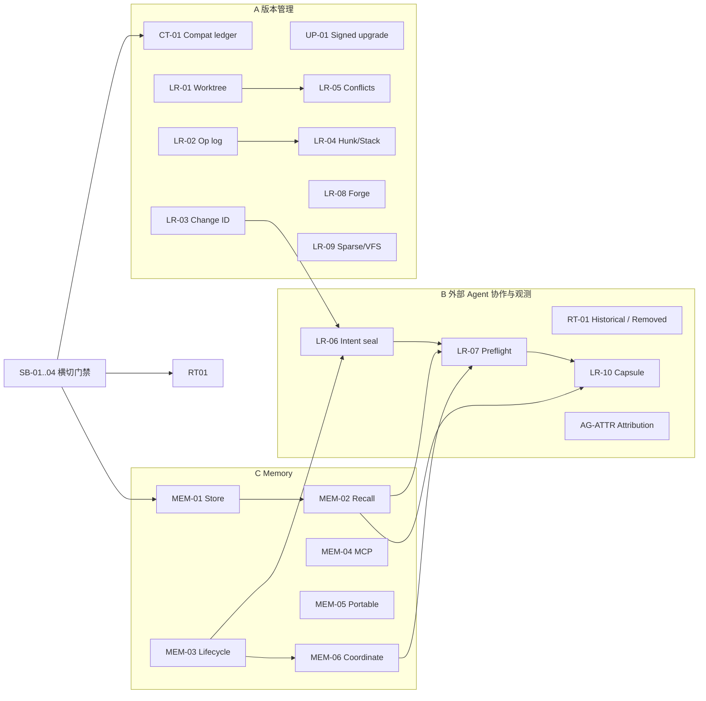

> **2026-11-02 LTR-11 长期索引：** by-path/by-scope 路径、派生 `ssh://traces@`、缺 `libra-traces-v1` 拒绝、Mega2 force-rewrite 在网络前拒绝、非快进不转 force/不新建 epoch/不回退代码 push。库测试 1 passed。Live 未跑。

> **2026-11-02 LTR-10 长期索引：** source 取 `RepoIdentity`，首次 epoch 在返回前写入仓库配置，显式 new-stream 才轮换；linked worktree 共用、独立 clone 分开。库测试 1 passed。Live fixture 缺席，live 门未执行。公开入口仍留给 LTR-12。无 Claude/Codex。

> **2026-10-31 15:28 UTC GOV C3 长期索引：** f9 同树唯一 C3 的 focused1/1 与原双 env full11083/11083、25原 ignored、0失败/FLAKY/TRY 均自然 exit0；后检源/DB/stash同一、owned survivors0，full 原件 `d52f56fb…`、terminal `09b87ad5…`。审计 v1 解析成功 Summary 假阴性 exit1 保留，v2 exit0且 ignored 逐名同一；39个既有条件跳过不计功能覆盖。七文档结果回填后的 B/VER7/fmt 已按最终字节 exit0（仓外 `governance-final-docs-c3/final-3/` 原件）；fresh upstream、签名DCO、push 和适用 main D 仍待，GOV 0/1、LTR 0/26、资格/H1/旧 D FAIL 不变；C1/P1/C2 STOP 与 R4 OAuth 无判词仍保留，用户只豁免本 GOV 后续 Claude Review。详见日期计划 GOV 卡。

> **2026-10-31 14:35 UTC GOV C2 STOP 长期索引：** P2 两相完整前检 PASS、11083默认/11108扩展/25原 ignored，fmt/Clippy/build 均exit0；C2唯一claim `89ccfdb5…`，focused1/1 PASS，full仅6539/11083运行、6469 PASS/70 FAIL/1 FLAKY/25原 ignored，4544因进程扫描竞态触发的SIGTERM未运行。child umask0002 令本地 `.libra` group-writable 与 Pi UnsafeDirectory/模式断言失败；full自然退出码未知、controller exit1/STOP，源/DB/stash后检同一、owned零存活。原件 full stderr `5aede707…`、terminal `4aecb6d4…` 见日期计划；C1/P1/C2原失败与已耗窗口保留。C3候选仅修子进程0022和`/proc`消失竞态，原完整覆盖/重试/超时不改，未claim。用户仅本GOV本轮免Claude，旧R4无PASS；GOV 0/1、LTR 0/26、资格/H1/旧D FAIL、未签推/D不变。

> **2026-10-31 13:41:01 UTC GOV P1 STOP 历史索引：** 用户限 GOV 本轮免后续 Claude Review，R4 OAuth exit1 无 PASS 原件保留。f9 静态 B/env/迁移前检三门 exit0，原默认 nextest list 达1800.076秒上限/exit -15、0列表，P1 STOP；无第二 list、safety、fmt/Clippy/build，C2 当时0 claim。合成孤儿探针1 adopted reap/cleanup clean，仅机制证明；退出后七路径/stage0/stash9/全库 DB 与 list 会话清理均核同。原件 digest 与恢复 P2 合同见日期计划本卡；当时拟限编译 jobs=4 而不改 selector/断言/单门1800或 C2 7200。GOV 0/1、LTR 0/26、资格/H1/旧 D FAIL 保留，无签推/D。

> **2026-10-31 13:02:44 UTC GOV 控制器静态 R3 长期索引：** R2 旧脚本静态 PASS/P0P1=0 不覆盖新 producer；R3 当前 f9 冻结四文件实际 FAIL/P0=0/P1×3/P2×10，子收割器及时 reap、迁移最大值/数据库前检及 VER-2 原件待修后本机 Claude 重审。C2 仍未 claim；C1 STOP、资格/H1/旧 D FAIL 保留，GOV 0/1、LTR 0/26，无签推/D。

> **2026-10-31 12:27:28 UTC GOV 静态 R1 FAIL / f9 长期索引：** C2 控制器本机 Claude 静态审给 P1×2/P2×8、总 FAIL；缺后代清理及退出后完整输入复核，仍非最终执行审。七文件保护后独立 clone 原生 rebase 至 `f9afd41627be53482f0d24a6931cf0b6b74962d4`，仅其它日期计划一行上游变更；本卡七文档精确恢复、stage 空、九 stash 保留。C2 未 claim，C1 STOP、资格/H1/旧 D FAIL 保留，GOV 0/1、LTR 0/26，无签推/D。

> **2026-10-31 12:14:50 UTC GOV b8b 前滚长期索引：** 独立 clone 原生 rebase 至 `b8b76a6979d132bbf58acc73b8e55259ebd69dcf`，七 GOV 文档上游原件未变，stash 应用错误后从已校验 SHA/mode 备份精确恢复；stage 空、八 stash 保留。R9 计划审 PASS 只绑定旧 97f，b8b 执行审/C2/最终 Review 与提交 D 待；C1 STOP、资格/H1/旧 D FAIL 保留，GOV 0/1、LTR 0/26。

> **2026-10-31 12:12:14 UTC GOV R9 计划 PASS 长期索引：** 本机 Claude R9 五项 PASS/P0P1=0/P2×3，仅对原冻结计划；三 P2 已在新字节处理，执行器/七文件仍须新本机 Claude 执行审。C1 STOP、R7/R8 FAIL 与旧资格 D FAIL 保留，C2 未 claim，GOV 0/1、LTR 0/26，资格/H1 阻塞，无签推/D。

> **2026-10-31 12:05:30 UTC GOV R8 FAIL / R9 长期索引：** R8 本机 Claude 计划审 ER03/HISTORY/SCOPE PASS、ER10/VERDICT FAIL/P1×1/P2×6；`DEFER-PI01-01` 为 C1 DB 迁移高概率既有来源，缺进程级证据仍不证明唯一写者。R9 具名 owner、claim 前迁移 parity、全库/stash 摘要、AC17/VER19 和六项 P2 处置，当前七文件待新本机 Claude 计划审；97f release build exit0 是离线候选。C1 STOP、R7/R8 FAIL、资格/H1/旧 D FAIL 保留，GOV 0/1、LTR 0/26，C2/提交/推送/D 均未发生。

> **2026-10-31 11:54:15 UTC GOV R7 FAIL / R8 恢复长期索引：** 本机 Claude R7 计划审 ER03/ER10/VERDICT 实际 FAIL，P1×2/P2×7；原 VER20 多项低计与 C1 DB 写者/后检缺口具名关闭方向已入 R8 候选。延后只读收据 `ffee33a4…` 只核 97f 当前 env/配置及已变化树，不能追认 C1；DB 写者 unknown，C2 前后语义摘要漂移即 STOP。AC18/VER19、PI-15/PI-03 status 写者、阶段预算和资格索引已同步；R8 计划审/执行审与 C2 都未通过或认领。GOV 0/1、LTR 0/26、资格/H1/旧 D FAIL 原样，未提交/推送/D。

> **2026-10-31 11:42:15 UTC GOV R6 C1 失败及 R7 候选长期索引：** e3d 本机 Claude R6 准入 PASS/P0P1=0，VER-7 1/1 PASS；原双 env full 实际 exit100，11075 run/11060 PASS/15 FAIL/25 filtered skipped，三次尝试仍失败、C1 STOP。仓外执行器 umask 077 影响模式断言，旧全局 Libra CLI 对测试升级的仓库 schema 不能后检；原失败/收据保留。上游 97f8b9e 已经七文件备份、原生 stash/fetch/rebase、status 三向保全，七份 stash 保留；e3d 全量/审查不覆盖 97f 新 Pi 测试。ER-10 同卡恢复提案增 AC18/VER20 与仅一次 C2/7200 秒，计划/执行器本机 Claude 明确 PASS 前不认领；未签推、无 D，GOV 0/1、LTR 0/26、资格/H1/旧 D FAIL 不变。

> **2026-10-31 10:35 UTC 前 GOV R5 长期索引：** e3d 本机 Claude 执行准入 R5 对冻结七文档给出 PASS/P0P1=0/P2×14，原 manifest/stream 有 SHA 收据；首次 VER-7 控制器因启动环境摘要错配在 source 与测试 spawn 前 exit1，未形成 focused 测试收据。保留 R5 PASS 限旧输入与前检失败，R6 按直接 Python 启动形态重冻宿主指纹和最终七文档，须本机 Claude 增量 PASS 才能运行。完整 C、提交/推送/D、资格/H1/LTR 均待。

> **2026-10-31 10:21:26 UTC GOV e3d 离线门长期索引：** nightly fmt exit0/4.99s、严格全目标 Clippy exit0/138.15s、release build exit0/207.48s，只有用户已排除的第三方 future-incompat 尾注；HEAD/命令/七文档当时 SHA 与日志已保存，文档回填后的最终字节另核。R5 安全审、VER-7/full、最终 ER-05/提交/D 均待，GOV 0/1、LTR 0/26、资格/H1/旧 D FAIL 不变。

> **2026-10-31 10:15:13 UTC GOV e3d 新清单长期索引：** 无 env 的默认/含 ignored/focused 三条 list 均 exit0，默认 11075/总 11100，含 ignored 11100，25 差集未变，focused 1/65。相对 b24 仅新增 IFP-01 一项只读 AST 守卫、零移除；十五外部写源 SHA 与 56 skip-site 源 SHA 同字节。R5 e3d 安全审及 VER-7/full/最终 C/提交/D 仍待，GOV 0/1、LTR 0/26、资格/H1/旧 D FAIL 不变。

> **2026-10-31 10:05:46 UTC GOV e3d 上游长期索引：** main 从 b24 前滚 e3d，`issues/664.md`、IFP-01 共享 status 两行及兼容 AST 守卫测试变化；GOV 七文件原生备份/stash/fetch/rebase，status 三向 diff3 exit0、无冲突，双方行保全、stage 空、六 stash 保留。b24 旧 list/fmt/Clippy/build 不覆盖 e3d，现重列并审查新测试；root 待协调完整 C 的串行 main 窗口。无 source/VER-7/full/最终 Claude/提交/D，GOV 0/1、LTR 0/26、资格/H1/旧 D FAIL 不变。

> **2026-10-31 09:55:35 UTC GOV b24 离线 C 候选长期索引：** nightly fmt exit0/4.91s、严格 Clippy exit0/81.51s、release build exit0/213.84s，只有用户已排除的第三方 future-incompat 尾注；各有 b24 HEAD/日志收据，本次索引回填后最终七文档字节仍待重核。无 source/VER-7/full/最终 Claude/提交/D，GOV 0/1、LTR 0/26、资格/H1/旧 D FAIL 不变。

> **2026-10-31 09:50:07 UTC GOV b24 新选集长期索引：** b24 两条无 source list 均 exit0，默认选中 11074/总 11099、含 ignored 11099/11099、25 差集未变；focused 守卫 1/65。PI-15 新增四项 TempDir 本地测试、零移除，原十二处外部写源 SHA 未变、Pi attribution 新源码只解析本地 header；旧两处 skip 行移各 +1 已按函数重核，56 处基线仍具名。静态证据待 b24 本机 Claude 实际审，未 source/VER-7/full/C/提交/D；GOV 0/1、LTR 0/26、资格/H1/旧 D FAIL 不变。

> **2026-10-31 09:37:23 UTC GOV b24 上游与长期索引：** GOV R5 尚未冻结时上游到 b24f6bb，PI-15 源码/测试、版本面与共享 status 三行已落；七文件先备份与原生 stash，fetch/rebase fast-forward 后以 0f5/本地/b24 三向 diff3 exit0 保全双方 status，六文件确认上游未改后恢复，stage 空、stash 五份保留。旧 0f5 准入/列表/Clippy/build 均不能覆盖 b24 源树，当前正重列选集并核新增 Pi 调用链；不 source/focused/full、不提交/推送，GOV 0/1、LTR 0/26、资格/H1/旧 D FAIL 不变。

> **2026-10-31 09:33:33 UTC GOV 执行审 R4 长期索引：** R4 本机 Claude 对 0f5 冻结输入实际 FAIL/P0=0/P1×2/P2×10，stream SHA256 `e0d855b8c1ba7a92e42104fa0b5885e06003fc8ac4bfbb69a3bbf06a6d8e6bf3`；旧 R3 两 P1 已实质修复，新 P1 为 focused 后置 guard SHA 指错路径导致无收据，以及 Python `splitlines()` 与 Bash 行界不一致。R5 候选在 spawn 前固定真 guard SHA、预写失败收据，env 用字节/LF/注释与赋值分类核；R1～R4 FAIL 不倒改，P2 具名待审。无 source/focused/full/最终 Claude/提交/推送/D；GOV 0/1、LTR 0/26、资格/H1/旧 D FAIL 不变。

> **2026-10-31 09:23:35 UTC GOV 执行审 R3 长期索引：** R3 本机 Claude 对 0f5 冻结输入实际 FAIL/P0=0/P1×2/P2×10，stream SHA256 `94b658f752f5442767fd9d9e489704bf5e5ec00fd07a678e19990c4d4d0fd344`；旧 R2 sourcepath P1 已关闭，新 P1 是单选 focused 过滤 64 例被误记运行时 skip 与 env 宽松赋值可漏额外变量。R4 候选已区分过滤/运行时 skip 并收紧为一行单赋值；R1～R3 FAIL 保留、P2 具名待审，无 source/focused/full/最终 Claude/提交/推送/D。GOV 0/1、LTR 0/26、资格/H1/旧 D FAIL 不变。

> **2026-10-31 09:13:39 UTC GOV 执行审 R2 与长期索引：** R2 本机 Claude 对冻结 0f5 七文件/执行器真实 FAIL/P0=0/P1×1/P2×7，stream SHA256 `c9dffc9bba67f0b3d2636697429929b883898dbd24b2d34fc8d03ebbab6fd4b1`，R1 两项 P1 已核关闭；新 P1 是 Bash `sourcepath` 对同名 env 的 `$PATH` 优先读取。R3 候选修复 PATH/sourcepath、配置 view、重列选集与 focused 收据并复审；R1/R2 FAIL 原件均保留。无 source/真实 full/最终 Claude/提交/推送/D，GOV 0/1、LTR 0/26、来源资格/H1/旧 D FAIL 不变。

> **2026-10-31 08:53:36 UTC GOV R1 安全审失败长期索引：** 本机 Claude 执行准入 R1 FAIL/P0=0/P1×2/P2×6，配置库远端键与宿主 live/flags/untracked 前检两处未闭合；旧 R5 仅治理准入 PASS 保留其原输入。新仓外 runner/只读 DB key 原件待 R2，未 source/focused/full、未提交/推送/D；GOV 0/1、LTR 0/26、资格/H1/旧 D FAIL 不变。

> **2026-10-31 08:41:16 UTC GOV R5 与长期索引：** 0f5 旧七文件准入 Claude 五轴 PASS/P0P1=0/P2×7，七项 P2 已在新字节逐项具名处理；0f5 两条 nextest 清单 exit0、11070 默认匹配/11095 含 ignored/25 差集，严格 Clippy exit0，release build 仍执行。当前七文件与安全执行合同待独立 Claude，未 source/full/提交/PR-main D；PI-02/IFP-01 status 写者需串行，GOV 0/1、LTR 0/26、资格/H1/旧 D FAIL 不变。

> **2026-10-31 08:23:14 UTC GOV 最新上游与长期索引：** 608efc3 的两条测试清单 exit0 只属旧树选集，0f5f715 上游 Pi/版本面更新后已原生保护七文件并快进，`plan-status.md` 三向保全新 PI-02 行；新树 list 正重验。外部目标未 source/写入，完整 C/最终 Claude/精确提交/PR-main D 均待；GOV 0/1、LTR 0/26、资格/H1/旧 D FAIL 不变。

> **2026-10-31 07:54:50 UTC GOV R4 长期索引前滚：** R4 对 608efc3 旧七文件准入 PASS/P0P1=0/P2×7，七项 P2 当前新字节已逐项修订、待真实本地 C 与最终本机 Claude；旧 R1/R2 FAIL、R3 旧 cfa PASS 各保留。GOV 0/1、LTR 0/26、资格/H1/旧 D FAIL 不变；IFP-01 status 写者须串行，无 source/full/提交/push。

> **2026-10-31 07:43:04 UTC GOV R3 与上游前滚长期索引：** R3 旧 cfa 七文件准入 PASS/P0P1=0/P2×9；608efc3 上游 IFP-01 索引两行已与本地治理三向无冲突保全，九项 P2 新字节及最终验收待复审。R1/R2 失败保留，GOV 0/1、LTR 0/26、资格/H1/旧 D FAIL 不变；无 full/C/提交/push。

> **2026-10-31 07:30:54 UTC GOV 准入 R2 后长期索引前滚：** R2 本机 Claude 真实 FAIL/P0=0/P1=1/P2=9；P1 逐门计数已修为 AC=17/20、VER=17/20，七文件本轮再审待。R2 审查期间仓外静态 env 前检文件被本执行 Agent 写入原审查证据目录，R2 输入冻结门亦 FAIL；仓库七文件/HEAD/diff 未漂移。R1/R2 失败保留，GOV 0/1、LTR 0/26、资格/H1/旧 D FAIL 不变；无 full/提交/推送。

> **2026-10-31 07:15:00 UTC GOV 准入失败后索引前滚：** 本机 Claude 准入 R1 FAIL/P0×1/P1×4 原件保留；未审的旧 cargo-test 额外必过门撤回，治理卡仍须 T-5 双环境完整 nextest 与自身全 C/Review/D。用户具名指令允许 GOV 在 v2.16 生效前交付，适用 main D 通过才供 26 张 LTR 产品卡及 qualification 待闭合部分消费；GOV 0/1、LTR 0/26、资格/H1/旧 D FAIL 均未改变。

> **2026-10-31 07:06:18 UTC 治理卡索引前滚：** 独立 `GOV-LTR-CO-01` 为 0/1、in-progress/空，七文件合同启用须双环境完整 nextest、旧 CLAUDE 字面全量、最终本机 Claude 与 self C/D；R9 旧输入 PASS、执行门 R1 FAIL 均保留，最终门待。LTR 产品 0/26、资格/H1 与旧 D FAIL 不变。

> **2026-10-31 06:36:15 UTC 索引前滚：** 七文档治理 R8 本机 Claude 实际 `VERDICT: PASS`、P0/P1=0、P2×6；本行待 R9 最终输入审查。真实原生 rebase 是 05:21:28 UTC 到 `cfa86fa54cf82ea77d4a1d18dd567b7b0426bb8d`，05:22:01 UTC 才改号 v2.16；旧 06:19:29 行“rebase 后”仅表达先后。旧标签时间与 incoming 简写只属原时点，现行 producer outgoing/consumer incoming、资格/H1 阻塞、LTR 0/26、旧 D FAIL 均保留，无提交/push。

> **2026-10-31 06:29:12 UTC 索引前滚：** R7 本机 Claude 实际 FAIL/P1×1，计划 06:09 旧行精确恢复；签名工具 `-S` 事实修正待 R8 审查。资格/H1、正式 0/26 与旧 D FAIL 不变。

> **2026-10-31 06:19:29 UTC 索引前滚：** R6 本机 Claude 实际 FAIL/P1×1；06:09 撞号说明误混入 05:54:24 旧行，本轮精确恢复 R5 原字节。05:18:55 初稿原用 v2.15，05:22:01 原生 rebase 后因与上游 v2.15 waiver 撞号更名 v2.16；05:54:24 行原本已是更名后的 v2.16 草稿，并非回填。改号披露由本行承载，R7 待审；资格/H1/正式 0/26 不变。

> **2026-10-31 06:09:09 UTC 索引前滚：** 本机 Claude R5 `VERDICT: FAIL`/P1×1（06:08:06 UTC），初稿误用 v2.15 与 05:22:01 UTC 更名 v2.16 的回填时序已具名登记；R6 待审。旧 D FAIL、资格/H1 前驱和 0/26 不变。

> **2026-10-31 05:54:24 UTC 现行索引补记：** Libra v2.16 code-only 受限草稿本机 Claude R3/R4 实际 FAIL，修订后 R5 待；仅计划治理，不解除 qualification/H1/LTR 产品卡前驱，不记新发布。

> **2026-10-31 05:18:55 UTC 当前来源与交付索引（待本机 Claude 审查/提交）：** `plan-20261015.md` 的未完成活动 LTR 卡转入模板 v2.16 受限 `code-only` 合同；原能力目标、H0～H6、家族 child→唯一集成点、网站同步与最终全量不变。每次提交前最新 origin/main fetch+rebase 并重核最终树与 Claude，精确 signed+DCO 串行推代码，核适用 PR/main CI D；不 bump/tag/Release/Docker tag D。`plan-20261025-qualification.md` 的 v0.30.92 已发布事实与同 SHA release-branch base run `40995496573` 失败并存，最终资格仍未取得；LTR-10/H1 前驱不因发布模式变更解锁。旧索引快照保留在下方，当前正式 LTR 0/26。

> **Libra来源资格消费（2026-10-27现场，origin/main `380c262257c5b4eae0725898444bb092bb86919e`）：** 只读核验已发布 qualification 交付，未重做修复卡，本提交 diff 只含 `docs/development/plan/plan-20261015.md`、`plan-status.md`、`plan-long.md`。tag 解引用均在该 origin/main 祖先内，提交含 gpgsig 头与 Signed-off-by（未做签名校验）：`v0.30.87`=`f33be958dcc3266df3a6ab796ed90d1766f3cd93`，`v0.30.88`=`e85470a05aa205737adef09e4da430778881fe51`，`v0.30.89`=`ff30d4ad28517d77d44f10e4753734b30a0b3677`，`v0.30.90`=`98852b791d553e72277230dde5bc23377e2ed089`，`v0.30.91`=`e24c88bb4c6b61b228d40f4505b6096064826829`。main D 经 `gh run view` 均为 success 且 headSha 与 tag 一致：v0.30.87 base 40156941519、CodeQL 40156941508、release 40157032761；v0.30.88 base 40349034162、CodeQL 40349034316、release 40349204443；v0.30.89 base 40391580491、CodeQL 40391580303、release 40391698253；v0.30.90 base 40406196457、CodeQL 40406196519、release 40406331881；v0.30.91 base 40426098305、CodeQL 40426098171、release 40426201816。终态窗口登记 `e5424c5114331612cb2f02206b18aafe112a2afb` 的 base 40433225564 与 CodeQL 40433225610 success；`380c262` 登记该 D，其 base 40439060976 与 CodeQL 40439060996 success。窗口通过范围只取 e5424c5 提交说明中的 fmt、clippy、默认套件、doc 与 network 三例，本轮没有重跑，也不补造未写入说明的计数。F2 仍 unknown，不能由人工 SQL 或无关 PASS 关闭。`DEP-TR-QUAL-REPAIRS` 因此有可追溯的五张实现卡发布与终态文档 D，但 FIX03 实际 Claude 资格 PASS 本轮未重放，该依赖仍保持 incoming；H0、H1、WRITERS、LIVE 未闭合，LTR-10 与 LTR-01 未完成，Libra 原计划仍 0/26。root 未推送提交 `692464ea35acd20dac269a732a2f54cec9081dcf` 不在本工作区历史中，本段不覆盖该副本。下方旧资格 1/4、1/5 与 FIX04 未发布文字按原时点保留。

> **MTR11自身ER-05通过、独立版本C待启动（2026-10-26）：** A1原SHA-256标准Git v0 fetch HTTP400/exit101/STOP保留；A2在1345.015/3600秒内全部本地门exit0且root于1377.665秒内核原件接受，HTTP Git2/2、关闭态3/3、完整模块7/4/15、普通Git/LFS smoke19/0/0、接近1GiB推送HTTP200且连续采样峰值1,150,152,704字节、最终VmHWM1,147,342,848字节，均≤4GiB。MTR11自身本机Claude ER-05 session`90fa13a9-e493-454f-99fc-ed6db1b2de62`实际ER05/H0/VERDICT三PASS，P0/P1=0；root具名P2：新增两unit由最终C全量逐名执行，版本bump后重建新bin，仓库只留脱敏摘要。任务卡现`in-progress/locally-accepted`，8AC/7VER本地勾选；版本后完整C、签名DCO提交、main/tag/手写Release及实际D均未开始，不标done/complete。正式Mega23/118、Libra原计划0/26、联合23/144；Libra交接a4d84829已在远端main且资格产品由另一机器负责，旧FIX3失败预算/STOP不变。

> **历史快照：MTR11 A2本地验收及根审计通过（2026-10-26）：** 原A1 SHA-256 v0 fetch HTTP400/exit101/STOP原件不变。经恢复计划Claude R2、源码R3、执行器R1各自四PASS后，A2于08:46:34.849222 UTC独立claim，1345.015/3600秒全部原定阶段exit0；root于1377.665秒内核原件接受。HTTP Git两hash2/2、关闭态3/3、三个完整模块7/7、4/4、15/15、nightly fmt/strict Clippy、当次release构建、普通Git/LFS smoke19/0/0均通过；接近1GiB解码推送HTTP200且18.122秒完成，进程RSS峰值1,150,152,704字节≤4GiB，资源后检无新DB/未知监听/存活自有进程。新增两unit按root具名P2留待最终C全量首次执行，不能当作已跑。MTR11自身ER05、版本后完整C、签名提交、main/tag/Release及远端D仍待，卡in-progress/空；正式Mega23/118、Libra原计划0/26、联合23/144。Libra交接a4d84829在远端main、资格由另一机器负责，旧FIX3预算及STOP不变。

> **历史快照：MTR11源码R3已准入、A2仍待执行器审查（2026-10-26）：** 本机Claude源码R3 session`894d0a09-8ee7-4575-8d55-cb4194437c5e`对当前源码/测试输入给出SOURCE_ADMISSION/ER03/H0/VERDICT四PASS、P0/P1=0；原R1/R2各自PASS仅覆盖其当时输入。R3两项P2已由root补记receive直接解析测试及具名接受新增unit在最终C全量`cargo test --all`首次运行，A2黑盒仍按原7VER全覆盖。源码目前是未编译/未验收候选；A1 SHA-256 v0 fetch HTTP400/exit101/STOP原件保留，A2尚未claim，执行器/自身ER05/完整C/D/提交推送发布仍待。正式Mega23/118、Libra原计划0/26、联合23/144；Libra交接a4d84829已在远端main，资格由另一机器负责，旧FIX3预算/STOP不变。

> **历史快照：MTR11源码R2与receive解析补强（2026-10-26）：** 本机Claude源码R2在当时输入给出SOURCE_ADMISSION/ER03/H0/VERDICT四PASS（session`bb81fe6b-70a2-447a-aa7e-eb665919ff0f`），P0/P1=0；其P2-1指出receive缺格式HTTP负例与空PACK错误可能同为400。本轮已在既定`http.rs`测试内增加receive命令直接解析的有/无格式对照并nightly格式化，修订后源码R3待审，原R2 PASS不覆盖新行。P2-2具名留待完整C的`cargo test --all`运行新增unit；A2本卡7项VER的真实Git黑盒先验证产品路径，不改卡片计数或缩小覆盖。P2-3将Libra旧H0段标历史。A1失败STOP原件不变；A2、自身ER05、C/D、提交/推送/发布皆未完成，正式Mega23/118、Libra原计划0/26、联合23/144，Libra资格仍由另一机器负责。

> **历史快照：MTR11 v0修复源码候选与复审（2026-10-26）：** 同卡ER-10恢复计划Claude R2四PASS已核、其三项P2文档修正。`trace_capabilities`仅对v0 upload的SHA-256省略格式放行，原显式错配/重复/未知、v2/receive与OID长度拒绝保持；原黑盒增加raw v0无格式pack oracle及负例，源码已nightly格式化但尚未产品测试。源码预审R1本机Claude SOURCE_ADMISSION/ER03/H0/VERDICT四PASS（session`b27ec94a-4244-48fb-b1ed-aea7ff700c18`），其四项P2已形成补强候选，修订后R2待审；不借原PASS覆盖新增行。A1 FAIL/STOP原件保留；A2、最终自身ER05、C/D、提交与发布均未完成。正式Mega23/118、Libra原计划0/26、联合23/144；Libra资格仍归另一机器，原FIX3预算/STOP不变。

> **历史快照：MTR11 A1恢复R2计划单审通过（2026-10-26）：** 本机Claude session`62b33da2-1224-4732-b2fb-e43ce514cd92`直接读取A1 claim/STOP与v0/v2抓包原件，对其当时计划输入给出ER03/ER10/H0/VERDICT四PASS、P0/P1=0；A1仍为SHA-256标准Git v0 fetch失败、exit101并STOP，诊断不计产品验收。R2三项P2（原件逻辑名、粒度矩阵、A2源码审查前置）已具名修正文档，后续最终输入仍须审；源码修复、A2、自身ER05、C/D与发布均未完成。Mega正式23/118、Libra原计划0/26、联合23/144；Libra交接a4d84829已在远端main且资格产品由另一机器负责，原FIX3预算/STOP保留。

> **历史快照：跨仓H0/MTR11恢复前沿（R2审查前，2026-10-26）：** Mega2 MTR11正式A1在SHA-256标准Git v0 fetch返回HTTP 400/exit101后STOP；原件保存且资源后检无新增DB/进程/监听。Docker Git独立抓包仅作诊断，不算产品验收。Mega2恢复提案本机Claude R1 ER03/ER10/H0/VERDICT四FAIL（原件读取权限、AC计数、A2绑定窗口），候选已按审查修订、R2待审；A2及C均未claim，MTR11自身ER05/提交/推送/CI仍待。正式Mega23/118、Libra原计划0/26、联合23/144。Libra交接卡a4d84829已在远端main，另一机器负责资格FIX链；本工作树H0治理同步不替代资格产品卡或LTR01发布。原FIX3失败/STOP及预算保留；协议唯一事实源为Mega2 `docs/refactoring/traces.md`，恢复约束见Mega2 MTR11任务卡。

> **历史快照：MTR11执行R2失败与R3修订（2026-10-26）：** 本地Claude执行R2实际EXECUTION/EVIDENCE/VERDICT FAIL、FORMAT PASS（session 75bb3cb6-a79a-4832-87b8-784ca81dc68f；工具66369实际exit1，原件/tmp/mtr11-A1-20261026/review-R2）。原执行R1三个P1已关闭，但新增spawn信号屏蔽被子进程继承，正常清理将失败；本轮以启动期间延迟处理信号、服务原始SigBlk/SigIgn核验、父监督器保留完整150秒清理区间修正候选，并补齐PID/start_ticks、已删除二进制进程识别及失败格式化快照。真实源码R5四PASS不变，执行R3待审；A1/C1尚未claim，原3600秒与全部旧失败/STOP保留。无编译、产品测试、自身ER05、提交、推送或发布；两计划目标及Libra另一机器资格实施边界不变。本段更新下方执行R2待审历史。

> **历史快照：MTR11 R5源码准入通过、执行器修复候选（2026-10-26）：** 本地Claude R5四项明确PASS（session 41ae0f36-8b8c-4cc1-9080-e11fd021eb9d；工具59691实际exit0；原件/tmp/mtr11-entry-20261026/http-candidate-review-R5）；root已核124输入及七生产文件与R4完全相同。两行测试配置修正通过源码/ER03/H0审查，真实Cedar、Git两hash及运行行为仍须A1证明。执行R1四FAIL保留；外部执行器已形成RSS合法配置、claim前格式化授权、逐轮资源所有权与有界清理候选，待具体执行R2真实本地Claude审查。监督器工作截止拟定为原claim后2850秒，预留150秒子清理；外层失败最多180秒等待及180秒所属资源兜底，全部受原3600秒总预算约束，未增加窗口或重试。A1/C1未claim，未编译/格式化/产品测试，无自身ER05、提交、推送或发布；23/118+0/26=23/144及Libra另一机器资格边界不变。下方R5待审记录保留为历史。

> **历史快照：MTR11验收执行审查失败及配置纠正候选（2026-10-26）：** 本地Claude执行R1实际四FAIL（session b2c14ea2-d7fb-4028-b0fc-4b1c91f2e65c；工具38575实际exit1；原件/tmp/mtr11-A1-20261026/review-R1）。三P1为RSS配置组合非法、格式化授权检查过晚、超时/信号下资源清理与归属不足；失败保留，尚未准入A1。root额外发现两hash新黑盒测试同样使用trunk+enforce非法配置，已在原测试I内改为Mono使用review+enforce且无push_auth，静态token使用trunk+token+off，保留配置中的ssh_receive_pack=false；生产代码未变，待R5真实源码/ER03/H0复审。下方R4四PASS是原输入的历史结论，不覆盖本次改动。A1/C1仍未claim，尚无编译、格式化、产品测试、自身ER05或本卡提交/发布；原3600秒预算、失败/STOP及正式计数不变。Libra交接a4d84829刚再次确认已推main且两项CI成功，另一机器资格实施边界不变。

> **历史快照：MTR11 R4源码审查通过、正式验收未开始（2026-10-26）：** 真实本地Claude R4四项PASS（session 52654345-6dfd-4732-ab1b-b8bcb3241917；工具10469实际exit0；原件/tmp/mtr11-entry-20261026/http-candidate-review-R4）。R3三个测试P1已关闭，root重哈希108审查输入及七生产文件，生产文件与R3相同；R2/R3 FAIL均保留。P2由root具名接受：早拒绝请求写失败风险包含≤64KiB编码负例及<512KiB delta负例，任一失败必须STOP；撤销fixture无delta由已恢复pack.window=0保证，错误400不可替代预期404。格式化转换和具体执行器仍须独立真实Claude执行审查。源码尚未编译/格式化/测试，A1/C1原3600秒窗口均未claim，无自身ER05、提交、推送或发布；计数仍23/118+0/26=23/144，资格1/5。Libra a4d交接main/CI成功与另一机器实施边界不变。本段更新下方R4待审历史。

> **历史快照：MTR11 R3失败与测试纠正（2026-10-26）：** 真实本地Claude R3已确认R2三个P1关闭，但新增测试存在三个P1，SOURCE_ADMISSION/VERDICT仍FAIL、粒度/H0 PASS（session d6a2a64d-8095-48e9-ae8c-e73c789cbf59；工具41503实际exit1；原件/tmp/mtr11-entry-20261026/http-candidate-review-R3）。原失败不回改。本轮仅在既定测试文件形成修订：按共享协议允许具备项目读权限的不同principal读取active traces，只有非owner写入与未知scope保持相同404；普通v0代码PACK显式剥离其尾部flush；delta与撤销fixture仅打包new-tip排除published-tip的新对象，避免64MiB早拒绝请求写阻塞。待R4源码审查，尚未编译/格式化/测试；A1/C1未claim，自身ER05、提交、推送和发布均未开始。正式计数及Libra main交接/CI成功事实不变；下方“跨principal拒绝”是先前不准确测试预期的历史记录，以本段的读写区别为准。

> **历史快照：MTR11 R2真实失败与修订候选（2026-10-26）：** 本地Claude R2终态为SOURCE_ADMISSION=FAIL、GRANULARITY=PASS、H0=PASS、VERDICT=FAIL（session 6619e422-9fbf-4441-b947-591094f92618；工具48424实际exit1，原件/tmp/mtr11-entry-20261026/http-candidate-review-R2）。三个P1为启用态普通字面别名的Content-Encoding回归、异步测试内嵌runtime播种token、delta负例错误期待409；均已在原I内形成修复候选，R2失败永久保留，待R3源码复审。新增/加强gzip及两层64KiB边界、绑定的跨principal拒绝、by-scope推送、静态token路径、checkpoint拒绝原因、100-continue确定性接收屏障和64MiB真实流失败fixture；没有放宽协议/超时或增开验收窗口。A1/C1尚未claim，未编译、未格式化、未运行测试，尚无自身ER05、提交、推送或版本发布。Libra交接单文件a4d84829已在main且两项main CI实际成功；DOC02继承FIX03产品C/D不变。正式计数Mega23/118、Libra原计划0/26、合计23/144，资格1/5；另一机器负责Libra资格实现。本段更新下方R2待审历史快照。

> **历史快照：MTR11 HTTP源码候选与验收准备（2026-10-26）：** R1源准入四PASS仅用于既定七生产文件的实现；HTTP接线、两hash真实Git黑盒候选及双语指南现已写入独立publisher，均未编译/未验收。命令/body解析避开普通日志；已核全局解压层次，现有http.rs外层中间件为traces保留Content-Encoding，实际解压延至鉴权后，压缩及展开后的upload命令各64KiB。该细节及新增VER7最大预算RSS登记待本地Claude R2审查；不是自身ER05或A/C准入。当前A1/C1均未claim，原STOP/预算不变，无MTR11提交/推送/Release。Libra交接a4d84829的两项main工作流与10/10任务均于本机04:23:52Z实核success，DOC02仍继承FIX03产品C/D；外部实现1/5、原计划0/26，资格实现由另一机器Agent承接。本段覆盖下方历史的HTTP/黑盒/指南未写与main CI pending快照；下一步完成具体验收执行器和RSS/普通Git smoke资源合同后另审，不把未执行结果记为通过。

> **历史快照：MTR11源码实现前沿（2026-10-26）：** 本地Claude session daea17b8-cb6c-4139-bf17-9fa49e0cac08已实际返回SOURCE_ADMISSION/GRANULARITY/H0/VERDICT四PASS，P0/P1=0；root重算82份输入及928tracked文件后采纳，仅准入MTR11既定七生产文件及随附测试/文档。当前in-progress/Acceptance空；许可池、raw PACK encoder、stored-parser错误映射及receive scope解析为未编译源码候选，HTTP接线/黑盒测试与双语文档尚待。A/C未claim、自己的ER05未完成、无新提交/push/tag/Release。十项P2具名留存，release二进制最大预算RSS登记、固定3600秒A/C、真实smoke19、旧锁等待风险及最终输入审查不省略。源码只改独立publisher，原Mega源码WIP与已推送Libra交接卡未动；Libra资格实现仍由另一机器Agent承接。后续源进度以本段及卡片为准，下方源准入候选快照保留为历史。

> **历史快照：现行收口与执行前沿（2026-10-26，MTR11源准入候选）：** 当前状态（2026-10-26，MTR11开工候选）：MTR103完整C/D已闭合，发布main 5a2b93d9ca5a4071dbb5d1a1a6c7a403742a6102/v0.42.75；当前源码未改、仅治理同步。正式Mega23/118、Libra原计划0/26、联合23/144；外部资格实现卡1/5（DOC01/02另计）。Libra单文件交接a4d84829d16205ce26317c6c9b8cdfc55e2ac4aa已单独提交并推main，原计划不因此完成。 当前依赖与后续门（2026-10-26）：MTR11前驱已闭合，本次源准入候选仍pending/空；当前ER01/02/03及本地Claude真实审查待，A/C未claim。依赖顺序11→40→13→39→92→12/H1→LTR10→11→12→LTR01/H2不变。Libra资格由用户安排另一机器Agent承接：FIX01→FIX05→FIX04→FIX02→FIX03；F2先做只读ATTRIB（可unknown），FIX05完整C/D后的同因CLOSE或独立FIX闭合必须在FIX04前；无循环依赖。仅FIX05一次release保留现有ingress两方法dead_code的具名例外仍未授权，不能由main交接推导。FIX04旧C1/F1/F2 FAIL与STOP、FIX02旧C1 STOP、所有旧预算及历史C2根因未知均保留。H0、资格、WRITERS、LIVE与H1仍分别核验。
> 本次九治理逻辑文件仍由MTR11既有I承载（Mega六文件两个副本、原Libra三文件本地/LTR01覆盖）；已推送的Libra单文件交接及两仓源码保持原样。以下旧数字/待审/候选文字按其历史时点保留。

> **当前C2终态与C3恢复候选（2026-10-25 20:27:14 UTC）：** MTR102 C2实际FAIL/STOP：fmt/strict及全量原生命令exit0，21 targets汇总3116PASS/3原ignored，但stdout/stderr交错导致一例身份解析断言失败，双build未跑，C未通过。经本地Claude退出R2 PASS与root实际50.468/600秒后检，28本轮测试库人工清理、107原库保留，仅两版本面恢复.73；三源码/A2的37例及自身R3原件保留。现仅提出分流原始日志的RB-MTR102-C3，一次3600秒/命令3000/root600，待恢复、carry、最终自身ER05治理增量和具体执行审查；未claim、未新Cargo、未提交发布。正式21/118、0/26、21/144，外部资格1/4；Libra FIX04的F1/F2与H1/LTR01仍待。 依据与预算见[日期计划](../../../../mega2/docs/plan/plan-20261015.md)的MTR-102。下方更早的C2待准入/未claim文字保留为历史快照，不能据此重开已消费窗口。

> **MTR102自身审查与C2具体准入前事实（2026-10-25 19:07:25 UTC）：** MTR102实际整合树自身R3本地Claude session f81ea66c-b6cc-4b60-9474-5e15549a542e于2026-10-25 18:45:10 UTC给出ER05/H0/VERDICT三PASS，root实算1144输入并以逐文件HEAD/blob补齐原生diff漏出的计划文件。未变A2的37例限域carry不变，源码不变。独立Libra FIX04失败C1四个未发布版本面已于18:57:47 UTC原生精确退出到b73/.87，七路径失败像/0664模式/stash988ded20/全部源码保持；实际退出R2 Claude session144da72b-958e-46e2-893a-16c289c5ceb4于19:02:37 UTC四PASS，root核85输入及2124+22路径状态后采纳，失败发布占用已关闭。原C1的11阶段0与native四FAIL/root STOP并存，F1/F2 P1仍未修，FIX04仍blocked/locally-accepted；不授新的LibraA/C或聚合。MTR102本机工具/Docker服务/环境与.87 native签名、已发布commit和tag payload已重新核验；具体C2合同现在待审，尚未claim/bump。一次总3600秒不变，命令实际截止3000秒（不超过原3300上限），留600秒root资源后检，依据104实测约306秒开销；不改变测试/断言/并发/内部deadline。当前102→103→11→40→13→39→92→12/H1→LTR10→11→12→LTR01/H2，95/93→102已满足；正式21/118、0/26、21/144与外部资格1/4不变。旧FAIL/STOP/预算/历史C2根因未知保持，尚无本卡新提交、推送、版本CI或发布。
> 下方带旧日期的待审/运行中字段为原时点记录；本段不预记尚未发生的C2结果。

> **MTR102实际恢复与整合（2026-10-25 18:38:27 UTC）：** MTR102恢复R2本机Claude五项PASS（session b6f0d6f9-7ca6-47b2-934a-09554aef0818），root已核1174输入并于2026-10-25 18:32:18 UTC采纳；18:32:25 UTC精确18处整合实际退出0：原两仓九治理、独立publisher六治理及三保存源。publisher以已发布3c9e5f3/v0.42.73为基线，保留其余published blob/mode与原工作区WIP，全部index为空。只carry未变A2的37例及原源码ER05，无需增量A；MTR102恢复in-progress/locally-accepted，最终整合树自身ER05、具体C2执行审查与完整C/D仍待，未claim/bump/commit/push。Libra FIX04 C1外层真实exit0、11阶段exit0及资源闭合已核，但四个重试测试/五次失败的实际Claude审查FAIL；root因存储配置错误回退和reset实际stderr不足两项P1记录STOP，候选0.30.88不得发布。Libra失败不构成102的新前驱；全量10761通过不代替验收，原21 ignored、37运行时覆盖缺口及两旧flake仍保留。正式Mega21/118、Libra0/26、联合21/144，外部资格1/4不变；当前102→103→11→40→13→39→92→12/H1→LTR10→11→12→LTR01/H2，95/93→102已满足。旧FAIL/STOP/已消费预算保持；Mega六治理由102本次C/D覆盖、其post-C/D事实由103六治理覆盖，原Libra三治理仍由LTR01覆盖。
> 以下带旧日期的候选、运行中或待审段是历史快照；当前状态以本段、当前任务字段及具名终态收据为准。

> **MTR102恢复候选（2026-10-25T17:08:05.676522+00:00，仅仓外待审）：** MTR104及三承载卡已实际完整C/D并done/complete，正式21/118、0/26、21/144，外部资格1/4。MTR102恢复候选以最新已发布3c9e5f3/v0.42.73为基线，保存三源码、原A2的37例及自身R2原件；来源审计930输入/105审查输入已核，拟只限域carry未变行为A/源审，不沿用旧C1。候选选择复用干净的独立publisher，精确导入三保存源及六治理；旧工作区/失败/预算保持。新C2候选一次3600秒、命令3300秒，另留300秒实际root资源后检；C后事实由MTR103六治理承载。本候选尚未本地Claude审查/采纳、未合源或claim；Libra FIX04原C1运行期间禁止另一Cargo/Claude。后续102→103→11→40→13→39→92→12/H1→LTR10→11→12→LTR01/H2及95/93→102不变。

> **MTR104真实C/D闭合与当前前沿（2026-10-25T16:55:54.587474+00:00）：** MTR104完整C/D及成员覆盖已实际核验：最终签名/DCO提交3c9e5f329e51d278a5d21edc32ad15a893fac0ef、v0.42.73标注tag和人工Release已发布；最终21 targets/3107 PASS/3原ignored/0失败，fmt/严格Clippy/双build均exit0且0项目warning。main 40210347780与tag 40211994533的amd64、arm64、manifest全部success，未使用Harbor延期。DIAG-MTR-01、FIX-MTR-13、FIX-MTR-12、MTR-104本地正式记录done/complete：Mega21/118、Libra0/26、联合21/144；外部qualification仍1/4。新前沿为MTR102来源/carry/恢复准入→103→11→40→13→39→92→12/H1→LTR10→11→12→LTR01/H2，另有95/93→102；102旧C1 STOP保留，新C尚未准入。Libra FIX04原C1正在执行，候选0.30.88尚未提交/发布；原A两flake的真实基线与FIX/DEFER条件仍待。本次仅原工作区既有九治理后置事实，Mega由MTR102后续C/D承载、Libra三治理由LTR01承载；不修改104已发布被测树或Libra运行中资格树，不重置任何旧FAIL/STOP/预算。
> 以下带旧日期的事件段保持原时点事实；当前状态以本段、四卡状态字段与文末闭合收据为准。

> **MTR104前驱本地闭合与发布入口（2026-10-25T15:06:18.333018+00:00）：** DIAG最终own R2/本地1a9cd767、组合AF1十阶段192唯一PASS、FIX13最终own R6/本地cca52ccd及FIX12最终own R5 8c66b333四PASS/本地4b763c5均已实际核验；三笔精确signed/DCO提交和独立GPG通过，origin仍b7df/0.42.72，未push。当前执行前沿MTR104自身ER05→另审具体C1→唯一patch完整C/D→102→103→11→40→13→39→92→12/H1→LTR10→11→12→LTR01/H2，另有95/93→102。两child仍locally-accepted并等待104覆盖，正式17/118、0/26、17/144及外部资格1/4不变。Libra FIX04 A1全量10761/21原ignored/2原生flake、源B/ownPASS已核，C/D待；两flake根因未证，资格完成前真实基线及FIX/DEFER条件保持。原REL-MTR-FIX-01退出、FIX3耗尽预算/所有FAIL-STOP、唯一publisher/no-push及H0～H6其它依赖不变。

> **FIX13实际本地提交与FIX12开工前沿（2026-10-25T14:49:01.072868+00:00）：** DIAG-MTR-01最终own R2 PASS及signed/DCO本地1a9cd767、组合AF1十阶段/192唯一PASS/root资源后检均已核。FIX-MTR-13实际自己的R4源ER05 PASS/H0 FAIL保留；R5 fd398e89与最终R6 c0ce5ca0四PASS，精确七路径signed/DCO本地提交cca52ccd，实际GPG416E…E0C及完整tree已核。FIX13仍locally-accepted、C/D待MTR104，未push；当前执行前沿为FIX-MTR-12最终增量ER05/精确九路径localcommit→MTR104自身审查/完整C/D→102→103→11→40→13→39→92→12/H1→LTR10→11→12→LTR01/H2，另有95/93→102。正式17/118、0/26、17/144不变；外部资格1/4。Libra FIX04 A1/full10761/21原ignored/2原生flake、源B与own e76e3d02 PASS已核，C/D待；两flake根因未证、资格完成前真实基线及FIX/DEFER条件保持。原REL-MTR-FIX-01退出、FIX3耗尽预算/全部旧STOP、唯一publisher/no-push与H0～H6其它边不变。

> **AF1实际终态与子卡提交前沿（2026-10-25T14:33:05.791314+00:00）：** DIAG-MTR-01最终自身Claude R2 a3f7bd2d PASS及signed/DCO本地提交1a9cd767已核，未推送。REL-MTR-ENV-01 R7已采纳；组合AF1十阶段exit0、五完整模块101+73+11+4+3=192唯一PASS，root于14:24:46Z核实际新编译产物、原107库名称owner及资源终态，未手工清理。FIX-MTR-13/12各自最终增量ER05与精确localcommit待；MTR-104完整C/D尚未准入。现行链99→DIAG→FIX13→FIX12→104→102→103→11→40→13→39→92→12/H1→LTR10→11→12→LTR01/H2，另有95/93→102；其余H0～H6不变。正式17/118、0/26、17/144不变，外部资格1/4。Libra FIX04 A1全量10761/21原ignored/2原生flake、源B与本地Claude e76e3d02 PASS已核，仅locally-accepted，C/D待；两flake根因未证，资格完成前按具名P2补FIX/DEFER及真实基线证据。FIX02旧C1 STOP/stash与FIX03后继保持；原REL-MTR-FIX-01退出、FIX3耗尽预算及全部旧STOP不复位。

> **REL-MTR-ENV-01实际采纳与组合源准备（2026-10-25T13:23:46.846168+00:00）：** DIAG-MTR-01 D1实际GO，七阶段exit0、root资源/来源后检与ownClaude06c202a4 PASS已核；仅证明受控Request机制，不证明历史Interrupted/交错/C2。REL-MTR-ENV-01切换R1/R2/R3/R4/R5/R6失败原件保留；实际R7 ed5d6a31-7828-40e2-bc13-2442d0932b57 于2026-10-25T13:21:47.060495+00:00 五项PASS，root已采纳；2026-10-25T13:23:18.332588+00:00 在独立legacy clone精确形成四测试文件组合树并同步21份治理。没有新AF1/C claim或提交/push；最终采纳文本自身审查及DIAG精确本地签名提交仍待。现行完整执行链：MTR-99→DIAG-MTR-01→FIX-MTR-13→FIX-MTR-12→MTR-104→MTR-102→MTR-103→MTR-11→MTR-40→MTR-13→MTR-39→MTR-92→MTR-12/H1→LTR-10→LTR-11→LTR-12→LTR-01/H2。另有MTR-95/MTR-93→MTR-102；H0～H6其余原边不变。正式17/118、0/26、17/144不变。Libra外部资格1/4；FIX04恢复R2 session15ccf47d于12:26:41Z四PASS，root采纳及精确恢复12:28:09Z已完成；执行审c8ad29bf于12:37:57Z四PASS，A1于12:38:25.742703Z已claim，终态/自身ER05/C/D尚未取得。FIX02旧C1 STOP及stash988ded20保留；FIX01→FIX04→FIX02→FIX03不替代H1。

> **历史R7候选快照（采纳前）：** **环境修复聚合资格切换R7候选（2026-10-25T13:18:15.748263+00:00，仓外待审）：** DIAG-MTR-01 D1实际GO，七阶段exit0、root资源/来源后检与ownClaude06c202a4 PASS已核；仅证明受控Request机制，不证明历史Interrupted/交错/C2。REL-MTR-ENV-01切换R1/R2/R3/R4/R5/R6实质G13 PASS但ER03/文档/H0总FAIL，原件保留；本R7将MTR01的H0～H6映射、SSOT §1 H0单审、两正文依赖登记与五索引对齐，并补Libra修订记录及显式历史来源说明；旧资格计划文件仍具名保留待FIX03受控整合，仍仓外待审、未正式合源/claim AF1或C。候选完整执行链：MTR-99→DIAG-MTR-01→FIX-MTR-13→FIX-MTR-12→MTR-104→MTR-102→MTR-103→MTR-11→MTR-40→MTR-13→MTR-39→MTR-92→MTR-12/H1→LTR-10→LTR-11→LTR-12→LTR-01/H2。另有MTR-95/MTR-93→MTR-102；H0～H6其余原边不变。正式17/118、0/26、17/144不变。Libra外部资格1/4；FIX04恢复R2 session15ccf47d于12:26:41Z四PASS，root采纳及精确恢复12:28:09Z已完成；执行审c8ad29bf于12:37:57Z四PASS，A1于12:38:25.742703Z已claim，终态/自身ER05/C/D尚未取得。FIX02旧C1 STOP及stash988ded20保留；FIX01→FIX04→FIX02→FIX03不替代H1。

> **Libra profile警告恢复H0候选（2026-10-25T12:03:44.446299+00:00，仅仓外未采纳）：** FIX02 C1实际STOP：9阶段exit0、full10761/21原ignored/0retry/0flake保留，release一项项目dead_code涉及两构造器；native build数值退出未记录，安装/提交/发布未执行。root已确认0owned/孤儿/target与实际云16表0/R2空；source审ce6fb162 SOURCE PASS、RECOVERY FAIL两P1由新qualification FIX04候选修订。外部候选四实现卡1/4，顺序01(done)→04→02→03；各自G07全C/D，H1/LTR10/LTR01不豁免。正式17/118、0/26、17/144不变。Mega D1于11:39:55Z实际claim，本H0源仅在D1协调器实际退出、资源closed，且D1自身review（原工具句柄24409）已有实际终态并完成root采纳/收据之后，按当时before hash逐项匹配采纳；任何不匹配先重建overlay并重审；本候选不预判D1 GO或REL eligible、不授新窗口。

> **恢复R2实际PASS与R3静态设计订正（2026-10-25T10:39:09.077932+00:00）：** 本地Claude09357ed6四PASS、两P1已闭；root于10:38:02Z保存并精确退出FIX13自己失败的.73两Cargo为.72，其它来源及空index保持。R2五P2由root承接：默认10次退避保守70秒，因此在D1尚未claim前提议RED/502新实验进程90秒，其它30秒/ready10秒、总3600不变；不改产品重试/原单测超时/旧窗口。R3及具体执行器仍须实际PASS；DIAG未claim、REL-MTR-ENV-01仍pending、无新C/合树/发布准入。源码guard相对真实dirty前像，重试类型集合只允许Request/Interrupted；两blocked卡旧依赖标历史。

> **恢复方案R2修订候选（2026-10-25T10:33:30.462307+00:00）：** 已保留R1真实FAIL并修订正文依赖/发布/里程碑与严格GO/NO-GO；REL-MTR-ENV-01仍pending、无诊断claim/新C/合树资格。原单本地Claude审查指令继续有效。

> **FIX13 C1失败后的新恢复候选（2026-10-25T10:18:00.497984+00:00）：** FIX13 C1已FAIL/STOP（2796PASS/3FAIL/3原ignored，20targets/双build未跑），A174及ownR3仅保存；FIX12 C1 STOP同样保留。新DIAG-MTR-01诊断候选pending、MTR-104聚合候选blocked，REL-MTR-ENV-01仅pending不授合树/发布；source审54cf861e确认proxy缺陷但历史选路待证。当前前沿为DIAG具体准入→机制证据→另审恢复边界，102/103/H1不解锁。正式17/118、0/26、17/144（活动17/117、0/25、17/142）；外部资格1/3。LibraFIX02 A2及自身R2 PASS，独立C1于10:09:46Z开始，.30.88本地待门，未提交/推送/发布。 原REL-MTR-FIX-01仍退出，旧FIX3的3/3、8/8与全部STOP不重置。单审依据用户原话“審查變爲單審，不要使用隔離的 Codex ，使用 Claude 進行審查”；该指令的原始UTC未提供，不虚构日期，本轮于上述UTC继承登记；只用本地Claude命令。下文旧时点原件保留。

> **FIX13 own最终审查R3与C准入候选（2026-10-25T09:38:18.648958+00:00）：** Claude session b32370dc-66f2-47e0-aad1-5a8e78ff6cfd ER03/ER05/H0/VERDICT全部PASS；source41c495与原174例资格不变，原A1 STOP保留。C尚未claim；新C执行审查R2须绑定本次最终pre-bump治理与严格被测树=提交树执行器。FIX13未提交/推送/发布，正式17/142不变。

> **FIX13 C前最终树一致性修订（2026-10-25T09:29:58.013813+00:00）：** own ER05/H0 R2 session92b5eb48已PASS，原A1计数STOP/零重跑恢复证据不变。root复核模板ER-04第③步“最终待提交树”后，不采纳C执行审查810a9a95的P2-5中C后再改治理再提交的建议；该原审PASS保留，但新的发布执行准入须重新审。C尚无entryclaim/claim、版本仍.72，没有消耗C1窗口。现明确C开始后全部tracked字节冻结直至本卡提交/推送/tag/D观察；被测树=提交树，任何tracked差异STOP，不设治理白名单。后置结果只在实际产生后先保留仓外原件，D终态后由root在既有治理路径本地如实回填，随已登记后继FIX12的治理写集/其最终C/D发布，不单独开证据版本，不改写FIX13被测commit。两仓正式17/116、0/26、17/142及依赖不变。

> **FIX13自身ER05/H0已PASS，C输入补齐（2026-10-25T09:08:05.161443+00:00）：** 本地Claude sessione7d022a7-2d91-45a4-8618-a2c318656942 ER05/H0/VERDICT PASS，P0/P1=0。root补真实未截断unified diff（3个hunk，仅局部runner及两负例；源hash不变），前滚两处治理旧状态/40计数为实际子字串73；6项P2逐名处置，完整最终输入仍须C执行准入。A1原计数STOP与恢复收据都保留，174实际例不重跑；.72未bump，无提交/push/tag/Release/C-D。LibraFIX02 A2全量进行中，Cargo发布门继续串行；17/116、0/26、17/142不变。

> **FIX13 A1原STOP保留、证据重新核定；自身审查待（2026-10-25T09:01:09.525409+00:00）：** 源码仅validate.rs cfg(test)；nightlyfmt、严格Clippy、RED预期1PASS/1FAIL、GREEN2PASS、错名child零测试被父进程拒绝、两完整模块101+73=174PASS（原目标141与额外commands模块33），库2802及3原ignored身份不变。13命令预期退出、原计数STOP 917.614/3600秒，root后检1449.985秒；107个全部DB名称owner保存、零owned-live/新孤儿。自己的Claude ER05/H0及独立五门C/签名/发布D尚待，未bump/提交/push。FIX12/MTR102原C1 STOP不复位。Libra独立FIX02 A1因实测umask0002违既定0022已STOP：5994PASS/5FAIL/4762未跑，旧15focused/1live只是观察；环境恢复A2候选另审，不冒充通过。正式17/116、0/26、17/142及99→FIX13→FIX12→102→…→H1不变。以下旧时点快照保留。

恢复审查收据：本地Claude 076a6493-a599-474e-b968-13886b6d84e7 ER03/RECOVERY/H0/VERDICT PASS；原terminal FAIL不改，仅独立qualified-A收据认可原命令真实覆盖，没有重跑或新增窗口。

> **FIX13 A1计数守卫STOP与零重跑恢复候选（2026-10-25T08:55:00.165386+00:00）：** A1实际13命令均按预期退出，fmt/严格Clippy与RED/GREEN/错名负控符合预期，两完整模块分别101/73PASS；但执行器把原命令`config::tests::`当prefix，仅预期40，实际Rust子字串另匹配commands::config::tests::33，因此末阶段计数守卫FAIL/STOP。917.614/3600秒，候选已还原，尚未接受A。root逐名核73恰等listing全部子字串匹配且含原40，107个DB名称owner不变、零owned-live/新孤儿；不重跑产品、不改测试过滤/断言、不重置A1。本轮只提证据核算更正与carry-forward、待真实Claude恢复/H0审核；ownER05/C-D未完成。LibraFIX02 A1环境STOP保留，A2恢复R2真实Claude四PASS并依独立资源收尾条件启动，不等于Libra验收通过。正式17/116、0/26、17/142及原依赖不变。

> **FIX13计划PASS、单文件实现候选（2026-10-25T08:17:31.965470+00:00）：** 本地Claude session0bf7b0d0-68ae-4170-b29a-d33ac362e3f6 ER03/H0/VERDICT PASS，root具名处置P2。旧FIX12失败.73两Cargo前像已保存并精确退出到.72，三测试候选/原C1 STOP与MTR102候选均保留。新独立clone仅validate.rs tests内两负例/局部runner候选，in-progress/空；未格式化/编译/新A/自己的ER05/C，未提交/push/tag/Release。A1控制实验及执行器待实审，Libra A进行期间不运行Mega Cargo。正式17/116、0/26、17/142不变；前沿99→FIX13→FIX12→102→…→H1。新clone签名key416E…是本次生成的新key，不倒记为既有发布key；C时核实际PGP/UID/DCO与tag冲突。以下历史原件保留。

> **FIX13独立G07恢复候选（2026-10-25T08:09:01.488404+00:00）：** FIX-MTR-13独立恢复计划待ER03/H0，pending/空；FIX12 A1/ownR2保存但C1 FAIL/STOP，blocked/locally-accepted；102 C1 STOP继续保留。新前沿99→FIX13→FIX12→102→103→11→…→12/H1→LTR10；正式17/116、0/26、17/142（活动17/115、0/25、17/140），外部资格1/3。 来源Claude5df82b11确认当前legacy OAuth测试env污染，时间交错快照缺口保留；不扩G13、不重置任何旧C窗口。新clone从实际published b7df/.72起步，只拟validate.rs测试模块内两负例/局部runner，不带FIX12或102候选。FIX12未发布.73须新计划PASS后保存前像并精确退出；FIX13完整自身C/D后再前滚FIX12、另审其A消费与新C窗口，102更后。Libra FIX02 A1已开始，完整15例及真实D1/R2一例PASS、唯一UUID16表零行/R2前缀空，全量仍待；第三方proc-macro-error2 futurewarning按用户排除。原Libra三治理仅本地LTR01承载，qualification分支不混入。以下日期快照保留。

> **FIX12独立C1失败/STOP、原候选保留（2026-10-25T07:57:20.283192+00:00）：** 机械0.42.73后的完整C1实际于2026-10-25T07:51:01.991381+00:00退出1，661.427/3600秒；fmt和严格Clippy通过，full-test退出101，仅库2798PASS/1FAIL/3原ignored，其余20targets与build/build-tests未执行。失败为`config::tests::server_identity_stability_credential_rotation_keeps_server_id`在reload.validate读到已移除`MEGA_OAUTH__CAMPSITE_API_DOMAIN`，源码归属待真实审查，不先算根因已证。原件`/tmp/fix-mtr12-C1-20261025/`，terminal SHA256 25b3996925ef8873d0a0988e5d09b49485ef0faf22cbda71bd6b17cb1be12b72；未重试、未提交/push/tag/Release。FIX12 blocked/locally-accepted，仅保留A1与自身ER05/H0 R2 PASS，不等于C完成。root精确手工清理本次dead PID600133的28个新DB、全部原107库名称owner保留，无owned存活进程/新孤儿/spool，三服务稳定；失败收尾原件`/tmp/fix-mtr12-C1-failure-20261025/`。原MTR102 C1及更早STOP不变；独立Libra FIX02 A1已准入，待/按本机串行启动，不受本次Mega发布阻塞而暂停。正式17/115、0/26、联合17/141不变。下方既有PASS/FAIL按当时scope保留。

> **FIX12实际A1通过、自己的ER05待（2026-10-25T07:22:20.378613+00:00）：** 受审A1实际14阶段PASS：nightlyfmt、严格all-target/all-feature Clippy零warning/error；受控RED原network通过/环境探针按预期失败，修复GREEN同两例通过，错误exact的0-child成功被父测试按预期拒绝；最终未插桩三完整模块11/4/3共18例全部PASS，2802库listing及3原ignored逐名核定。root后检在原3600秒内1023.064秒完成，104原DB名称/owner保持、无owned存活进程、未手工清理；四变体fresh=false/产物hash及最终模块binary绑定核实，MTR102候选完整保留。FIX12 in-progress/locally-accepted，自己的本地Claude ER05和完整C/D待，版本仍.72、未提交/push/tag/Release；不是历史C1交错或C2数据库根因证明。Libra DOC PR636/main全部实际D成功，FIX02 helper实现候选但未验收；外部1/3、正式17/115与0/26、联合17/141不变。以下旧FAIL/STOP原样保留。

> **FIX12 A1执行审查R1 FAIL、未claim（2026-10-25T06:57:28.993059+00:00）：** 本地Claude session6748d1a5 EXECUTION FAIL/H0 PASS，唯一P1为环境指纹含易变工具调用ID且缺claim前验证；本轮排除具名会话传输字段，增加相同sourced-env preclaim验证。P2补ignored3逐名、实际候选binary绑定、退出后进程观察、中断先回收再恢复、恢复守卫决定PASS；保留内存输出/失败日志，proxy Drop避免双panic；尚未执行的实验barrier界限明确10秒，原2/5秒请求与20/30秒进程界限及A3600秒均不变。原R1输入/FAIL保留，执行R2待；新A尚未claim、未消耗验收尝试。FIX12与Libra FIX02均只有实现候选，未验收/提交/发布，17/115、0/26、17/141、外部1/3不变。

> **FIX12计划R3已采纳、实现候选与A1待审（2026-10-25T06:46:17.909186+00:00）：** 本地Claude sessiondd1fe5ec-53ef-4e79-86d3-4353bc4b6b72 ER03/H0/VERDICT PASS，R1/R2 FAIL完整保留；root逐项核60输入并具名处置P2。原102失败的本地.73机械bump已保存前像并精确退出到.72，三个候选源码/旧C1 STOP未变。独立clone FIX12三cfg(test)文件已实现候选、nightly格式化，尚未验收/自身ER05/C/提交/推送/发布；in-progress/空。A1一次3600秒的具体RED/GREEN/错误exact负控与三完整模块18例执行器待本地Claude，未claim。前沿99→FIX12→102→103→11→…→12/H1→LTR10；正式17/115、0/26、17/141、外部1/3不变。Libra main核心10761PASS/21原ignored/0retry/项目warning0；network D仍待，FIX02独立分支已取实际合并源，尚未实施。以下旧日期快照保留。

> **FIX12计划R2 FAIL后的R3候选（2026-10-25T06:36:23.586705+00:00）：** R2 session01150932实际ER03/H0 FAIL，唯一P1为里程碑M1/H1漏同步；本轮补齐FIX12完整C/D→102→103→11→…→H1并登记修订历史，R3待。R1其他P1已获R2确认修正。17/115、0/26、17/141、外部1/3不变；源码/版本退出/新验收/提交/推送均未执行，102 C1 STOP及旧失败保留。

> **FIX12计划R1 FAIL后的R2候选（2026-10-25T06:31:19.176954+00:00）：** 本地Claude session67966d1d实际ER03/H0 FAIL，阻断项为正文顺序/依赖/发布窗口与修订历史追溯未同步；本轮已前滚修订，R2待。新前沿99→FIX12→102→103→11→…→12/H1→LTR10，计数17/115、0/26、17/141，外部1/3不变。修复设计获R1认可不等于计划总PASS；尚未实现/验收/版本退出/提交/发布。102 C1 STOP与候选完整保留。以下历史不回改。

> **FIX-MTR-12独立恢复候选（2026-10-25T06:23:48.226590+00:00）：** FIX-MTR-12代理测试进程隔离为当前候选前沿，ER03/H0待本地Claude；未实施/验收/提交/发布。MTR102 blocked/locally-accepted：A2与自身R2保存，C1 FAIL/STOP，不授C2。 源审session a8cf92a6已确认两测试共享代理env污染缺陷，但C1历史交错仍未证明。拟从已发布b7df855d/0.42.72独立native clone修复，只以Command启动环境传代理、保留原断言/timeout；不带102候选代码。原102 .73仅本地未发布，受审后保存前像并只退出自己的机械bump。新DAG：99→FIX12→102→103→11→40→13→39→92→12/H1→LTR10→11→12→LTR01/H2。正式Mega17/115、Libra0/26、联合17/141（活动17/114、0/25、17/139），外部资格1/3；新增一张独立FIX不改旧失败/预算/STOP。Libra DOC PR636已合并b73e98a，main Clippy/Rustdoc实际项目warning=0，base其余D待；FIX02/03与原merge政策/H1仍待。Libra三治理只本地由LTR01覆盖。以下带日期内容为历史。

> **MTR102 C1真实STOP与只读归属（2026-10-25T06:09:53.994636+00:00）：** MTR102 C1实际FAIL/STOP，blocked/locally-accepted（仅保存A2及自身Claude结论）；0.42.73仅本地bump，未提交/push/tag/Release。fmt/strict Clippy通过，full lib2807PASS/1FAIL/3原ignored，后续20targets及双build未执行。失败是raw-fetch测试fixture首次put_raw的GET运输出错，根因尚未证明；不自动重跑C、不增加超时或减覆盖。 原terminal SHA256 d4bd911237aed2d4390591895933f3802ba5c56cf90752456e22c0f20c61de0e；执行647.571/3600秒后失败。root核source/tool/review终态无漂移、无owned/新孤儿/spool，RustFS实例稳定且raw前缀0；26个本轮零连接DB逐名绑定已退出PID4078417后人工清理，原104个名称/owner保持，不宣称自动回收或历史C2根因。两处测试全局代理环境修改与默认HTTP client读取是待验证并发污染线索，不是已证历史因果。仅只读源码/原件审计及恢复设计可继续，受控实验或新C须先具名审定。自己的Claude最终R2 session4f679d9e-fe60-4e52-bff2-da736cd1cb97 ER05/H0/EXECUTION PASS不能覆盖本次失败。Mega17/114、Libra0/26、联合17/140、外部1/3不变；MTR103/11及H1仍待。Libra PR636合入b73e98a、main D仍待，原三治理仍只本地LTR01承载。以下旧日期快照保留。

> **MTR102自身Claude R1通过、最终治理与C合同R2待（2026-10-25T05:43:17.171586+00:00）：** A2实际37例/资源后检通过；自身R1 session8a6087eb-543a-4a5a-8f1a-5bd6d37d64c3 ER05/H0/VERDICT PASS，无P0/P1。root具名接受NoSubscriber每次构建Dispatch造成全局interest重建的P2性能风险：当前无公开transport；MTR11开工必须评估Dispatch::none()，任何修正先核合法I/粒度与真实验收，不提前声称修复；两项并发/created_at测试覆盖限制如实保留。源码/A2字节不变，本轮仅9治理记录，R2与C准入待；未bump/提交/push，102仍in-progress/locally-accepted。Libra DOC PR636已由gh合并b73e98a77ecc7c3db1ea905ab55478785d76c041，13PR检查全绿、10761selected PASS/21原skipped/零retry，Clippy/Rustdoc/core项目warning=0；main D及FIX03覆盖仍待，不增版本。FIX01 done/complete、外部1/3；正式17/114、0/26、17/140与前沿102→103→11→…→12/H1保持。以下日期快照保留。

> **MTR102实际A2通过与自身Review前沿（2026-10-25T05:36:56.619767+00:00）：** MTR99 done/complete（b7df855d/v0.42.72）；MTR102 A2实际37例通过、in-progress/locally-accepted，自己的Claude ER05/H0及完整C/D待。原A1与A2 R1 FAIL/STOP保留。Mega17/114、Libra0/26、联合17/140（活动17/113、0/25、17/138）；外部资格1/3：FIX-LTR01 main/release D实际全绿并done/complete；DOC PR636/main与FIX02/03仍待。前沿102→103→11→40→13→39→92→12/H1→LTR10→11→12→LTR01/H2；H1与原merge政策未闭合。 三完整模块4/18/15、fmt/strict Clippy/listing全部通过；root后检1337.390/1800秒，在原05:44:30.433733Z截止内，104原DB名称/owner保持、无owned/新孤儿、未手工清理；工具/config/source均核。源码3文件/7AC/3VER不变，0.42.72未bump/提交/push；本次治理字节尚待自身H0，非已通过的A输入。Libra三文档只本地、由LTR01覆盖。以下日期快照保留历史。

> **MTR102 A1实际FAIL/STOP与有界A2候选（2026-10-25T05:26:43.466526+00:00）：** 102三文件源码候选及新增8例已写；A1 fmt PASS、strict Clippy exit101（测试helper缺StorageConnector import），A1时36例尚未执行；无残留worker、104原DB保持、未手工清理。A2 R1真实FAIL（时间戳/工具现核）；R2补正确时间、claim/逐阶段工具与Cargo配置hash守卫及180秒后检余量。另源核SeaORM debug-print会展开首次认证token bind，本卡敏感查询以scoped NoSubscriber隔离，新增真实日志控制对照；3文件/7AC/3VER不变，37例待跑。原A1起点2026-10-25T05:14:30.433733Z、总1800秒/绝对截止05:44:30.433733Z不重置；提议一次A2重跑原6阶段，诊断/修文/Claude审查/后检全部扣原窗口，须真实本地Claude ER03/H0/执行合同PASS后才claim。原FAIL/STOP保留，本次不是自己的最终源码ER05、C或发布PASS；不提交/push/bump。正式17/114、0/26、17/140；103/11仍待逐卡开工，H1不提前。

> **MTR11开工发现与G09修订候选（2026-10-25T04:57:04.668267+00:00，真实本地Claude ER03/H0待）：** MTR99已done/complete（b7df855d/v0.42.72，完整C与main/tag D实际success）。源码审查session b3f3d07d的SOURCE_REVIEW PASS/总VERDICT FAIL及5项P1保留；拟拆MTR102可信Mono凭据→MTR103绑定管理→MTR11 HTTP。新总数Mega114/Libra26/联合140（活动113/25/138），正式完成仍17/0/17，外部资格0/3。102/103/11尚未实施或验收；本候选经本地Claude单审明确PASS前不启动实现。H1仍为12，后续11→40→13→39→92→12/H1→LTR10→11→12→LTR01/H2不变。Libra DOC-LTR-01已signed 5c449bba推分支/PR636，A/B及自身Claude PASS、PR Clippy/Rustdoc项目warning=0；PR/main门与FIX03覆盖仍待。FIX01合入f33be958/v0.30.87，main全量D尚未终态；原Libra三治理文件仅本地由LTR01覆盖。旧失败、STOP、缺失原件、取消项和原merge签名政策不改。

> **MTR99实际收口与当前执行前沿（2026-10-25 04:29:22 UTC）：** MTR99 done/complete：0.42.72源码/A1/自身Claude R2/五门C/签名提交b7df855/main/tag/人工Release及实际D全通过；MTR11待ER01/02/03，尚未实施。Mega17/112、Libra0/26、联合17/138、外部资格0/3；H1与Libra资格/原merge政策仍待。 MTR99五门C实际21 targets/3107 PASS/0 FAIL/3原ignored，local C含postchecks2582.007/3600秒；原资源观察器对并发拼接port行FAIL保留，受审保守superset只读恢复通过。25个本次owned测试DB经精确授权人工删除、原104DB保留，此为测试环境收尾，不是自动回收修复或历史C2根因证明。main Harbor40160748002及tag Docker40160777703的amd64/arm64/manifest四job全部success，D终态2026-10-25 04:26:13 UTC；实际head b7df855d2ca6fb945774b5dd397884ad82b46c31、annotated v0.42.72、人工Release均核。 Libra独立资格clone的DOC-LTR-01已通过A/B，自己的本地Claude审查进行中、尚未提交；FIX01 PR635已合并f33be958/v0.30.87，release与CodeQL成功、main base待。原Libra三治理文档仍只本地、由LTR01覆盖，不混入用户指定下一笔warning提交。以下日期快照保留历史。

> **MTR99自身R1源审PASS/H0 FAIL与前滚修订（2026-10-25T02:50:50.524869+00:00）：** MTR101 done/complete：v0.42.71完整C/D；MTR99 A1实际61例通过、自己的R1源码ER05/内存PASS，但H0四处索引P1导致总FAIL；索引已前滚、R2待审，未bump/提交/push/C-D。正式Mega16/112、Libra0/26、联合16/138、外部0/3；Libra资格/H1/原merge政策待。 原R1精确1016输入与FAIL完整保留；A1源码字节不变、不重跑已通过的61例。五项P2具名登记，原FAIL/STOP与缺失证据保持。

> **MTR99实际A1通过、自己的源码审查待（2026-10-25T02:39:53.809601+00:00）：** MTR99五文件实现已通过A1：nightlyfmt/严格Clippy、原selector4/3/4及七完整模块7/13/5/6/9/7/14，共61唯一用例0fail/0ignore；root后检496/1800秒，104个DB名称/owner保持、无owned进程/私有spool、RustFS raw前缀仍0，未手工清理。自己的Claude ER05/H0及完整C/D待，0.42.71不变，未提交/push/tag/Release。正式Mega16/112、Libra0/26、联合16/138、外部0/3保持；101已done/complete，Libra PR635 fontconfig及资格02/03、H1/原merge政策仍待。旧FAIL/STOP与缺失原件不改。

> **MTR99开工已准入、源码实施候选（2026-10-25T02:06:58.385961+00:00）：** 本地Claude R2实际五项PASS（session0b34282e，终态01:56:01 UTC），root重算54输入无漂移、保存原件并具名处置5项P2；R1 FAIL/STOP与缺失证据保持。MTR99已开始五文件I内实现及真实后端测试候选，尚未执行A/自己的源码ER05/C/D，不勾AC/VER、不bump/提交/push。MTR101 v0.42.71完整C/D已闭合。正式Mega16/112、Libra0/26、联合16/138、外部0/3保持；Libra PR635远端fontconfig阻塞与资格02/03、H1及原merge签名政策未关闭。

> **MTR101实际C/D闭合与MTR99 R2候选（2026-10-25 01:50:01 UTC）：** MTR101 done/complete：0.42.71源码/A4/自身Claude/五门C/签名提交6a63504/main/tag/人工Release及实际D全通过；MTR99 R1三P1 FAIL保留，R2候选待本地Claude，未实施。Mega16/112、Libra0/26、联合16/138、外部0/3；H1与Libra资格/原merge政策仍待。 main40150856672及tag40150892586全部四job success，终态01:43:34 UTC。Libra原三已审文档signed+DCO本地7541e9b已核，未push；PR635仍未合并/tag/Release，compat-clippy缺fontconfig。旧FAIL/STOP与缺失原件均保留；下方带日期旧前沿为历史。

> **MTR101已发布、MTR99开工修订候选（2026-10-25 01:36:27 UTC）：** MTR101自己的Claude R2 ER05/H0 PASS；0.42.71五门C实际21 targets/3096 passed/0 failed/3原ignored/0 filtered，root资源后检2596/2700秒。signed+DCO `6a635042a40bb4d013c56c8655d9a42558150c83`、main、标注v0.42.71及人工Release实核；main40150856672/tag40150892586正在执行，in-progress/remote-pending。MTR99仅候选：解耦raw读取/parser控制与push时钟，拟5生产文件/3落点/M，8AC/3VER与independent patch/self保持，须本地Claude ER03/H0及101 D成功后实施。Libra PR635未合并/tag/Release，compat-clippy缺fontconfig.pc，资格02/03与H1/原merge政策待。正式Mega15/112、Libra0/26、联合15/138、外部0/3不变；历史FAIL/STOP与缺失原件保留。

> **MTR101 A4验收与最终源码审查前沿（2026-10-25T00:34:41.026023+00:00）：** MTR101 A4实际PASS：fmt/严格Clippy、selector6/4/1及四完整模块7/9/16/10全通过，42唯一用例、0failed/0ignored；212.117/900秒，root后检确认输入/工具/104个DB名称与owner不变、无新孤儿、未手工清理。新覆盖已兑现，最终候选自身Claude ER05 R2待；0.42.70不变，未bump/提交/push/C-D。Libra PR635已推但CI缺fontconfig未闭合，未合并/tag/Release；资格02/03与H1前驱不变。 原A1/A2 FAIL/STOP、A3/R1限定输入PASS保留；正式Mega15/112、Libra0/26、联合15/138、外部0/3不变。

> **MTR101 覆盖方案采纳与实现候选（2026-10-25 00:20:32 UTC）：** 本地Claude ER03/H0实际PASS，无P0/P1；仅两现有cfg(test)模块补齐候选，生产字节不变。新增storage第二页缺失/异tree拒绝及全匹配正对照，保留At并补Absent/首发无副作用、原checkpoint同一行的真实增量发布，原断言与空tree stale-binding覆盖保持。A4预期42例、一次900秒执行准入待，尚未编译/测试；自己的新ER05与C/D仍待。A3/R1 PASS和旧FAIL/STOP均保留；Libra PR635 CI缺件未闭合，正式计数不变。

> **MTR101 自身审查与覆盖补齐候选（2026-10-25 00:12:22 UTC）：** MTR101当前源码自身Claude ER05/H0已PASS、A3实际41例通过；root决定在C前关闭P2-1/2覆盖缺口与P2-6正文滞后。仅两个现有cfg(test)模块拟补断言/一个case，生产源码不改；A4一次900秒方案待ER03/H0审查，尚未实施/claim。0.42.70不变，未提交/push/C-D。Libra PR635 clippy缺fontconfig失败，未合并/tag/Release；其余资格和H1前驱不变。 原A3 PASS、A1/A2 FAIL/STOP及预算全部保留；正式15/112、0/26、联合15/138、外部0/3不变。

> **MTR101 实际A3与自身代码审查前沿（2026-10-24 23:59:09 UTC）：** 2026-10-24 23:59:09 UTC：MTR101 A3实际PASS，完整模块7/9/15/10共41例、0fail/0ignore；fmt/严格Clippy通过，32.954/900秒。root核输入/工具/DB/进程无漂移或残留，原A1/A2 FAIL/STOP不改；源码及A/B完成候选，自己的本地Claude代码ER05待，未bump/提交/push/C-D。Libra FIX-LTR01已signed2852497推功能分支PR635，远端clippy缺fontconfig.pc失败，未合并/tag/Release；资格02/03与H1仍待。 正式Mega15/112、Libra0/26、联合15/138、外部0/3不变；以下旧时点均为历史。

> **当前恢复与跨仓前沿（2026-10-24 23:51:00 UTC）：** 2026-10-24 23:51:00 UTC：MTR101 A2实际FAIL/STOP；三组selector6/3/1已PASS，外部阶段名校验在首个完整模块Cargo启动前失败，四完整模块均未执行。A3恢复候选一次900秒、ER03/H0/执行准入待本地Claude；源码不变，8AC/4VER未勾。Libra FIX-LTR-01本地C受限接受、自己的Claude PASS，signed/DCO提交2852497已推功能分支并建PR635；远端clippy缺fontconfig.pc失败，未合并/tag/Release。 原A1/A2预算与FAIL/STOP全部保留；旧时点为历史。正式Mega15/112、Libra0/26、联合15/138、外部0/3不变。

> **MTR101 A2准入修订（2026-10-24 22:10:09 UTC）：** R1实际EXECUTION FAIL/H0 PASS；执行器串行前置P1已修成R2候选，待本地Claude复审，尚未claim/测试。原A1 FAIL/STOP、源码恢复ER03/H0 PASS与一行夹具修复保留。Libra FIX-LTR-01已bump0.30.87并运行独立C，尚未提交/推送/发布；不与A2并跑测试。下方旧时点保留。

> **MTR101恢复方案实际通过（2026-10-24 22:01:36 UTC）：** 本地Claude ER03/H0 PASS，P0/P1无；root采纳受审的一行cfg(test)键隔离修复，8AC/4VER未勾，in-progress/空。A1 FAIL/STOP保留；A2一次1800秒最终执行准入待，尚未运行。原功能链/计数与C/D边界不变；下方候选及旧状态为历史。

> **MTR101恢复候选与Libra并行前沿（2026-10-24 21:56:54 UTC）：** 2026-10-24 21:56:54 UTC：MTR101 A1实际FAIL/STOP，chain6/6、publication0/3，resources及四完整模块未运行；原8AC/4VER未勾。仅测试fixture冪等键隔离的ER03/H0恢复候选待本地Claude，A2一次1800秒未准入/未执行，旧A1不重置。FIX-LTR-01源码/A/自身Claude ER05已PASS，C准入待、无提交/push/发布；外部0/3。FIX11已done/complete；Mega15/112、Libra0/26、联合15/138。 当前功能链仍101→99→11→40→13→39→92→12/H1→LTR10→11→12→LTR01；LTR10仍需H0/H1/WRITERS/LIVE及DEP-TR-QUAL-REPAIRS，原merge签名政策未关闭。以下旧时点事实保留。

> **MTR101 实施候选与 Libra 并行验收（2026-10-24T20:47:02.168654+00:00）：** FIX11两个告警已实际fixed且C/D闭合；MTR101按已PASS的R2五生产文件写集开始实施：raw事实绑定原请求old-tip与真实新增链，新增私有历史witness，service/storage只接收witness，storage原事务算法不变。已写真实raw链、完整关系快照、原请求稀疏重试、新键no-op、旧tip竞态、跨页取消/Drop测试候选；尚未编译、A/自身ER05/C/D均未执行，不能据此放行HTTP/SSH。仅编辑期nightly rustfmt已应用，不是fmt验收。Mega A保留一次1800秒且尚未claim，测试/发布与当前Libra A串行。Libra独立clone FIX-LTR-01本地Claude执行准入PASS，当前fmt/clippy exit0、精确1/1与完整target54/54通过，全量列举仍运行；其A总判定、自己的代码ER05/C/D未完成。原治理签名本地提交Mega71d15f84、Libra660d7d2e已核且未push；当前新增事实由既定后续卡覆盖。Mega15/112、Libra0/26、外部修复0/3不变，原失败/STOP及旧证据缺口保留。**

> **FIX-MTR-11实际收口（2026-10-24 20:22:25 UTC）：Dependabot23/24已由GitHub实际标fixed，fixed_at分别2026-10-24T20:16:51Z/20:16:52Z，均非dismissed；main与v0.42.70解引用均932731d9b7f274638d2fb1bfa10d571207a54a39，人工Release已发布，main Harbor40112708799及tag Docker40112738161三job全部success。自己的Claude R3 ER05/H0 PASS、21 targets/3085 PASS/0 FAIL/3原ignored的五门C与signed/DCO均已核，现done/complete；RED1 FAIL/STOP与原P2不改。原件D-alerts-fixed-terminal-20261025 SHA256 2585fecfeacde5f37a6bae1eed701898e20f8254e11d704cc08e017129a0e7f9。Mega15/112（活动15/111）、Libra0/26（活动0/25）、联合15/138（活动15/136）；外部恢复0/3。恢复方案R4及治理自身R5真实本地Claude均PASS。安全前置已解除；下一步优先在独立Libra clone核入场并实施FIX-LTR-01，MTR101亦仅解除本安全前置，不跳过各卡独立门。原Libra merge签名政策、H1/LTR10及LTR01仍未完成。**

> **2026-10-24 20:15:32 UTC 治理采纳与自身审查实际收据：** 九份文档已按受审hash采纳；真实本地Claude R5 `DOCS_ER05_VERDICT / ER03_VERDICT / H0_SYNC_VERDICT / VERDICT: PASS`，P0/P1=0，session `e72fd9de-c479-457d-9eff-71ea07a7b49d`，审查输出SHA256 `cd632543ed9722003ebdda14f6e6f32512eb84f7b8e63e0940ce13a96291d4b7`，manifest SHA256 `096eae5326d3714271eaa2c4c3ba59dfa1f7c1156b6aa3d48d8bdf5c7f0fa78a`。本行是审查之后的事实收据，不声称审查器读过其自身后产出的输出。root接受非阻断P2：例行维护收据/预算约束以下方具名表为准，执行前并入对应条款并实审；历史横幅保留，本文首收据为当前时点；终态执行器仍须生成/冻结/实审。缓存复制实际exit0，31147文件（deps11178/build4563/fingerprint15406）、19035122524字节，root已核排除第一方/测试可执行文件及硬链接；这只完成源准备，不是验收。两仓精确signed本地提交待，尚未push；原治理由既定MTR01/LTR01承载。三张修复仍pending、0/3；原14/138不变；FIX11两告警实际fixed及逐卡入场条件未满足前不实施，不复用任何旧FAIL/STOP窗口。

> **2026-10-24 20:09:49 UTC 恢复计划实审收据：** 本地Claude R4 ER03/H0/VERDICT均PASS（session67756716-0e46-4d90-bf70-fd23dff6b918，输出SHA256 48f93079f925f4129fa9523b78a5cf2bae123e9aa4fab890be11b9b15dd793a2），P0/P1=0；R1～R3 FAIL保留。当前仅计划准入，P2时间/日志已校正，最终治理自身ER05待审；源码/验收/提交/发布未执行，FIX11两告警实际fixed前不放行新卡。原14/138与外部0/3不变。

> **2026-10-24 20:03:41 UTC 恢复审查前滚：** R2及R3均为ER03 FAIL/H0 PASS，R4待审；下方R2/R3待审文字仅为原时点候选快照。原失败、UTC和STOP保留。

> **Libra新来源资格FAIL/STOP及独立恢复候选（2026-10-24T19:30:46.309170+00:00）：原7200秒首次窗口用4982.973秒，coordinator1/native full100；10761身份全部到达，10760最终PASS/1FAIL/21原ignored/1flaky success，实际失败尝试4；doc/network未开始，2125输入未变。确定性失败为新UI guard增加Ui排除但旧完整字串oracle未同步；另有QUAL-LTR-FLAKY复现及本轮MCP worker手工清理，不能称自动清理。失败处置本地Claude a87e189c输出7e9531e8736c8d67b9e83ea17b954885f3694dc918ae9047b9bdd5c357ba4edf实际PASS仅认可记账/归属，不是资格或新执行PASS。三个修复在新独立计划逐卡patch/self，使用不含原未发布治理的独立clone，原LTR01不吸收实现；ER03/H0待审，原窗口/旧STOP不复用。原两计划14/138保持，外部修复0/3单列；FIX11告警仍open，MTR101和新修复实施均未放行。**

[独立来源修复计划](plan-20261025-qualification.md)。以下旧快照及原失败保持。

> **MTR101 R2规范采纳（2026-10-24T17:21:27.378717+00:00）：实际本地Claude session`a7c421e9-fd30-4919-9a82-c4705308369e`、exit0，ER03/H0/VERDICT全部PASS，输出SHA256`1a42f8b0ea062e12ff89a6a532e51ac4930de43baf07316f9f2b84c4384eec10`、manifest`0e22f6325401049e27cc546a1e734e526a5c42d98a8e2cddc7cfd50a174fef6f`；8份受审候选已按SHA守卫应用。root从两仓原生HEAD blob独立核fenced历史字节及53风险行保留，VER4明确消费service及storage两个prepared入口，原R1 FAIL保留。仅规范采纳，MTR101源码/新A/自己的ER05/C-D未执行；FIX11两告警fixed前不实施，当前仍remote-pending。Libra外部merge签名/DCO及新UI/git依赖资格由root在LTR10/LTR01/任何push前处理，本轮不改写或push。本段是审查后新增的实际采纳事实，不冒称包含在R2冻结字节或FIX11已测树，随本卡最终ownER05/C-D及Libra LTR01覆盖。**

> **MTR101 ER03首轮FAIL与R2修订（2026-10-24T17:15:04.464940+00:00）：本地Claude session`a7c421e9-fd30-4919-9a82-c4705308369e`实际ER03 FAIL/H0 PASS，输出SHA256`baa6f049e32edfd896cf8b3202648326f4f6c95263c85d3444dea3fa5e8ae636`，无输入漂移；P1仅原publication.rs只读括注与补齐基线/请求链要求冲突。R2同步Description/Out of scope/I，明确本卡在98原语上补齐old-tip raw基线和new-tip到明确old-tip/合法根的有序链/映射，不改闭包、身份、预算、深度或95事务算法。原8AC/4VER、3落点/5生产文件/M、独立发布和A1800/C2700不变，源码未写、全部原FAIL/STOP保留。root落实六P2，告警于2026-10-24T17:12:34.978203+00:00实际仍open；fixed前不实施。R2 ER03/H0待真实本地Claude。Libra外部unsigned merge保留，签名政策/新UI资格须在LTR10/LTR01及任何push前另行处置，不借本次H0授发布资格。**

> **FIX11已发布、CI成功与MTR101开工修订候选（2026-10-24T17:02:21.747641+00:00）：FIX11源码/受控RED2-GREEN/A1/B、自己的本地Claude最终R3 ER05/H0 PASS已核；0.42.70最终五门C实际21 targets/3085 passed/0 failed/3原ignored/0 filtered，2098.348秒、935输入无漂移，双build零warning/error。signed+DCO提交`932731d9b7f274638d2fb1bfa10d571207a54a39`、main、标注`v0.42.70`对象`9a2be07f18bff719abdc0fd3f5200ca40cc4b1b1`与人工Release实核；main Harbor `40112708799`及tag Docker `40112738161`三job全部success。远端Cargo.lock逐字节匹配且SBOM已有russh0.64.1，但两Dependabot23/24仍open/fixed_at=null，故FIX11仍in-progress/remote-pending、MTR101未实施。29个本次隔离DB按实际进程归属/退出/零连接手工清理，原104库逐名保留，不冒称自动清理通过。MTR101拟增加storage内部witness参数落点，原8AC/4VER不变、3落点/5生产文件/M、独立patch/self；新计划ER03/H0待本地Claude，告警fixed前不实施。Mega14/112（活动14/111）、Libra0/26（活动0/25）、联合14/138（活动14/136），后继101→99→11→40→13→39→92→12/H1→LTR10→11→12→LTR01不变。Libra外部合并HEAD`ed566b0229dfe2805a2317f889355e449f7d4e77`保留2755eb7与最新上游0ca47cc两父，生产树等于上游且三治理文件等于原本地父；该非root合并无gpgsig/DCO，未补造签名，新UI/依赖尚未重新资格验收，不push。原FAIL/STOP/旧C2未知根因/缺失原件保留。新后置治理字节由MTR101后续完整C/D及Libra LTR01承载，不倒记为FIX11已测发布树。**

> **FIX11代码ER05 PASS与P2收敛（2026-10-24T16:00:31.254237+00:00）：** 本地Claude session`9c2003f8-e112-40d5-bd6f-90ca4b19b514`实际ER05/H0/VERDICT均PASS、无P0/P1或漂移，输出SHA256`d4b90a621f3095c67c848437d070537ed17e2a5e39e6204d0f5e315a47a12bed`、manifest`ee8d02a01383594ef97310d42b1ac3eb37ae0fcf7243fd3ce317dda087ec67a3`。root处置P2-1：测试索引改实际源码/A1-B状态；P2-2：Libra status/long中两个fenced历史快照恢复为本次安全任务前的逐字节内容（不声称重建更早首次创建状态），当前非fenced索引仍保持14/112及FIX11前置；P2-3：明确user_router六例不是公钥解析的直接oracle，该部分AC5按未变应用源码、未变ssh_key锁节点、两个russh版本相同的parse_public_key_base64函数及整个keys/key.rs、真实SSH指纹回归作间接兼容证据，root接受此非阻断覆盖限制，今后改动该解析路径须补定向API正反例；P2-4：本地arm64镜像`mega2-fix-mtr11-a1`/`sha256:bf5a2c4de69f97371dc9df411d1567737942860881799ad61bd5b928b4ff3e47`由root保留为A1复核产物，不是运行服务或已发布镜像。源码/A1输入不变，P2文档增量复核待；仅机械patch0.42.70及自身完整C/D仍待，未提交推送，Libra不push。

> **FIX11 A记账口径修正（2026-10-24T15:54:38.301570+00:00）：** A1所有19门真实PASS不变。首个记账脚本把跨目标名称直接去重，得到155而非预期158，断言停止且未写验收状态；三个git_cli共享helper分别在SSH和Traces目标执行，正确身份为(target,case)共158项、155个名称，现按实际目录/日志登记。shell在该记账非零后误继续启动只读代码review，root已取消，CLI exit143、无Claude判词；原件`/tmp/fix-mtr11-code-review-final-20261024/`（目录名不表示通过），wrapper FAIL只表示未取得终态，不是Claude给出的FAIL。源码/A输入未变、未重跑测试、不增加A/C窗口；修正后重新绑定最终输入进行实际源码ER05/H0。

> **FIX11本地A1/B通过（2026-10-24T15:53:53.559523+00:00）：** russh0.64.1最小锁图升级及四例回归源码完成；RED2预期2PASS/2FAIL、同源码GREEN4/4。A1一次19门全部exit0、1885.423/5400秒、输入无漂移；fmt/strict Clippy、实际metadata/feature图、完整SSH39、SSH库34、send_pack13、client3、key8、user-key6、github_sync3、Traces24及CI24exact均通过，共158项(target,case)用例、155个不同名称（3个共享helper在两个目标分别执行）、0failed/0ignored；pg_trgm前置、真实release binary原19smoke（0fail/0skip）、linux/arm64本地Docker build/load与镜像CLI均通过。A terminal SHA256`2dba10fab493f6381eb5b1c6e8e0a475d061d8a353f86ec9aa661c64dfcece8d`、inputs`26be2cf0ff2b4976f3081dd2c60a45e950eb412f949460ba0e51b386ff1d33f2`，原件`/tmp/fix-mtr11-A1-20261024/`。数据库前后原104个逐名保持、无新增/移除，无需人工DROP；实际服务清理见终态。B138卡/170直接边/220展开边/803相对链接0缺失。5AC/4VER本地已核，in-progress/locally-accepted；自身本地Claude ER05、机械patch0.42.70完整五门C、精确signed/DCO提交/main/tag/人工Release/实际D及两告警fixed仍待。当前产品版本0.42.69。原RED1意外1PASS/3FAIL及STOP、计划R1/R2 FAIL保留；Libra治理只本地、不push。

> **FIX11受控RED2与依赖候选（2026-10-24）：** 恢复后RED2实际exit101、预期2PASS/2FAIL、3.547/600秒，无输入漂移；两负例分别到达预声明算法不匹配/重复lifetime安全断言，日志SHA256`14b5f79655529443a6aac5f150fa396f13a72d1ef3e48a61665e458d342939ce`，原件`/tmp/fix-mtr11-RED2-20261024/`。随后仅升级russh0.63.3→0.64.1，lock只有该包版本/checksum改变、依赖边完全相同，无其它包/feature更新，产品版本仍0.42.69。新增四例测试及双语兼容文档是候选；正式A1 GREEN/完整模块/smoke/Docker尚未执行，自己的代码ER05、C/D与告警fixed均待。RED1 1/3失败与STOP保留。

> **FIX11 RED2恢复采纳（2026-10-24T15:17:52.917462+00:00）：** 本地Claude ER03/H0/VERDICT均PASS、无P0/P1及漂移，输出SHA256`dd05b71dee492e84e869a5e987de6535601791346deb987d320f71f578240c0a`、manifest`fb081377bc7b00d74daf28c402d455073f5099f9d72c248f292cd8fe3886e37c`。仅应用受审新测试退出oracle修正，依赖仍0.63.3；本卡in-progress/空，RED2单次600秒待执行，A/C未启动。P2-7当前索引同步；RED1失败/STOP原样保留。root核H0八治理文件一致；review中称protocol也记录RED1仅为mention推断，protocol当前没有该记录，不能当其证据，后续兼容事实按自身来源更新。

> **FIX11 RED1 STOP与恢复候选（2026-10-24T15:15:29.271133+00:00）：** 旧版4例实际1PASS/3FAIL、exit101，输入未漂移；两个SSH用例被夹具错误的client退出Ok假设拦住，尚不能记双漏洞RED。原日志/终态保留，本卡blocked/空。只修新测试本地主动Disconnect的精确终态并await双方task，原安全断言不变；实际Claude ER03/H0恢复PASS后另开一次RED2 600秒，原RED1不复用、不自动重试，A/C未启动且预算不变。依赖仍0.63.3，无生产源码修改；H1/LTR01及后继仍待。

> **FIX11计划采纳（2026-10-24T15:11:12.310462+00:00）：** 本地Claude session`94ac21e9-9cac-4e79-b73f-bbea18f80e5f`实际exit0，ER03/H0/VERDICT均PASS、无P0/P1或输入漂移，输出SHA256`810afc437d35bb44cb406e547b6cc69f6953ae8f3cf8ec013de2c0d7e416e823`、manifest`deaa637e1f37f8f6ea5e579e931cae1f39cbe0579a1be5f9dc438cb84bf855a0`。R1/R2 FAIL保留，P2-1～6按修订落实；本卡in-progress/空，四例回归和依赖升级尚未执行，5AC/4VER及自身ER05/C-D仍待。Libra本地治理、不push；历史STOP不重开。

> **FIX11 R2修订候选（2026-10-24T15:10:20.648639+00:00）：** 本地Claude session94ac21e9-9cac-4e79-b73f-bbea18f80e5f实际ER03 FAIL/H0 PASS，输出SHA25649877520f1828afda45b00911e8354f93b399d3511cc6d84611ce2bac3453d9e，原FAIL保留。新P1-A补齐两个直接测试消费者及完整integration_github_sync/integration_traces目标，覆盖原3/24例（执行前再核实际目录）；AC5明确Traces SSH拒绝。P2-5两当前H1链补FIX11，规范来源仍为各卡Dependencies。5AC/4VER/I-R/5400秒A/2700秒C及历史预算不变，R3待；无源码或依赖更改。

> **FIX11 R1修订候选（2026-10-24T15:05:15.794222+00:00）：** 本地Claude session3856ed9e-d216-46f0-b93d-96c670bcd9d2实际exit0但ER03/H0/VERDICT均FAIL（输出SHA256159a077d3b59a5732ad390b1d29daf651d8749f7c245d1a8c8aa778c25a0b271），原件保留。P1-1补齐全部六处russh消费及三个完整测试模块，P1-2统一当前索引/实施顺序；P2-1补实际pg_trgm与24exact CI本地步骤，P2-2固定custom Signer负例机制，P2-3 root接受远端扫描未知等待且不自行延期，P2-4记录本地arm64/远端双架构。无源码改动，预算不变，R2待。另现场原生fetch发现Libra origin前进至`bd9e4ef7f1fe3347bf6b2df3c0ff3c9b95441056`，仅merge/cherry-pick四份双语命令文档；HEAD86dedca保留，本地ahead6/behind1，不push，Libra实施前另核整合双方历史；此前83dfafd是当时快照。

> **MTR98完成与安全修复优先候选（2026-10-24T14:58:32.966617+00:00）：** MTR98源码/A3/B、真实本地Claude最终ER05/H0 PASS及0.42.69完整五门C已核；20 targets/3081 passed/0 failed/3原ignored/0 filtered。signed+DCO提交`74ea9699b2e7ef80b593d100540438fa2dba87cc`、main、标注`v0.42.69`与人工Release实核；2026-10-24T14:49:01.755040+00:00实际tag Docker `40102899317`双架构与manifest、main Harbor `40102868779`均success，原件`/tmp/mtr98-release-20261024/D-terminal.json`。MTR98现done/complete，原A1/A2 STOP及已接受P2保留；25个新隔离DB是受控手工清理，不宣称自动清理通过。按用户优先指令新增独立FIX-MTR-11候选，升级russh0.63.3至最小修复版本0.64.1，关闭实际open Dependabot23/24；先本地Claude ER03/H0，后实现/独立A-B/自身ER05/patch完整C-D，未实施未验收。当前前沿FIX-MTR-11→MTR-101→99→11→40→13→39→92→12/H1→LTR-10→11→12→LTR-01/H2。候选总数Mega112（活动111）、Libra26（活动25）、联合138（活动136）；完成14/112、0/26、14/138（活动14/111、0/25、14/136）。Libra HEAD`86dedca810a18007d683a63582329adabec44467`、origin`83dfafd801025bb9cae3efb2af8b5bbc5f291f2c`、ahead6；三治理文件仅本地signed保存，禁止提前push。H0～H6、旧FAIL/STOP/预算及缺失原件不改；此新增治理字节由FIX11后续完整C/D及Libra LTR01承载，不倒记进MTR98已测发布树。以下带日期旧快照保留。

> **MTR98已发布、D待定（2026-10-24T14:32:47.141550+00:00）：** 本地Claude最终R2 session `f771163d-c57e-431a-a211-6fb5446fba6f` exit0、ER05/H0/VERDICT均PASS、无P0/P1/漂移，输出SHA256 `bfde2ac7486a652f1b63dba260b1bcccc19c5811065700b584e5e5bee9cd8c1b`；明确撤回R1深度误读，rollback等待等P2仍具名接受。0.42.69最终树五门C全部exit0、20 targets/3081 passed/0 failed/3原ignored/0 filtered，933输入无漂移，2074.665/2700秒；C terminal SHA256 `e8f78c6d0b92457b0f039becce73f160e60fe42d4a55a3e12d073d8ea5bcc935`。精确15路径signed+DCO提交`74ea9699b2e7ef80b593d100540438fa2dba87cc`已推main，标注`v0.42.69`对象`0e278b12117f52e5e358298dda93c1120d88c116`与人工Release已实核；实际tag Docker/main Harbor D仍待。MTR98 in-progress/remote-pending，不是done；Mega仍13/111、Libra0/26，MTR101及H1/LTR01未放行。完整套件后25个新隔离测试库在进程退出/零连接后手工清理，101旧库逐名保留、无服务/spool残留，不宣称自动DB清理通过。提交helper一次预检因暂存状态列误判停止，commit尚未调用，修正后实际提交成功；非源码/C失败、未重跑C。原A1/A2及旧FAIL/STOP不改。以下新事实字节在发布后新增，未倒记进已测试/已推树；后续受审治理/C覆盖仍需，Libra三文档只本地、由LTR01承载，不push。

> **MTR98自身审查R1与P2订正（2026-10-24T13:50:36.721953+00:00，最终文档R2待）：** 本地Claude session `f771163d-c57e-431a-a211-6fb5446fba6f` exit0，ER05/H0/VERDICT均PASS、无P0/P1/漂移；输出SHA256 `4866da7f1e6232603fd10352407115173fe56d070a38c610e1645d9a2b6a916a`，manifest `f147940240292e9a1ad62bf7e1827072b59ed495e3a159de3a46338e097e1d6c`。root接受R1 P2-1事务取消后rollback等待可能超出原时钟，明确内部实现边界，不将其当已测根因或端到端300秒保证；MTR101来源审计及MTR11接线前须消费，若需越I修复先ER03。R1 P2-2的“浅处已见导致更深跳过”与源码depth>=visit.depth条件相反：更深会重访，原判定请Claude复核；不据误读弱化depth契约。P2-3非法old-tip静态错误类别暂由root接受、MTR11统一wire映射；P2-4半bump失败保留.before并STOP，手工只恢复自身版本字节，不自动重跑/reset；原P2-1/2/3保持接受而非修复。A3源码与验收输入不变，本次仅文档澄清；自己的最终输入R2及0.42.69完整C/D待，Libra不提前push。以下旧快照保留。

> **MTR98本地A/B实际通过（2026-10-24T13:40:12.342202+00:00，自身代码ER05待）：** R4采纳后A3一次执行于13:34:21.894749 UTC exit0，172.387/1800秒；fmt/strict Clippy exit0，VER3 6/6、七完整模块9/13/6/9/5/12/10全通过，0failed/0ignored，实际64个不同用例逐名核实。A2 VER1 9/9、VER2 2/2精确源绑定沿用，A3完整模块又覆盖全部同名用例；726源/配置比对仅服务cfg(test)夹具改变，生产前缀相同。VER4当前可见性/调用图及B137卡/168直接边/218展开边/699链接/0缺失已核。A3 terminal SHA256 `be2067af1166ac0af09d83fe6f597d1719d7a2c91c4990bfc957d45e5921373a`，inputs `f814655b625c4ca12ada5ba9955191c4fbc47f60647e13ea2b5c98f577946659`；原件`/tmp/mtr98-A3-20261024/`，无输入漂移。运行后无新增/移除测试DB、无spool；101个旧DB残留未清理。MTR98 in-progress/locally-accepted，8AC/4VER本地已核；自身本地Claude ER05、0.42.69完整C、签名提交/main/tag/人工Release/真实D全部仍待，当前版本0.42.68。A1/A2失败和STOP、P2-1/2/3及历史未知C2根因保留；未接wire、101逐commit策略未完成；Libra三治理文件只本地LTR01承载，不push。以下旧快照按原时点保留。

> **MTR98恢复R4已采纳（2026-10-24T13:31:29.348173+00:00）：** 本地Claude session `42b16d45-b823-476f-b7d0-77227551b14c` exit0、ER03/H0/VERDICT均PASS、无P0/P1/漂移；输出SHA256 `cca2b73332c0eb335bb7c63e6c1176d8d1b7f56341588e9c59ad90445623a6fe`，manifest `994f5eb1c27c8196ed5936bc08b840ff28be689b0f3703a2e1e3d0f4350e6795`。root核受审全部输入、A2源身份及夹具外生产前缀相同后采纳，MTR98回in-progress/空，准备执行唯一A3；不是A3/ER05/C-D通过。采纳后重跑B、最终VER4并据实际日志逐名核模块覆盖与新增残留。原A1/A2 STOP和具名P2-1/2/3保留；Libra仅本地LTR01承载。以下提案保留其原时点。

> **MTR98 A2 STOP与夹具恢复提案（2026-10-24T13:26:32.418153+00:00，A3待审未执行）：** A2于13:23:27.339391 UTC实际STOP，298.084/1800秒；fmt/strict均exit0，VER1 9/9、VER2 2/2，VER3 5/6且exit101，七模块尚未执行，输入无漂移。失败仅在双hash用例设置：先创建sha1 stream再UPDATE为sha256，真实DB正确拒绝hash_kind immutable；不归因环境，不绕过trigger。候选将测试helper在INSERT时指定hash domain，原stream helper仍默认sha1；生产代码/断言/约束不变。A2后实查无新增测试DB或spool残留，旧DB基线保留。拟经本地Claude ER03/H0后另开一次A3=1800秒，重跑VER3与完整七模块及fmt/strict；未变化VER1/2的原exact证据绑定A2输入，A3完整module亦逐名覆盖，不重复单独selector。A1/A2及旧STOP全保留，自己的ER05/C-D仍待；卡blocked/空，Libra不提前push。

> **MTR98恢复R3已实际采纳（2026-10-24T13:18:29.086299+00:00）：** 本地Claude R3 session `42b16d45-b823-476f-b7d0-77227551b14c` exit0、ER03/H0/VERDICT均PASS、无P0/P1/漂移；输出SHA256 `8d7e69989cce7fcedbdd76b95430f067f9a645b22b19a2ec2f19c099cc560214`，manifest `195d8eb6569aff21424ef0561a92fba1db6b1e73a27cb274f3b362007c1628db`。root实核全部受审输入后采纳，MTR98回到in-progress/Acceptance空，准备冻结唯一A2=1800秒；不是A2或代码ER05/C-D通过。原A1 STOP及历史预算保留。R2 P2-1/2/3具名接受的性能、错误分类、spool限制继续保留；root将采纳落盘后重新执行B/当前源码VER4并核实际A2终态与数据库新增残留，之后自身ER05/完整C-D仍必需。Libra三治理文件仅本地、LTR01承载，不提前push。以下旧提案/快照按其原时点保留。

> **MTR98恢复R2 PASS与测试P2落实（2026-10-24T13:13:37.015120+00:00，A2尚未启动）：** 本地Claude session `42b16d45-b823-476f-b7d0-77227551b14c` exit0、ER03/H0/VERDICT均PASS、无P0/P1/漂移；输出SHA256 `a27ab2a7de99f2caf0b095b8a60059152ea5d9ef9bfae7314880091aa925d89b`，manifest `be9f935755559728b83b73c21521e5ef65f4f4d6af255afc91c6cdea08f76a2d`。R2明确接受完整祖先核验成本，并撤回仅凭visible截断建议；其余具名P2保持。root按新P2补当前测试库pg_locks过滤、原时钟到期断言、预热第二连接，新增且尚未执行的deadline例采用5秒测试budget/4秒观察；不改生产300秒或任何原测试超时，不为已失败测试延时。两 malformed 例改断言既有InvalidParameter；仅publication.rs cfg(test)改动、计数9/2/6及9/13/6/9/5/12/10不变。开发期fmt/strict观察不替代正式A2；最后增量确认待，A1 STOP保留、Libra不提前push。

> **MTR98恢复R1 PASS及P2增量提案（2026-10-24T13:03:52.234097+00:00，A2未启动）：** 实际本地Claude session `10f3f621-e602-44ef-9589-0eaa3e224cf2` exit0、ER03/H0/VERDICT均PASS、无P0/P1/输入漂移，输出SHA256 `6ff8fb2269b00206bfcbfc79d0a547f1b42565886f2862690e12b968ff55f92f`，manifest `f6e909f8adeef63eefb3bbde0582c19505dbcf9184da72451350ab4c556b73c6`。root先落实P2再冻结A2：候选拒绝非连续parent与未排序tree，新增prepare中真实DB锁等待耗尽原时钟及Drop清理用例，关闭DB例增加实际数据库清理断言。P2-1拟明确接受本卡完整祖先核验的成本：原95 DTO发布能留下缺tree的可见commit，visible不是历史闭包证明，不能仅凭它截断；新增回归验证此来源风险。该性能限制随MTR101/11既有开工来源与性能审计消费，不宣称高频wire ready。P2-2静态QueryTimeout与P2-3阻塞fs/崩溃残留/磁盘量限制具名保留。增量ER03/H0审待，未消耗或重开A2；拟VER1/2/3=9/2/6、七模块9/13/6/9/5/12/10，一次1800秒不变。旧A1及所有STOP保留，Libra不提前push。

> **MTR98 A1 STOP与同轴恢复提案（2026-10-24T12:47:42.357646+00:00，待本地Claude审）：** A1原件`/tmp/mtr98-A1-20261024/`；nightly fmt exit0、strict Clippy exit101，三处新增测试断言clone lint，91.637/1800秒终止，测试未启动、输入无漂移。原A1窗口已消耗，不重用、不自动重跑；源码候选保留，Acceptance空、Lifecycle blocked。三处改为借用slice且断言不变；root另核新prepared桥的DB失败须保持静态错误，补映射和真实关闭测试DB用例，仍原7文件/8AC/4VER。拟经ER03/H0本地Claude PASS后执行独立一次A2=1800秒完整原VER+七模块+fmt/strict Clippy，无自动重试，之后自己的ER05及原C2700/self发布/D不减；本提案尚未获审、不执行A2。用户完成两计划的持续授权覆盖本卡常规同轴修复，未借此重开任何旧FIX3/其它STOP。Libra三治理文档仅本地、C/D仍由LTR01承载。以下旧时点快照保留。

> **MTR98 ER03/H0实际采纳（2026-10-24T12:12:25.480846+00:00）：** 本地Claude R2 session `12d90d2a-71b2-4158-95f2-60c952349133`，exit0，ER03/H0/VERDICT均PASS、无P0/P1；输出SHA256 `a1724f2941f91e58e123606096dcf720a681db4ad6c23475e224edaa8743b066`，manifest `a3eb0488640ec649aa2b2da9d97ff67b1cd8d2b950431f982c44417ed8f35973`。八治理文件SHA守卫精确应用已exit0；R1 ER03 PASS/H0 FAIL及缺修订行原件保留。root具名承担R2 P2：本行前滚登记采纳事实，不倒改11:57候选；WouldBlock新调用者只映射现有MegaError::Traces静态变体，不新增wire错误面。MTR98现in-progress、Acceptance空，源码实施/A/代码ER05/0.42.69完整C-D仍待；FIX07已发布完整闭合，Libra三文档仍仅本地、由LTR01承载，不提前push。

> **FIX07发布闭合与MTR98开工修订候选（2026-10-24T11:57:29.340263+00:00）：FIX07原8AC/7VER、A5、实际本地Claude最终ER05/H0 PASS及0.42.68完整C均已核；20 targets/3063 passed/0 failed/3原ignored/0 filtered，五门exit0、0警告/错误、928输入无漂移。signed+DCO提交`526be0ca3981311e18bcf7999ab2e6e161564a2e`已推main，标注`v0.42.68`与人工Release实核；tag Docker `40090664050`三job及main Harbor `40090640763`全部success。FIX07产品done/complete；Mega13/111（活动13/110）、Libra0/26（活动0/25）、联合13/137（活动13/135）。MTR98仅ER01/02已核，新增两I源文件的ER03/H0候选待本地Claude单审，未实现、未验收；仍独立patch/self C-D。前沿98→101→99→11→40→13→39→92→12/H1→LTR10→11→12→LTR01/H2，H0～H6和旧FAIL/STOP不变。Libra HEAD9de45d3、origin83dfafd、ahead5且干净，三治理文件仅MTR01/LTR01本地承载，禁止提前push。以下旧快照按各自日期保留。本次新增治理字节由后续MTR98完整C/D覆盖，不倒记进FIX07已测已发布树。**

> **FIX07回迁与新组合树A5实际结果（2026-10-24T10:47:15.980060+00:00）：** 本地Claude ER03/H0/VERDICT均PASS，session `ce9e53bd-c582-468f-bc5d-907a660dbf1d`，输出SHA256 `12e135000f67ceb1c8fe77c03b7055635224cf873894d1379effaf0368eb7f34`；Markdown加粗导致首个提取器误判，原始PASS与parser失败记录均保留，root核实际原文和57输入无漂移后登记。原生stash/ff-only整合实际exit0，原HEAD5ee8f51→已发布FIX10 `dab66b68cbaa4e6a1f454d5eaf18b31df8aeca28`；stash `cd81d7dce9caf2e6df12f0ba85ab738e17ab65eb`保留且11blob已核，六非重叠保存像逐字节相同、五gov基于已发布树重建。root唯一publisher回到原工作区，独立clone退役；apply terminal SHA256 `918a4fad3840b89a5a7a082ce77c9dbb9b0132ebe260a41ee22a2b8fb7caae94`。新组合树A5一次实际exit0：fmt、strict all-target/all-feature Clippy、adapter7/7、分进程8/8、raw5/5、roundtrip3/3、完整adapter20/20、release build及原19smoke19PASS/0FAIL/0skip。各lib门0failed/0ignored；VER6/7实际包含在广前缀，按唯一case不重复累计；VER5锁定SDK五源码SHA与当前raw/staging消费链重核。A5终态SHA256 `816a9c39a1ec5ed290ee98ddb4cf99c9f8023f468cb4f965f30cb8c7cd828a9d`，smoke日志SHA256 `b507ccc24e2ed87b490624eb42c9836c53657b8dd6481ce5ce6d7a3d9ae2c058`。lib子进程退出/对象清理以fixture实际断言为据，不把空MEGA2_IT_PIDS_FILE伪当外部清理证明；smoke服务exit0、自有DB/Redis键/容器/工作目录清理与源码/runner无漂移均实际核实。FIX07源码/A-B现locally-accepted，自己的代码ER05/H0、patch bump、完整C、签名提交、推送与版本D仍待，当前版本0.42.67；FIX10完成事实不代本卡门。root接受整合P2-1～8，六前后baseline blob额外已核，Libra三文件待精确本地签名且不push；超时若发生必须人工核自有资源，不自动重试。旧A2 lint、smokeR1/R2、FIX3/STOP均保留。完成数仍Mega12/111、Libra0/26，后继98与H1/LTR01仍待本卡完整C/D。

> **FIX-MTR-10 实际发布闭合与 FIX-MTR-07 恢复入口（2026-10-24T10:29:04.138921+00:00）：** FIX10源码7AC/4VER、受控RED/GREEN及本地Claude最终R3 ER05/H0/VERDICT均PASS，session `9b3bd01e-e05d-4e91-b6c7-d589818b6934`，输出SHA256 `63f6311224cf622552e60618c5429d576f5d53b120489bbe23fe879dea1099c4`。0.42.67最终树完整C五门exit0，20 targets/3048 passed/0 failed/3原有ignored/0 filtered，编译0警告/错误，C terminal SHA256 `f494216b14f764eec52fb952710e04a304a100e03c6d0e5181c576157ed30fab`。signed+DCO提交`dab66b68cbaa4e6a1f454d5eaf18b31df8aeca28`、main、标注`v0.42.67`及人工Release均实核；tag Docker `40085020955`双原生架构与manifest三job、main Harbor `40084993632`均实际success，D终态SHA256 `32b178514a5327fb6bda45ad7821dd7d6e2e1fdf8d5029642fab504c3086da8b`。FIX10现done/complete；Mega完成12/111（活动12/110）、Libra0/26（活动0/25）、联合12/137（活动12/135）。原FIX07仍是已保存候选，旧A2 lint FAIL、smoke R1无Bash及R2 18PASS/1FAIL均保留；此次另审原生stash/ff-only整合，真实Claude ER03/H0 PASS及精确应用终态前不写原工作区。整合后本卡才恢复in-progress，须重新执行受影响A/B、自身代码ER05、独立patch与完整C/D；未提前验收或发布。后继98→101→99→11→40→13→39→92→12/H1及LTR10→11→12→LTR01/H2不变，H0～H6不变。Libra三个治理文件属MTR01/LTR01，仅本地signed提交、不push。本轮新治理字节由FIX07后续完整C/D承载，不倒记入FIX10已经通过的被测树；以下带日期旧快照与FAIL/STOP/预算保留。

> **FIX10代码审查R1事实与文档订正（2026-10-24，最终输入R2待）：** 本地Claude session `235da2d1-f225-4c03-a85c-e84971911a44`，exit0，ER05/H0/最终VERDICT均PASS，无P0/P1；输出SHA256 `a5380d528ff218fe57c31644581059fd5ad0c172611ad65ce5426610ba1ede2a`。root选择在发布前关闭P2-A～C：订正陈旧RED/GREEN待执行文字，恢复误插FIX10的历史快照原文并保留当前依赖边，对齐Granularity写集措辞；上述变更另行R2审查，源码及A1输入不变，不冒用R1覆盖改后文档。root具名接受P2-D：头长度解析允许前导+但最终原解析器拒绝，至多回原EOF路径；P2-E：缺权限由未改exec入口先拒绝，现有完整SSH进程目标在最终C实跑，早处理不绕过此入口。无新scope/waiver。C/版本/提交/推送/D均未执行。

> **FIX10本地A/B结果（2026-10-24，代码ER05待）：** 独立clone单生产文件SSH修复候选完成；旧源handler RED1PASS/4FAIL、真实Docker Git RED0PASS/2FAIL（原90秒期限）已保存。相同新测试GREEN5/5、真实Git2/2、完整SSH模块34/34，0failed/0ignored；nightly fmt、strict all-targets/all-features clippy、release build均exit0。原19项HTTP/SSH/PUSH/LFS smoke 19PASS/0FAIL/0skip，HTTP OpenAPI200/3.1.0/96paths、SSH就绪实测；自有服务exit0、DB/Redis键/容器/目录均清理，无source/runner漂移。A1 terminal SHA256 `bdfd4f90cb34791337ab0dbb84d9eaeae9c70c19db6fa050b304f2ec97b6f330`，原件`/tmp/fix-mtr10-A1-20261024/`；smoke log SHA256 `addaaa247a9809959889bd54deb08267e79c48c195f0e0372afd5a166624a59b`，原件`/tmp/fix-mtr10-entry-20261024/`。原始A/B不替代最终C：本卡尚无代码ER05、版本bump、签名提交、推送、tag/Release或D。原FIX07候选仍冻结/blocked，未随本卡发布。两仓当前完成数仍11/0/11，Libra不push。

> **FIX10计划采纳事实（2026-10-24）：** 本地Claude R2 session `9057479b-c960-44fc-ad17-5f38715acd2f`、exit0，ER03/H0及最终VERDICT: PASS；输出SHA256 `7caa7cc57c97dadf32a5dec7c1499ea80f33405841c209143b3743bf9a2fb6b5`，manifest SHA256 `48fe01cd13f5f2d2545c9c637bdc36b8b7cfc09a67af4e197b67efcaf93f7fad`，九文件SHA守卫应用成功，仅Mega独立发布clone六文件及Libra三文件。原Mega11个FIX07候选完全冻结。R1两个P1已关闭，R1真实FAIL原件/摘要保留于`/tmp/fix-mtr10-entry-20261024/review-terminal.json`；本PASS只准入计划，不是代码ER05/C-D。root负责R2 P2-1～4本批事实同步（待代码ER05核）、P2-5未来整合候选证明原生stash/ff-only行为、P2-6本登记。新测试先运行旧源RED；源码实现、全部A/Review/C-D/提交/推送仍待。

> **FIX10 R2隔离同步补充：** 本候选仅应用发布clone与Libra治理文档；原Mega工作区11文件完全冻结。FIX10 D后另行本地Claude ER03/H0审查原生stash/ff-only/逐路径恢复候选，六非重叠文件保持字节，五治理文件以已发布树重建，不pop覆盖。详见Mega计划发布窗口；R1真实FAIL保留，单审不免C/D。

> **FIX-MTR-10 前滚候选（2026-10-24T08:45:37.406255+00:00，已由Claude R2 ER03/H0采纳）：** FIX07源码候选/专项7+8+5+3、完整adapter20、fmt与修正后strict clippy、release build已实测；完整Git/SSH/LFS smoke R2为18PASS/1FAIL/0skip，SSH delete-only等待EOF挂起，未过A，更无代码Review/C-D/提交/发布。原候选11文件保存在`/tmp/fix-mtr10-entry-20261024/saved-fix07.json`及原工作区，暂停写入。新增独立FIX-MTR-10→FIX-MTR-07边，先于原子存储发布修复普通SSH无PACK删除，不聚合、不重启旧REL/FIX3/STOP。新卡独立原生Libra clone `FIX10-ISOLATED-CLONE` 从远端main5ee8f51起步，源树不含FIX07三文件改动，禁止以原工作区WIP作其C输入或夹带提交。唯一publisher=root，本次原Mega11文件完全冻结；FIX10完整独立C/D后另行ER03/H0受审整合（详见发布窗口），保留已发布历史及未提交候选字节并重新验收FIX07。新总数Mega111/Libra26/联合137（活动110/25/135），已完成仍11/0/11；H0～H6和LTR01不提前发布边界不变。

> **FIX-MTR-07 08:20历史进展与本轮终态补充：** R6计划/H0已采纳；新测试在未改生产树5ee8f51上实际RED（exit101，两个独立进程均Ok，预期输家ObjectIntegrity），日志SHA256 `49b53c35a2f5d553c10d50861004358c88cf50a4e11736e9c030246b93db0c4b`。原工作区两生产文件已实现未发布候选（不在FIX10 clone源码内）：Traces条件创建、有界完整缓冲、冲突后一次HEAD及静态错误；raw层生产未改。首轮适配器6/6 PASS、0ignored，日志SHA256 `04538fed9ce58b4fd84cb2826797fbbf44524197481b99ed4dec79ec76944247`；新增不支持条件创建回归及child日志隔离后的A2随后因测试type_complexity lint失败（保留原件）；修复后A3 strict clippy exit0，A4专项7+8+5+3/模块20及fmt、release build通过，完整smoke R2仍18PASS/1FAIL/0skip，当前blocked于FIX10，不把上述专项当最终PASS。原件`/tmp/fix-mtr07-implementation-20261024/`；自身代码Claude Review、完整C/D、签名提交/推送/发布均未完成，版本仍0.42.66，Libra不push。

> **FIX-MTR-07 采纳事实（2026-10-24）：** R6本地Claude session `6094ff89-db5a-49a6-8b1c-1f145fbcb25c` / exit0，ER03/H0及最终 `VERDICT: PASS`；无P0/P1，输入无漂移，8文件SHA守卫实际应用成功。审查输出SHA256 `50022225aa0a7c6065489c7f9e4800d79ca042c0f73239fb4bbf922cd56458bd`，manifest SHA256 `28b47b4c139118284b37987329917b2425e78079bbdaecb08f10102d68258d69`；原件`/tmp/fix-mtr07-adoption-20261024-r6/`。仅计划采纳，源码/新A-B/代码ER05/完整C-D尚待。root负责P2：状态/ledger对齐随本次登记；MTR11/92/12各自ER02/03定义端点conformance收据形状并映射既有VER/ER04，不新增隐形验收轴；本事实进入后续最终代码Review。Libra为新signed本地治理提交，不amend、不push；历史FAIL/STOP不改。

> **FIX-MTR-07 ER-03/H0已采纳（2026-10-24，尚未实施）：** 保持完整Local/S3/GCS条件创建轴，不采用R3的Local-only限制；R4实核锁定object_store0.14.1将409映射AlreadyExists，原“409通用错误”判断不成立，旧审查记录保留。新增冲突后对象尚不可见的可重试分类及SDK协议/RustFS真实进程门，8AC/7VER、原两生产文件/一落点/M、independent patch/self C-D；无新卡，仍Mega110/Libra26。MTR97产品v0.42.66 C/D已过，文档C4五门已实际PASS（20targets/3041passed/0failed/3原ignored），Mega收口5ee8f51已签名推送、Libra ca96846已签名本地提交且未push；本候选已按R6 PASS及SHA守卫应用，开始本卡实施。用户goal授权覆盖必要执行，不重置旧FAIL/STOP/预算；仅本地Claude单审。Libra三治理文档属MTR01、LTR01承载，不提前push。后继98→101→99→11及H1/LTR01依赖不变。

> **MTR-97 产品发布门已闭合（2026-10-24）：** 新源码8AC/3VER、A/B与正式本地Claude ER05/H0均PASS；本机完整C为20 targets/3041通过/0失败/3原有ignored、fmt/strict clippy/双build全exit0。C1缺runner101、C2外层预算124及STOP保留，C3仅按用户“授权”补齐build-tests一次并exit0。signed+DCO提交`04a206a`、main、标注`v0.42.66`及人工Release均实核；tag Docker `40059700063`的ARM64/AMD64/manifest三job与main Harbor `40059605942`全部success，未使用Harbor豁免。Mega产品卡完成数11/110（活动11/109），Libra0/26（活动0/25），联合11/136（活动11/134）。本次仅七文档收口候选；收口审查R1为FAIL，H0事实PASS，要求收口文档最终树完整五门C。授权前快照：该C及精确治理提交尚待，用户原“授权”仅限已执行C3；新C4窗口须另行明确授权。最终执行收据固定为`/tmp/mega2-mtr97-closeout-C4-20261024/C-terminal.json`，只在真实exit0且无漂移后才准本提交生效，不提前认定它存在或通过。旧C未被宣称覆盖新增文档。下一代码前沿FIX-MTR-07须待此收口，后续98→101→99→11及H1/LTR01边界不变；Libra治理仅本地、不push。以下旧快照按其时点保留。

> **MTR-97 已发布、远端待验（2026-10-24）：** 用户明确“授权”一次仅build-tests补齐窗口；本卡C3实际exit0/161.17秒、0警告/0错误，922输入及.env.test/工具链未变，沿用已通过四门。五项本地C为20 targets/3041通过/0失败/3原有ignored及双build全绿；C1缺runner101、C2外层预算124与原STOP均保留。精确signed+DCO提交`04a206a`、main推送、标注`v0.42.66`及人工Release已实核；Docker `40059700063`、main Harbor `40059605942`仍在运行，卡为in-progress/remote-pending，不记完成。Libra仅本地signed治理，LTR01/H1前不push；完成数仍Mega10/110、Libra0/26。

> **MTR-97 环境恢复审查通过（2026-10-24）：** 真实本地Claude session36bb023f/exec95192 exit0，对一次C恢复、原代码ER05沿用及H0同步均明确PASS，P0/P1=0；18输入hash核同。仅固定设施与机械0.42.66版本变化，源码/SSOT未改；不表示C或D通过。root接受P2：Libra新事实精确签名本地提交（owner=root/LTR01、不push）；此前未运行的后续target若失败须新证据并STOP（owner=root）；Cargo.lock相对正式前像仅mega2版本一行的实际diff已保存，若1800秒到期记timeout且不重跑（owner=root）。首次64失败及全部旧STOP保留。

> **MTR-97 首次完整C失败及环境恢复（2026-10-24）：** 0.42.66首次完整测试exit101，`integration_git_cli`为3通过/64失败，64项均缺规范`mega2-it/git-cli` runner；此前单元2739/0/3原有ignored、trunk80/80等通过不代全量C。原始日志与SHA保留，无源码改动、无新提交/推送/发布。root按测试基础设施约定恢复规范项目及固定Git/LFS runner，探针通过后只再执行一次原样完整C；若再次失败先保存并停止，不自动重试或降低门。原正式Claude代码/H0 PASS仅绑定原输入，环境恢复与新事实待真实本地Claude复核；Libra治理仍仅本地，LTR01/H1前不push。

> **MTR-97 正式单审既成事实（2026-10-24）：** 本地Claude exec34487/exit0，对代码ER05及两仓H0同步均明确PASS，P0/P1=0；输入实际hash核同。Mega进入0.42.66完整C，产品发布/D尚待。当前只提交已审三治理文档，不改本仓版本/源码，不在LTR01/H1前push；该既有C/D承载与Libra0/26、LTR00取消保持。审查原件 `/tmp/mega2-mtr97-formal-20261024-r1/`，当前完成不得由仅Review或后续推送推断。

> **MTR-97 正式审查前同步（2026-10-24）：** Mega新树A/B实际admission12/12、PACK9/9、ingest6/6及fmt/strict clippy通过；Libra fmt/strict clippy退出0，保留proc-macro-error2既知future-incompat提示。依用户最新指示，后续用真实本地Claude单审，不再隔离Codex；此前代码预审PASS仅旧输入，P2-1/2/3/5已修复复测，P2-4由root具名限域接受给11/12前置消费，P2-6是G03分子/上限表示而非错误。当前正式ER05、版本bump与完整C/D待，MTR97为locally-accepted。三治理文档仅本地签名提交准备，不提前push；Libra0/26、LTR00取消及LTR01/H1唯一发布边界不变。详情见[Mega日期计划](../../../../mega2/docs/plan/plan-20261015.md)与[SSOT](../../../../mega2/docs/refactoring/traces.md)。

> **MTR-97 跨仓事实同步（2026-10-24）：** Full Access和本机Docker前置已恢复，Mega真实DB用例通过，Claude代码预审PASS；P2同轴修复与正式ER-05/C/D待。Libra0/26、LTR00取消和LTR01唯一家族发布/H1边界不变，三文档仅本地治理，不提前push。详见[本计划](plan-20261015.md)与[Mega2计划](../../../../mega2/docs/plan/plan-20261015.md)。

> **最新事实前沿（2026-10-22 22:47:54 UTC为本轮事实正式写入起始秒，实际apply收据 `/tmp/fix06_A_smoke_final_fact_apply_actual_20261023/receipt.json`）：** FIX06批量生产实现及测试已应用，累计24个新增测试、当前批量来源新增13个；正式8AC/8VER及canonical限定不变。执行合同R3 actual70980/exit0/chunk7b76dc为真实Claude/Codex双PASS（含VER2_MAPPING），仅合同资格；新产品A actual13933/exit0/chunk7bb0e2十门真实通过：fmt/clippy/release各exit0，VER1/2/3/5分别4/13/4/7通过，VER6_7_capture另1通过，traces24，api433通过/1原ignored。84次native查询，32次清理信号发送有完整journal，remaining_owned={}。root已具名判定当前源码VER4/6/7/8手工证据PASS，VER2+VER5跨选择器映射按两门实际通过共同消费。新smoke执行合同86711/exit0/chunkcd70d8真实Claude/Codex双PASS；产品smoke81644/exit0/chunk7be561实际18通过、0失败，runtime OpenAPI HTTP200/3.1.0/30 paths，7个owned containers和10项fixture清理成功，host清理0信号/0错误、remaining_owned={}。本次事实同步B、自身ER05、完整C/D及提交/推送/版本发布仍未完成。 A与手工原件位置见Mega2 FIX-MTR-06 Current evidence；旧FAIL/STOP/缺失/取消和各历史pending原文保留，不能回填为当时通过。AC勾选、Lifecycle/Acceptance、Dependencies/I/R/独立发布边界不改；Libra13本地文档不提前push，MTR95仍独立阻塞。

> **执行事实更新（2026-10-22 22:01:45 UTC，本次写入时点）：** FIX06批量源码及测试已应用，实际产品A尚未启动。执行合同R1 session92123/exit1与R2 session24301/exit1均为Claude PASS、Codex FAIL；R2确认两项P1关闭，清理journal及独立观察连接P2正在前滚修复，未以评审次数耗尽停止。前两次准备实际64055/78353共扣72秒，原首个A claim未创建，后续准备继续累计；旧FAIL/STOP与FIX3/LTR00取消不变。VER2的owner预占零tree证据明确由VER5具名用例补充，必须两门真实通过；此映射澄清待下一轮双审，8AC/8VER、原命令/覆盖/期限、依赖与发布边界均不变。H0既成PASS仅为计划采纳；FIX06新A/自身ER05/C/D、提交与推送均未完成，Libra13笔本地文档不得提前push，MTR95独立阻塞保留。R2原件 `/tmp/fix06_batch_A_execution_review_r2_20261023/root-terminal.json` SHA `ca767f9eaaad960097ca08b1b42598276f80c7056c010dd48b837c8e3d6cedf0`。

> **最新结果登记（2026-10-22 21:26:53 UTC，root实际终态判定时点，非候选生成/未来写入时间）：** H0 R2真实session81653/exit0/chunkf7fd06，Claude与隔离Codex对H0_GOVERNANCE及FIX06_PLAN_ADOPTION均明确PASS；root已核同一manifest `b6d576d9af90cfbf678bf62f951ad58c798abfafeae3f95dd9df35b36dc1b181` 与全部冻结输入并完成P0/P1关闭、具名P2处置。仅准当前8AC/8VER+canonical计划采纳与H0前置闭合；FIX06批量源码、新A/B、自身ER05及完整C/D尚未完成。Libra52474来源资格仍仅限域carry（full10757/21ignored/1flaky、15focused及具名三门；network3；余1093），13笔本地文档不得提前push；MTR95的move/rebind/Native intermediate风险仍独立阻塞。R1 actual81582 ClaudeFAIL/CodexPASS、全部旧FAIL/STOP/missing/取消及审前pending保留为各自历史时点。root终态 `/tmp/fix06_joint_H0_final_review_r2_20261023/root-terminal.json` SHA256 `4338a0aac40b068a01663301c3a01d5d0d86ccaf333a804db7c98c92d404da28`；本登记不改变AC/Lifecycle/Dependencies或发布边界。

# Libra 长期功能规划

> **现行执行前沿（原8文档正式写入：2026-10-22 21:00:20 UTC；非本次新采纳或评审PASS时间）：Libra选定f966来源资格限域接受，FIX06的8AC/8VER与canonical采纳仍待本轮共同H0。** 新恢复方案84664/exit0/chunk8f6dc7真实Claude与隔离Codex双PASS后，actual52474/exit0/chunkac9169完成原network3通过/0ignored/0重试、42条命令全部exit0且owned清理为空；新各boundary源码inventory与VCS身份一致。仅具名继承旧fmt/strict clippy/product CLI build、15focused及full10757最终通过/21原ignored/1flaky；不把旧22040/31114 STOP、missing终态、迁移者UNKNOWN或非连续审计改写成通过。root终态 `/tmp/libra_f966_cwd_recovery_actual_after31114_20261023/root-terminal.json` SHA256 `3fb07e4b14bb915b6dbf1de6cbcb5e75f3f9656e33d94f972ea4f3456ad8c77d`绑定本地430b1cae/上游f966548/版本0.30.86。inner185.297950秒不是最终预算记账；outer188.596712秒加1秒launcher余量扣190，7200累计6107、剩余1093秒（不是1097），无自动新尝试授权。H0尚未PASS；FIX06批量实现、新A/B、自身ER05及完整C/D未完成，LTR卡未完成，13笔本地文档不得提前push。以下旧“当前/待资格/运行中”等段均按各自时点保留。 原实际写入由 `/tmp/fix06_H0_governance_apply_actual_20261023/receipt.json` SHA256 `6dd403e4bbd18ecbd6ba2c920d691dc18ef2e0a2533982aef6ef4b5bb56fcb0f`绑定；此前20:59:30为候选生成时间，H0 R1 actual81582/exit1/chunk061e55为Claude FAIL/Codex PASS，此次仅订正登记，仍待复审。


> **2026-10-23 更新执行前沿：Libra 31114启动前STOP，剩余1283秒，恢复与共同H0仍待。** actual31114/exit1/chunk899531因root从 `/media/eli/data/mega2` 启动，与冻结cwd `/media/eli/data/libra` 不符而在入口断言STOP；未启动native或产品命令，inner输出目录/claim/终态均不存在，不补造。外部一次launch已消费；实际观测32.762631秒及1秒launcher余量共扣34，原7200累计5917、剩余1283秒。root终态 `/tmp/libra_31114_cwd_stop_20261023/root-terminal.json` SHA256 `160ed68426886d37066f4e139eb1b6b3d34ddd0e2b5b29535e68968b09119f9b`不授权自动重试或新增窗口；修正启动cwd的新恢复仍待审及真实执行终态。以下22040的STOP、限定15focused/full10757最终通过/21ignored/1flaky及当时1317余额逐字保留为历史；network未取得资格通过。FIX06仍8AC/8VER及合法canonical存储状态等价/异常路径Err整txn回滚限定，批量实现未启动，当前采纳差异及两仓H0仍pending，不继承旧8/5设计PASS。无新增提交、push、tag、Release或CI/D；旧FAIL/STOP及FIX3/LTR00取消不变。


> **本次共同H0待审采纳差异：** 批量恢复仅对合法canonical存储状态声明静态等价。锁后inactive行须严格验证存储路径为canonical；异常路径返回Err并由外层事务rollback，不能silent normalize或顺手修DB。该防御归既有AC-5错误回滚与VER-2错误覆盖，不新增AC/VER，仍8AC/8VER；R2旧8/5设计PASS不覆盖本差异。


> **2026-10-23 当前执行前沿：Libra 22040实际STOP，FIX06采纳稿8AC/8VER待共同H0。** Libra actual22040/outer exit1/chunk9c321b：15focused全部exit0，full实际exit0、10757最终通过/21旧ignored/1flaky；随后固定0.30.69 CLI的rev-parse HEAD因数据库schema2026102201超过支持的2026101902而exit128，network未启动。full-after源码inventory与入场逐项相同，但不覆盖活仓VCS DB；原full-after-vcs及terminal-inputs缺失不可补造，迁移触发者UNKNOWN。整窗3214.211489秒扣3215，原7200累计5883、剩余1317秒；来源资格未完成、不构成H0/C/D或LTR完成。root仅登记1317余额内匹配0.30.86工具的新恢复方案，待新真实双审，未预授carry或执行PASS。FIX06方案R1 actual8843/exit1的Claude FAIL/Codex PASS保留；R2 actual15527/exit0/chunkbfc3c6真实双PASS仅覆盖旧8AC/5VER设计（manifest c1b9e7f8af1f6969819ec56e3c622303e8c19438ccad47e2a1cd4c8ccc1bec50、62输入核同）。当前采纳稿按G-03将SQL锁对象、唯一索引、fallible解析分列VER6/7/8，总8AC/8VER、无余量，尚待共同H0真实审查；批量实现、新A/B、自身ER05及完整C/D未启动。旧7/4与8/5证据和以下全部旧“当前/运行中”段按各自时点保留。Libra13笔本地文档仍不得提前push；Mega6/109、Libra0/26不变。


> **2026-10-23 FIX06同轴批量恢复v2待复审终态：** 当前候选新增AC-8/VER-5，粒度为8AC/5VER、四生产文件/三落点/M，行为轴、Dependencies、I/R及independent patch/self发布边界不变。拟将逐目标SQL改为排序分块锁定、分块owner查询、按层批取tree和受唯一约束保护的分块激活；批量实现尚未启动，新A/B、自身ER05和完整C/D均未执行。旧7AC/4VER输入的A10886与smoke78803只归历史源码，不覆盖未来批量树。方案层R1真实session8843/exit1/chunk68d34d为Claude FAIL/Codex PASS、整体FAIL，manifest `db813099268253c1998e032260e928f52a9d45dc2bd914734e27c78b7e9a0627`原件保留。v2以七项精确修订补齐跨chunk错误整txn回滚、owner四时点竞争、空ID仍验证root/Q1、root歧义、原无全表锁/无新增timeout重试、schema guard及borrowed txn计数正控制；新真实复审终态待，不预记PASS，也不以旧Performance文字澄清豁免GC-10。Libra22040仍在完整测试，最终资格和共同H0待实际终态审定。


> **2026-10-23 当前前滚控制恢复已双审、资格执行中：** 固定Libra来源430b1cae/f966548/0.30.86不变。56333控制STOP、已消费claim、0产品cases及缺失终态inventory继续保留，不补造旧终态。具名前滚控制恢复R1 actual37040/exit1为Claude PASS、Codex BLOCKED（越过可读allowlist），不是双PASS；read_guard修复后R2 actual10179/exit0/chunkcaf5d4真实双PASS，manifest `328049a5f61c4dfffad2c95b1cd9daf2baa03c3981986790041cd15304931d7b`，仅覆盖恢复执行安全及覆盖。准备2314/exit0耗7.012474秒扣8，原累计余额4540降为4532秒；新增时间0，审查轮次不重置旧测试/诊断预算。一次新执行22040已启动，当前没有实际终态，不能记产品资格通过或倒填最后退出、计数、清理及输入一致性。H0、FIX06自身/Performance/完整C/D、95独立风险及LTR01发布边界仍待；Libra13笔本地文档不提前push，Mega6/109、Libra0/26不变。下面56333段落是其原时点历史记录。


> **2026-10-23 56333时点历史资格STOP与恢复待审：** Libra固定整合来源 `430b1cae5a165adfc0f70858805bb480c085b737` / 上游 `f96654855d59455604b7b64669ba036b7b452ef7` / 0.30.86；13笔本地Traces文档重放、签名/DCO及上游产品树保留是既有整合事实，未提前push。listing恢复16996实际exit0，full10757 selected/21 ignored、network3/0，111条差异归属与6项未消费范围保留。最终执行合同R1为Claude PASS/Codex FAIL（binary privacy），R2 actual96103/exit0双PASS仅覆盖执行合同。产品资格 actual56333/exit1 STOP：53.788156秒扣54，账面余额4540秒，claim已消费，focused/full/network产品cases为0；缺失原terminal inventory，不能声称终态全树未漂移。确定的控制器缺陷是JSON list与runtime tuple比较误拒；两行修复及51项保存数据控制fixture已有原件，只是候选，不是产品/H0通过。root登记一次前滚恢复，仍从原7200累计余额扣账，旧claim/STOP不重置，须新真实双审与独立入口。H0、FIX06自身ER05/Performance及完整C/D、MTR95独立风险、LTR10的H1/WRITERS/LIVE和LTR01唯一发布边界均未解除；完成数Mega6/109、Libra0/26不变。以下旧“当前/待执行”均保留其原时点，不改旧失败、取消或预算。


> **2026-10-22 当前 Traces 前沿：** Libra 已将13个本地计划提交原生重放至最新上游 `f96654855d59455604b7b64669ba036b7b452ef7`（0.30.86），当前HEAD `430b1cae5a165adfc0f70858805bb480c085b737`；逐个DCO/签名及上游产品树保留已核，四份脏文档保留、index空、未推送。旧MC32四处格式候选已被上游吸收，旧R7只覆盖旧树；新整合源资格/当前治理双审待。完整复验按用户既有rebase重测授权具名执行，旧FAIL/STOP预算保留。FIX06自身/H0/C/D、MTR95独立风险及Libra H1/LTR01尚待，正式Mega6/109、Libra0/26不变。详见[日期计划当前执行前沿](plan-20261015.md#当前执行前沿libra-最新源整合2026-10-22)；以下旧“当前”按其原时点理解。

## 双评审迭代规则（2026-10-22 用户授权，当前生效）

用户原话：“请修改计划,双评审可以多次,直到双评审可以通过”。适用于 Mega2/Libra 两份 Traces 计划及其当前阻塞修复（含 FIX06、MC-32）的计划、源码和验收脚本双评审。root 可在处理本轮问题后继续发起后续轮次，直到真实 Claude 与独立上下文 Codex 对同一最终冻结输入均明确 `VERDICT: PASS`；不再设“双方各一次后必须重新申请”的总轮数限制，也不因上一轮 FAIL 或既有审查次数用完而重复询问这类评审授权。

每轮均保留独立原件、输入摘要、实际退出与终态；先修复问题或具名核清事实，再冻结新输入复审，不以重复请求施压取得 PASS。P0/P1 必须关闭，P2 按模板具名责任与条件处置。PASS 仅覆盖对应输入及审查范围；两人隔离审查，root 核实实际终态后才记双 PASS。每轮保留最多30分钟的进程看护上限；该上限不作为后续修复评审轮次的总预算。provider/MCP 等技术故障仍按 ER-10 分类及有界退避，真实凭据、额度或服务不可用须报告，不能伪造成功或静默空转。

本条只前滚调整双评审的轮次授权；历史 R1/R2/R3 FAIL、STOP、截止和原件原样保留，其“各一次/后续须另授权”只描述当时规则，不再限制本条生效后的审查。产品诊断、A/B/C 测试次数与窗口、旧 FIX-MTR-03/LTR-00 预算、验收标准、提交签名及发布边界仍分别按原任务卡执行；本条不授予新的产品测试次数或提前发布权限。解析器fixture通过不替代产品资格，当前修复版正式双审可直接按本条开展。

## 当前双审迭代：R6 终态与 v11/v12 修复（2026-10-22）

R6 实际 session24950 / exit1，Claude PASS、Codex FAIL；原件 `/tmp/libra_mc32_recovery_review_r6_20261022/`，manifest `e7cc6f3f5047901490c4cce45d9bdfaa0e6c871e7e43c59d5fc5ea387abc7a3f`。两方认可多轮评审规则及v10 flaky/leaky可观察边界；新的 `P1-R6-OUTCOME-METADATA` 是JUnit outcome只核非空type、console对账只核成功/失败，可能接受执行错误、普通失败、超时或recap类别矛盾。v11候选按固定producer严格核tag/type组合和每attempt的共同可观察类别；失败case主outcome是第1attempt、rerun按序，flaky事件对应成功前失败；recap对console规范化标签一致，不猜JUnit未给出的信号号码。未知type、不兼容tag/type、类别错配及recap矛盾均STOP。首轮纯解析671/671、exit0原件保留（chunk bd87a0，`/tmp/libra_mc32_junit_v11_parser_validation_actual_20261022/`）；随后补齐已知LEAK-FAIL但summary省略附计数的拒绝，最终纯解析676/676、exit0（chunk474cc7，原件 `/tmp/libra_mc32_junit_v11_parser_validation_r2_actual_20261022/`），最终候选run SHA `ae6c8fa177dbef0ad8c0c92f500057a9a6b18b964e5785a16f83407f45cc7e11`；原397名称保留，其中`final-error`错误接受预期改为拒绝，旧helper错误type及无JUnit stub输入修正另列清单，原397历史原件不改。五组旧v10错误接受/新v11拒绝对照成立；这是解析检查，尚待最终冻结后的真实双审，不是产品资格。

v12随后仅收紧本机Linux普通失败退出码为1..255：executor先把0归成功，排除信号后由Rust/libc WEXITSTATUS取低8位；无效0/负数/>255不能以普通failure type通过。独立LEAK-FAIL的error文本code0语义保持。实际纯解析760/760、exit0（chunk52149f，原件 `/tmp/libra_mc32_junit_v12_parser_validation_actual_20261022/`），原676项同名同判定、15组v11错误接受/v12拒绝；最终候选run SHA `97a28b7004f128b250060442dcb2fa9ff840fbf2bbe692e25be4b416be63f0c5`，待R7真实双审。

R6 P2具名处置（owner=root）：finalize前核产品授权原话及hash与多轮评审授权不同；产品启动前特别检查冻结`.pi`临时文件对应写者，记录不可见进程及点时观察限制，不停止用户写者、不豁免inventory；若实际hardstop exit124且缺terminal，外层仍记录真实退出、清理状态与已消费claim。继承R5允许新增selected全部执行、零删除/ignored变化，GC-MC-07五exact具名退出/集合/日志收据，execfail不一致STOP且不自动重跑。后续评审仍按用户持续授权，不另申请轮次。历史FAIL/STOP不改；FIX06自身/H0、MC32产品资格与C/D仍待，无新增产品运行、提交、推送或发布。下方旧“当前”均为原时点记录。

## 当前双审迭代：R5 终态与 v10 修复（2026-10-22）

R5 实际 session41138 / exit1，Claude PASS、Codex FAIL；原件 `/tmp/libra_mc32_recovery_review_r5_20261022/`，manifest `0f2f67cf5bffbcdb9644ae105f6fdb23db24913f55d5939f85cb4e2324da014c`。v9信号映射已受核；本轮 `P1-R5-FLAKY-LEAK` 是nextest重试成功即使泄漏也只打印 `TRY n PASS`、summary却同时计入flaky/leaky，旧脚本误拒合法结果。v10按固定nextest源码核对显式成功泄漏数K、无显式泄漏身份的成功flaky候选数F与实际summary泄漏数L，要求K≤L≤K+F，持久记录真实L、已知身份、候选集合和差值；不臆造具体flaky用例的泄漏身份。该日志/JUnit不能独立证伪区间内少报，明确保留此信息限制，其它逐case/summary/exit一致性仍严格检查。实际纯解析397/397、exit0（chunk d50c3f，原件 `/tmp/libra_mc32_junit_v10_parser_validation_actual_20261022/`），原363项同名同判定，三组v9 RED/v10 GREEN保留；最终修复仍待真实双审，不是产品资格。

R5 P2具名处置（owner=root）：相对旧资格基线的selected新增允许记录并全部执行，selected删除和ignored增删仍为零；本轮源码/config/env冻结，实际listing/JUnit身份精确一致，本条不减少覆盖。产品finalize须另绑定一次7200秒明确产品授权原话，禁止复用多轮评审授权；启动前只读检查`.pi`写者并记录不可见进程限制，不停止用户写者、不豁免输入。R4的GC-MC-07外层具名收据、五exact退出/集合/日志绑定和execfail不一致即STOP义务继承。继续双审无需另问次数；历史FAIL/STOP不改，FIX06自身/H0、MC32产品资格及C/D尚未完成。本轮无产品运行、提交、推送或发布。下方旧“当前”均为原时点记录。

## 当前双审迭代：R4 终态与 v9 修复（2026-10-22）

R4 实际 session78924 / exit1，Claude PASS、Codex FAIL；原件 `/tmp/libra_mc32_recovery_review_r4_20261022/`，manifest `08c59cc99bd88df39d9b6db28ba6f91d6238c8156534ff35fcd5c601c1bd14d3`。两方认可本页多轮双评审规则，R3捕获输出问题已在v8受核；整体仍FAIL，因为 `P1-R4-SIGNAL-STATUS`：pinned nextest 的重试信号缩写（如SEGV/KILL）会被旧解析拒绝。root按既有用户授权修复并继续下一轮，不另申请评审次数。v9候选精确补齐该版本信号/短状态映射，首轮纯解析实际363/363、exit0（chunk dbc0be，原件 `/tmp/libra_mc32_junit_v9_parser_validation_actual_20261022/`），原139项保留；候选最终输入与后续真实双审另行绑定，未记产品资格或P1最终闭合。

R4 P2具名处置（owner=root）：① finalize前须绑定与“多轮双评审”不同、明确授予一次7200秒产品运行的用户原话，并在外层收据引用；② 本次补齐MC-32 R2/R3/v8/用户授权/R4修订历史；③ 启动产品验收前只读核查`.pi`写者，不停止用户写者、不豁免冻结输入；④ execfail显示内容与JUnit描述不一致时记“full failed、metadata STOP、network未收集”，不自动重跑；⑤ 最终外层收据须具名GC-MC-07等价执行方式，并绑定五条原exact实际退出、结果集合、日志摘要。全部旧FAIL/STOP及产品预算保留；本次没有产品运行、提交、推送或发布，FIX06自身/H0与MC32 C/D仍未完成。下方旧轮次状态是原时点记录。

> **当前 MC-32 恢复审查 STOP（R3 实际终态，2026-10-22）：** session8661 / exit1；Claude PASS、Codex FAIL，root overall FAIL，未关闭项为 `P1-R3-LOG-FRAMING`。v7 把 nextest 捕获的测试 stdout/stderr 当作控制记录，并对整个日志拒绝 ANSI；合法重试或真实 full 失败的子输出若含 `Starting`、`Summary`、状态行或 ANSI，会误触 metadata STOP，阻止应允许的 network 收集。root 采纳 Codex 的 P1 定级，不能以 Claude 对同一问题的 P2-1 定级豁免。root 已保存 v8 控制记录/捕获输出边界修复候选，runner SHA `6203d38170b5392ac5ac394f7817c8298d00bac36b985ba5342dbdf7468989d5`；实际纯解析139/139、exit0（tool chunk21281a，原件 `/tmp/libra_mc32_junit_v8_parser_validation_r2_actual_20261022/`），保留原81项和三项v7 RED/v8 GREEN。候选以同case/同attempt JUnit输出划定捕获帧，控制对账不弱化；未知变换仍STOP。原R3 P1保留为该受审树的失败，v8尚待新的真实双审，不视为产品资格或P1正式闭合。

> **阶段与授权分账：** 四处 fmt-only 源码修复及 MC-32 现行恢复规范已经应用；产品后继完整资格尚未运行、未创建新产品 claim，一次7200秒产品窗口仍未获授权。原77621格式失败与已消费claim、R1/R2/R3失败、v6纯解析79项exit1及v7纯解析81项exit0均保留；81项只证明已检查的解析形态，不是产品资格，也不关闭本次P1。本次R3仅审查阶段已使用Claude/Codex各一次并因FAIL停止，不以剩余时间自动重开；原R1/R2绝对截止和各原预算作为历史保留；当时“后续审查须另授权”的限制已由本页顶部2026-10-22用户多轮双评审授权前滚替代，产品运行授权仍单独记账。

> **R3具名后置义务（owner=root）：** P2-2要求在实际启动前只读核查`.pi`等冻结域写者；不把runner作为向该仓写元数据的pi任务启动，不要求用户让出写窗，不擅停其写者、不豁免`.pi`或放宽inventory；发现冲突/漂移即STOP。P2-3由本次前滚标识当前终态、把旧“当前R1”说明标为历史，旧正文保留。P2-4要求将`GC-MC-07`等价执行方式具名写入最终外层验收收据，绑定五条原exact命令的实际子退出、完整结果集合及日志哈希，并由最终真实审查确认；不能只凭runner内部scope字符串代替该收据。

> **证据与边界：** R3原件 `/tmp/libra_mc32_recovery_review_r3_20261022`，manifest SHA `2a08cc88555a51c7a76cdb027563203caa1cf4964947c506e03897ac1034bd5e`；Claude raw SHA `ad30a2389735c06fc04ce7194c62f1a1dda199c80f67afb8da7275d4304aac59`，Codex raw SHA `b724f87bde609a9a5dc036ab91a05367947de74c91251233efcadf54def4cd62`。root/effective及两provider实际终态均保留；外层工具只保存metadata、完整输出留在原工具会话，不把这份失败原件消费为PASS证据。MC-32原5AC/5VER、I/R、依赖及independent/patch/self边界不变；三Traces文档仍为协调集，13本地Traces提交不得借MC-32发布。H0继续仅消费历史SSOT `e274439`，本机资格真实终态前不更新新SSOT绑定；H1/LTR-01、branch-force OPEN及无push边界保持。

> **历史 R2 实际审查终态（2026-10-22）：** session17424 / exit1，Claude PASS、Codex FAIL，overall FAIL。三个 P1 是日志与 JUnit 重试/终态未逐例对账、未知 XML 属性未拒绝、listing 重复键与未知排除状态未拒绝；P2 是五个 exact 的额外结果行未穷举排除。root 在原审查阶段内准备严格解析修复，未新增产品运行/claim、未获新的7200秒次数授权，不把纯解析器检查当源码资格。原件 `/tmp/libra_mc32_recovery_review_r2_20261022`，manifest SHA `22b51041ad40c91e11753b090586abb4272e0ecf13dc80c7bd2f36d9ab59fa18`；原 R1/R2 FAIL、77621 格式失败与旧预算全部保留。原审查阶段绝对截止 `2026-10-21T19:45:53.123538+00:00`，不得自动延长。

> **历史 R1 恢复审查终态及当时前滚候选：** 实际 session22920 / exit1，Claude PASS、Codex FAIL、overall FAIL（3P1）；新运行未启动、新次数授权仍 pending。当前前滚候选将失败继续收集的唯一例外及逐G/完整命令/五exact/严格metadata规则直接写入 [MC-32任务卡](plan-20261019-agent-mcp-server.md#task-mc-32-对象尺寸-helperdelta-感知不重建对象)，runtime校验修复及新树双审尚待，不以旧R3或本摘要放行。三Traces文档是root协调写集，不属于MC-32产品发布slice；原13个本地提交、LTR-01发布边界、branch-force OPEN与旧FAIL/STOP/claim不变。本次H0仍引用已冻结的历史SSOT `e274439` 上下文，未把Mega FIX06进行中源码或新SSOT资格移交给Libra；资格真实终态前不更新该H0。

> **历史首次本机资格 STOP 与当时恢复候选（77621）：** selected99 / 本地 `57fb4acc` / source `.84` 的首次资格 session77621 实际 exit1；preclaim readiness 已通过、原一次 claim 已消费，nightly fmt 因 MC-32 `src/command/mod.rs` 四处纯格式差异失败（66.1187s），其余四门与两次 listing 未执行。原 7200 秒窗口不重置，拟申请后继一次完整7200秒（原五门/两listing/原29+3必含集，含readiness与清理），新增次数尚未获许可；MC-32 同轴格式修复候选、独立审查和恢复授权均待。上游 MC-32 原 locally-accepted 与五项 focused 勾选保留为历史，不证明这台机器当前源码已通过或已发布。13 个 Traces 本地文档提交不得借 MC-32 发布搬运；LTR-01、H1 与已登记 branch-force 风险均未关闭。详情见 [MC-32](plan-20261019-agent-mcp-server.md#task-mc-32-对象尺寸-helperdelta-感知不重建对象) 的本机恢复候选段。


## 当前99固定整合树前沿（2026-10-21T18:10:31.027815+00:00；新联合治理待审）

MTR100完整C/D与后置收口已完成，Mega6/109、Libra0/26不变。Libra13笔签名文档与上游MCP三行/原dirty治理精确保留，HEAD `57fb4accac009e4f09a76e466a32ef239a09d354` / upstream99a92c1、版本.84；新五门首次资格7200一次/29必选未执行，旧f0入口90973 STOP、0测试/0claim保留。FIX06仍pending，原7AC/4VER/4生产/3落点/M及SSOT e274439不变，联合双审待；branch-force独立交付阻塞、95具名风险、H1/LTR01与不push边界保持。发布前fresh整合重测，后续远端观察不追溯取消固定树真实结果。详见[日期计划](plan-20261015.md)。

## 历史f0候选前沿（2026-10-21T17:45:12.316323+00:00；本轮治理待双审）

MTR100及后置七文档已实际双审/提交，Mega main为9149149；.60完整C/D保持done/complete。Libra13笔文档已精确重放到f0ea585，本地HEAD f733ba7d83e84b191c244c75d8988ae2a1461738，新.83全量资格待、未push。FIX06按ER03待审4生产文件/3落点/M及六P2处置，新SSOT e274439未发布；7AC/4VER/独立patch不变，95其余具名风险仍阻塞。完成数Mega6/109、Libra0/26；历史失败/取消/STOP/预算不变。此次治理由FIX06与LTR01分别承载，不能继承旧.60覆盖新字节。完整事实与单次资格合同见[日期计划](plan-20261015.md)。

## 当前实际发布前沿（2026-10-21T16:49:06.220390+00:00；新增文档待提交）

MTR100源码、A/B、自身与最终双审、0.42.60完整C、签名提交、main/tag/人工Release及适用D已实际闭合：done/complete。Mega6/109（活动6/108）、Libra0/26（活动0/25），联合6/135（活动6/133）。DEBT-MTR-01仅disabled HTTP94+SSH100拒绝边界closed；enabled/H1/LTR01仍待。 下一前沿FIX06仍需ER01/02/03；MTR39等13，93来源限制与既有P2不变。Libra.83资格待、仅本地无push。本次文档新B/双审/精确收口另待。详见[Mega实际.60发布与D原件](../../../../mega2/docs/plan/plan-20261015.md)。


## 历史当前本地C前沿（2026-10-21T16:07:04.807973+00:00；提交/发布/D待）

MTR100源码、恢复树九门A/18项smoke、自身ER05及0.42.60本地完整五门C已核；仍in-progress / locally-accepted，最终交付双审、精确签名提交、main/tag/人工Release与适用D待。完成数仍Mega5/109（活动5/108）、Libra0/26（活动0/25）。 真实C session46316 exit0、20目标2985通过/3原有ignored；本次新增事实B与最终交付双审另待。Libra.83资格/H1/LTR01、DEBT-MTR-01仍未闭合。详见[Mega最终本地C原件](../../../../mega2/docs/plan/plan-20261015.md)。


## 历史当前版本入口前沿（2026-10-21T15:08:59.857205+00:00；完整C/D待）

MTR100恢复树A/smoke与原后置文档B已核，自身ER05 R2真实双PASS；0.42.59→0.42.60版本入口已实际完成，现in-progress / locally-accepted。0.42.60完整C、精确签名提交、推送/tag/Release及适用D仍待；完成数保持Mega5/109、Libra0/26。 实际生产落点仅ssh.rs，server.rs仅I允许未改；原523链接B已PASS，本次新事实B另待。R1 Claude PASS/Codex BLOCKED与前驱补件保留；Libra.83资格/H1/LTR01仍待、无push。详见[Mega自身审查与版本入口原件](../../../../mega2/docs/plan/plan-20261015.md)。


## 历史当前实际A前沿（2026-10-21T14:17:51.396714+00:00；自身ER05与C/D待）

FIX08已done/complete；Mega完成5/109（活动5/108），Libra0/26（活动0/25）。MTR100恢复后的新组合树九门A及完整18项smoke/运行时OpenAPI已据实际终态核验，现in-progress / locally-accepted；自身ER05、0.42.60完整C、提交/推送/Release与适用D均待。 Libra0.30.83新树资格仍待，H1/LTR01仍阻塞、未push；当前SSOT18327为未发布WIP。readiness R1的Claude PASS/Codex FAIL与R2双PASS均保留，新事实七文档静态B待；详见[Mega实际A证据与剩余边界](../../../../mega2/docs/plan/plan-20261015.md)，本索引不复制执行合同。


## 历史当前恢复前沿（2026-10-21T13:10:22.615922+00:00；待审）

FIX08已done/complete，Mega完成5/109（活动5/108）、Libra0/26（活动0/25）。MTR100六非Cargo路径已恢复，现in-progress；locally-accepted仅保留历史A/B输入资格，新组合树九门A及完整18项smoke未执行，新自身Review与0.42.60完整C/D待。 Mega HEAD/main6361830；restore6实际88081 exit0，SSOT18327为未发布WIP。Libra本地 `0dd5b4e842b59eb91588a399a23a523097cd22a7` 已整合 `27a72b3a1acc0dbb765b100995c706b76966f8ba`、实际 `0.30.83` 资格待、未push，H1/LTR01仍阻塞。9A拟7200、smoke另拟总7200（内含1800清理）、.60 C独立既登记7200；旧工具链原件不足不carry，旧FAIL/STOP/claim保留。详见[Mega恢复入口与证据合同](../../../../mega2/docs/plan/plan-20261015.md)；A与smoke同一readiness双审待，新A/Review/C/D未取得。


## 历史FIX08实际发布与D收口（2026-10-21T12:17:08.506230+00:00）

FIX08已完成源码、A/B、真实ownER05与最终交付审查、本地五门C、精确签名+DCO提交、main/tag/人工Release及适用D：done/complete。Mega正式完成5/109（活动5/108）、Libra仍0/26（活动0/25）。MTR100仅其FIX08发布前驱解除，可按受保护前像精确恢复六个非Cargo路径；恢复尚未在本收据执行，MTR100自身输入/Review/0.42.60完整C/D仍待，不能据此标本卡完成。

Mega signed commit `42137d6dbcffe9e906bb325bd17a8ae7846bc65c`，父 `c52bf4a99486e9f766192b5bb69a020d8ce83165`；Libra精确文档signed commit `076c24ab662ee88b12dde5c9cc905243c90a0acf`仅本地、不push，且不是新上游产品资格。两者实际GPG VALIDSIG/DCO及root工具终态均已核。main实际ref等Mega commit；标注 `v0.42.59` 对象 `973297f03a0a1c675531e959566c5af9c5474db3` peeled等同提交；人工Release https://github.com/gitmono-dev/mega2/releases/tag/v0.42.59。

Docker run 39595847652：两个原生架构job及manifest、所有关键发布step实际success；main Harbor run 39595506466：实际success。D实际root终态及完整API/ZIP原件由本次生成manifest逐项绑定，生成器不发起网络查询或workflow。

最终交付审查manifest `77e6b385c47de991648e1dc654a3f5db341dc494f96c1bb13d2dd54f7d1ee94b`，真实两方单项PASS；本卡0.42.59本地五门20目标2981/0/3既有ignored已核。此次七份收口文字是发布后的事实增量，仍待root静态B/必要真实审查与精确文档收口提交；不倒记为已包含在上述发布commit中，不新bump/tag/Release，也不扩大后续卡发布权限。

MTR100恢复只能六非Cargo路径，旧59失败版本前像保留不套回；Cargo须后续独立前滚60。本收据不运行恢复。H1/LTR01、来源受限条件及其他前驱仍按卡执行；Libra不提前发布。D1/历史C失败、旧C2未知、STOP/已消费claim/取消记录均保留，FIX08真实socket修复与本轮成功不补认历史41555根因。


## 历史FIX08最终本地C实际收据（2026-10-21T11:31:34.696631+00:00）

FIX08源码、六门A/B及ownER05双PASS已核；0.42.59最终五门本地C实际通过（session68149 exit0，20目标2981通过/0失败/3原有ignored/0过滤/0measured，fmt/strict clippy及双build零warning/error）。Lifecycle=in-progress、Acceptance=locally-accepted；尚未提交/推送/tag/人工Release/D，不能done/complete。MTR100 WIP仍受保护；Libra仍待新上游资格/H1/LTR01。

最终C合同审查实际session80476 exit0，Claude/Codex各一项PASS；manifest SHA256 `cbea41bbfa0dd265cf65ee8c30804edbf99533f008ebe9b7d6b6234a7179db90`。ownER05原件另在 `/tmp/fix_mtr08_er05_review_r1_20261021`（manifest `8c4d9c34971af3a832f9774202543a04651ec36f5ee313cc63c906f27d1a14ee`），不把本地C当提交/远端D。C receipt SHA256 `a01444d82f0a1ef41d9f387e9bb83cea6324c5d35f82c5ec54e76128d915ce6f`，root实际工具终态SHA256 `65e90fda2da4646203fa510bc85cafa1bc9a220edac14bc37f41ad798230bbb3`。

| 门 | 原命令 | 实际子exit | 原日志SHA256 |
|---|---|---|---|
| fmt | `cargo +nightly fmt --all --check` | 0 | `e3b0c44298fc1c149afbf4c8996fb92427ae41e4649b934ca495991b7852b855` |
| clippy | `cargo clippy --all-targets --all-features -- -D warnings` | 0 | `320e25669939ab3661e08d5109c8067ce0675703b776974c6b29a4df02751c36` |
| full-test | `source .env.test && cargo test --all` | 0 | `d7439bba06b744d1cc9d0aa770eeaf2c3e5798a219da5ac5771e0b3989fac956` |
| build | `cargo build` | 0 | `1e320dfea6b333a03198a10b4d055b739e9cf966042f51d69dc45d0a7e3c1bd5` |
| build-tests | `cargo build --tests` | 0 | `0d6adee6320c697164cf8b91c1b425a33f222f8158fe9af6aadf0b46db70287c` |

完整目标逐case与MTR94 C4原日志闭包一致，仅新增两项本卡harness测试；三个既有ignored逐名核同，未跳过/弱化/增加超时或自动重跑。最终输入及各门边界一致，owned host清理为空；不声明共享daemon全局恢复。当前SSOT仍是已发布94的7794字节，18327 SSH说明仍仅受保护MTR100 WIP。

待精确signed+DCO提交、实际签名验证、fresh远端ref核验、main/tag/人工Release及适用CI/D全部终态；此前不放行MTR100 WIP恢复或0.42.60新C。Mega完成数仍4/109、Libra0/26。D1入口STOP/已消费claim、MTR100初始C失败及全部旧取消/FAIL/STOP保留；本卡结果不证明41555或旧C2根因。


## 历史FIX08 ownER05与版本入口实际收据（2026-10-21T10:39:42.328334+00:00）

FIX08 in-progress/locally-accepted；2AC/3VER及六门A/B已核，自身ER05真实Claude/Codex双PASS（session82523 exit0）；版本入口实际session25405 exit0，58→59两面一致。完整C尚未启动；签名提交、推送/tag/Release/D均待。MTR100 WIP继续受保护，未恢复；Mega完成仍4/109、Libra0/26。

ownER05 manifest SHA256 `8c4d9c34971af3a832f9774202543a04651ec36f5ee313cc63c906f27d1a14ee`；claude raw `c74a1d27802a24bd99378e890d9986ef32c162e3247a23e3b9812a7d943dd0b7` / terminal `dec58bc8399bec6224fce204c7ce3b1d07828887d132ff1bcce9d4507f01b431`；codex raw `8d4ef2faa7f267e32ec9e97f620aacd1e0f07071f3ddc25625d2a62f83a3334b` / terminal `802fc22ca1fb3335d68b8098d977ca749c413e9fc48197759acda96c7a7c778b`。两个review实际exit0/单PASS，P0/P1=0，root已具名接受P2。此审查不代后置版本最终C，旧治理/AB/FAIL/STOP原件保留。

版本入口原件 `/tmp/fix_mtr08_version_entry_actual_20261021`；receipt SHA256 `b1f713eddcdbe002818b0ca015199b49d25f9ea1e6e1e192f5a4ece73391ffd2`，root terminal SHA256 `df9dad6433f1d801115f91db177ef1a28aac0f337501ad213040834b6e67fc3f`。`cargo check -p mega2`与`cargo metadata --format-version 1 --no-deps --locked`实际均exit0，只有Cargo.toml/Cargo.lock自身版本58→59；受保护MTR100原59失败树未重用。入口owned host清理为空，不声明共享daemon恢复。该入口不是五门C或build验收。

当前SSOT `7794d82f6a34eb7741fc2f17eeeb6789464db29a405c506ffdfe36544d0fb4b4` 是已发布94；`18327a4f3277f028350ab03c231570261ae54785e8c5900816a1b5a6f4cb8fec` 仅为受保护SSH WIP。D1入口STOP/已消费claim、MTR100初始C失败、全部旧取消与预算保持，不认定41555或旧C2历史原因。

Codex P2：本轮修正FIX08测试矩阵陈旧pending文字，保留旧行快照；最终C输入还须绑定原C4 raw log与实际target推导原件。root须完成本次后置文档静态B并冻结最终C输入；完整C/D实际通过后才恢复MTR100六非Cargo路径并独立0.42.60发布，Libra仍待自身新上游资格/H1/LTR01。


## 历史FIX08 A/B终态与治理采纳收据（2026-10-21T10:23:18.538031+00:00）

FIX08六门A/B原件已核（2026-10-21T10:23:18.538031+00:00）：in-progress/locally-accepted，2AC/3VER已核；ownER05、版本bump、完整C、签名提交、推送/tag/Release/D均未执行。MTR100 blocked/locally-accepted，受保护WIP尚未恢复；完成计数仍Mega4/109（活动4/108）、Libra0/26（活动0/25）。

治理R1真实Claude/Codex各PASS，root实际session59044 exit0；manifest SHA256 `f72e00e3f59f865ca01e236a8a57cd5a5afd1fdb32af2749aeb7566a0607a517`。此为治理/执行方案审查，非本卡实现后的ownER05。D1入口STOP/claim及MTR100初始完整C失败保持，不认定41555或旧C2原因。

当前SSOT为已发布94字节 `7794d82f6a34eb7741fc2f17eeeb6789464db29a405c506ffdfe36544d0fb4b4`；SSH disabled说明 `18327a4f3277f028350ab03c231570261ae54785e8c5900816a1b5a6f4cb8fec` 仅在受保护MTR100 WIP，未恢复/未发布。FIX08仅测试harness，无生产/协议语义变化。

| 门 | 实际命令 | 子进程exit | 原日志实际计数 | 日志SHA256 | 外部工具终态 |
|---|---|---|---|---|---|
| red | `source .env.test && cargo test -p mega2 --test integration_api_write_trunk service_readiness_rejects_tcp_self_connection -- --exact --test-threads=1` | 101 | `{"failed": 1, "filtered": 74, "ignored": 0, "measured": 0, "passed": 0}` | `4a6e7b17b04a74c679b34ada27ed904f258883fc77d46b158675977d05e4cfc8` | root session59654 exit0 |
| green | `source .env.test && cargo test -p mega2 --test integration_api_write_trunk service_readiness_rejects_tcp_self_connection -- --exact --test-threads=1` | 0 | `{"failed": 0, "filtered": 74, "ignored": 0, "measured": 0, "passed": 1}` | `4dbe4409231cdc8a62f7c60b88a0da53f2c5b022b340b6d20204c5d071509f7f` | root session79419 exit0 |
| positive | `source .env.test && cargo test -p mega2 --test integration_api_write_trunk service_readiness_accepts_real_listener_connection -- --exact --test-threads=1` | 0 | `{"failed": 0, "filtered": 74, "ignored": 0, "measured": 0, "passed": 1}` | `0736f132568916edc04c9fc4fbe085a4d8945fe7881ae318427d6b1272592671` | root session17258 exit0 |
| target | `source .env.test && cargo test -p mega2 --test integration_api_write_trunk` | 0 | `{"failed": 0, "filtered": 0, "ignored": 0, "measured": 0, "passed": 75}` | `2a47afe7f08c39648c9f7de670495ffe6f3d81893186cb24fc44a458d68a2013` | root session7847 exit0 |
| fmt | `cargo +nightly fmt --all --check` | 0 | `{"failed": 0, "filtered": 0, "ignored": 0, "measured": 0, "passed": 0}` | `e3b0c44298fc1c149afbf4c8996fb92427ae41e4649b934ca495991b7852b855` | root session42739 exit0 |
| clippy | `cargo clippy --all-targets --all-features -- -D warnings` | 0 | `{"failed": 0, "filtered": 0, "ignored": 0, "measured": 0, "passed": 0}` | `e2e61bfe5e5d676e24160850c50b58da817d7a45fd0125782f1e549eac1fe9da` | root session75657 exit0 |

RED exit101仅为AC1旧语义预期失败；GREEN、正常listener和完整原并发target分别有独立实际终态。完整target逐名对应原73+新增2，未过滤/未新增ignore；fmt与strict clippy零warning/error。受审输入前后同一、owned host清理为空，不声明共享daemon全局恢复。原始依据 `/tmp/fix_mtr08_ab_actual_20261021`，此次动态核验摘要见生成器输出manifest。

待root执行文档B及本卡实现真实Claude/隔离Codex ownER05；通过后才可在独立版本面上执行FIX08完整C/D。FIX08实际D前不恢复MTR100六非Cargo路径，不放行其0.42.60完整C，不提前Libra发布。


## 历史FIX-MTR-08采纳前候选（原冻结文字保留；后续实际状态见文首收据）

FIX08采纳候选待双审；Mega109/活动108、Libra26/活动25、联合135/活动133；完成仍4/109与0/26。D1入口STOP、未运行测试且claim已消费；MTR100 blocked/locally-accepted，独立FIX08完整C/D前不放行。

- **D1实际终态：** 原件`/tmp/mtr100_trunk_diagnostic_actual_20261021/{receipt,observer-errors,queries,actual-outer-tool-terminal}.json`；root实际session52522 exit1、28.303519521秒，claimed=true、launched=false、leader exit=null、0个服务。Libra `status --porcelain` 查询20秒TimeoutExpired触发入口STOP；原73例目标未启动，test_result=UNKNOWN、root_cause=UNPROVEN，不能记为产品测试FAIL、未复现、根因或完整C。D1 claim保留且不得重开。R3真实Claude/Codex各单PASS，actual session97178 exit0；原件及effective/root/tool terminal位于`/tmp/mtr100_diagnostic_plan_review_r3_20261021`，manifest SHA256 `363ba5317bd4253327ffc47b16c33c287d508cbca526f9f16f3183690b1d771a`，root实核3253审查项/3264取证项一致；P2具名处置已记录。此PASS只覆盖D1方案，随后入口STOP不追认为目标运行。
- **候选依赖：** `MTR-94 + DEP-TR-SERVICES → FIX-MTR-08 → MTR-100 → FIX-MTR-06 → MTR-95`；其后原宏链、H0～H6及LTR01唯一发布边界不变。FIX08只修测试TCP自连接假就绪，不补认41555、旧MTR94 C2或FIX3 C2历史原因。FIX08 pending/空、2AC/3VER、landing=1/prod-files=0/S；MTR100原5AC/1VER不削减，旧A/B/审查保留原输入限定。
- **WIP隔离实际入口：** fresh fetch actual26898 exit0，HEAD=origin/main=`c52bf4a99486e9f766192b5bb69a020d8ce83165`。8非plan路径独立WIP/HEAD原字节与SHA保存在`/tmp/fix_mtr08_wip_protection_20261021`；精确native stash actual96785 exit0，OID `cfacd14da3bf980ddf7c0f451e3632044a75e604`，保留不pop。隔离核验actual13225 exit0：883个非plan跟踪文件逐blob匹配发布HEAD，index空，工作区仅4计划，版本0.42.58；首轮只读核验因不支持refs/stash语法失败保留，改用原生JSON查询核明stash身份。现行SSOT SHA256 `7794d82f6a34eb7741fc2f17eeeb6789464db29a405c506ffdfe36544d0fb4b4`；`18327a4f3277f028350ab03c231570261ae54785e8c5900816a1b5a6f4cb8fec`仅为受保护MTR100 WIP历史输入，SSH改动不在本卡验收树。沿用原工作区，无shared-worktree/reset/force；实际harness尚未修改。
- **独立发布顺序（待审）：** FIX08 A/B（含旧语义确定性RED及同oracle GREEN）、自身真实双审后，亲自bump0.42.58→0.42.59并执行完整五门C、签名+DCO、本卡main/tag/人工Release及全部适用D；其D实际闭合后，仅从前像精确恢复MTR100六个非Cargo路径，保留stash，Cargo另按新基线前滚至0.42.60。MTR100必须重核输入/依赖/自身Review并独立完整C/D，不继承FIX08对其SSH WIP的覆盖。原MTR100失败树0.42.59和claim永久保留，不倒改为0.42.60。
- **新恢复授权与预算（治理待双审）：** 用户最新明确指令为“请分析 C 失败的原因并修复,然后重新启动完整的验收,继续推进计划完成”；root据此登记本次必要独立修复及后继验收，不复用此前一次120分钟claim。FIX08 A/B六门RED→GREEN→正常连接→完整trunk→nightly fmt→strict clippy，各仅一次，单门≤30分钟、总墙钟≤120分钟（含RED/GREEN切换）；源码修复后FIX08自身完整五门C一次≤120分钟，再在其C/D闭合及MTR100恢复/验收/审查后，MTR100自身完整五门C另一次≤120分钟，三者独立claim、首非预期失败STOP、无自动重试。两个完整C均保留原fmt/clippy/full/all-build覆盖与全部断言/原超时；本轮治理审查须核此分立范围。新A/B执行器及具体冻结清单另绑定本轮最终输入，C执行器须在各自最终版本树启动前再冻结双审；不借治理PASS省略自身ER05。
- **跨仓与证据承载：** Mega四计划为FIX08 I的附随治理；Libra三计划仅MTR01既有文档治理写集、C/D仍待LTR01，不允许Libra提前push。SSOT和两仓生产契约不改；Libra新上游资格待验、旧28来源卡blocked、53风险、取消验收和全部历史FAIL/STOP不变。本轮新增治理尚未双审，不借旧108/26或D1的PASS覆盖。新卡采纳、源码、验收、审查、提交、推送、CI/发布各阶段分别记账。


> **历史MTR100恢复R3待审（2026-10-21）：** D1方案R2为真实Claude FAIL/Codex PASS，actual session17407 exit1；v4已关闭旧三P1，另有adopted orphan误STOP和持有服务日志未copy两P1。v5保守处置已准备、待新双审；D1仍未执行/claim未创建，原完整C失败及已消费120分钟保留。当前一次30分钟完整trunk取证、其后ER03归属修复及新完整C授权有效；不减覆盖/断言/超时，不重开FIX3/LTR00旧预算。Mega源码未修，MTR100 blocked/locally-accepted；Libra已整合fc5至0c1613da、新上游资格待验；未提交/推送/CI发布，FIX06/H1/LTR01仍阻塞。

> **历史MTR100恢复R2待审（2026-10-21）：** 当前诊断方案R1真实Claude PASS/Codex FAIL，actual session9416 exit1；三P1为祖先身份、退出码归属及两仓冻结不完整。v4候选已修并待新真实双审；尚未执行D1、claim未创建，旧C失败与已消费120分钟不变。用户已授权分析/修复/新完整验收：D1仍仅一次30分钟完整trunk目标取证，原命令/覆盖/超时/并发不改；之后先独立归属修复及自身验收/Review，再新完整C。Mega c52bf4a、Libra已整合fc5至0c1613da，源码未修/新测试未启动；MTR100 blocked/locally-accepted，DEBT open、FIX06和H1/LTR01仍阻塞，未提交/推送/CI发布。

> **历史MTR100恢复R1待审（2026-10-21）：** 用户现授权分析当前C失败、修复并重新完整验收。初始C session21819 exit1/120分钟claim已消费；失败事实审查session24412真实Claude/Codex双PASS仅覆盖失败记账。现提出一次30分钟完整trunk目标取证，须新最终输入双审及实际终态后启动；根因尚未证明，未修源码、未重跑C。后续修复需ER03归属及自身验收/审查，再以新claim执行一次最多120分钟原五门完整C；不复用旧预算。MTR100仍blocked/locally-accepted、DEBT open、FIX06未开工；提交/推送/tag/Release/D均未执行。Libra已获取fc5eafc新上游，保留其Worktree/MCP成果及Traces本地历史，新上游源码资格待验，LTR01不提前发布。

> **历史MTR100完整C失败（2026-10-21T07:23:46.242313+00:00）：** MTR100初始完整C已实际FAIL/STOP：controller session21819 exit1，fmt/严格clippy exit0；原`source .env.test && cargo test --all` exit101，已到5目标合计2775通过/1失败/3原有ignored/0过滤，后续目标及双build未执行。失败为`delete_entry_reject_traversal_400`夹具seed阶段Git clone连接本地41555端口被拒绝，未到400业务断言，服务退出/端口归属原因尚未证明。一次120分钟claim已消费（1416.872秒），不自动重跑或复用余时；0.42.59已bump而未提交/推送/tag/Release/D。卡现blocked/locally-accepted，原A/B及R4源码/执行器双PASS保留其限定输入，不覆盖C失败。DEBT open、FIX06未开工，Libra仍本地e938c05，H1/LTR01边界不变。

> **历史MTR100入口资格（2026-10-21T06:24:32.425312+00:00）：** R3真实Claude/隔离Codex对源码/A/治理及v5控制器均两项PASS，actual session84473 exit0、541输入核同，原健康探针P1关闭。版本入口随后两次preflight STOP：SSH22 banner超时（443严格既有key认证与原生origin查询成功）及PG缺省HostConfig.Init直接取值报错；均未改版本、未消费entry/C claim。v6只修可选Init读取，真实三容器精简查询exit0，Git仍强制Init=true；待新R4双审后另用新入口路径。0.42.58、locally-accepted、完整C/提交/发布/D待和Libra仅本地边界不变。

> **历史MTR100控制器修订（2026-10-21T05:52:19.021295+00:00）：** MTR100源码/A及关联治理在R2仍获真实Claude、隔离Codex双PASS；C执行器v4为Claude FAIL/Codex PASS，root实际session31967 exit1，421输入核同。P1为Docker健康探针临时ExecID导致误STOP，禁止执行v4。root正在独立修订v5并安排新双审；用户继续测试授权有效，初始完整C一次120分钟尚未启动/未消费claim，版本仍0.42.58。5AC/1VER与locally-accepted保留，提交/推送/CI-D未执行，DEBT open；Libra只本地，旧失败/取消/预算不重开。

> **历史MTR100审查阶段（2026-10-21T05:35:07.494545+00:00）：** MTR100本地A/B保持通过；R1真实Claude与隔离Codex对自身实现/验收及两仓关联/C合同各给两项PASS，actual session52532 exit0、398输入终态同一，P0/P1=0。root具名接收5项P2并修订过期H0摘要与ignored标签；C执行器须另审。未执行v2控制器，静态修为v4：按本仓doctest=false允许空doc集合、只核本轮Running产物、只读VCS schema漂移门及精确Docker资格。新v4和本轮事实同步待R2真实双审；0.42.58仍未bump，完整C/提交/推送/D未执行，DEBT仍open，Libra仍仅本地。

> **历史MTR100本地验收（2026-10-21T05:23:55.973928+00:00）：** MTR100最终SSH禁用拒绝实现及A/B已通过：VER1 G3为2/2，完整Traces24/24，SSH29/29、HTTP8/8、server39/39、API433通过/0失败/1原有ignored；nightly fmt、严格clippy、fresh release build均exit0、零warning/error。新Docker Git/LFS原18项矩阵及运行时OpenAPI、owned清理已通过。现in-progress/locally-accepted，自身与两仓联合真实双审尚待；版本仍0.42.58，独立patch0.42.59及完整C/D未执行，未提交/推送本卡。RED、首轮夹具FAIL和clippy首轮FAIL保留；93/94 done及来源限94/100拒绝路径不变，Libra本地e938c05、H1/LTR01阻塞与不push边界不变，DEBT-MTR-01仍open。

> **历史MTR100阶段（2026-10-21T04:49 UTC）：** disabled SSH源码候选与专有VER1已真实2/2通过、0失败/ignored，807输入稳定，服务退出；首轮旧码RED与夹具URL编码FAIL保留。现继续fmt/clippy、SSH单元、完整Traces target、HTTP/server/API及原18项Git smoke；全A/B、自身双审、版本及完整C/D尚未取得，仍in-progress/空。93/94完整闭环、Libra仅本地且待H1/LTR01的边界不变。

> **历史MTR100候选复验状态（2026-10-21T04:43 UTC）：** MTR100旧源码RED已真实0通过/2失败（disabled仍广告capabilities），修复候选已落一生产文件；首次候选验证仍0通过/2失败，定位新增Git SSH URL正对照未转义字面%，传到服务端的是保留根而非预期普通路径。保留FAIL并只修夹具URL编码后重验，生产守卫/断言/超时不放宽；5AC/1VER尚未验收，自身双审与独立patch完整C/D待。MTR93/94 done/complete、Mega main c52bf4a/Libra本地e938c05和LTR01发布边界不变，旧FIX3/LTR00及MTR94 C4预算不重开。

> **历史开工状态（2026-10-21T04:23:33.853724+00:00）：** MTR94完整C/D及最终D事实双审已核；Mega文档收口c52bf4a已推main，Libra对应signed e938c05仅本地。93/94 done/complete，01仅Mega侧覆盖，Libra仍待LTR01；MTR100于2026-10-21T04:22:24.959231+00:00完成ER01/02/03，现in-progress/空，准备实现disabled SSH拒绝。5AC/1VER未验收、自身双审与独立patch完整C/D未执行；不开放enabled数据面，不重启旧FIX3/LTR00或C4窗口。

> **历史94收口跨仓终态（2026-10-21T04:02:51.712358+00:00）：** MTR94源码/A-B及自身真实双审、C4五门（2979通过/0失败/3原有ignored）、signed04c42e1、main/标注v0.42.58/人工Release已核；版本Docker run39539957757的amd64/arm64/manifest三job全部success，main Harbor run39539882313亦success。root于2026-10-21T04:00:24.847557+00:00重新取得原始API并核同提交/ref/Release。94现done/complete；93原signed2320e95精确树获94 C/D覆盖，done/complete，来源资格仍仅94/100拒绝路径；01本增量Mega覆盖已取得，Libra侧仍待LTR01，整卡不done。MTR100仍pending，须重新ER01/02/03后开工；本次D事实文档自身B/双审及精确提交待，不倒记为版本预发布字节。

> **历史94收口本仓状态（2026-10-21T04:02:51.712358+00:00）：** Libra选定上游3b1200a/0.30.69，full10658/network3资格已核，21既有ignored、1 flaky、future-incompat警告保持；已签名本地文档checkpoint b157396f5c1aacbbaf5071b23ef34d9184f968e6（父9314a17），未push。H1/LIVE/WRITERS与Worktree冻结、LTR01唯一发布点不变。Mega正式完成4/108（活动4/107），Libra0/26（活动0/25）；其余旧blocked不批量改判。

> **历史D待定发布事实（2026-10-21T03:43:53.672324+00:00）：** MTR94源码/A-B、自身R2及C4后置最终真实Claude/Codex双PASS已核；C4五门exit0、编译0警告/错误，full2979通过/0失败/3原有ignored（20目标）。精确13路径signed+DCO提交`04c42e10ba88ed45b830d509407d5732f4f17845`已推main；标注`v0.42.58`及人工Release已核。版本Docker run39539957757与main Harbor run39539882313均已触发，最后观察运行中，D尚待；94为in-progress/remote-pending，93覆盖及100前驱未闭合，100未开工。

> **历史D待定跨仓事实（2026-10-21T03:43:53.672324+00:00）：** Libra选定上游`3b1200a80e00e8d1a8866ab07aa790c27f8a17a9`、0.30.69资格保留：full10658与network3实际PASS，21原有ignored、1 flaky及future-incompat警告不隐去；三份计划文档精确signed+DCO提交`9314a17348aceb0c631139715fd213ead73ed90c`已验签，仅本地未push。H1/LIVE/WRITERS与Worktree发布冻结、LTR01唯一发布点均不变，formal0/26。


> **历史提交前资格与本地提交（2026-10-21T03:14:24.621527+00:00）：** Libra选定上游3b1200a、本地2332823f1a2841a4e3121b164965dea25dea98fc/0.30.69；新树fmt/clippy/CLI build/full10658/network3实际exit0，21原有ignored、1 flaky与proc-macro-error2 future-incompat警告保留；后置三文档最终R2真实双PASS，signed+DCO2332823及精确3路径/签名已核，仅本地。此次两仓新事实文档另作B/双审；H1/LIVE/WRITERS与Worktree发布冻结不变，LTR01唯一发布点、formal0/26，未push。

> **历史提交前跨仓发布状态（2026-10-21T03:14:24.621527+00:00）：** MTR94源码/A-B及自身R2真实双PASS保留；新授权C4一次120分钟已实际执行，0.42.58最终源码树五门均exit0、编译0警告/0错误；full20目标2979PASS/0FAIL/3原有ignored、无过滤。窗口2082.320秒，98530输入终态同一，owned host为空/Git容器已停。当前in-progress/locally-accepted；后置文档最终双审、精确签名提交、main/tag/Release和实际D待，未填done/complete。原C2/C3 FAIL/STOP、消耗claim及历史C2原因未知保留；不复用剩余时间。 93→94→100及H1发布依赖仍待，未授LTR01发布。

> **历史整合入场快照（2026-10-20T16:56:43.319120+00:00）：** 已原生整合选定最新远端3b1200a80e00e8d1a8866ab07aa790c27f8a17a9（含e3eaff1源码变更），本地HEAD 3eec95934e5862f2528c6fb181fcd5da3b7a4ab3；5本地文档提交逐条重放重签、DCO/GPG核同，源与上游相同仅3计划文档本地差异。版本四面0.30.69；新CLI/新树完整资格待，不继承旧10636集合。原e4d树022恢复16/full10636/network3真实PASS及后置双审签名870aec0保留为历史选定树资格。未push/tag/Release/D，H1/LIVE/LTR01仍待。 Mega94原一次120分钟C3已FAIL/STOP并消费claim：fmt/clippy0、lib1349PASS/1337FAIL/3ignored，build未到；源码/A-B/R2双PASS保留，blocked/locally-accepted。新C4仅修正执行启动资源parity，实际15类入口/每gate child限制拒绝门，另一次7200秒候选，真实双审与新用户授权待；不自动重跑、不重用剩余时间，旧C2因果仍未证。

> **历史发布执行状态（2026-10-20T15:45:39.735347+00:00）：** MTR94源码/A-B及修复后自身R2双PASS保留；最终C2失败、原因未证，blocked/locally-accepted。C3条件方案R3 Claude PASS/Codex FAIL，输入路径集合与超时进程清理两P1待修；新候选未获审、更未获用户60分钟窗口，禁止执行。未提交/push/tag/Release/D，93覆盖与100前驱仍待。

> **历史跨仓事实（2026-10-20T15:45:39.735347+00:00）：** Libra原full exit100（10620通过/16失败/21既有ignored）、network exit0（3/3）不变。恢复R3对Libra v3单项实际双PASS；组合总体Claude PASS/Codex FAIL（Mega脚本两P1），未执行。现拆为独立Libra恢复R4审查与入口，脚本v3不改、只按本次精确manifest绑定。H1/LIVE仍缺，LTR01与Worktree发布边界保持。 SSOT当前SHA256 `7794d82f6a34eb7741fc2f17eeeb6789464db29a405c506ffdfe36544d0fb4b4`。

> **历史执行事实（2026-10-20T14:32:22.290875+00:00）：** Libra已整合选定上游e4d843d至e2509aa，source与上游一致，四份本地文档patch重签/GPG/DCO核同；0.30.68新CLI已构建。原full仍以umask0002/单build job执行10636项，已有五项终次FAIL（原三次尝试保留），原network按既定命令续行，均不能称PASS。三项文件mode断言实际0775≠0755；标准umask022仅为待终态归属后的环境恢复候选，尚未改变或重跑。21skipped全部ignored且上游既有，具名审计保存。H1/LIVE未交付，LTR10/11/12与LTR01不跳前驱；Worktree发布冻结、COV/OG及旧取消/STOP不变。

> **历史Mega输入/联合审查：** MTR94的LFS原URI同轴修复已完成；新真实HTTP3/3、HTTP单元8/8、server39/39、API433通过/0失败/1既有ignored，fmt/严格clippy、release构建、完整Git/SSH/LFS18/18及运行时OpenAPI均通过。原LFS RED与R1 Claude PASS/Codex FAIL保留；修复后R2自身/联合双审尚待，完整bump树C/D未开始，未提交/push/tag/Release。93仅94/100来源资格、C/D94待；100未开工。 唯一SSOT当前SHA256 `8160b5b9036d0ca7f6c240ea8d0f05294bdd453f0007d82a637a5b9ab9929210`；修复后新字节R2双审待，旧4d4df/R1结论不覆盖当前字节。

> **历史联合审查状态（2026-10-20T13:48:54.964226+00:00）：** MTR94首轮自身审查Claude PASS/Codex FAIL；LFS重写可丢失原保留定位符P1尚待修复/真实回归，禁止进入C。原A结果保留限定覆盖，AC4/5/6和VER1待补证；root已在原轴/I内完成ER03复核，未bump/commit/push。Libra新CLI0.30.68实际构建/version/SHA核验通过，新树full/network待。 本次MTR01联合新字节Review未双PASS，Libra三文档不提交；H1/LTR01边界保持。

> **历史执行事实（2026-10-20T13:37:27.007033+00:00；MTR01三文档跟进自身审查待）：** Libra已按真实上游e4d843d整合四份本地文档提交，HEAD e2509aa91f51434399156c0a2be2b29c4a4fdab0；4条逐补丁核同且重新GPG验签/DCO通过，源码与上游一致。fmt与strict clippy退出0（保留依赖future-incompat提示）；新树full/network及0.30.68 CLI构建仍待，未push/tag/Release。Mega94源码及A/B已通过（HTTP3/3、模块8/8、API433/0/1既有ignored、release smoke17/17），自身双审与C/D待；93已自身双PASS及签名source-qualified仅94/100，C/D94待。H1/LIVE未交付，LTR10/11/12及LTR01不能跳前驱。

> **历史契约输入：** `4d4df6cd32ee5e476f6f1fc6cdfac3aad108fea9196c3cc945409da47f3dde2a`，仅同步Mega HTTP disabled实现；HTTP/SSH enabled数据面与H1未交付。旧FAIL/STOP、取消、COV/OG及Worktree发布冻结保留。

> **MTR93历史审查终态（2026-10-20T12:21:45.754218+00:00）：** 17AC/17VER及文档B已PASS；本卡自身真实Claude/Codex均exit0、VERDICT: PASS，67冻结输入核同，P0/P1=0，root具名接受Claude五P2（见日期计划末尾）。Libra三文档事实跟进自身ER05亦双PASS。精确signed+DCO本地交接与验签仍待，核实后才开94；本轮只准94/100禁用拒绝路径，95及后续身份消费仍受47/06风险阻断。93保持in-progress/locally-accepted，C/D94待；LibraC/D仍LTR01，无push/tag/Release。下面较早时点的审查/B待属于先前阶段。

> **MTR93文档B终态（2026-10-20T12:12:48.467071+00:00）：** 134卡/223依赖边无环、467相对文件链接零缺失；两仓native diff check均exit0、暂存为空，只有已登记4+3文档变更。实际收据`/tmp/mtr93_start_20261020/B-receipt.json`；17项audit核验及本次B均PASS，自身真实双审和source签名交接待。以下较早时点的“B待”保留为先前阶段，不作当前阻塞；C/D仍待94/LTR01。

<!-- traces-forward-93-100-20261020 -->
> **历史前滚登记（2026-10-20 12:05:48 UTC；两仓治理amendment已签名本地提交，93自身B已PASS/ER05待）：** MTR-38/MTR-91已done/complete；MTR-01的Mega旧输入已获C/D、Libra三文档仍待LTR-01，整卡未完成；LTR-10仍pending/缺H1与LIVE。Mega2总108/活动107；Libra总26/活动25、正式完成0/26、活动正式完成0/25；联合总134/活动132。Mega2 `eca629866fb9763f2c8126ca858c43732bf6a44e` / `v0.42.57`；annotated tag对象`01473a9c1b58eca860d8d59aa54994e2ad512b2a`解引用同提交；Release https://github.com/gitmono-dev/mega2/releases/tag/v0.42.57 。tag Docker run `39405703760` 的arm64 job `118570980098`、amd64 job `118570980580`、manifest job `118577609288`均success；main Harbor run `39405661929` / job `118570839354`亦success。本轮108/26治理R2真实Claude与隔离Codex均exit0、VERDICT: PASS；联合H0与MTR01本治理增量自身ER05均PASS，P0/P1=0；两仓精确signed+DCO本地amendment已提交并实际验签；MTR93已正式核17AC/17VER，自身B/ER05及signed source提交待，只提出94/100拒绝路径受限资格候选。旧R5a及91/01/38自身审查只保留原输入归属。Libra不提前push。

> **历史选定树快照（2026-10-20 13:37 UTC；现态见顶部）：** 当前Libra本地HEAD=`e2509aa91f51434399156c0a2be2b29c4a4fdab0`，已获取origin/main=`e4d843d1c6591f7064c9e1a8478e046f503c1978`。共享唯一契约当前源码说明SHA256=`7794d82f6a34eb7741fc2f17eeeb6789464db29a405c506ffdfe36544d0fb4b4`；MTR94修复后R2自身/联合双PASS已取得；GET/POST文案澄清后的最终元数据补审待。历史771fb/R2双PASS只绑定旧治理字节，协议语义及卡依赖/发布边界未改。

> **历史治理绑定：** Libra当前本地HEAD=`c2c76b3e1f926ebfaa8dd3d276b564adbbeecf3b`（父`3433d7703752a581355293ec2d361a09b232e2c4`），已获取origin/main=`5f0e80823b6994575af33eacf9946df55bcc6648`；实际整合/重放映射、签名、复测及远端核验见下列具名收据；不以重放前旧签名代替新提交验签。共享唯一契约SHA256=`771fb2807909aa0b282fa11f3c4f51b8c7bf4b9998d5d4d6c0f3dc17920cecc6`。 本轮新增Mega治理C/D=94，Libra三文档C/D=LTR01。

> **历史交接登记（由本轮现行合同替代）：** 2026-10-20 09:04:04 UTC：MTR01自身Claude/Codex均exit0、VERDICT: PASS，P0/P1=0；Mega2五文档签名提交1385f58604f4bdb46419231edf9344dc1e0dafbd、Libra三文档签名提交32287f7e1633db0301a80d09e07f78e65ff0bc33均DCO和GPG验签通过，现source-qualified。91/01均locally-accepted、未C/D；MTR38已按新前驱开始源码实现，验收/Review/发布尚待。Libra LTR10仍等H1/LIVE，无提前push。

> **历史执行登记：** 当前 2026-10-20 08:43:28 UTC：H0 R5a真实Claude/Codex双PASS；MTR-91自身双PASS、签名+DCO本地提交`3723200180b914f20af7152968438009cac373fe`已核，source-qualified；MTR-01本轮A/B已核、in-progress/locally-accepted，自身ER05及两仓精确本地提交待取得，之后才放行MTR-38。91/01均未C/D完成；Libra已原生快进141de9ab，LTR-10仍等H1/LIVE。

> **plan-20261015 历史前滚（2026-10-20 08:12:36 UTC；由本轮合同替代）：** 两仓root现行治理H0前滚R1 Claude FAIL/Codex PASS、R2 Claude PASS/Codex FAIL、R3/R4 Claude FAIL/Codex PASS，谓词计数及承载方法修订后待现行冻结输入真实双审，MTR-01登记；取消的FIX3/LTR-00仍blocked/空，旧FAIL/STOP保留。Mega2当前路线MTR-91→MTR-01→MTR-38→11→40→13→39→92→12/H1；91/01各自A/B、自身双审、精确签名本地提交先交来源，Mega侧C/D由38承载；01的Libra治理文档由LTR-01承载，两仓各自精确签名/DCO本地提交、不提前push。Libra LTR-10的前驱改为H0/H1/逐卡WRITERS/LIVE，当前pending/缺H1，01仍等完整小家族。逐卡协调目标写集，不要求整仓永久让窗；G-10实际重叠禁止，live与完整C/D不减。Mega97/活动96、Libra26/活动25；基线74ce530d/6003a0c，未预填新PASS或发布。 MTR-92显式承接真实HTTP v0/v2/SSH discovery能力、scope/server_id与授权不泄漏黑盒门；91不提交唯一契约。 LTR-01/REL-LTR-PUSH具名承载01的Libra三文档C/D，root实获后回填Mega；91原生构造仅审计收据cached blob，01后提交余下治理。

> **plan-20261015 历史取消处置（2026-10-20 07:20:41 UTC）：** FIX-MTR-03 与 LTR-00 的后续验收按用户指令取消，分别记 DEFER-TR-FIX3-AC / DEFER-LTR-06；两卡仍 blocked/空，旧 FAIL/STOP 与已发布事实保留。引用卡不自动解锁，替代依赖须另行 ER-03/G-09 两仓双审。Mega2 origin/main=74ce530d（原生 fetch 与只读 ref 一致）；Libra 原生 HTTPS fetch/快进后 main=origin/main=6003a0c（只读 ref 一致），上游 15 路径不含本轮三份计划文档。LTR-00 取消前 49 行 source pin 中三行随上游改变，现行静态脚本 exit1；不再作为当前验收。R4 双审 FAIL 已保留，R5 待审，不触发发布。

> **plan-20261015 历史决议（2026-10-20）：** Libra main=origin/main `e24c2d4`；Mega2 本地 `74ce530d`，本轮远端 fetch 因 SSH `LBR-NET-002` 未获核实。用户确认原 C2 同源材料已不存在，停止原件依赖的新增诊断合同；FIX3 AC-1/VER-5、B8 FAIL、3/3 与 8/8 STOP 保留。LTR00 三条 pin 重绑但完整 B/AC-3/自身 ER-05 未闭，仍 blocked/空；LTR01 未开工。R15/R16/R17 双 FAIL 均保留；R18 冻结输入治理修订 Claude/Codex 双 PASS（仅治理）；Mega2 远端未核实，H0 仍未 PASS；现行 H0 未取得 PASS，不授新诊断、代码写集或发布资格；下方 03:44:17 为历史输入。

> **plan-20261015 历史现场（2026-10-20 03:44:17 UTC）：** Libra 原生快进到 `fc56869d4ad33efea085f43747494c3a4841a62b`（保留上游 CC-00..08 done/complete），Mega2 `74ce530d333aa9caee07ab74e051b5539aff937c`。旧 `ec77730` 冻结字节的治理 R11 真 Claude `VERDICT: PASS`（JSON SHA `cd6152ead3e32c60f5b57a99a95f367aca5bc7809ee64dd2fcb4c072323cfd8c`）与隔离 Codex `VERDICT: PASS`（final SHA `659d252b8780db7b64e9a6ebc9ea1f4d58243b5ab6ab577e5290761c832e8ea4`）仅覆盖旧输入。用户确认没有交接包；原 C2 原件/MANIFEST 不可核，历史数据库机制和第四调用点身份仍 unknown。旧 B8 FAIL、3/3 诊断、8/8 A/B STOP 不变；无新增诊断/A-B/发布窗口。FIX3/FIX4/MTR-01/LTR-00 blocked/空，LTR-01 未开工；R13 Claude/Codex 双 `VERDICT: FAIL`：Mega2 H0 映射旧状态 P1 已修，Libra 交叉写者标题旧 HEAD P2 已修；R14 双审待取得。

> **plan-20261015 历史现场（2026-10-20 03:39:25 UTC）：** Libra 原生快进到 `fc56869d4ad33efea085f43747494c3a4841a62b`（保留上游 CC-00..08 done/complete），Mega2 `74ce530d333aa9caee07ab74e051b5539aff937c`。旧 `ec77730` 冻结字节的治理 R11 真 Claude `VERDICT: PASS`（JSON SHA `cd6152ead3e32c60f5b57a99a95f367aca5bc7809ee64dd2fcb4c072323cfd8c`）与隔离 Codex `VERDICT: PASS`（final SHA `659d252b8780db7b64e9a6ebc9ea1f4d58243b5ab6ab577e5290761c832e8ea4`）仅覆盖旧输入。用户确认没有交接包；原 C2 原件/MANIFEST 不可核，历史数据库机制和第四调用点身份仍 unknown。旧 B8 FAIL、3/3 诊断、8/8 A/B STOP 不变；无新增诊断/A-B/发布窗口。FIX3/FIX4/MTR-01/LTR-00 blocked/空，LTR-01 未开工；R12 Claude `VERDICT: FAIL`（Mega2 两索引仍把旧 00:38 标当前的 P1）、隔离 Codex `VERDICT: PASS`；P1 与具名 P2 已前滚，R13 待双审。

> **plan-20261015 历史现场（2026-10-20 03:31:42 UTC）：** Libra 原生快进到 `fc56869d4ad33efea085f43747494c3a4841a62b`（保留上游 CC-00..08 done/complete），Mega2 `74ce530d333aa9caee07ab74e051b5539aff937c`。旧 `ec77730` 冻结字节的治理 R11 真 Claude `VERDICT: PASS`（JSON SHA `cd6152ead3e32c60f5b57a99a95f367aca5bc7809ee64dd2fcb4c072323cfd8c`）与隔离 Codex `VERDICT: PASS`（final SHA `659d252b8780db7b64e9a6ebc9ea1f4d58243b5ab6ab577e5290761c832e8ea4`）仅覆盖旧输入。用户确认没有交接包；原 C2 原件/MANIFEST 不可核，历史数据库机制和第四调用点身份仍 unknown。旧 B8 FAIL、3/3 诊断、8/8 A/B STOP 不变；无新增诊断/A-B/发布窗口。FIX3/FIX4/MTR-01/LTR-00 blocked/空，LTR-01 未开工；现行 H0 重新双审待取得。

> **plan-20261015 历史现场（2026-10-20 00:38:10 UTC）：** Libra `main=ec77730a`、Mega2 `main=74ce530d`；R10 Claude FAIL/Codex PASS：两计划正文 DEP-TR-H0 行仍以旧 R6 为当前的 P1 已前滚，R11 终态由本字节的真实隔离双审输出裁定，不预填 PASS。FIX3 原 B8 FAIL/3+8 STOP 与 C2 原件缺失不变；FIX3/FIX4/MTR-01/LTR-00 blocked/空，LTR-00 AC-3/自身 ER-05 未过、formal 0/26，LTR-01 未开工；零新增诊断/A-B 窗或发布。

> **plan-20261015 历史增量记录（截至 2026-10-20 00:34 UTC）：** Libra 已原生快进到 `ec77730a43efab02ed47462f31d1d20226796b9e`，Mega2 仍为 `74ce530d333aa9caee07ab74e051b5539aff937c`；上游 6 提交及 worktree 索引增量已与本地 H0 文档合并。新 HEAD 的静态预检为 121 卡/123 边、444 相对链接零缺失；旧 49 路径 source pin 在首次检查有 8 条失效（exit1）；加入当前摘要后共重绑 9 条，同一静态脚本复核 exit0，49 行有效（输出 SHA256 `9ab2beb0e6e6bd94c2f566d8dfca19afb3703b9cc2d299c196ad0d2b80dba970`）。FIX3 原 B8 FAIL、3/3 诊断、8/8 A/B STOP 及原 C2 包缺失不变；LTR-00 自身 ER-05 双 FAIL、AC-3 未勾和交叉写者未让出，formal 0/26，LTR-01 不开工。此为同步/预检，不是新验收窗口、卡完成或发布。 旧治理 R7 冻结输入的 Claude/Codex 均明确 PASS（Claude JSON SHA `66c5fd2e85af482f4b2236b61b25a67f6e53d0ee7e44361134ec1462bcd9f1e1`、Codex final SHA `63933b2fb0f1127c44c1b69b7f909fb39305054e9bac44b00f4d806933d91e23`）；新 HEAD 整合治理 R8 首轮 Claude/Codex 均 FAIL：现行 WD 写者登记及 LTR-00 VER-1 的 441/444 当前口径两项 P1。R9 隔离 Codex PASS（final SHA `bbd9e722d31933e2f5d3ea39db522a924ba14593102afa5804a7fb0b085b9c91`）、Claude FAIL（JSON SHA `6249776b3ccf6d4e8b84bf4cc0f01feb98f4818c9ba68647b9012051c3c1cf7a`）：索引仍以旧 18:34 作当前及两计划缺 2026-10-20 修订行两项 P1；已前滚修订，R10 待最终字节双审，旧 FAIL 均保留。

> **thinking 数据获取基线（2026-10-18决定；2026-10-19 CX-00交接快照，实时执行见 plan-status.md）：** [DATA-CAP-20261019](plan-20260904.md#thinking-data-baseline-20261019) 替代下方 2026-10-18 四 provider 计划的隐私剥离/native 来源保存前置。以 OpenCode macOS 13段/4617 bytes、2个自动 checkpoint 原值一致为已证基线；系统 OpenCode 默认 Opus 5.5 medium + summarized 的无 --model 实测另得到131 bytes正文。Codex CX-00 已于2026-10-19在 main 开工并完成本地source审计（Claude R2 PASS，首轮FAIL保留并已修复），其余28张CX及Claude 9/Pi 11/Hermes 10卡仍pending（正式complete仍0/59）；2026-10-18只修订计划和配置事实；获取的数据可普通保留并标 Unproven/Partial，不把空壳当通过。Codex source 审计与隔离hash-list已执行，四工具真实模型smoke均未执行；用户本次已授权Codex计划实施，没有native grant。当时Codex CX-00 source-qualified、下一卡CX-12（实时见plan-status）；另三工具下一卡CC-00 / PI-00 / HM-00；实现依原逐文件串行与 schema/cloud 数据正确性边界。旧 PASS/FAIL 与完成数保留历史；2026-10-18 16:39:27 UTC 本轮 fmt/strict、104/104 focused 与 Claude R2 实际 PASS 已登记于各计划；源数据获取/可读正文仍须未来真实测试，无版本发布。

## 文档职责与维护协议

本文是 Libra 不绑定具体发布日期和版本号的长期能力组合路线图。它回答「哪些能力值得长期投资、为什么、依赖什么、何时具备进入日期计划的条件」，不是 release 承诺、owner 清单或逐项实施任务表。具体设计、迁移、拆分、发布和回滚只进入按日期计划或后续 RFC/ADR。上次审计基线为 2026-09-23（第十三次）；本轮只更新允许的审计快照与路线图状态。

**本次改版：2026-10-15（第十四次）竞品审计。** 审计机为 Linux（Omarchy，`git 2.55.0`，`libra 0.30.49`），本轮以实际 `$LIBRA_REPO=/run/media/genedna/data/libra` / `$COMP_ROOT=/run/media/genedna/data/competition` 与 `SCRATCH=/run/media/genedna/data/competition/libra-competitor-audit-2026-10-15` 为准；第十三次审计机路径（`/media/eli/data/...`）与第十二次 macOS 路径（`/Volumes/Data`）只保留在历史记录。核心变化：Libra 推进至 `v0.30.49`；**Memory 由零实现进入实施**（plan-20260926：`DM-01/02/03/10/13` 已合入、`DM-11` locally-accepted，`libra memory` 公开命令面与 Episode 投影 / 新鲜度窗口落地）；**LR-09 由已验证推进为实施中**（plan-20260913 FastCDC Media 家族 `FL-00/01/07/02/06/03` done，v0.30.0 家族发布），**AG-ATTR 由候选推进为实施中**（Agent Capture 通用架构 ACF-01..20 与 Session Capture 收口，`src/internal/ai/capture/**` 合入）。快照为 42 个 Git 仓库（本机无 Libra 类型；`cursor/` 为唯一空一级目录），20 up-to-date / 11 fast-forward / 10 blocked-forced-update / 1 blocked-local-ahead。本轮无优先级（P 级）变化、无新增编号。

> **产品状态校正（2026-09-23，优先于下方历史审计快照）：** `plan-20260715`、`plan-20260824`、`plan-20260825` 保留为历史完成/发布证据；其 `libra code`、Web Code UI、内部 AgentRuntime、内建 provider/control/MCP/usage 等产品面已由 [`plan-20260920.md`](plan-20260920.md) 拆除，不得作为现行能力或重启前置。当前 B 类路线只保留外部 Agent 观测、traces、hooks、bridge、review/investigate 只读运行与可追溯协作；任何旧审计段落、图表或完成证据若仍用现在时描述 Code，均按本段解释为历史事实。通用 WIO 与测试并行度成果继续有效，但新工作必须另立基于当前架构的日期计划。

状态定义：

| 状态 | 含义 |
|---|---|
| 候选 | 有问题线索，但 Libra 缺口、架构适配或证据尚不足 |
| 已验证 | 已同时核对竞品证据与 Libra 当前源码/测试，确认问题和可执行缺口真实存在 |
| 已排期 | 已有按日期计划覆盖该项的明确范围，并从本文链接 |
| 实施中 | 日期计划已有已合入和未完成切片，长期完成判据仍未全部满足 |
| 已实现 | 当前可发布版本中的代码、测试、用户/兼容文档共同证明完成判据已满足 |
| 历史封存 | 曾满足完成判据并有发布证据，但对应产品面随后被正式拆除；保留证据，不得作为现行能力或直接重启 |
| 已替代 | 原问题仍有效，但由另一项或更合适的机制承接 |
| 不采纳 | 经审计确认不适合 Libra，保留编号与理由 |

只有当前 checkout 的代码、测试、兼容性与用户文档，以及可发布版本证据共同成立时，才能标记「已实现」。日期计划写完、竞品已有、存在 schema 或文档声明都不构成实现证明。编号一经引用不重编号。

## 规划原则

1. **三类分工清晰。** 版本管理回答「代码与历史如何正确」；外部 Agent 协作与观测回答「第三方 Agent 的工作如何被安全捕获、审计并与代码关联」；Memory 回答「跨会话/跨 Agent 如何记住并召回工程判断」。三者共享 SQLite、对象库、稳定错误码与 `--json`，但不互相替代事实源；Libra 当前不内建代码生成执行器。
2. **开发者价值优先于命令数量。** 不以 Git flag parity 或竞品功能清单长度衡量进展。
3. **Libra-native，不复制竞品实现。** 复用 Git 对象/pack 兼容、SQLite 可变状态、外部 Agent capture/bridge、sandbox、cloud；不复活已拆除的 AgentRuntime/Code UI。
4. **Git 互操作仍是底线。** 扩展元数据可以是 Libra 专有，但普通提交、对象传输和远端协作不能无故破坏 Git 兼容。
5. **所有 mutation 必须可观察、可恢复。** 进入 operation log；具备 preview、原子提交与失败恢复。
6. **机器接口先于交互外壳。** 先冻结 Rust API 与 `--json`/`--machine`；只有经独立产品决策才新增交互外壳，不以路线图条目暗中恢复 Web/TUI。
7. **逻辑身份与存储身份分离。** commit OID 是内容身份；change / intent / review / memory / capsule 使用稳定逻辑身份。
8. **共享数据必须经过安全发布。** 原始 prompt、tool call、transcript、私有路径不得因写入对象库就自动成为团队可读数据。
9. **先确定性、后智能化。** preflight、hunk identity、overlap、recall 先提供确定性基线；LLM 只作为带 provenance、可撤销的增强层。
10. **计划状态必须据代码更新。** 每次实施前重核 `src/`、`COMPATIBILITY.md`、命令文档与测试。

---

## 本次竞品审计快照

审计时间：**2026-10-15（第十四次）**。审计机：Linux（Omarchy），`git 2.55.0`，`libra 0.30.49`；Libra 主仓 `/run/media/genedna/data/libra`（HEAD `c5a138445aab2f81f4567b9789241adb25e63eff`，最新 tag `v0.30.49`，工作树 clean），竞品根 `/run/media/genedna/data/competition`。范围严格限定为竞品根下直接两层仓库（**42 个 Git 仓库**，本机无 Libra 类型；`cursor/` 为唯一空一级目录）。Git 仓库在 `git status --porcelain` 为空且有 upstream 时按本轮执行 `git fetch --prune` + `git merge --ff-only @{u}` 两步更新；本机无 Libra 类型竞品。本轮 20 个 up-to-date、11 个 fast-forward、10 个 `blocked-forced-update`（crabbuild/crab、dolthub/dolt、entireio/cli、EpicGames/lore、git-ai-project/git-ai、gitbutlerapp/gitbutler、go-git/go-billy、go-git/go-git、jj-vcs/jj、matrixorigin/Memoria；多数 forced update 发生在非默认分支，默认分支未合并，增量按「沿用」或本地 revision 只读核对）、1 个 `blocked-local-ahead`（diegoxtr/ctx-open）。`blocked-*` 只表示本地 revision 可读，**不**表示已更新到远端最新。仓库身份按规范化 remote 键匹配、目录名只作展示；集合变动见下附表。scratch 目录为 `/run/media/genedna/data/competition/libra-competitor-audit-2026-10-15`。
上次快照：2026-09-23（第十三次）；本轮对照其 revision 增量，并以当前 checkout 的 Libra 代码、测试、文档与发布 tag 为事实源。增量范围验证：全部 42 个上次 revision 均经 `git cat-file -e <rev>^{commit}` 存在且为本地 HEAD 祖先，无基线重置。

| 竞品（目录） | remote | 类型 | 归类 | 分支 | 上次 revision | 审计 revision | 更新结果 | 增量/覆盖 | 证据入口（≤80 字） |
|---|---|---|---|---|---|---|---|---|---|
| `crabbuild/compass` | crabbuild/compass | Git | 版本管理（相邻，本地恢复） | `main` | `5a9081f93` | `b204213c68` | **fast-forward** | 层2 / +73，主题 100%，diff 抽样 | CompassQL/只读结构查询；query 分页/预算加固（E1/E2，本轮） |
| `crabbuild/crab` | crabbuild/crab | Git | 版本管理（相邻，本地恢复） | `main` | `77a9dc868` | `77a9dc8682`（未证明远端最新） | **blocked-forced-update** | +0 / 沿用 | 大文件分块与对象存储（README 沿用）；forced-update 未合并 |
| `crabbuild/prolly` | crabbuild/prolly | Git | 版本管理（相邻，本地恢复） | `main` | `6ee959eae` | `6ee959eaed` | **up-to-date** | +0 / 沿用 | 不可变有序 KV/结构共享（README 沿用） |
| `crabbuild/silo` | crabbuild/silo | Git | 版本管理（相邻，本地恢复） | `main` | `7f71a06b0` | `7f71a06b05` | **up-to-date** | +0 / 沿用 | 对象版本账本（README 沿用，SB-03/LR-02/09 参考） |
| `crabbuild/trail` | crabbuild/trail | Git | 版本管理（相邻，本地恢复） | `main` | `9823ed755` | `9823ed7551` | **up-to-date** | +0 / 沿用 | Git 旁路 operation 账本（README 沿用，LR-01/02/07 参考） |
| `deepseek-ai/deepseek-harness` | deepseek-ai/deepseek-harness | Git | Agent 生成代码（相邻） | `master` | `c291e7961` | `571902028a` | **fast-forward** | 层3 / +4051，热区+关键词 100% | session 事件名与 `SESSION_FORMAT_VERSION=4` 保留（E2）；桌面/CUA 面不采纳 |
| `diegoxtr/ctx-open` | diegoxtr/ctx-open | Git | Memory（相邻） | `main` | `862e12b` | `862e12b1cd`（未证明远端最新） | **blocked-local-ahead** | +0 / 沿用 | 认知对象版本化（source-available 概念参考）；local-ahead 未合并 |
| `dolthub/dolt` | dolthub/dolt | Git | 版本管理（相邻） | `main` | `3ca268096` | `3ca2680964`（未证明远端最新） | **blocked-forced-update** | +0 / 沿用 | malformed adaptive value 报错（E2，沿用）；forced-update 未合并 |
| `entireio/cli` | entireio/cli | Git | 版本管理（相邻，本地恢复） | `main` | `9c06bfb1` | `9c06bfb136`（未证明远端最新） | **blocked-forced-update** | +0 / 沿用 | secret patterns fail-closed（E1，沿用）；forced-update 未合并 |
| `entireio/forgemark` | entireio/forgemark | Git | 版本管理（协作参考） | `main` | `47f57bf` | `d4853db88a` | **up-to-date** | 层1 / +18，主题 100% | redirect-refusal/凭据过期/错误 redaction（E2，本轮） |
| `EpicGames/lore` | epicgames/lore | Git | 版本管理 | `main` | `074eb0b0d` | `cb5b536be4`（未证明远端最新） | **blocked-forced-update** | 层2 / +157，主题 100%，diff 抽样 | JWT `typ` 白名单 `60a7ab4` + presigned 限界 `128e8be`（E2） |
| `facebook/sapling` | facebook/sapling | Git | 版本管理 | `main` | `85572b5c9` | `79071c2a3e` | **fast-forward** | 层3 / +1023，热区+关键词 100% | linked worktree 共享 store `713e475600f`（E2）；lz4 分配错误化（E1） |
| `getcursor/cursor` | getcursor/cursor | Git | Agent 生成代码（相邻） | `main` | `654b1b4` | `654b1b4775` | **up-to-date** | +0 / 沿用 | issue 信号源，无产品源码 |
| `git-ai-project/git-ai` | git-ai-project/git-ai | Git | Agent 生成代码（相邻） | `main` | `f8e39c2c8` | `f8e39c2c89`（未证明远端最新） | **blocked-forced-update** | +0 / 沿用 | 遥测/计费面（不采纳，沿用）；forced-update 未合并 |
| `gitbutlerapp/gitbutler` | gitbutlerapp/gitbutler | Git | 版本管理 | `master` | `32dd13413` | `32dd13413a`（未证明远端最新） | **blocked-forced-update** | +0 / 沿用 | 未提交区 ID/hunk mutation（E2，沿用）；forced-update 未合并 |
| `gitbutlerapp/grit` | gitbutlerapp/grit | Git | 版本管理 | `main` | `dfb079967` | `ffa5310c59` | **fast-forward** | 层3 / +1362，热区+关键词 100% | repack 丢 grace-protected 对象 `de8158cf2`（E2）；Rabin delta `a3171d1e9`（E2） |
| `git/git` | git/git | Git | 版本管理（参考基线） | `master` | `47ce80527c` | `6de20f6092` | **up-to-date** | 层2 / +174，主题 100%，diff 抽样 | pull NULL 段错误 `38bdda17dd`（E2）；curl 凭据剥离 `76524c2604`（E1） |
| `go-git/go-billy` | go-git/go-billy | Git | 版本管理（架构参考） | `main` | `7bd0594` | `7bd0594967`（未证明远端最新） | **blocked-forced-update** | +0 / 沿用 | FS 抽象与 capability（沿用）；forced-update 未合并 |
| `go-git/go-git` | go-git/go-git | Git | 版本管理（架构参考） | `main` | `29c4ef62f` | `29c4ef62fd`（未证明远端最新） | **blocked-forced-update** | +0 / 沿用 | 凭据作用域/URL 脱敏（E2，沿用）；forced-update 未合并 |
| `graphwisdom/perstate` | graphwisdom/perstate | Git | Memory | `master` | `95e27e3` | `95e27e3bb1` | **up-to-date** | +0 / 沿用 | push+rebase 重试非并发安全模型（沿用） |
| `jj-vcs/jj` | jj-vcs/jj | Git | 版本管理 | `main` | `c09b0c337` | `c09b0c337f`（未证明远端最新） | **blocked-forced-update** | +0 / 沿用 | 并发 stacked_table 写丢失修复（E2，沿用）；forced-update 未合并 |
| `letta-ai/agent-file` | letta-ai/agent-file | Git | Agent 生成代码 | `main` | `78212eb` | `78212eb571` | **up-to-date** | +0 / 沿用 | `.af` 可移植格式（沿用） |
| `letta-ai/letta-agent-sdk` | letta-ai/letta-agent-sdk | Git | Agent 生成代码 | `main` | `f45ddfe2` | `12535cac5c` | **fast-forward** | 层2 / +49，主题 100%，diff 抽样 | worker turn 跨可恢复错误保留 `4c77ad0`（E2） |
| `letta-ai/letta-code` | letta-ai/letta-code | Git | Agent 生成代码 | `main` | `1d506973` | `cc4654acc3` | **fast-forward** | 层3 / +341，热区+关键词 100% | always-on redaction `4b028fab`；memory writer 串行 `5c995a72`（E2） |
| `letta-ai/skills` | letta-ai/skills | Git | Agent 生成代码 | `main` | `b03323bfe` | `6785511e7d` | **up-to-date** | 层1 / +1，主题 100% | 提示词仓（§1.3 排除路径） |
| `letta-ai/trajectory` | letta-ai/trajectory | Git | Agent 生成代码 | `main` | `21ae92d` | `b8c508fd1e` | **up-to-date** | 层1 / +13，主题 100% | 导入会话与轨迹 schema 分离 `424d8c9`（E1） |
| `lorevcs/lore` | lorevcs/lore | Git | 版本管理（相邻） | `main` | `1fd2ea9` | `1fd2ea9dfb` | **up-to-date** | +0 / 沿用 | intent 记录（单人项目，沿用） |
| `MachineWisdomAI/fava-trails` | machinewisdomai/fava-trails | Git | Memory | `main` | `10f689f74` | `f1c89ae10d` | **fast-forward** | 层1 / +21，主题 100% | 跨进程 jj init 锁 `a28fa7a`；Trust Gate egress 声明纠正 `acac695`（E2） |
| `mainline-org/mainline` | mainline-org/mainline | Git | Agent 生成代码 | `main` | `5704305` | `79f4be3bc1` | **up-to-date** | 层1 / +2，主题 100% | hub 稳定唯一外部贡献 ID `014bb62`（E2） |
| `matrixorigin/Memoria` | matrixorigin/memoria | Git | Memory | `main` | `689f3f9ba` | `689f3f9bad`（未证明远端最新） | **blocked-forced-update** | +0 / 沿用 | MCP ping/存储兼容（E1，沿用）；forced-update 未合并 |
| `memorax-ai/memorax-code` | memorax-ai/memorax-code | Git | Memory（相邻） | `main` | `1525c20f` | `55981ea9e8` | **fast-forward** | 层3 / +233，热区+关键词 100% | 跨 worktree 共享基线 `9d367c0`（E2）；自动更新仍无验签 |
| `nervosys/Lit` | nervosys/lit | Git | 版本管理（相邻） | `master` | `a930e44` | `66b2c771e3` | **up-to-date** | 层2 / +33，主题 100%，diff 抽样 | malformed remote ref panic `2f4d122`（E1）；hv2-sandbox 隔离测试（E2） |
| `rekal-dev/rekal-cli` | rekal-dev/rekal-cli | Git | Memory | `main` | `4550e602e` | `4550e602ea` | **up-to-date** | +0 / 沿用 | 写前 secret 脱敏/home 匿名化（沿用） |
| `rohitg00/agentmemory` | rohitg00/agentmemory | Git | Memory | `main` | `e04ba88` | `36eb328e12` | **fast-forward** | 层2 / +82，主题 100%，diff 抽样 | 持久捕获/spool `60b88a2`；vector pending log `cd4ca4e`（E2） |
| `ruvnet/agentic-flow` | ruvnet/agentic-flow | Git | Memory | `main` | `d3735a3` | `a2f6c1cfa7` | **fast-forward** | 层1 / +13，主题 100% | SECURITY.md + Windows 修复；宣传材料（不采纳） |
| `sachinsharma9780/memweave` | sachinsharma9780/memweave | Git | Memory | `main` | `2ff82df` | `2ff82df714` | **up-to-date** | +0 / 沿用 | Markdown+SQLite 索引（沿用） |
| `sl4m3/ledgermind` | sl4m3/ledgermind | Git | Memory（反例） | `main` | `7e05e8db` | `cd68dfd801` | **up-to-date** | 层1 / +3，主题 100% | 仅文档/基准（宣传材料，沿用） |
| `sqliteai/sqlite-memory` | sqliteai/sqlite-memory | Git | Memory | `main` | `0f0aede` | `0f0aede814` | **up-to-date** | +0 / 沿用 | SQLite 混合检索（沿用） |
| `StepzeroLab/research-git` | stepzerolab/research-git | Git | Agent 生成代码（类型变化：Libra→Git） | `main` | `62bcdf5` | `62bcdf5f3a` | **up-to-date** | +0 / 沿用 | Feature Capsule/recall（LLM 承担，沿用） |
| `tobi/walgit` | tobi/walgit | Git |  | `main` | `80e9a20b2` | `80e9a20b29` | **up-to-date** | +0 / 沿用 | 退役前可达性守恒证明 `bf65c01`（E2，沿用） |
| `treeverse/lakeFS` | treeverse/lakefs | Git | 版本管理（相邻） | `master` | `4bb11638e` | `34567699ea` | **fast-forward** | 层1 / +12，主题 100% | GHSA-223c-qwgx-wwcg 内网 SSRF 阻断 `a6d4f1345`（E3）；License 改 BSL |
| `xai-org/grok-build` | xai-org/grok-build | Git | Agent 生成代码 | `main` | `37949780` | `2bdd1d6a63` | **up-to-date** | 层1 / +7，主题 100% | monorepo sync；本轮无新结论（E1） |

| 变动类型 | 仓库（目录） | 上次 revision / 当前 HEAD | 说明 |
|---|---|---|---|
| 本地缺失 | `Einsia/agent-git` | 531bfcec0 / — | 本地缺失（第 12 轮 531bfcec0；上游状态未验证）；网页型条目 AgentGit 本轮按 §7.8 单独更新，本地 clone 仍不在册 |
| 本地缺失 | `akitaonrails/ai-memory` | a200127c5 / — | 本地缺失（第 12 轮 a200127c5；上游状态未验证）；MEM-06 主要证据沿用在案 |
| 本地缺失 | `anomalyco/opencode` | bbd72fb8b0 / — | 本地缺失（第 12 轮 bbd72fb8b0；上游状态未验证）；SB-02 权限证据沿用在案 |
| 本地缺失 | `cursor/agent-trace` | 2754f07 / — | 本地缺失（第 12 轮 2754f07；上游状态未验证）；AG-ATTR 参照沿用在案 |
| 本地缺失 | `agenta-ai/agenta` | 53717db / — | 本地缺失（第 12 轮 53717db；上游状态未验证） |
| 本地缺失 | `entireio/cli-checkpoints` | 0204a02 / — | 本地缺失（第 12 轮 0204a02；上游状态未验证） |
| 本地缺失 | `entireio/git-sync` | 013012ac8 / — | 本地缺失（第 12 轮 013012ac8；上游状态未验证） |
| 空目录或普通目录 | `cursor/` | — / — | 空一级目录，不计入总数 |


待验证账本索引（E1；全量在 `$SCRATCH/pending.tsv`）：

| 关联编号 | repo@sha | 最小验证步骤 |
|---|---|---|
| SB-01 | sapling@4159be9d783 | 读 `eden/scm/lib/lz4-pyframe/src/lz4.rs` 分配失败路径与调用方错误处理 |
| SB-01 | git/git@506a21b312 | 读 `wrapper.c` writev_in_full 溢出守卫与 `t/` 覆盖归属 |
| SB-02 | git/git@76524c2604 | 读 `http.c` match_effective_url 与 redirect 后凭据剥离测试归属 |
| SB-01 | lit@2f4d122 | 读 `src/federation/peers.rs` want-list 校验并确认是否有回归测试 |
| MEM-01 | agentmemory@194b050 | 读 REST 认证默认值与路径收敛实现及测试归属 |
| AG-ATTR | trajectory@424d8c9 | 读 `CONVERSATIONS.md` 与 `src/adapters/**` 的 schema 分离边界 |


| 审计日期 | 仓库数 | 更新摘要 | 路线图结论 |
|---|---:|---|---|
| 2026-10-15（第十四次） | 42（42 Git + 0 Libra） | 20 up-to-date、11 fast-forward、10 blocked-forced-update、1 blocked-local-ahead；集合变动 8 行（本地缺失 7 沿用：agent-git/ai-memory/opencode/agent-trace/agenta/cli-checkpoints/git-sync；空目录 1：cursor/）；无基线重置（42/42 上次 revision 均为本地 HEAD 祖先） | **Libra 自身为主**：Memory 由零实现进入实施（plan-20260926 DM-01/02/03/10/13 已合入、DM-11 locally-accepted，`libra memory` 命令面/Episode 投影落地）；**LR-09、AG-ATTR 推进为实施中**（FastCDC Media 家族发布、ACF/SCAP 收口）；竞品侧 SB-01（grit 对象守恒、git/git NULL 段错误、lore presigned 限界）、SB-02（letta-code always-on redaction、lore JWT typ、lakeFS SSRF GHSA）、SB-04/MEM-01/02/03/05/06 补充判据；无优先级（P 级）变化、无新增编号 |
| 2026-09-23（第十三次） | 42（42 Git + 0 Libra） | 8 个 fast-forward、18 个 up-to-date、16 个 blocked（14 dirty、2 timeout）；集合变动 15 行（本地缺失 7：agent-git/ai-memory/opencode/agent-trace/agenta/cli-checkpoints/git-sync，本地恢复 6：crabbuild/*×5 + entireio/cli，类型变化 1：research-git Libra→Git，空目录 1：cursor/）；sapling/deepseek/memorax/ledgermind 上次 rev 不在本机历史 | **Libra 自身为主**：0.23.0 breaking 移除 web/worker/`libra code`/Code 执行面，**LR-02 / LR-03 的 operation v2 与 sidecar Change ID 随 0.23.x 正式发布**；Code 时代 MCP 子系统移除、由确定性 `permission/` 引擎 + `sandbox` + `run_admission` 承接，**SB-02 生产信任边界显著落地**。竞品侧 lore/go-git/letta-code 的安全与可靠性修复只补充既有 SB/MEM 判据；git-ai 全为遥测/计费面（不采纳）；Memory 仍零实现。无优先级（P 级）变化、无新增编号 |
| 2026-09-17（第十二次） | 44（39 Git + 5 Libra） | 15 个 fast-forward、15 个 up-to-date、14 个 blocked（10 forced-update、2 network、1 shallow、1 local-ahead）；集合变动 20 行（本地缺失 5：crabbuild/*，目录改名 6，首次纳入 3：agent-git/ai-memory/opencode，类型变化 1：research-git Git→Libra，本地恢复 5）；jj/gitbutler/dolt/git-ai 本机落后于第 11 轮 revision 且被 forced-update 阻塞（增量 0） | **LR-03 已排期→实施中**（sidecar Change ID 模块合入未发布）、**MEM-06 候选→已验证**（ai-memory v2.3.0 inbox/queue，E3）；SB-01 pkt-line 切片收口（plan-20260901 完成，v0.22.47）；LR-02 显著缩小（v2 restore/undo/redo 合入）；SB-02/SB-04/LR-01/LR-09/MEM-01 补充判据；上轮待验证账本 6 项全部关闭；无优先级（P 级）变化、无新增编号 |
| 2026-09-14（第十一次） | 41（41 Git + 0 Libra） | 14 个 fast-forward、21 个 up-to-date、6 个 `blocked-forced-update`（dolt、git-ai、git/git、gitbutler、go-billy、jj）；首次纳入 `crabbuild/*` 五仓 | Libra 已发布 `v0.22.19`；merge 主线、operation v2 foundation 与 FastCDC 相关差距缩小；竞品新增证据继续补强既有 SB-01..04、MEM-01 与 AG-ATTR，不新增编号、不改变优先级 |
| 2026-09-03（第十次） | 36（36 Git + 0 Libra） | 9 个 fast-forward（sapling、gitbutler、lore、go-git、dolt、git-ai、grok-build、letta-code、letta-agent-sdk、memorax-code、Memoria、ledgermind 中 9 个达 fast-forward，其余 up-to-date）、25 个已是最新、2 个 `blocked-forced-update`（git/git、jj）；集合变动 12 行（本地缺失 5、目录改名 4、首次纳入 walgit、基线重置 ledgermind、类型变化 research-git、空目录 cursor/） | **UP-01、RT-01 推进为「已实现」（Libra 自身证据驱动）；LR-02、SB-02、SB-04 推进为「实施中」；SB 表新增状态列。** 竞品侧安全/可靠性证据面加厚（jj 并发写丢失、dolt 带 GC 数据丢失、git/git UAF、letta shell 解析绕过、git-ai 迁移原子化、walgit 授权缺口）全部映射到既有 SB-01/SB-02/SB-03/SB-04/MEM-01 补充判据，无新增编号、无优先级升降 |
| 2026-08-25（第九次） | 40（35 Git + 5 Libra） | 15 个 fast-forward（13 Git：sapling、jj、gitbutler、lore、git/git、go-git、dolt、git-ai、grok-build、letta-code、letta-agent-sdk、memorax-code、agentmemory；2 Libra：entireio/cli、git-sync）、23 个已是最新、2 个 blocked（agenta `blocked-timeout`、agent-trace `blocked-network` 远端仍 404）；无新增/删除仓库 | 竞品侧无优先级变化（安全/可靠性证据面加厚：go-git 循环 delta 栈溢出、grok-build shell 写权限 fail-closed、lore 内容尺寸上限、git/git 溢出与 unchecked-returns 加固、entireio redaction fail-closed、memorax 数据隔离与 lineage）——全部为既有 SB/MEM/LR 的补充完成判据或竞品证据，无新增编号。**Libra 自身进展为主**：CT4-01 发布卡执行、FIX-05 B 段 waves 发布；`plan-20260715`（RT-01）关闭；新增 `plan-20260821`（UP-01）、`plan-20260822`（LR-02/LR-03）、`plan-20260825`（B Code provider）；**LR-02/LR-03 由已验证推进为已排期**；更正上版把 `plan-20260822` 误标为 UP-01 的链接 |
| 2026-08-22（第八次） | 40（35 Git + 5 Libra） | 1 个 fast-forward（letta-code）、38 个 up-to-date、1 个 `blocked-network`（agent-trace 远端 404）；新纳入 10 仓库（deepseek-harness、ctx-open、dolt、lorevcs/lore、memorax-code、Lit、rekal-cli、git-ai、lakeFS、cursor/cursor） | **RT-01 推进为实施中、UP-01 改判已排期、MEM-01/02 推进已排期**（均为 Libra 自身进展驱动）；竞品侧 rekal-cli 与 letta-code shared-memory skills 加强 MEM-* 证据；无优先级降级或新增编号 |
| 2026-08-09（第七次） | 30 | 9 个 fast-forward（Lore、Sapling、git/git、GitButler、jj、letta-code、letta-agent-sdk、grok-build、entireio/cli）、20 个已是最新、1 个 `blocked-dirty`（agenta） | **CT-01 由「已验证（下一个执行任务）」推进为「实施中」。** 版本管理侧证据面加厚；Memory 类证据面不变，MEM-01/MEM-02 维持已验证。 |
| 2026-08-07（第六次） | 30 | 2 个 fast-forward（Lore、Sapling）、27 个已是最新、1 个 `blocked-dirty`（agenta）；新纳入 `matrixorigin/Memoria`、`memweave`、`ledgermind`、`sqlite-memory`（4 个 Memory 参考） | **无优先级变化。** Memory 类证据面加厚；CT-01 仍是下一个执行任务，MEM-01/MEM-02 维持已验证。 |
| 2026-08-07（第五次） | 26 | 1 个 fast-forward（Lore）、24 个已是最新、1 个 `blocked-dirty`（agenta）；首次按三类重组；新纳入 `letta-ai/*`（5）与 `rohitg00/agentmemory` | **结构重组。** Memory 升格为第一类长期能力（`MEM-*`）；CT-01 仍是版本管理类下一个执行任务；MEM-01 为 Memory 类首个验证任务。 |
| 2026-08-02（第四次） | 20 | 9 个 fast-forward、10 个已是最新、1 个 blocked-dirty | 无优先级变化 |

**本次结论：** 本轮最重要的变化来自 Libra 自身：Memory 由零实现进入实施（plan-20260926 `DM-01/02/03/10/13` 已合入、`DM-11` locally-accepted，`src/internal/ai/memory/` 与 `libra memory` 公开命令面落地），**MEM-01/MEM-02 由已排期推进为实施中**；FastCDC Media 家族（plan-20260913 `FL-00/01/07/02/06/03`）随 v0.30.0 发布，**LR-09 由已验证推进为实施中**；Agent Capture 通用架构（plan-20260924 ACF-01..20、plan-20260925 SCAP）收口，**AG-ATTR 由候选推进为实施中**。BLAKE3 object format（plan-20260907，`B3-00..B3-17`，v0.23.68→v0.29.0）与 Publish/Worker 拆除后的 D1 面收敛属无编号横切交付。竞品侧本轮以可靠性/安全加固为主：grit 修复 repack 静默丢弃 grace-protected 不可达对象（数据丢失）、git/git 修复 `pull` 的 NULL commit 段错误与 curl 重定向后的凭据剥离、lore 增加 JWT `typ` 白名单与 presigned 限界、letta-code 增加 always-on secret redaction 与 memory writer 跨进程串行、lakeFS 以 GHSA-223c-qwgx-wwcg 修复内网 SSRF、agentmemory/fava/memorax 给出记忆耐久性/跨进程锁/跨 worktree 共享基线的可测形态；这些全部映射到既有 SB-01/02/03/04 与 MEM-01/02/03/05/06 的补充判据，无新增编号、无优先级（P 级）升降。网页型竞品（AgentGit、Delta、ERSC）全部 E0，不进矩阵；ERSC 为首次建档条目。

Top-5 最重要差距（两榜合成）：

| 排名 | 榜 | 关联编号 | 差距一句话 | S/D/X/U/C/E | 分 | 竞品证据 | Libra 证据 | 动作 |
|---|---|---|---|---:|---|---|---|
| 1 | A | SB-01 | 生产 panic/abort 与对象/维护路径的静默数据丢失面未清零 | 2/1/2/3/2/E4 | 8 | grit `de8158cf2`（repack 丢 grace-protected 不可达对象，E2）；git/git `38bdda17dd`（`pull` NULL commit 段错误，E2）；lore `128e8be`（presigned 传输限界，E2） | `src/internal/ai/observed_agents/registry.rs:400` `panic!`；`src/internal/ai/observed_agents/builtin/claude_code.rs:768` `expect`；`src/utils/storage/load_cost/pack.rs:15` 环检测 | 补充完成判据 ×3（聚合） |
| 2 | A | SB-02 | 权限引擎已落地，但凭据/URL/内网目标与发布门禁的跨源边界未收口 | 2/1/2/3/2/E4 | 8 | letta-code `4b028fab`（always-on secret redaction，E2）；lore `60a7ab4`（JWT `typ` 白名单，E2）；lakeFS `a6d4f1345` GHSA-223c-qwgx-wwcg（E3） | `src/internal/ai/permission/{rule,evaluate,approved}.rs`；`src/internal/ai/sandbox/{proxy,runtime}.rs`；`src/internal/ai/run_admission.rs` | 补充完成判据 ×3（聚合） |
| 3 | A | LR-09 | 对象退役/维护不得静默丢弃不可达对象；partial clone/promisor 与 materializing sparse 仍缺 | 1/2/2/2/1/E4 | 8 | grit `de8158cf2`（grace-protected 不可达对象，E2）；sapling `d12242459aa`（浅历史共享，E2） | plan-20260913 `FL-00/01/07/02/06/03` `done`；`src/utils/media/{chunker,manifest,transfer}.rs`；`src/internal/sparse/mod.rs:5` | 更新状态（已验证→实施中）+补充完成判据 ×1 |
| 4 | B | MEM-01 | 存储/投影/命令面已开始交付；写入上限、离线 spool 与 dead-letter 的耐久性判据待补 | 1/1/3/3/2/E4 | 8 | agentmemory `60b88a2`（durable capture/spool/dead-letter，E2）；letta-code `4b028fab`（E2） | `src/internal/ai/memory/{episode,projection,reader}.rs`；`src/cli.rs:452 Memory`；plan-20260926 `DM-01/02/03/10/13` | 更新状态（已排期→实施中）+补充完成判据 ×2 |
| 5 | B | MEM-02 | 召回面（recall/search）未交付；FTS5/BM25 已入迁移 schema | 1/1/3/2/2/E4 | 7 | agentmemory `cd4ca4e`（vector pending log 跨 force-kill，E2）；`9d70369`（召回保留与预算，E2） | `src/internal/ai/memory/projection.rs`；plan-20260926 `DM-04`/`DM-08` pending | 更新状态（已排期→实施中）+补充完成判据 ×2 |

能力差距矩阵（本轮完整覆盖 `ids.old` 的 24 个编号）：

| 编号 | 类别 A/B/C/SB | 状态（旧→新） | 最佳竞品参照 repo@sha path:line + 参照来源 | Libra 现状 file:line / test / 可复算命令 | 差距一句话 | 本轮变化 + 驱动方（Libra/竞品/双方） | 动作 | E |
|---|---|---|---|---|---|---|---|---|
| CT-01 | A | 实施中→实施中 | `gitbutlerapp/grit@a3171d1e9` Rabin delta 编码对齐 + `fd1498373` push 新 ref（E2） | `tests/command/t4_port_test.rs`（82 test）；`tests/compat-ledger` 34 toml；本轮核对 `find tests/compat-ledger -name '*.toml' \| wc -l` = 34 | 首个 t4 wave 后无新族 wave；S4 族 waves 与 S2 离线发现器未收口 | 不变（Libra 无新 wave；竞品补 Git 包/传输 parity 参照） | 保持 | E4 |
| UP-01 | A | 已实现→已实现 | `memorax-ai/memorax-code@1491fbb` 中断替换恢复（E2） | `src/internal/upgrade/trusted_keys.rs:37`；`docs/commands/upgrade.md`；tags v0.23.49..v0.30.49 持续经签名链发布 | 签名升级链持续兑现；CHANGELOG 0.22.1..0.22.10 文档债仍登记 | 不变（本轮核对 `libra tag \| sort -V \| tail -1` = v0.30.49） | 保持 | E4 |
| LR-01 | A | 实施中→实施中 | `facebook/sapling@713e475600f` linked worktree 共享 store（E2）；`memorax-ai/memorax-code@9d367c0` 按 Git common dir 共享基线（E2） | `src/command/worktree.rs:87`；`src/internal/workspace.rs:211 WorkspaceLease`；`worktree_isolation_test` | linked worktree 的共享/本地状态划分已有竞品可复算参照；parallel lanes、崩溃矩阵仍未成判据 | 扩大（竞品；Libra 无新 slice） | 补充完成判据 ×2 | E4 |
| LR-02 | A | 实施中→实施中 | `gitbutlerapp/grit@de8158cf2` 维护操作不得静默丢对象（E2，LR-09 共用） | `src/internal/operation/{view,snapshot,restore,undo,reconcile,doctor}.rs`；`op_test`/`restore_test`；`OL-15` `done/remote-pending`（plan-20260822） | v2 已发布；剩余远端兼容门禁与发布验收 | 不变（本轮核对 `ls src/internal/operation` = 14 项） | 保持 | E4 |
| LR-03 | A | 实施中→实施中 | `jj-vcs/jj` 本轮 blocked-forced-update（本地 rev 未变，沿用） | `src/internal/change/{identity,genealogy,store,resolve,builder,workflows}.rs`；`change_revision_provenance_test.rs`；`ChangeId`（`identity.rs:16`） | sidecar Change ID 已发布；重写谱系/immutable 边界未验收 | 不变（本轮核对 `ls src/internal/change` = 7 文件） | 保持 | E4 |
| LR-04 | A | 已验证→已验证 | `gitbutlerapp/gitbutler` 本轮 blocked-forced-update（本地 rev 未变，沿用） | `src/command/apply.rs`；`grep -rn 'HunkId\|hunk_assign' src tests` 无生产命中 | 无非交互 hunk 身份/assignment/stack mutation | 不变（本轮核对 `ls src/command/apply.rs`） | 保持 | E4 |
| LR-05 | A | 实施中→实施中 | `git/git@742d8eb897` rerere 不记录失败解析（E1，仅线索） | `src/command/merge.rs`；plan-20260903 `MG-01..21` 已交付、最终收口未完成 | versioned conflict object / modeless sequencer 仍无 | 不变 | 保持 | E4 |
| LR-06 | A | 已验证→已验证 | `mainline-org/mainline@014bb62` hub 稳定唯一外部贡献 ID（E2） | `src/internal/ai/agent_run/`；`grep -rn 'intent_pin\|IntentSeal' src` 仅测试名命中 | seal/pin/团队 publication 仍无 | 不变（竞品补互操作 ID 参照） | 保持 | E4 |
| LR-07 | A | 已验证→已验证 | `crabbuild/compass@c02f27c6` 有界 typed query（`c02f27c6`，E1）；`e3507eaa` 不返回未解析符号证据（E2） | `src/internal/ai/agent_run/context_pack.rs`；`src/internal/ai/agent_run/parallel.rs:310 write_scopes_overlap` | 缺开工前确定性 overlap receipt / intent projection；新增并行 scope overlap 原语不等于 pre-edit gate | 不变（Libra 新增并行运行重叠拒绝） | 保持 | E4 |
| LR-08 | A | 已验证→已验证 | `gitbutlerapp/grit@fd1498373` push 新 ref 语义（E2，CT-01 共用） | `grep -rn 'trait Forge\|pull_request\|check_runs' src` = 0 | 无 Forge/PR/CI 机器接口 | 不变 | 保持 | E4 |
| LR-09 | A | 已验证→实施中 | `gitbutlerapp/grit@de8158cf2` repack 不得丢 grace-protected 不可达对象（E2）；`facebook/sapling@d12242459aa` git 浅历史读取（E2） | `src/utils/media/{chunker,chunk_store,manifest,negotiate,transfer,page_cache}.rs`；`Cargo.toml:22 fastcdc`；`compat_fastcdc_feature_gate_guard`；`src/internal/sparse/mod.rs:5` skip-worktree | Media 家族已落地并发布（plan-20260913）；partial clone/promisor 与 materializing sparse 仍缺；对象退役守恒成新判据 | 缩小（Libra：FL 家族合入+发布，SW-07 skip-worktree） | 更新状态（已验证→实施中）+补充完成判据 ×2 | E4 |
| LR-10 | B | 已验证→已验证 | `StepzeroLab/research-git` 本轮无新增量（沿用） | `src/command/agent/{checkpoint,skill}.rs`；`grep -rni 'capsule' src` 仅 `src/internal/ai/capture/checkpoint.rs:1694` 注释 | capsule lifecycle / compare / ablation 仍无；`src/command/package.rs` 已随 0.23.x 拆除 | 不变（锚点迁移） | 更新锚点 | E4 |
| RT-01 | B | 历史封存→历史封存 | `deepseek-ai/deepseek-harness@a2dd724c60` session format status/migration 面（E1） | `src/internal/ai/agent_bridge/{ingress,methods}.rs`（自有 `session.open/event.append/session.flush/session.close`）；`src/cli.rs` Mega2 新命令面 | Code 面保持拆除；bridge 契约未变 | 不变（核对 deepseek 事件名与 `SESSION_FORMAT_VERSION=4` 仍存在） | 保持 | E4 |
| AG-ATTR | B | 候选→实施中 | `letta-ai/trajectory@424d8c9` 导入会话与轨迹 schema 分离（E1）；`git-ai-project/git-ai` 本轮 blocked（沿用） | `src/command/agent/import.rs`；`src/internal/ai/capture/**`（catalog/checkpoint/coordinator/pending/…）；plan-20260924 ACF-01..20 `done`/`complete`、plan-20260925 SCAP `done`/`complete` | 捕获/归一底座已合入并发布；行级归因（`grep -rn ai_edit_trace src sql` = 0）仍缺 | 缩小（Libra：ACF/SCAP 收口） | 更新状态（候选→实施中） | E4 |
| MEM-01 | C | 已排期→实施中 | `rohitg00/agentmemory@60b88a2` durable observation/spool/dead-letter（E2）；`letta-ai/letta-code@4b028fab` always-on redaction（E2） | `src/internal/ai/memory/{episode,projection,reader,derive_commit}.rs`；`src/cli.rs:452 Memory`；plan-20260926 `DM-01/02/03/10/13` `done`、`DM-11` locally-accepted | 存储/投影/公开命令已开始交付；写入上限、spool/dead-letter 耐久性判据待补 | 双方（Libra 缩小 + 竞品耐久性判据扩大） | 更新状态（已排期→实施中）+补充完成判据 ×2 | E4 |
| MEM-02 | C | 已排期→实施中 | `rohitg00/agentmemory@cd4ca4e` pending log + durable backlog 跨 force-kill（E2）；`@9d70369` 召回保留已存记忆与预算（E2） | `src/internal/ai/memory/projection.rs`；`grep -rn 'fts5\|bm25' src` 命中（`DM-10` schema 已合入）；`DM-04`/`DM-08` pending | 召回面（recall/search）未交付；FTS5/BM25 已入迁移 schema | 缩小（Libra：schema 已入） | 更新状态（已排期→实施中）+补充完成判据 ×2 | E4 |
| MEM-03 | C | 已验证→已验证 | `MachineWisdomAI/fava-trails@acac695` Trust Gate egress 声明纠正（E2） | `src/internal/ai/history.rs` erase/tombstone；`src/internal/obliteration/`；`src/internal/ai/memory/` 尚无巩固层 | 巩固/衰减/晋升门禁仍未实现；LLM Trust Gate egress 不得声称已 redact | 扩大（竞品反例） | 补充完成判据 ×1 | E4 |
| MEM-04 | C | 已验证→已验证 | `letta-ai/letta-code@a75111ea` storage-backed OAuth authorizer（E2） | `src/internal/ai/permission/`（Allow/Deny/Ask、approvals、inheritance）；`src/internal/ai/mcp` 已拆除 | Memory 机器面待随 `libra memory --json` 与 permission 引擎接线 | 不变（机器面重界定） | 补充缺口 | E4 |
| MEM-05 | C | 候选→候选 | `rohitg00/agentmemory@a5e036c` `MEMORY.md` 桥仅缺失时创建、内容不同即报错（E2） | `src/command/agent/skill.rs`；无 portable Memory export | 可移植导出/skill 投影仍缺 | 不变（竞品给出导出幂等边界） | 补充完成判据 ×1 | E4 |
| MEM-06 | C | 已验证→已验证 | `MachineWisdomAI/fava-trails@a28fa7a` 跨进程初始化锁（E2）；`letta-ai/letta-code@5c995a72` memory checkout writer 串行化（E2）；`memorax-ai/memorax-code@9d367c0` 跨 worktree 共享基线（E2） | `src/internal/workspace.rs:211 WorkspaceLease`；`src/internal/ai/agent_run/parallel.rs:310`；`src/internal/ai/memory/` 无 coordinator | 协调通道实现为零；竞品给出锁序/共享基线/冲突修复的可测形态 | 扩大（竞品） | 补充完成判据 ×2 | E4 |
| SB-01 | SB | 实施中→实施中 | `gitbutlerapp/grit@de8158cf2` gc 不得丢 grace-protected 对象（E2）；`git/git@38bdda17dd` `pull` NULL commit 不再段错误（E2）；`EpicGames/lore@128e8be` presigned 传输限界（E2） | `tests/compat/all_production_unwrap_guard.rs`；`src/internal/ai/observed_agents/registry.rs:400` `panic!`；`src/internal/ai/observed_agents/builtin/claude_code.rs:768` `expect`；`src/utils/storage/load_cost/pack.rs:15` 环检测 | 生产 panic/abort 面未清零；对象退役守恒、分配失败路径、外部输入界读须持续加界 | 双方（竞品加界 + Libra pkt-line 已收口） | 补充完成判据 ×3（聚合） | E4 |
| SB-02 | SB | 实施中→实施中 | `letta-ai/letta-code@4b028fab` always-on vault redaction（E2）；`EpicGames/lore@60a7ab4` 仅接受配置的 JWT `typ`（E2）；`treeverse/lakeFS@a6d4f1345` GHSA-223c-qwgx-wwcg 阻断内网 SSRF（E3） | `src/internal/ai/permission/{rule,evaluate,approved,inheritance}.rs`；`src/internal/ai/sandbox/{proxy,runtime}.rs`；`src/internal/ai/run_admission.rs` | 权限引擎已落地；凭据跨源作用域、URL/错误脱敏、内网目标拒绝与团队发布门禁仍未收口 | 双方（竞品加界 + Libra 引擎） | 补充完成判据 ×3（聚合） | E4 |
| SB-03 | SB | 已验证→已验证 | `git-ai-project/git-ai` 本轮 blocked（沿用，E2） | `src/utils/d1_client.rs:749` `ensure_object_index_table`、`:1220` `ensure_repositories_table`（逐语句，无账本）；消费方 `src/command/cloud/sync.rs:32`；`src/command/publish.rs` 与 `worker/` 已拆除 | wrangler 第二 runner 随 Publish/Worker 拆除消失；D1 `ensure_*` 仍逐语句无事务账本 | 缩小（Libra：第二 runner 消失） | 补充缺口（更新锚点） | E4 |
| SB-04 | SB | 实施中→实施中 | `letta-ai/letta-code@968e8c66` 子进程 OOM/SIGKILL 后宿主可恢复（E2）；`@bde8cd05` 锁发布期 worker 启动不失败（E2） | `src/internal/process_terminate.rs:12`；`tests/SERIAL_REGISTRY.tsv`；nextest CI | 测试隔离已落地；child scope/late-spawn kill/PID-reuse 抽象与中断清理未统一 | 扩大（竞品） | 补充完成判据 ×1 | E4 |

不做 Top-3（按 (S+D+X) 从「不采纳/延后」候选中取）：

| 排名 | 关联编号/来源 | 内容 | 理由 | E |
|---|---|---|---|---|
| 1 | 不采纳（letta-code） | 跨 MCP 信任边界继承父 secrets（`9c7dd3ca`） | 与规划原则 8 冲突：共享数据必须经过安全发布；Libra 不继承，改为显式授权 | E2 |
| 2 | 不采纳（agentmemory） | 自动导出/改写 Claude Code `MEMORY.md` 形态（`a5e036c`） | Libra 的 Memory 导出必须显式、幂等、不覆盖既有文件；该提交只作 MEM-05 判据 | E2 |
| 3 | 不采纳（deepseek-harness 桌面/CUA/浏览器产品面；letta-ai/trajectory Slack 会话 schema） | 桌面发布审批/CUA/网页终端与 Slack 会话归一 | 与 VCS/Agent 观测长期能力无关；trajectory 的 schema 分离只作 AG-ATTR 线索 | E1/E2 |

本轮竞品要点（更新增量审计）——6 类 × {发现数, 值得借鉴数, 进入 plan-long 数}：

| 类别 | 发现 | 值得借鉴 | 进入 plan-long |
|---|---:|---:|---:|
| security | 12 | 9 | 5 |
| reliability | 14 | 10 | 6 |
| bugfix | 6 | 3 | 0 |
| compat-migration | 6 | 3 | 2 |
| improvement | 7 | 4 | 2 |
| feature | 4 | 2 | 0 |

本轮进入 plan-long 的竞品要点（≤12 条；对应差距矩阵动作 ≠ 保持的行）：

- **SB-01** grit `de8158cf2`：repack/维护在移除旧 pack 前必须把仅存于其中的不可达对象先写成 loose，`gc.pruneExpire` 宽限期内不得静默删除（E2）。
- **SB-01** git/git `38bdda17dd`：`pull` 在 commit lookup 失败时必须返回而非解引用空指针（`t5520-pull.sh`），生产解析路径不得以段错误收场（E2）。
- **SB-01** lore `128e8be`：presigned 传输只允许 GET（HEAD/fallback 405）并对兑换施加传输上限（E2）。
- **SB-02** letta-code `4b028fab`：secret redaction 必须 always-on 覆盖 tool 返回与用户消息，而非仅在特定模式（E2）。
- **SB-02** lore `60a7ab4`：`[server.auth]` 必须可按配置校验 JWT `typ`（含 `at+jwt` 媒体类型归一），缺 typ/不匹配即拒绝（E2）。
- **SB-02** lakeFS `a6d4f1345`：GHSA-223c-qwgx-wwcg——hook 出站必须默认拒绝 loopback/私网/link-local，仅允许显式 `allowed_hosts`，且不继承 proxy 环境（E3）。
- **SB-04** letta-code `968e8c66`：子进程被 OOM/SIGKILL 终止后宿主必须可恢复并区分「可能 OOM」与真正 crash（E2）。
- **MEM-01** agentmemory `60b88a2` + `35813c5`：捕获必须持久接受、重启安全去重、离线 spool/dead-letter 有硬上限，且脱敏不得改写标识符（E2）。
- **MEM-02** agentmemory `cd4ca4e`：向量/索引写入须有 pending log + durable backlog，强制终止后不得丢已存向量（E2）。
- **MEM-03** fava-trails `acac695`：LLM Trust Gate 的 egress 必须如实描述为「选定字段」而非已 redact；不实声明即是隐私缺陷（E2）。
- **MEM-06** fava `a28fa7a` + letta-code `5c995a72` + memorax `9d367c0`：跨进程初始化/记忆写入必须以阻塞锁串行、锁在进程存活期不得被耗时抢占，linked worktree 按 Git common dir 共享基线（E2）。
- **LR-01** sapling `713e475600f`：linked worktree 的共享 store 与每工作树本地状态必须按 `GIT_COMMON_DIR` 显式划分（E2）。

Libra 自身（HEAD `c5a138445aab2f81f4567b9789241adb25e63eff`，`Cargo.toml` version `0.30.49`，审计日期 2026-10-15；自上次审计基线 `c590840cfe` 起 `libra log --oneline c590840cfe..HEAD` 共 722 条：docs(plan) 342 / feat 129 / fix 73 / test 48 / release 34 / merge 35 / other 16，已发布版本 = `v0.30.49`（本周期 v0.23.49..v0.30.49 共 78 个 tag，含 0.23.0 拆除收束、0.24.0 与 BLAKE3/FastCDC 大版本推进），未发布提交 = `libra log --oneline v0.30.49..HEAD` 共 16 条）：

- **Memory（MEM-01/02）进入实施**：plan-20260926（取代已退役的 plan-20260819）`DM-00/01/02/03/10/13` 已 `done`/`complete`（`603bad3` schema、`125657b` commit/change 派生、`c384bc7` 路径/搜索 schema、`e237365` 公开命令注册、`99c4bce` 新鲜度/horizon、`4721ab7` 只读子命令），`DM-11` `locally-accepted`；`src/internal/ai/memory/{episode,projection,reader,derive_commit}.rs`、`src/cli.rs:452 Memory`；`DM-04/05/06/07/08/12` pending。**MEM-01/02 已排期→实施中。**
- **LR-09 FastCDC Media 家族发布**：plan-20260913 `FL-00/01/07/02/06/03` `done`/`complete`（`ecb5563` 配方冻结、`30aab9e` 分页 manifest、`6e445c5` 协议切换、`71fa1a5` prior re-chunk 接线），v0.30.0 REL-FL-01/FL-06 家族发布；`FL-04` `in-progress`/`locally-accepted`、`FL-05` 待效果门；`Cargo.toml:22 fastcdc` + `compat_fastcdc_feature_gate_guard`；issue 490 `SW-07` skip-worktree 入口 `46440ba`/`9a874e4`（v0.30.30）。**LR-09 已验证→实施中。**
- **AG-ATTR 进入实施**：plan-20260924 ACF-01..20 与 FIX-ACF-01 `done`/`complete`（R91 PASS），plan-20260925 SCAP-01/02 `done`/`complete`（v0.23.55 `fa3849e`）；`src/internal/ai/capture/**` 与 `src/command/agent/import.rs` 合入；未发布 16 提交继续版本化 pending/coverage 校验（`b1443c9`、`9417d97`、`18b424d`、`c5a1384`）。行级归因仍缺（`grep -rn ai_edit_trace src sql` = 0）。**AG-ATTR 候选→实施中。**
- **BLAKE3 object format 横切收口（无编号）**：plan-20260907 `B3-00..B3-17` `done`/`complete`（`66a68f1` init 门与 Convert/reinit fail-closed、`7e415d1` 本地写、`b789fd9` fsck/索引摘要、`97a59b8` pack idx v2、`2ddc4c6` D1 object_format ensure-column、`0c9f3cb` cloud restore kind、`0148c93` 收口收束），v0.23.68→v0.29.0；`COMPATIBILITY.md` 增记 object_format 面。
- **CT-01 / LR-02 / LR-03 / UP-01 保持**：CT-01 账本仍为 34 toml（t4 12 + `_negative`），无新 wave；LR-02 `OL-15` `done/remote-pending`；LR-03 `src/internal/change/` 7 文件；UP-01 持续签名发布（v0.23.49..v0.30.49）。
- **Git parity / 安全面（HP 系列等）**：issues/480 `HP-01..16`（`37298f9` 当前仓库作 remote、`809fc48` push 到本地 Libra 仓库、`108f22f` fetch `--atomic`/`--prune-tags`、`73f418a` remote mirror）；SSH 主机键交互确认 `9dec40d`（#582，默认 `ask` 四值策略）；vault/GPG 导入与撤销 `8aed55e`/`029da3f`/`ada163f`/`568d8b3`/`cd61069`（v0.23.65）；属既有编号的兼容/安全面推进，不单独成行。
- **未发布（v0.30.49..HEAD，16 条）**：集中于 Agent capture 版本化 pending/coverage 与文档（`b1443c9`、`9417d97`、`18b424d`、`c5a1384` 等），未触及「兼容与迁移」「安全与隐私」门禁的公开行为变更；无 CHANGELOG `[Unreleased]` 段（0.30.49 已发布）。
- **日期计划对账**：磁盘 40 个 `plan-2026*.md`；本轮索引新增 4 行（`plan-20260904-cx00-probe.md`、`plan-20260926.md`、`plan-20260927-closeout.md`、`plan-20261013-coverage-schema.md`），状态列统一为四词。plan-20260926 文件头仍写「设计计划（草稿）；全部任务卡 pending」，与卡内 `Lifecycle` 及已合入提交矛盾，按卡内状态与提交证据为准（计划级文档债）。
- **stale facts 更正**：plan-20260819 已于 2026-10-07 正式退役（由 plan-20260926 `DM-00` 登记）；`src/command/package.rs` 已随 0.23.x 拆除，LR-10 锚点迁至 `src/command/agent/{checkpoint,skill}.rs`；`src/internal/ai/context_budget/*`、`intentspec` 已不在 HEAD，LR-06/07 锚点迁至 `src/internal/ai/agent_run/`；SB-03 的 wrangler 第二 runner 随 `src/command/publish.rs`/`worker/` 拆除消失，锚点改为 `src/utils/d1_client.rs:749`/`:1220` + `src/command/cloud/sync.rs:32`。

---

## 逐竞品分析：功能重叠、Libra 优势与差异化

本节以 **2026-10-15 第十四次审计快照**为比较基线，覆盖快照内 **42 个 Git 仓库**（本机无 Libra 类型；crabbuild/* 五仓与 entireio/cli 在本机在册，其下文各行沿用第 12–13 轮分析），并沿用关于本地缺失仓库（agent-git/ai-memory/opencode/agent-trace/agenta/cli-checkpoints/git-sync）的表述。同一组织的仓库按职责分别分析，避免把 SDK、格式、基础库和完整产品视为同等竞争者。竞品 revision、更新限制与证据入口沿用上方快照及差距矩阵；这里的分析是该基线上的产品判断，不代表重新完成远端更新或全量实现审计。

**比较口径：**「高重叠」表示争取同一核心开发工作流；「中重叠」表示覆盖其中一个环节；「低重叠」表示相邻数据领域、基础组件或生态接口。重叠程度包含长期目标，表中会明确区分 Libra 当前能力与规划。**现有优势**只指已有功能组合带来的适用性；**潜在优势**必须等相应 LR/MEM/SB 完成后才能成立。功能更多不等于性能、可靠性、安全性或用户体验更好，本节没有跨产品基准测试，因而不作这类排名。

Libra 比较基线可从 [外部 Agent 捕获与观测](../../commands/agent.md)、[operation 命令及恢复边界](../../commands/op.md)、[兼容性清单](../../../COMPATIBILITY.md)以及上方「Libra 自身」证据核对：Git 对象与远端互操作、worktree/lease、operation 基础、外部 Agent capture/traces/bridge 已构成可复用底座；完整快照恢复、稳定 Change ID、hunk/stack 编辑与 VCS-native Memory 仍须按各自完成判据验收。尤其不能把现有 session/history 当作 MEM-01/02 已实现，也不能把历史 Code runtime 当作现行比较基线。

### 版本管理、存储与代码理解（19 个仓库）

| 竞品 / 角色 | 核心功能与适用场景 | 与 Libra 的功能重叠 | Libra 优势或差异化空间 | 对方长处、Libra 缺口与取舍 |
|---|---|---|---|---|
| **Sapling**（`facebook/sapling`；直接对标） | Smartlog、提交栈与大仓工作区；EdenFS/VFS 面向大型仓库的按需访问。 | **高**：日常版本管理、worktree、提交组织；大仓物化对应 LR-09。 | **现有**：同一产品中提供源码版本管理与外部 Agent capture/traces，适合希望把 Agent 工作纳入仓库审计流程的团队。 | Libra 尚缺同等完整的 stack/VFS 工作流；借鉴可视历史、预取与工作区可靠性，推进 LR-01/04/09，并验证部署假设。 |
| **Jujutsu / jj**（`jj-vcs/jj`；直接对标） | operation DAG、稳定 Change ID、一等冲突与后代自动 rebase；强调可重写、可恢复的开发流程。 | **高**：LR-02/03/05 的核心对标；两者都需处理 Git 互操作。 | **现有**：外部 Agent 会话证据可与源码管理关联；**潜在**：让意图、记忆与变更身份共同演进。 | jj 是变更身份与恢复语义的重要参照；Libra 的 operation 基础不能等同于完整 undo/redo，须先完成 LR-02/03/05。不把 Git 互操作表述成 Libra 独占优势。 |
| **GitButler**（`gitbutlerapp/gitbutler`；直接对标） | 并行分支/workspace、hunk 归属、提交栈编辑与 Forge 协作；近期涉及 committed hunk mutation。 | **高**：并行 Agent 修改、局部变更组织与 stacked review，对应 LR-01/03/04/08。 | **现有**：源码操作可与外部 Agent 轨迹关联；**潜在**：把 hunk mutation 接入 operation 与 intent，供外部 Agent 稳定调用。 | Libra 缺稳定 hunk 身份、assignment 和完整 stack mutation；优先冻结机器接口及 ID 迁移契约，再完善交互体验。 |
| **Grit**（`gitbutlerapp/grit`；兼容性参考） | Git 实现及以上游测试套件治理兼容性的工程方法。 | **中**：Git 命令行为与 conformance，主要对应 CT-01。 | **现有**：Libra 的兼容账本已有分型与部分 wave 证据，同时服务其 VCS 与外部 Agent 协作面。 | Grit 的价值在可复算的兼容验证；Libra 仍需收尾 CT-01。采用净室场景与自有断言，不用功能数量代替兼容性证据。 |
| **EpicGames Lore**（`EpicGames/lore`；大仓对标） | 大二进制、sparse/virtual 工作区、批量物化与 replica 生命周期。 | **高（大仓场景）**：对象传输、merge、按需获取与 Media。 | **现有**：Git 互操作、源码命令与外部 Agent 轨迹关联同产品提供；FastCDC Media 已增加分块传输基础。 | Libra 的 whole-object hydrate 与默认关闭的 FastCDC 不等于完整虚拟工作区；推进 LR-09，并借鉴内容上限、路径验证与副本回收。 |
| **Git**（`git/git`；互操作基线） | 源码历史、分支、合并、对象与远端协议，是 Libra 兼容性契约的参照。 | **高**：日常源码管理与远端协作。 | **现有**：提供外部 Agent capture/traces/bridge 与命令级 operation 入口，减少证据关联环节的另行拼装。 | Libra 尚有兼容性与协议健壮性缺口，不能据 Rust 实现宣称更安全；CT-01、SB-01 先保证互操作与错误处理。 |
| **go-git**（`go-git/go-git`；嵌入式实现参考） | 可嵌入应用的 Git 实现；对象、协议、commit graph 等接口。 | **中**：Git 库能力与多协议实现，产品终端用户不完全相同。 | **现有**：Libra 同时提供完整 CLI 与外部 Agent 证据接口；这是产品范围差异，不是对 Go 库的性能优势。 | 借鉴缺口矩阵与对象解析负向测试；commitgraph 缺失父引用、循环 delta 等案例进入 CT-01/SB-01。 |
| **go-billy**（`go-git/go-billy`；文件系统基础库） | 文件系统抽象及 capability，为不同存储/测试后端提供统一接口。 | **低**：与 worktree I/O、存储适配和测试替身相邻。 | **现有**：Libra 的 worktree I/O 与仓库状态、lease、operation 有业务关联；双方不构成完整产品替代。 | 重点借鉴后端 capability 与 conformance；Libra 应显式区分原子替换、锁和同步能力，支撑 LR-01/02 与 SB-04。 |
| **Forgemark**（`entireio/forgemark`；协作格式参考） | Forge metadata 的表示与交换。 | **中（协作目标）**：review/Forge 元数据关联；Libra LR-08 尚缺机器接口。 | **潜在**：以稳定 Change ID 连接 review、intent 和提交重写，形成跨 Forge 的仓库内关联。 | 格式层可补互操作，但不能替代 PR/CI adapter；先完成 LR-03，再以 LR-08 验证一条端到端协作路径。 |
| **Dolt**（`dolthub/dolt`；数据版本相邻产品） | SQL 数据的版本、差异、分支与合并；prolly 结构支持数据存储。 | **低（用户任务）/中（底层机制）**：都管理历史与合并，但 Libra 主要管理源码。 | **现有**：源码 checkout、Git 远端与外部 Agent 改码证据关联是 Libra 的适用场景；不将 SQL 数据库能力视为待补齐清单。 | 学习引用自描述、GC 可达性及迁移正确性，纳入 SB-01/03；不扩展为通用 SQL 数据版本产品。 |
| **Lore VCS**（`lorevcs/lore`；意图记录相邻项目） | 围绕开发意图保留记录；与 EpicGames Lore 是不同项目。 | **中**：Libra 已有 intent/session/checkpoint 基础，长期对应 LR-06。 | **现有**：意图捕获可与既有 VCS 命令和外部 Agent 执行轨迹关联；**潜在**：seal、pin 与团队安全发布闭环。 | 单人项目的意图表达可提供场景参考，尚不足以证明生产成熟度；以 LR-06 的稳定身份、发布和撤销判据筛选。 |
| **Lit**（`nervosys/Lit`；相邻 VCS） | 项目以 agent-first VCS 和加密能力定位；已有审计指出密钥轮换声明与运行情况不一致。 | **中**：Agent/VCS 结合与供应链信任主题。 | **现有**：Libra 已有 UP-01 的签名升级发布证据及兼容账本，可用可验证流程说明能力。 | 不从对方加密宣传推导性能或安全结论，也不由其缺陷推导 Libra 整体安全领先；密码与迁移能力须有可运行测试，映射 UP-01/SB-01/03。 |
| **lakeFS**（`treeverse/lakeFS`；数据湖版本相邻产品） | 面向对象存储数据集的版本与分支管理，提供 S3 gateway 等访问面。 | **低（源码工作流）/中（存储）**：与 cloud、对象历史和发布授权相邻。 | **现有**：Libra 面向开发者本地源码与外部 Agent 改码证据，已有 Git 互操作入口；产品定位区别不代表数据湖能力更强。 | 借鉴对象发布与权限隔离；S3 gateway 授权绕过案例强化 SB-02/03，不据此新增数据湖产品线。 |
| **WalGit**（`tobi/walgit`；服务端托管参考） | 对象存储 WAL、lease 与 Git hosting；仓库写入和管理授权。 | **中**：remote/cloud、并发写入和恢复机制。 | **现有**：Libra 覆盖客户端源码管理与外部 Agent capture/bridge；**潜在**：将本地 operation 与远端发布的审计关联。 | hosting 与 Libra 只读 publish 不是同一能力；借鉴 WAL/lease 和独立 admin 权限，映射 SB-02/03、LR-08，托管成熟度仍需验证。 |
| **Compass**（`crabbuild/compass`；代码理解相邻产品） | README 描述本地符号/依赖知识图、影响分析、历史图差异、只读 CompassQL、MCP 与可视导出。 | **中**：服务开工前上下文与代码调查；Libra 的 session graph 不等同于源码结构图。 | **现有**：Libra 能承接分析后的代码修改、版本操作和执行记录；**潜在**：将结构证据接入 LR-07 preflight。 | 对方功能定位集中于确定性结构查询；本轮只补读 README，不认定全量实现已验证。先评估固定 revision 的只读结果接入，不新增图数据库真源。 |
| **Crab**（`crabbuild/crab`；大文件直接对标） | README 描述 Git pointer、内容去重分块、用户自管对象存储及 remote helper，适合模型、数据集、媒体与构建产物。 | **高（Media）**：大文件分块、去重、上传下载及对象存储；与 LR-09 相邻基础直接重叠。 | **现有**：Libra 将 Media、源码 VCS 与外部 Agent 证据关联放在同一产品中；减少工作流切换是其整合价值。 | Crab 的专门大文件入口及多云路径值得验证；Libra FastCDC 默认关闭，不能宣称吞吐、成本或 provider 覆盖领先。以 LR-09 验证重试、完整性与按需物化。 |
| **Prolly**（`crabbuild/prolly`；数据结构基础库） | README 描述不可变有序 KV、内容寻址、结构共享、diff/merge 与可插拔 Store；`prolly-vcs` 另属提案。 | **低（产品）/中（机制）**：与对象索引、快照与增量同步相邻。 | **现有**：Libra 提供仓库/CLI/外部 Agent 协作的应用语义；基础库本身不是完整替代品。 | 借鉴确定性编码与结构共享，评估格式、GC 和迁移成本；不把树级 merge 当源码 merge，也不将提案视为已交付 VCS，映射 LR-02/09、SB-01。 |
| **SILO**（`crabbuild/silo`；对象版本账本） | README 描述 S3 上的不可变对象历史、原子多文件会话、CAS refs、writer fencing、可恢复检查与 GC；payload 保持 whole-object。 | **中**：对象发布、快照、并发写入与恢复；与 Media 分块传输职责有别。 | **现有**：Libra 具备本地源码操作和外部 Agent 证据入口；**潜在**：形成从本地 mutation 到安全发布的连续证据链。 | 其服务商一致性前提和可恢复维护流程值得核验；不能把普通对象存储适配当作同等账本保证，借鉴 SB-03、LR-02/09。 |
| **Trail**（`crabbuild/trail`；Agent/VCS 交叉对标） | README 描述 Git 旁路的本地 operation DB、transcript/checkpoint/rewind、稳定 LineId、lane 协调、readiness 与 CLI/HTTP/MCP。 | **高**：operation、未提交工作、Agent 轨迹、并行工作区和行级归因，多项直接对应 LR-01/02/07、AG-ATTR。 | **现有**：Libra 自身承载源码 VCS 与外部 Agent capture/traces；**潜在**：统一这些流程的身份、恢复与发布契约。 | Trail 的未提交行身份、lane readiness 值得专项验证；本轮 README 不足以证明其完整保证。Libra 尚缺对应闭环，不能仅凭原生 VCS 定位宣称领先。 |

Crabbuild 五仓的功能定位补读入口均固定到本轮快照：[Compass README](https://github.com/crabbuild/compass/blob/5a9081f931ebb11e8c6556eea29ccea1d063a503/README.md)、[Crab README](https://github.com/crabbuild/crab/blob/77a9dc8682724f4e431b0d1ca57aaab8dfae64ba/README.md)、[Prolly README](https://github.com/crabbuild/prolly/blob/6ee959eaed2625bf086ae0c4d1a2b5934f7e3872/README.md)、[SILO README](https://github.com/crabbuild/silo/blob/7f71a06b0560fb1ef85c3aa57bcac365dbe9d7be/README.md)、[Trail README](https://github.com/crabbuild/trail/blob/9823ed7551a1c53bb1a2c1dc329d9faf30e6f460/README.md)。这些补读用于说明角色和重叠范围，不提高既有审计证据等级。

### Agent 生成代码与执行生态（11 个仓库）

| 竞品 / 角色 | 核心功能与适用场景 | 与 Libra 的功能重叠 | Libra 优势或差异化空间 | 对方长处、Libra 缺口与取舍 |
|---|---|---|---|---|
| **Git AI**（`git-ai-project/git-ai`；归因对标） | 行级 agent/model/prompt 归因、checkpoint 与相关统计。 | **高（归因目标）**：Libra 已有 Agent transcript 导入，行级归因仍属 AG-ATTR 候选。 | **现有**：Libra 同时管理源码操作和执行轨迹；**潜在**：将归因连接稳定 change/intent，保留重写谱系。 | 行级来源与跨工具格式是 Libra 的缺口；先只读互操作，再验证重写后的归因。迁移事务/去重经验纳入 SB-03，不扩展遥测重摄取产品面。 |
| **Grok Build**（`xai-org/grok-build`；外部 runtime 对标） | 隔离执行、ACP/headless、权限策略、子进程 scope 与故障注入。 | **高（边界与互操作）**：外部 runtime 的 capture/bridge、sandbox 边界及资源回收。 | **现有**：Libra 将外部执行事件接入自身仓库状态、worktree 与 operation 记录，但不内建替代 runtime。 | 子进程生命周期、shell fail-closed 与 ODB 工作复用值得借鉴；Libra 仍需收口 SB-02/04，不能由集成程度推导隔离保证更强。 |
| **Cursor**（`getcursor/cursor`；产品需求信号） | 本地仓库提供 issue 信号，可反映编辑器/Agent 用户的工作流问题；不含可审计的完整产品源码。 | **中（可确认的需求层）**：AI 改码、上下文与开发者反馈；无法据该仓库完成产品能力对等比较。 | **现有定位**：Libra 以仓库 CLI、外部 Agent capture/bridge 和可核对的本地源码为入口；是否优于编辑器体验尚无验证。 | 以 issue 提取可复现需求；补充产品级证据后再比较编辑体验、模型效果与规模，不推断闭源实现或虚构缺失能力。 |
| **Mainline**（`mainline-org/mainline`；意图协作对标） | intent seal、commit pin、确定性 preflight 与 hook 上下文预算。 | **高（长期目标）**：Libra intent/checkpoint 是基础，LR-06/07 尚缺 seal/pin/pre-edit gate。 | **现有**：Libra 同时控制源码操作与执行记录；**潜在**：用 Change ID 和 Memory 召回降低意图与实际修改脱节。 | 对方直接覆盖「开工前避免重复/冲突」；Libra 应先交付确定性 overlap receipt，不以 LLM 判断代替身份与范围校验。详见 [Mainline 差距分析](../gap/mainline.md)。 |
| **Research Git**（`StepzeroLab/research-git`；研究工作流对标） | Feature Capsule、recall/compose、实验 provenance 与 ablation；reapply 依赖 LLM 非确定性处理。 | **高（研究目标）**：Libra 有 artifact/skill/intent 捕获，LR-10 的 capsule lifecycle 尚缺。 | **现有**：Git 互操作与外部 Agent 证据底座已具备；**潜在**：让 capsule 复用具有确定性 preview、恢复和来源证明。 | 借鉴实验比较及可移除能力单元；Libra package 尚未注册为稳定命令，不能当交付证明。按 [Research Git 分析](../gap/research-git.md)推进 LR-10。 |
| **Letta Code**（`letta-ai/letta-code`；有状态 Agent 对标） | 有状态编码 harness、memory、hooks/permissions、skills 与工作区生命周期工具。 | **高（外部协作目标）**：hooks/capture/bridge/worktree 相邻；持久记忆召回对应尚未实现的 MEM-01/02。 | **现有**：Libra 以源码版本操作和外部 Agent 轨迹关联为共同入口；**潜在**：把记忆与 change/operation 的生命周期绑定。 | memory 写入限额、shell 解析和离开工作区的保护值得借鉴；先收口 SB-02/04 与 MEM-01/02，再谈跨会话体验优势。 |
| **Letta Agent SDK**（`letta-ai/letta-agent-sdk`；集成参考） | 程序化 Agent/session 使用、cloud sandbox 仓库 commit pin 与 dispose 资源释放。 | **中**：Libra bridge 与工作区资源生命周期。 | **现有**：Libra 直接提供源码仓库语义和 CLI bridge；SDK 更偏宿主应用集成。 | 借鉴精确 revision pin 和资源释放契约；Libra 的 bridge 不自动等于 SDK 生态覆盖，映射 LR-06、SB-04。 |
| **Trajectory**（`letta-ai/trajectory`；轨迹格式参考） | 将多个 runtime 的 transcript 归一为可分析记录。 | **中**：Libra capture/import 已有基础，跨格式归一仍属 AG-ATTR。 | **现有**：Libra 可将导入轨迹放入仓库与 session 上下文；**潜在**：关联具体变更及重写谱系。 | 归一 adapter 是互补入口；先验证只读导入、来源保留与重复导入幂等，不强制替换现有 capture schema。 |
| **Letta Skills**（`letta-ai/skills`；内容生态） | skills/提示词材料，提供技能组织与加载使用场景。 | **低（实现）/中（入口）**：Libra 已有 skill 注册、发现与外部事件捕获，Memory→skill 投影仍属 MEM-05。 | **现有**：Libra 能把外部宿主的 skill 使用事件纳入 capture/traces；功能优势不能由提示词数量衡量。 | 此仓主要是提示词，不是安全或检索实现证据；参考分层加载需求，MEM-05 再验证可移植子集。 |
| **Agent File**（`letta-ai/agent-file`；可移植格式） | `.af` Agent 状态交换格式。 | **中（导出目标）**：Libra 有 Agent/skill 基础，portable Memory export 尚缺。 | **潜在**：导出受控子集时携带仓库来源、逻辑身份与隐私边界。 | 格式可移植性是对方直接价值；Libra 需完成 MEM-05 往返测试和兼容范围文档，导入默认成为私有 draft。 |
| **DeepSeek Harness**（`deepseek-ai/deepseek-harness`；外部宿主及互操作参考） | session 事件、持久化接口与 handle 生命周期；为外部 Agent 宿主提供运行时集成面。 | **高（外部 bridge）**：Libra 保留 `libra agent bridge`，session 事件可进入 capture/traces；RT-01 内建 runtime 已封存。 | **现有**：Libra 提供 bridge 入站契约，并结合自身 VCS、SQLite 状态与 operation 记录；可作为跨 runtime 的仓库记录层，不内建替代执行器。 | 上游 breaking 变化要求持续契约测试；保持 session 事件适配，借鉴 handle 生命周期，保留 Libra operation 状态真源，映射 agent bridge/SB-04。 |

### Memory 与跨 Agent 记忆（11 个仓库）

本组多数功能与 Libra 的**规划**重叠。当前没有 MEM-01/02 实现证据，因此「VCS-native」在这里主要是差异化机会；已有 SQLite、对象库和 session 只能证明具备建设基础。

| 竞品 / 角色 | 核心功能与适用场景 | 与 Libra 的功能重叠 | Libra 优势或差异化空间 | 对方长处、Libra 缺口与取舍 |
|---|---|---|---|---|
| **ctx-open**（`diegoxtr/ctx-open`；认知对象概念参考） | 对工程认知对象进行版本化；source-available，沿用审计的概念参考边界。 | **中（规划）**：intent/decision 基础与 Memory 生命周期目标相邻。 | **潜在**：让认知对象与源码 change、operation 和证据引用共同演进。 | 参考对象身份与版本语义，映射 LR-06、MEM-01/03；不把概念文档视为实现成熟度或复制实现的依据。 |
| **Memorax Code**（`memorax-ai/memorax-code`；编码记忆相邻产品） | 编码记忆层、按仓隔离、turn lineage 与上下文压缩；npm 分发。 | **高（记忆目标）**：跨会话上下文与来源保留；Libra 目前仍以 history/capture 为基础。 | **现有**：UP-01 提供签名升级证据；**潜在**：记忆使用仓库原生身份、可恢复操作与显式晋升。 | 仓隔离、压缩保留来源和冲突 turn 拒写值得学习；MEM-01/03 待落地。query token 与无验签自动更新作为 SB-02/UP-01 反例，不等于整体产品比较结论。 |
| **Rekal CLI**（`rekal-dev/rekal-cli`；会话记忆对标） | commit 时捕获、写前 secret 脱敏/home 匿名化、本地索引与 embedding、仅 merged 工作的共享边界；`.rekal/` 为 gitignored DuckDB 本地库。 | **高（记忆目标）**：Libra 已有轨迹捕获，缺记忆检索与共享晋升。 | **潜在**：通过类型化证据引用连接源码、记忆和 operation，复用统一写入器与隐私门禁。 | 对方提供会话到记忆的具体链路；Libra 应先交付 MEM-01/02，再补 MEM-03。不得沿用「`.rekal/` 原文全量入 Git」的旧误述。 |
| **Agentmemory**（`rohitg00/agentmemory`；Memory 主对标） | 四层记忆、BM25/vector/graph 混合检索、hook 捕获、预算注入、遗忘与跨 Agent MCP。 | **高（规划）**：覆盖 MEM-01..04 的主要用户任务；Libra 当前缺检索与巩固层。 | **潜在**：将记忆来源与源码变更、意图和可恢复操作绑定；以本地确定性召回提供基础路径。 | 功能链路是 Libra 主要缺口参照；先实现有界 FTS5/BM25 与 citation，再评估向量/图，不追逐工具数量。 |
| **Fava Trails**（`MachineWisdomAI/fava-trails`；共享记忆对标） | jj 后端共享记忆、draft/Trust Gate/晋升、op_restore 与结构化冲突。 | **高（规划）**：记忆版本化、晋升和多 Agent 协调，映射 MEM-01/03/06。 | **潜在**：直接复用 Libra 仓库、worktree/lease 与 operation，连接代码修改和记忆晋升。 | 对方已有 VCS-backed 方向，故「使用 VCS 存记忆」并非 Libra 独有；应以跨代码/记忆的一致性证明差异，避免单仓全局锁和单一 LLM Trust Gate。 |
| **Agentic Flow**（`ruvnet/agentic-flow`；编排需求参考） | 多 Agent 编排、共享记忆与 trajectory 的需求信号；本轮以宣传性材料为主，submodule 未更新。 | **中（需求层）**：Agent 编排、共享上下文与协调目标。 | **现有**：Libra 有可核对的外部 Agent capture/worktree 基础；**潜在**：用有界协调记录连接工作所有权与代码写入。 | 未验证的性能/QuantumDAG 指标不纳入比较；MEM-06 只吸收 claim/handoff/冲突声明等可测场景。 |
| **Perstate**（`graphwisdom/perstate`；状态持久化参考） | branch-as-identity、人格与状态持久化，使用 Git 同步。 | **中（规划）**：长期 Agent 身份与记忆状态；不等同于源码工作区隔离。 | **现有基础**：Libra 已有 workspace lease；**潜在**：协调条目采用 CAS、TTL 与来源身份。 | push+rebase 重试不能提供并发安全保证；借鉴使用场景，以 MEM-03/06 的冲突与过期判据验证，不能把 lease 当已完成 Memory 协调。 |
| **Memoria**（`matrixorigin/Memoria`；记忆版本对标） | 记忆 snapshot/branch/merge/rollback 与 MCP；本轮含 MatrixOne 兼容修复。 | **高（规划）**：版本化记忆、恢复与跨 Agent 访问。 | **潜在**：把记忆与源码/operation 放入关联生命周期，减少平行状态的对账。 | 「Git for memory」定位已有同类探索；Libra 需通过 MEM-01/03/04 证明晋升、恢复、隔离和召回，不把 SQLite 选型本身当优势。 |
| **Memweave**（`sachinsharma9780/memweave`；本地检索参考） | Markdown + SQLite 索引、零外部服务的 recall 基线。 | **高（首切片目标）**：本地可解释检索，直接对应 MEM-01/02。 | **潜在**：在本地检索之外加入源码来源、历史重写关联与团队晋升。 | 离线和 SQLite 都不是 Libra 独有；对方的简单本地路径值得借鉴，Libra 应先交付可用召回，再增加生命周期复杂度。 |
| **LedgerMind**（`sl4m3/ledgermind`；宣传材料/反例） | 自演进记忆管理的产品叙述；本轮源码已移除，当前可读内容为文档/品牌。 | **中（概念）**：自动巩固与遗忘目标相邻，无法核验运行行为。 | **潜在**：采用可审计晋升、确定性规则与 tombstone 形成可验证替代路径。 | 无法比较召回质量、性能或实现完整度；MEM-03 只吸收「自主变异必须可追溯、可撤销」的风险问题，不据宣传增加能力编号。 |
| **SQLite Memory**（`sqliteai/sqlite-memory`；存储/召回参考） | Markdown + SQLite 混合检索与离线同步；submodule 未更新，验证范围受限。 | **高（首切片目标）**：本地存储、混合召回与可移植数据，对应 MEM-01/02/05。 | **潜在**：结合仓库来源、白名单晋升和 operation 恢复；本地 SQLite 架构本身不是独有差异。 | 借鉴索引可重建与离线体验，核验同步边界；Libra 先保证无 embedding 配置仍可召回，再评估导出与同步。 |

### 本地恢复的历史参照（5 个仓库）

下表 5 个参照在第 10–11 轮曾本地缺失；本机当前在册者仅 `entireio/cli`（Git 类型），`agenta-ai/agenta`、`entireio/cli-checkpoints`、`entireio/git-sync`、`cursor/agent-trace` 在本机仍缺失，其分析沿用历史证据。

| 历史参照 / revision | 功能与 Libra 重叠 | Libra 优势或差异化空间 | 缺口、证据限制与后续方向 |
|---|---|---|---|
| **Entire CLI**（`entireio/cli`；`7d16639e`） | session↔commit 链接、多 Agent review 与工作区歧义处理；与 Libra capture/traces/bridge **高重叠**。 | **现有**：Libra 自身提供 VCS 与外部 Agent 证据入口；**潜在**：以稳定 change/intent 关联跨会话证据。 | 沿用历史分析；seal/pin、完整 rewind 仍需 LR-02/06，不声称对方当前能力弱于 Libra。 |
| **Entire Checkpoints**（`entireio/cli-checkpoints`；`0204a02`） | refs checkpoint、rewind/resume；与 Libra checkpoint/operation **高重叠**。 | **潜在**：用统一恢复视图覆盖源码、工作区和 Agent 上下文，减少状态错配。 | Libra 现有 checkpoint 不等于完整工作区恢复；LR-02 需验证未提交改动、并发 workspace 与崩溃路径，竞品实现沿用历史证据。 |
| **Entire Git Sync**（`entireio/git-sync`；`3ee99835`） | pack relay/同步；与 Libra remote/cloud **中重叠**。 | **现有**：Libra 提供客户端源码工作流及自身协议/存储实现，具备端到端集成入口。 | 不以 relay 替代自身 remote/cloud；恢复可读 revision 后再核验认证、重试、幂等和传输能力，映射 SB-01/03、LR-09。 |
| **Agenta**（`agenta-ai/agenta`；`53717db`） | prompt/workflow 版本化；与 Libra intent/artifact/研究工作流 **中重叠**，不属源码 VCS 同类产品。 | **现有**：Libra 管理实际代码修改及对应执行轨迹；**潜在**：把实验结论连接 capsule 与变更历史。 | 仅参考实验谱系、评估结果和版本关联，不扩展成 prompt 应用平台；见 [Agenta 分析](../gap/libra-improvements-from-agenta-versioning.md)，映射 LR-10。 |
| **Agent Trace**（`cursor/agent-trace`；`2754f07`） | 文件/行级 AI 归因互操作格式；与 AG-ATTR **高重叠（目标）**。 | **现有**：Libra 有原生轨迹导入；**潜在**：把外部归因作为有来源的只读仓库证据。 | RFC 与当前实现未复核；先按 [Agent Trace 分析](../gap/agent-trace.md)验证只读适配，不写入默认 commit 语义或宣称兼容完成。 |

### 对 Libra 产品投资的含义

| 竞争主题 | 可成立的 Libra 价值 | 必须补齐的证明 | 路线图落点 |
|---|---|---|---|
| **版本管理与外部 Agent 可追溯协作** | 已有 VCS、worktree、operation、外部 capture/traces 与 bridge，用户能关联代码修改和外部执行来源。 | 完整恢复、稳定身份、并行 mutation、授权与来源闭环；不依赖已拆除的内建 Web runtime。 | CT-01、LR-01..05、AG-ATTR、SB-01/02/04 |
| **开工前减少重复劳动与冲突** | intent/checkpoint、bridge 可作为输入基础；Compass 的结构证据和 Mainline 的确定性 gate 提供互补参照。 | 有界检索、精确 revision、overlap receipt 与误报/漏报基线；目前属于待交付价值。 | LR-06/07、MEM-01/02/06 |
| **跨 Agent 的仓库原生记忆** | 潜在价值是代码、意图、记忆共用可追溯身份与生命周期；Fava Trails、Rekal、Memoria 表明 VCS-backed 并非独有概念。 | 先交付本地存储/召回，再证明晋升不泄漏、遗忘可解释、重写后来源仍有效；不能用架构设计替代可用体验。 | MEM-01..06、LR-03/06、SB-02/03 |
| **源码与大文件共同协作** | 已有 Git 互操作、对象存储及 FastCDC Media 基础，适合同时涉及源码与媒体/模型产物的项目。 | 对照 Lore/Crab 验证传输完整性、重试、容量与成本，再推进 sparse/partial clone/VFS；目前无性能领先证据。 | LR-09、SB-01/03 |
| **开放格式与可靠交付** | 已有 bridge、原生轨迹导入、兼容账本和签名升级证据，可支撑生态接入。 | 格式往返、幂等、版本迁移和负向测试；Forge/PR/CI 与可移植 Memory 仍有明显缺口。 | CT-01、UP-01、LR-08、AG-ATTR、MEM-05 |

维护本节时，每个新增仓库都应补齐上述比较维度；每次将「潜在优势」改为「现有优势」须链接代码、测试、文档和发布证据。竞品功能宣告只有在完成实现核验后，才能用于调整差距等级与执行优先级。

---
## 三类能力总览

| 类 | 最要完成（按执行优先） | 既有/新增编号 |
|---|---|---|
| **A. 版本管理** | CT-01 收尾 -> LR-01 收尾 -> LR-02 -> LR-03 -> LR-04/LR-05 -> LR-08 -> LR-09（UP-01 已实现） | CT-01, UP-01, LR-01..05, LR-08, LR-09 |
| **B. 外部 Agent 协作与观测** | 工程安全 SB-02/SB-04 收口 -> LR-06 -> LR-07 -> LR-10 -> 归因/trajectory -> capture/bridge（plan-20260713/0818/0902/0904/0905/0911/0916）；RT-01 仅作历史封存 | LR-06, LR-07, LR-10, AG-ATTR；横切 SB；RT-01（历史封存） |
| **C. Memory** | MEM-01 存储与隐私 → MEM-02 混合召回 → MEM-03 巩固/晋升 → MEM-04 MCP 面 → MEM-05 可移植导出 → MEM-06 并行协调 | MEM-01..MEM-06 |

横切工程门禁 **SB-01..SB-04** 适用于三类，不单独占一类名额。



---

## A. 版本管理

### 竞品角色

| 竞品 | Libra 应学的问题 | 不应照搬 |
|---|---|---|
| Jujutsu | operation DAG、稳定 Change ID、一等冲突、descendant rebase | 放弃 Git 默认互操作 |
| GitButler | 并行 workspace、hunk 归属、change-keyed Forge、diff-anchored 元数据 | 复制其 UI 产品形态 |
| Sapling | Smartlog、提交栈、EdenFS/VFS | 绑定 Facebook 内部部署假设 |
| Lore | 大二进制、sparse/virtual、batch materialization、replica lifecycle | 另起一套对象格式 |
| Grit + git/git | 外部兼容证据账本、conformance 测试模式 | 逐字 vendor GPLv2 `t*.sh` |
| go-git / go-billy | 缺口矩阵、多后端 conformance、FS capability | 用 Go 实现替换 Libra |
| git-sync / forgemark | pack relay、Forge metadata | 替代 Libra remote/cloud |

### A 类最要完成的任务

| ID | 任务 | 优先级 | 状态 | 一句话缺口 |
|---|---|---:|---|---|
| **CT-01** | 上游 Git 套件驱动的兼容性证据账本 | P0 | 实施中 | 首个 t4 wave 与 FIX-01..05 B 段 waves 已合入并发布；**DEFER-09 已由 plan-20260825 TA-01/02 + plan-20260827 NP-00 承接关闭**（更正：非「转 blocked」）；测试并行度已落地（`a8218ac` nextest、`b6959e5`/`315132a` 序列注册）；剩余 S4 族 waves 与 S2 离线发现器（DEP-01 + SB-04 前置）；机制归 [`../gap/grit-gap.md`](../gap/grit-gap.md) GGT-00A。本轮核对 `tests/compat-ledger` 34 toml（t4 12 + `_negative`），无新族 wave；竞品 grit `a3171d1e9`（Rabin delta）/`fd1498373`（push 新 ref）补 Git 包/传输 parity 参照（E2） |
| **UP-01** | 官方签名自动升级链 | P0 | 已实现 | 四证据齐备：代码 `895589d`（手动 `libra upgrade`）+ `2ea10cc`/`a0cb725`/`4bb5672`/`fc9c203`；测试 `upgrade_auto_test`（31 fn）等；文档 `docs/commands/upgrade.md`、`COMPATIBILITY.md:118`、`docs/error-codes.md LBR-UPGRADE-001`、`release-signing-auto-upgrade.md`（D1–D10）；tags v0.22.1/2/6..10（D10 首签 v0.22.7，closeout `00bc815`）；本周期 v0.23.49..v0.30.49 持续经签名链发布。残留 DEFER-02..06 与 CHANGELOG 0.22.1..0.22.10 条目文档债 |
| **LR-01** | 完整多工作区隔离与并行 Agent 工作区 | P0 | 实施中 | W1–W2/lease/list\|show/doctor（`run_worktree_doctor`、`begin_repair_operation`）已合入；缺 parallel lanes、崩溃矩阵完整性、capture/export ownership 复核；**本轮新增判据**：linked worktree 的共享 store 与每工作树本地状态按 `GIT_COMMON_DIR` 显式划分（sapling `713e475600f`、memorax `9d367c0`，E2） |
| **LR-02** | 全命令 Operation Log、完整快照与 Undo/Redo | P0 | 实施中 | v1 已发布；v2 `RepoViewV2`/`WorkspaceSnapshotV2`、crash-safe restore/undo/redo/doctor 与多 worktree reconcile **已随 0.23.x 正式发布**（PR #503 收口）；[`plan-20260822.md`](plan-20260822.md) M2/M3/M6 已关；OL-14（Web 图）已取消；OL-15A runtime cutover 与 OL-15 v1 retirement 已在 PR #503 落地，等待远端兼容门禁与发布验收 |
| **LR-03** | 稳定 Change ID 与历史重写谱系 | P0 | 实施中 | sidecar 模块 `src/internal/change/`（identity/genealogy/store/resolve/builder/workflows）+ `change_revision_provenance_test.rs` 已随 `9da06b4` 合入并随 v0.23.0 发布；ADR-OL-04 sidecar-only（`plan-20260822.md:123`） |
| **LR-04** | 非交互 Hunk API、归属与 Stack 编辑 | P0 | 已验证 | 有只读 hunk；无稳定 ID、assignment、mutation；gitbutler 本轮把未提交区 ID `zz`→`@` 并支持 committed hunk mutation（Agent 面向 ID 契约变更，E1 线索） |
| **LR-05** | 一等冲突对象与 Modeless Sequencer | P1 | 实施中 | merge 主路径、rename/D-F/octopus/mergetool/签名已随 `plan-20260903` 交付；versioned conflict object / descendant rebase 仍无 |
| **LR-08** | Forge/PR/CI 与 Stacked Review | P1 | 已验证 | 无 Forge trait、PR/CI 状态、stack mapping |
| **LR-09** | Materializing Sparse、Partial Clone、VFS Hydration | P2 | 实施中 | Media 家族已落地并发布（plan-20260913 `FL-00/01/07/02/06/03` done，v0.30.0；`FL-04` in-progress、`FL-05` 待效果门）；sparse-view 只读；hydrate 为 whole-object；无 promisor/VFS；FastCDC media transport 已合入（`ca997dd`，feature `fastcdc` 默认 OFF，`COMPATIBILITY.md:116 media`）；对象退役无守恒证明。进展（2026-09-20，issues/490 SW-01..07）：skip-worktree 索引位（v3 扩展标志读写、保留、尊重）、`update-index --skip-worktree` 设置入口与 `ls-files -t/-v` 的 `S` 标记已交付（v0.30.30，D10 部分重开）；materializing sparse-checkout 命令、模式匹配与工作树物化仍延后（D10 RFC） |

### A 类完成判据（摘要）

- **CT-01**：按命令族可复算的证据账本入库；`direct`/`adapted`/`declined`/`blocked` 分型；净室边界不被突破；首批 wave 有回归。**当前进度**：首个 t4 wave 与 FIX-01..05 B 段 waves（CT1-01..CT3-06、CTF-P01..P05）已合入；**CT4-01 发布卡已执行**；DEFER-09 已关闭；测试并行度已落地（`a8218ac`）；剩余 S4 族 waves 与 S2 离线发现器待推进。
- **UP-01**：非空 `PRODUCTION_TRUSTED_KEYS`、发布签名 job、官方 install 验签；未签名包 fail closed。**已实现**（v0.22.10 四证据齐备）。
- **LR-01**：linked worktree 的 HEAD/index/sequencer/lease 崩溃与并行矩阵通过；`worktree doctor` 可诊断/修复（doctor/repair 已合入）。**本轮新增**：① linked worktree 的共享 store 与每工作树本地状态必须按 `GIT_COMMON_DIR` 显式划分，不得相互覆盖（sapling `713e475600f` 引入 `$GIT_COMMON_DIR/sl/store/` 共享与 `$GIT_DIR/sl/` 本地划分并加 `test-worktree-git.t`，E2）；② 跨 worktree 共享的启动锁/基线必须按 Git common dir 归类，独立 clone 保持隔离（memorax `9d367c0`，E2）。
- **LR-02**：生产 mutation 默认进 operation log；snapshot 含恢复所需状态；`op restore` 可验证；restore/undo 不得覆盖已被 worktree checkout 且 ref 不一致的 ref（GitButler `95527608ec` 拒绝此类 oplog 恢复，防数据丢失）；oplog/snapshot 合并并发 head 后必须保留最新已保存状态、不得丢失新写入（jj `0a9b86970` stacked_table 并发写丢失修复，E2）。
- **LR-03**：rewrite 后 review/intent/Forge 仍能锚定同一 change。本轮补充：genealogy 判定须尊重 immutable heads/untracked remote tags，不得把不可变引用纳入可重写集（jj `efe0cf178`，E2）。
- **LR-04**：Agent 可非交互完成 hunk 归属与 stack 编辑，且进 operation log。
- **LR-05**：冲突可作为可版本化对象存在；modeless 继续工作；推送冲突有显式策略。
- **LR-08**：至少一个 Forge 的 PR/CI/stack 状态可从 Libra 机器接口读写。
- **LR-09**：materializing sparse + partial clone 在大仓基准下正确；失败可诊断。**本轮新增**：① 维护/repack 移除旧 pack 前，仅存于其中的不可达对象必须先写成 loose，`gc.pruneExpire` 宽限期内不得静默删除（grit `de8158cf2` 要求先写 loose 再删旧 pack 并加 `maintenance_git_compat.rs`，E2）；② 浅历史/共享存储的读取必须从 common dir 解析，不得按 worktree 本地路径猜测（sapling `d12242459aa`「git: read shallow history from the common dir」，E2）。

### CT-01 分阶段契约（摘要）

CT-01 的可执行切片与任务卡在 [`plan-20260729.md`](plan-20260729.md)；机制与净室边界在 [`../gap/grit-gap.md`](../gap/grit-gap.md) 的 `GGT-00A`。本文只固定阶段名与准入关系，避免与日期计划漂移。

| 阶段 | 含义 | 本日期计划是否承接 |
|---|---|---|
| **S0** | 范围裁定与合规边界（无生产行为变更） | 是（CT0-*） |
| **S1** | **预先计划的** test-oracle / 兼容前提修复（不是「唯一」可改 Libra 行为的阶段） | 是（前两项：`config` 裸读、`update-ref` 值操作数；`.libraignore` 抑制随 S2 延后） |
| **S2** | 离线 gap 发现器（代码入库、上游语料不入库）；五分列统计随本阶段 | 否（DEFER；前置 DEP-01 许可 + **SB-04**） |
| **S3** | 兼容证据账本 schema 与守卫 | 是（CT2-*） |
| **S4** | 逐族 clean-room wave；**可经评审的 `CTF-0n` 修复迁移暴露的实现缺陷**，wave 在全绿前不得准出 | 是（t4 首个 wave：CT3-*） |
| **S5** | CI 落点与证据面（非默认阻断门） | 否（后续日期计划） |

S4 不要求 S1 全部候选项先发布：每个 wave 只以其候选集实际触及的 S1 项为行为前置。不得把 Grit/上游通过率当作完成判据；排除项必须带 `reason` / `category` / `owner` / `review_date`（实施面见 S3）。

### A 类详细规格入口

- CT-01 阶段契约见上表；任务卡、ADR、净室门与发布模型以 [`plan-20260729.md`](plan-20260729.md) 为准。
- UP-01 / LR-01..LR-05 / LR-08 / LR-09 的细规格以对应日期计划与当前代码复核为准；本文总览只保留状态与一句话缺口。
- 日期计划：[`plan-20260708.md`](plan-20260708.md)、[`plan-20260714.md`](plan-20260714.md)、[`plan-20260729.md`](plan-20260729.md)、[`plan-20260821.md`](plan-20260821.md)（UP-01）、[`plan-20260822.md`](plan-20260822.md)（LR-02/LR-03）；[`plan-20260825.md`](plan-20260825.md) 的 Code provider 轴仅作历史封存，其测试并行度轴由 [`plan-20260827.md`](plan-20260827.md) 承接完成。

---

## B. 外部 Agent 协作与观测

### 竞品角色

| 竞品 | Libra 应学的问题 | 不应照搬 |
|---|---|---|
| Entire CLI + checkpoints | session↔commit 链接、refs checkpoint、rewind/resume、multi-agent review、worktree ambiguity | 复制其云端产品与默认 branch 策略 |
| Mainline | sealed intent、commit pin、确定性 preflight、hook 上下文预算 | 「near-100% pin」宣传指标 |
| Grok Build | 外部 hermetic runtime、ACP/headless 边界、ProcessScope 子进程回收、fault injection、进程级 git ODB 门控（status/diff 串行 + 快照复用） | 复制其 runtime、TUI 或品牌外壳为 VCS 能力 |
| Letta Code / SDK | 外部宿主的有状态 harness、hooks/permissions、subagent、skill 加载、`EnterWorktree`/`ExitWorktree` 工作区生命周期工具 | 把 Libra 变成通用 chatbot 或内建执行器平台 |
| research-git | Feature Capsule、recall/compose、ablation/provenance | 实验 DSL 绑定单一 Agent |
| agent-trace | 文件/行级 AI 归因互操作 | 未冻结 RFC 前当完成标准 |
| trajectory | 多 runtime transcript 归一为可验证记录 | 强制替换 Libra 既有 capture schema |
| Agenta | prompt/workflow 版本化（相邻） | 当作源码 VCS 对标；且本轮 dirty |

### B 类最要完成的任务

| ID | 任务 | 优先级 | 状态 | 一句话缺口 |
|---|---|---:|---|---|
| **SB-02** | 统一外部 Agent ingress / bridge / sandbox 信任边界 | P1 | 实施中 | 确定性权限引擎已落地（`src/internal/ai/permission/` Allow/Deny/Ask + wildcard + 持久 approvals + `sandbox`/`run_admission` fail-closed）；SBX-01..05 的共享 SandboxManager transform 已合入；其中历史 macOS Seatbelt OpenCode 内容导出已因取消收束安全风险退役，当前 macOS fail-closed 且 metadata-only，Linux Required bwrap 是唯一内容导出路径（见 `plan-20260830` 顶部后继说明）；剩余外部入口授权、跨源凭据作用域、URL 脱敏、写重定向 fail-closed 与团队发布门禁。**本轮新增判据**：always-on secret redaction（letta-code `4b028fab`）、JWT `typ` 白名单（lore `60a7ab4`）、内网目标默认拒绝（lakeFS `a6d4f1345`，GHSA-223c-qwgx-wwcg，E3） |
| **SB-04** | 测试与子进程资源生命周期隔离 | P1/P2 | 实施中 | nextest CI 与序列注册已落地（`a8218ac`、`315132a`）；child scope（ProcessScope 同类：closed-scope / late-spawn kill / PID-reuse 防护）、shutdown 后调用语义与阻塞任务后台化未统一。**本轮新增判据**：子进程被 OOM/SIGKILL 终止后宿主必须可恢复并区分「可能 OOM」与真正 crash（letta-code `968e8c66`，E2） |
| **LR-06** | Intent Seal、Intent-Commit Pin、安全团队发布 | P1 | 已验证 | 本地 Intent/Decision/checkpoint 有；seal/pin/白名单 publication 无 |
| **LR-07** | 开工前意图检索与语义冲突 Preflight | P1 | 已验证 | 缺团队 intent projection、确定性 overlap receipt、pre-edit gate |
| **RT-01** | AgentRuntime / Code UI 历史产品线 | P1 | **历史封存** | [`plan-20260715.md`](plan-20260715.md) 与 [`plan-20260824.md`](plan-20260824.md) 的完成/发布证据保留；公开 `libra code`、Web UI、内部 runtime 及 Code 专属 DEFER 已由 [`plan-20260920.md`](plan-20260920.md) 拆除或墓碑化，不得重启 |
| **LR-10** | Feature/Research Capsule 与实验谱系 | P2 | 已验证 | `src/command/package.rs` 已随 0.23.x 拆除；`src/command/agent/{checkpoint,skill}.rs` 有 artifact/skill 捕获；无 capsule lifecycle / compare / ablation |
| **AG-ATTR** | Agent 代码归因与 transcript 归一 | P2 | 实施中 | capture/归一底座（plan-20260924 ACF-01..20、plan-20260925 SCAP）已合入并发布（`src/internal/ai/capture/**`、`src/command/agent/import.rs`）；行级归因（`ai_edit_trace`）仍缺；先只读导出，不改 Git 对象默认语义；竞品 trajectory `424d8c9` 给出「导入会话 vs 轨迹 schema」分离参照（E1） |

### B 类完成判据（摘要）

- **SB-02 / SB-04**：见下文「工程安全基线」；外部 Agent 入口、bridge 或后续 mutation host 不得绕过。
- **LR-06**：intent 可 seal；与 commit/change 稳定 pin；团队发布经白名单与 redaction；可撤销/tombstone。**本轮新增**：对外贡献/hub 导出的 ID 必须稳定且唯一，重复运行不得改 ID（mainline `014bb62`，E2）。
- **LR-07**：开工前确定性 overlap receipt；可注入有界上下文；误报/漏报有可测基线。
- **RT-01**：历史完成判据曾由 plan-20260715/0824 满足；其后产品面由 plan-20260920 完整拆除。当前状态是**历史封存**，不再有 runtime/TUI/Web 完成判据或可重启 DEFER。
- **LR-10**：capsule 可捕获、召回、在今日代码上安全 reapply/remove，并带 provenance。
- **AG-ATTR**：至少一种外部 transcript/归因格式可导入为只读证据；默认不污染 Git 历史。**当前进度**：capture/归一底座（ACF/SCAP）已合入并发布（`v0.23.55`）；行级归因仍缺（`grep -rn ai_edit_trace src sql` = 0），状态为实施中。

### B 类与 Memory 的边界

- 外部 Agent **session / checkpoint / transcript** 属于 B（观测与执行轨迹）。
- 从轨迹中**巩固出的长期事实、技能、决策偏好**属于 C（Memory）。
- Intent seal（LR-06）发布到团队前，应走 Memory 的晋升/Trust 门禁（MEM-03），避免原始 transcript 直接共享。

---

## C. Memory

### 竞品角色

| 竞品 | Libra 应学的问题 | 不应照搬 |
|---|---|---|
| **agentmemory** | 四层巩固、混合检索（BM25+vector+graph）、hook 自动捕获、token 预算注入、隐私过滤、跨 Agent MCP、遗忘/矛盾解决 | 54 工具堆砌；默认外部 embedding SaaS；与 VCS 脱节的平行数据库 |
| **fava-trails** | draft→Trust Gate→原子晋升、op_log/op_restore、结构化冲突、doctor | 单仓全局锁；把 LLM Trust Gate 当唯一安全边界 |
| **Letta agent-file / MemFS / skills** | 可移植 Agent 状态（`.af`）、git 跟踪的 memory blocks、skill 分层加载 | 把 harness 自改造成产品主线 |
| **perstate** | branch-as-identity、人格/状态持久化场景 | shell 自动 pull/push 当并发安全模型 |
| **agentic-flow** | 编排侧对共享记忆/trajectory 的需求信号 | 宣传性 QuantumDAG；不可移植封装 |
| **Memoria** | 记忆的 snapshot/branch/merge/rollback 与 MCP 面 | 「Git for memory」宣传口径；平行 DB 默认同步 |
| **memweave** | Markdown 文件 + SQLite 索引、零外部服务、recall 基线 | 单机库形态不替代 Libra VCS-native 边界 |
| **ledgermind** | 自演进记忆管理（反例：自主变异不可审计） | 无监督自主改写当默认行为 |
| **sqlite-memory** | Markdown + SQLite 混合检索、离线同步 | 默认上传托管服务 |
| **rekal-cli**（新纳入，Apache-2.0） | git-native 会话记忆全链路：commit 时自动捕获、`.rekal/` 即存储、仅 merged 共享、写入前 secret 脱敏 + home 匿名化、本地背景索引/embedding | 单仓 git-hook 捕获不含对象库/SQLite 双层与 Trust Gate；复制其「raw 会话全量入 git」形态 |
| **ctx-open** / **memorax-code**（新纳入，相邻） | 认知对象版本化（ctx-open，source-available 许可只作概念参考）；npm 记忆层产品形态（memorax-code） | 作为 Memory 主线证据；不复制实现 |

### 为什么现在升格

旧版将 Memory 竞品标为「不新增 LR」。第五次审计后变更理由：

1. agentmemory / Letta MemFS 证明「编码 Agent 的长期记忆」已是独立产品面，不再只是 VCS 的附属注释。
2. Libra 已有 session/checkpoint/skill/intent 捕获，但**没有**可检索的巩固层与跨 Agent 共享召回——LR-07 preflight 会持续缺燃料。
3. Libra 的差异化应是 **VCS-native Memory**：记忆对象、晋升与遗忘进入 SQLite/对象库/operation log，而不是再挂一个与仓库无关的记忆 SaaS。

### C 类最要完成的任务

| ID | 任务 | 优先级 | 状态 | 主要竞品证据 |
|---|---|---:|---|---|
| **MEM-01** | VCS-native Memory 存储与隐私基线 | P0 | 实施中 | agentmemory 管道；fava-trails draft 隔离；**rekal-cli `.rekal/` 本地 DuckDB + 写入前 secret 脱敏/home 匿名化**（更正：`.rekal/` 为 gitignored 本地库，非「入 git」）；letta-code `9047f71c` memory 限额 pre-commit 强制（E2）；plan-20260926（取代已退役的 plan-20260819）：`DM-01/02/03/10/13` done、`DM-11` locally-accepted（`src/internal/ai/memory/`）；agentmemory `60b88a2` durable spool（E2） |
| **MEM-02** | 混合召回与会话注入（有界 token） | P0 | 实施中 | agentmemory BM25+vector+graph + provenance；SessionStart 注入；plan-20260926：`DM-10` 路径/搜索 schema done；`DM-04` recall/`DM-08` FTS5 pending；agentmemory `cd4ca4e` pending log（E2） |
| **MEM-03** | 巩固、衰减、遗忘与团队晋升门禁 | P1 | 已验证 | agentmemory 四层 + decay；fava-trails Trust Gate；rekal-cli「仅 merged 工作才随 push 共享」作为晋升边界证据；memorax-code `80123b9` 拒绝 turn ID 冲突写记忆（E2，账本关闭）；Memoria `a2e1e25` 跨 schema 恢复保全数据（E2）；fava-trails `acac695` Trust Gate egress 声明纠正（E2） |
| **MEM-04** | 经鉴权的 Memory MCP / 机器接口 | P1 | 已验证 | agentmemory 54 tools（规模作反例）；letta-code `a75111ea` storage-backed OAuth authorizer（E2）；MCP 子系统已随 0.23.x 拆除，机器面改由 `libra memory --json` + permission 引擎承接；须服从 SB-02 |
| **MEM-05** | 可移植导出（`.af` / MemFS 子集）与 skill 投影 | P2 | 候选 | Letta agent-file、skills、MemFS；agentmemory `a5e036c` `MEMORY.md` 桥仅缺失时创建、内容不同即报错（E2） |
| **MEM-06** | 并行多 Agent 协调 Memory（协调通道） | P1 | 已验证 | ai-memory `74bd791c` 跨项目 agent inbox/queue + 启动通知（E3，随 v2.3.0 发布）；并行工作区需求；Libra worktree/lease 基础；复用 MEM-01/03；fava-trails `a28fa7a` 跨进程 jj init 锁、letta-code `5c995a72` memory writer 串行化、memorax-code `9d367c0` 跨 worktree 共享基线（E2） |

### MEM-01：VCS-native Memory 存储与隐私基线

**开发者问题：** Agent 每天产生大量 tool 观察与决策，但重启或换 Agent 后只能靠 `MEMORY.md` 或口头重述；且原始 transcript 含秘密，不能直接当团队记忆。

**目标能力：**

- 以 Libra 仓库为边界，持久化 Memory 记录（逻辑 ID、来源 session/checkpoint、时间、层级、内容摘要、可选 embedding 引用）。
- 写入前强制隐私过滤（密钥、token、`<private>`、凭证路径）；过滤失败则拒绝入库。
- 原始观察与巩固后的事实分层存储；原始层默认私有。
- 所有写入可审计，并可选进入 operation log（至少晋升/删除/遗忘必须）。

**非目标：** 替换云端向量数据库产品；默认上传第三方 embedding；无鉴权的全局共享记忆。

**完成判据：**

- 本地单仓可记录、列出、删除 Memory；秘密探针不出现在存储与日志。
- 与现有 `agent session/checkpoint` 可链接，不复制第二套 session 真源。
- schema/migration 有 forward + 测试；损坏数据 fail loud。
- Memory 存储路径锚定绝对化，不得用 cwd-relative 存数据（agentmemory `e04ba88` 曾因 engine 无 cwd 导致「数据全丢」）。
- 多仓 / worker 级 Memory 数据隔离（memorax-code `5498144` 把 repo-memory worker DB 按仓隔离）。
- redaction 失败路径 fail-closed 为全量脱敏，不泄漏私密（本轮以 `letta-ai/letta-code@1d506973` 的权限／memory 边界测试作为 E2 参照）。
- Memory 写入有可配置上限（单文件字符数、目录深度）且在提交入口强制，超限写入被拒绝（letta-code `9047f71c` pre-commit 强制 memory 限额，E2）。
- 载荷转义/脱敏的修复必须带「防 no-op 回归」验证：同一修复在全部受支持实现（shell/awk/平台）上行为一致，且以负向测试证明转义确实发生（ai-memory `2be13836` 转义修复在 BusyBox awk 上曾是 no-op，`c83076b3` 修复修复并以三 awk 实现回归 `b129a684`，E2）。
- 捕获必须持久接受、重启安全去重；离线 spool 与 dead-letter 队列必须有硬上限，不得无界增长（agentmemory `60b88a2`，E2）。
- 脱敏必须 always-on 且不得因正则边界误改标识符（letta-code `4b028fab` 对 tool 返回与用户消息 always-on redact；agentmemory `35813c5` 为正则加词界，E2）。

### MEM-02：混合召回与会话注入

**开发者问题：** 全量塞进上下文既贵又噪声；纯关键词漏语义；纯向量丢文件名/符号。

**目标能力：**

- 确定性基线：路径/符号/BM25（或等价）检索，不依赖外部模型即可工作。
- 可选向量通道与实体图通道；融合排序（如 RRF）并做 session 去重。
- 外部 Agent hook/import/bridge 的受控上下文出口（若启用）按 token 预算提供 top-K；预算可配置且有硬上限，且不得借此重建内建执行器。
- `--json` 返回命中、分数分量、来源 citation（可追溯到 observation/session）。

**完成判据：**

- 无 embedding 配置时召回仍可用且可测。
- 注入不超过预算；citation 可人工核验。
- 与 LR-07 preflight 共享同一检索服务，不各写各的。
- 向量/索引写入必须有 pending log + durable backlog；强制终止/force-kill 后不得丢已保存向量（agentmemory `cd4ca4e`，E2）。
- 召回必须保留已保存记忆并服从 token 预算，不得因预算裁剪掉已确认事实（agentmemory `9d70369`，E2）。

### MEM-03：巩固、衰减、遗忘与团队晋升

**开发者问题：** 原始观察不能当真理；过时记忆会误导；团队共享需要显式晋升而非默认同步。

**目标能力：**

- 四层或等价模型：working → episodic → semantic → procedural（命名可 Libra-native，语义对齐）。
- 巩固任务可本地、可调度；矛盾检测与 supersession 有确定性规则，LLM 仅增强。
- 衰减/遗忘 API：TTL、重要性、显式 `forget`；遗忘写 tombstone，不假装跨 clone 物理擦除。
- 团队晋升：draft → review/Trust Gate（可插拔，默认确定性规则 + 可选 LLM）→ 白名单 publication；复用 LR-06 安全发布边界。

**完成判据：**

- 巩固与遗忘有单测 + 集成测；晋升失败不泄漏私有原文。
- doctor 可报告记忆健康（膨胀、矛盾、过期）。
- 巩固 / compaction 必须保留 turn lineage 与 provenance 证据，不因压缩丢失溯源（memorax-code `039f2ec`/`1af0359`）。
- LLM Trust Gate 的 egress 必须如实描述为「选定字段」；不得声称已 redact 而实际外传原文（fava-trails `acac695`，E2）。

### MEM-04：经鉴权的 Memory MCP / 机器接口

**开发者问题：** 多 Agent（Claude/Codex/Cursor/…）需要同一记忆面，但开放 MCP 无认证不可接受。

**目标能力：**

- 小而稳定的 Memory tool 面（search/get/put/forget/promote 量级），不是几十个平铺工具。
- 默认 loopback；非 loopback 必须认证 + fail-closed authorizer（SB-02）。
- principal 不来自模型自报；mutation 声明 approval。

**完成判据：**

- deny-all / 角色 authorizer 覆盖全部 Memory tools。
- 与 `libra agent` CLI 同源服务。

### MEM-05：可移植导出与 skill 投影

**开发者问题：** 用户希望带走 Agent 人格/技能子集，或与 Letta 等生态交换，但不想绑定单一 vendor。

**目标能力：**

- 可选导出 Memory/技能子集为开放格式（评估 `.af` 子集或 Libra 自有包）；导入为新私有 draft。
- skill 注册表与仓库内 `.agents/skills` / 捕获 skill 事件投影对齐（已有 `libra agent skill` 基础）。

**非目标：** 完整兼容 Letta 云；自动双向 sync 任意 GitHub memory repo。

**完成判据：** 至少一条导出→清空→导入→召回仍命中的往返测试；文档明确兼容范围。导出必须显式、幂等：仅当目标文件缺失时创建；内容不同返回错误而非覆盖既有文件（agentmemory `a5e036c`，E2）。

### MEM-06：并行多 Agent 协调 Memory（协调通道）

**开发者问题：** 多个 Agent 在同一仓库并行执行开发工作时，缺一个共享、有界、可审计、可过期的通道来协调**所有权（谁改什么）**、**移交（做完交给谁）**、**冲突声明（哪里撞了）**与**同步点**；靠猜测、共享文件或 merge 后撞冲突都会造成重复劳动、覆盖与延迟发现。完整设计见 [`tracing/memory.md`](../tracing/memory.md) §19。

**目标能力：**

- 新增保留 namespace `coordination` 与 `MemoryCoordinator` Module（`claim`/`release`/`handoff`/`progress`/`conflict_declare`/`sync_point`），复用 `MemoryWriter` 单一 seam（§4.2.1）。
- 所有权声明用 cell CAS 保证**单写者赢**；协调条目带短 TTL 自动过期，不毒化后续工作。
- `CoordinationView` 在 SessionStart 注入（活跃声明、待处理移交、未解冲突、同步点），TurnEnd 经 Working 缓冲回写。
- 协调条目默认 ephemeral，仅达到晋升门槛（sync-point 复用、handoff 稳定）才经 consolidation + Trust Gate 巩固为持久 note。

**非目标：** 实时消息总线 / agent IM；分布式锁替代（写入冲突仍由 ref CAS / 冲突检测兜底）；默认进入 `default` 持久团队知识；复制 mainline intent-team publication。

**依赖：** MEM-01（存储/隐私）、MEM-03（Trust Gate / 巩固）；与 LR-01 worktree/lease 与 SB-02 授权边界相容。

**完成判据：**

- 单写者赢：并发 `claim` 同一 cell 恰一成功，释放后可重 claim。
- 移交闭环：A handoff → B（或 `any`）在 SessionStart 注入，B ack 后 A 释放。
- 过期不毒化：TTL 过期条目从 `CoordinationView` 排除，历史可审计、不阻塞新 claim。
- 冲突声明触发 `contradicts` 链接并进入隔离；`SecretLike`/`Confidential` 不进协调通道，actor 不信任自报。
- 协调条目从 `refs/libra/memory/*` 可重建；`MemoryCoordinator` 不绕过 `MemoryWriter`。
- 并发初始化/记忆写入必须以跨进程阻塞锁串行；锁在进程存活期不得因耗时被抢占（fava-trails `a28fa7a`；letta-code `5c995a72`，E2）。
- linked worktree 按 Git common dir 共享启动锁与基线，独立 clone 保持隔离；post-turn 冲突必须可后台修复并留状态（memorax `9d367c0`；letta-code `02c5437c`，E2）。

---

## 工程安全基线（横切）

以下不占用三类产品名额，但是 A/B/C 进入实施与发布前的门禁。

| ID | 主题 | 优先级 | 状态 | 阻断范围 |
|---|---|---:|---|---|
| SB-01 | 消除生产路径可触发 panic | P1 | 实施中 | 网络协议、仓库打开、全部 CLI |
| SB-02 | 统一外部 Agent、bridge、review/investigate、sandbox 信任边界 | P1 | 实施中 | agent hooks/import/bridge、review/investigate、sandbox、automation、未来 Memory host |
| SB-03 | D1 schema 迁移原子性与单一事实源 | P1 | 已验证 | cloud 与未来 D1 消费者；已删除的 Publish/Worker 仅作历史反例 |
| SB-04 | 测试进程共享状态与资源生命周期隔离 | P1/P2 | 实施中 | CI、并行测试、Agent child 回收 |

要点（完整修复要求仍以代码审计为准）：

- **SB-01**：pkt-line / DB / HEAD / ToolRegistry 全面 fallible；生产 `unwrap`/`expect`/`panic!` CI 守卫；pack/delta 路径须环检测 + 深度上限 + 溢出防护（go-git `e258d68a` 循环 delta 栈溢出、git/git pack/delta `size_t` 宽化 `d50ac11724`/`58f35eea9b`）、对象/内容尺寸上限（lore `07b75f6`/`fd6d075`）、未检查返回值须显式处理（git/git Coverity 批次）、协议 v2 服务端解析须防 NULL 解引用（git/git `serve` NULL-deref 崩溃修复）；编码/引用外部对象时对「不在索引内的引用」显式报错，禁止静默写零值或 nil 解引用（go-git `2ef9e4b0`，E2）；带外引用值须在节点内自描述，防被 GC 误回收（dolt `01dea76505`，E2）。Libra 的 `src/utils/storage/load_cost/pack.rs:15` 已有 `MAX_DELTA_DEPTH` + 环检测 + `MAX_VALIDATED_DELTA_BYTES` + `checked_add`，写/`index-pack` 路径须保持同级别防护。**pkt-line 切片已收口**（plan-20260901 完成，v0.22.47：`read_pkt_line` 返回 `Result`、`PktFrameError` 下界/上界、`LBR-NET-002` 文档化）。**本轮新增**（聚合 ≤3）：① 维护/repack 移除旧 pack 前，仅存其中的不可达对象必须先写成 loose，宽限期内不得静默删除（grit `de8158cf2`，E2）；② 生产解析路径不得以段错误/NULL 解引用收场（git/git `38bdda17dd` `pull` commit lookup 失败即返回 + `t5520-pull.sh`，E2；lore `128e8be` presigned 仅 GET + 传输上限，E2）；③ 并行 pack fsck 必须把损坏对象计入报告而非静默通过（grit `8454a8afc`，E2）。
- **SB-02**：非 loopback 强制认证；authorizer fail closed；shell `env_clear`；写权限对「无法提取目标的写重定向」（`> $OUT`）fail-closed（grok-build `shell_access.rs` `unextracted_write_redirect`）；shell 命令解析遇「不可解析片段」（如尾缀 `&&`/`||`）必须 fail-closed 拒绝而非放行（letta-code `3785e254`，E2）；破坏性操作的授权档位须独立于写权限（walgit `527c7d1` 仓库删除 require_admin，E2）；认证 token 不得接受来自 URL query string（memorax-code `request.ts` 反例，E2）；secret 集中管理面（letta-code `letta secret` `70955190`）；mutating tool 真审批；apply_patch TOCTOU 收敛。**本轮权限引擎落地**：Code 时代 MCP 子系统移除，`src/internal/ai/permission/{rule,evaluate,approved,runtime_cache}.rs` 构成 Allow/Deny/Ask + wildcard(findLast) + 持久 approvals + pre-filter 的确定性权限引擎；`sandbox/{proxy,runtime}.rs`（`LoopbackOnlyProxy`、`env_clear`）、`run_admission.rs`（fail-closed）、`command_safety.rs`（shell 分类）落地。**本轮补充**（聚合 ≤3）：① secret redaction 必须 always-on 覆盖 tool 返回与用户消息，不得依赖特定模式（letta-code `4b028fab`，E2）；② `[server.auth]` 必须可按配置校验 JWT `typ`（含媒体类型归一），缺 typ/不匹配即拒绝；鉴权失败须返回 permission_denied 而非 internal（lore `60a7ab4`/`a214335`，E2）；③ hook/出站请求默认拒绝 loopback/私网/link-local，仅允许显式 allowlist 且不继承 proxy 环境（lakeFS `a6d4f1345`，GHSA-223c-qwgx-wwcg，E3）。SBX-01..05 已合入（plan-20260830）；剩余为跨源凭据作用域、URL 脱敏、写重定向 fail-closed 与团队发布门禁。
- **SB-03**：D1 迁移单一事实源；禁止逐语句半迁移窗口。迁移脚本必须逐脚本原子提交（崩溃后不得留下「半迁移永久失败」状态），且去重约束升级须先迁移存量数据（git-ai `1bc9d49e2`，E2）——`src/utils/d1_client.rs:749`/`:1220` 的 `ensure_*` 逐语句执行正是其反面；wrangler 第二套 runner 已随 `src/command/publish.rs`/`worker/` 拆除消失（消费方 `src/command/cloud/sync.rs:32`）；退役/清理类维护操作须先证明守恒再执行（walgit `bf65c01`，E2，同 LR-09）。
- **SB-04**：统一 env/CWD/DB/child/server fixture；对齐 Grok `ProcessScope` 的 closed-scope / late-spawn kill / PID-reuse 防护；中断/取消时清理阻塞子任务与流（letta-code `ff0e2158`/`356d54fb`/`46c23664`、`d490443f` silent stream 恢复）；连接/子进程断开不得在持锁状态下触发同步回调重入自死锁，断开后 pending 请求须显式失败并可诊断（sapling `bf0537023d6`，E2）。**本轮新增**：① 子进程被 OOM/SIGKILL 终止后宿主必须可恢复并区分「可能 OOM」与真正 crash（letta-code `968e8c66`，E2）；② 锁/worker 发布期间启动失败必须可重试、不得因瞬时锁竞争永久失败（letta-code `bde8cd05`，E2）。nextest CI 与序列注册已落地（`a8218ac`、`315132a`）；child scope 抽象仍缺。

---

## 实施顺序

### 下一个执行任务（全局）

1. **CT-01 收尾**（版本管理）：CT4-01 发布卡已执行（v0.21.21）；DEFER-09 已承接关闭；剩余 CT 后续 S4 族 waves 与 S2 离线发现器（DEP-01 + SB-04 前置）。
2. ~~**UP-01**（版本管理）~~：**已实现**（v0.22.10，四证据齐备）；残留 DEFER-02..06 与 CHANGELOG 文档债按各自条件处置，不再占据执行队列。
3. **LR-02/LR-03**（版本管理）：按 [`plan-20260822.md`](plan-20260822.md) 执行；v2 `RepoViewV2`/`WorkspaceSnapshotV2`、crash-safe restore/undo/redo、多 worktree reconcile（OL-13）与 sidecar Change ID **已随 0.23.x 正式发布**（plan-20260822 closeout `795eba8`）；OL-14 已取消，OL-15A runtime cutover 与 OL-15 v1 retirement 已由 PR #503 收口，剩余为远端兼容证据、发布验收与计划记账。
4. ~~**RT-01 收尾**（历史 Code 产品线）~~：**历史封存**——plan-20260715/0824 的完成与发布证据保留；产品面已由 plan-20260920 拆除，全部 Code 专属 DEFER 已关闭或墓碑化，不再进入执行队列。
5. **SB-01/SB-02/SB-04 收口**（横切）：SB-01 的 pkt-line 切片已随 plan-20260901 完成收口（v0.22.47），剩余生产 panic 面清零（`observed_agents/registry.rs:400`、`claude_code.rs:768`）与对象退役守恒；**SB-02 的确定性权限引擎（`permission/`+`sandbox`+`run_admission`）已落地**，剩余跨源凭据作用域、URL 脱敏、内网目标拒绝（lakeFS GHSA-223c-qwgx-wwcg）与团队发布门禁；SB-04 的 child scope 抽象与 OOM/SIGKILL 恢复是下一批日期计划候选。
6. ~~**B 类 Code provider / 凭据 UX**~~：**历史封存**——plan-20260825 的 PS 完成证据保留，产品轴已随 plan-20260920 拆除；TA 测试并行度成果继续有效，通用测试 DEFER 须另立计划。
7. **MEM-01/MEM-02**（Memory）：按 [`plan-20260926.md`](plan-20260926.md)（取代已退役的 plan-20260819）继续 `DM-04..09/12`；不得在 SB-02 完成前开放非 loopback Memory 机器面。
8. ~~deepseek-harness bridge（plan-20260818）按其任务卡排期执行~~：Libra 侧已完成（LB-01..LB-07，`v0.21.1`）；本轮复核 deepseek 上游 session 事件面未变，bridge 无需变更；TypeScript `@libra-tools/dsh-bundle` 在兄弟仓 `REL-TS-01`。M2 不得再抢 `agent bridge` 面。

### 阶段零：工程安全

SB-01 → SB-02 → SB-03 → SB-04（可部分并行；负向门禁见旧审计：禁止新 panic、禁止无认证远程 MCP、禁止第二套 D1 runner、禁止散落测试 env mutation）。

### 阶段一：版本管理安全并发

LR-01 收尾 → LR-02 → LR-03。

### 阶段二：版本管理变更组织

LR-04 → LR-05；并行推进 LR-08 设计。

### 阶段三：外部 Agent 意图与协作

LR-06 -> LR-07（RT-01 / plan-20260715 已历史封存，永久不是本阶段前置）；Memory MEM-01/MEM-02（plan-20260819 M2 切片）向 LR-07 供数；deepseek-harness bridge（plan-20260818）作为外部宿主面独立演进。

### 阶段四：Memory 巩固与规模

MEM-03 → MEM-04；LR-09（plan-20260913 `FL-04/05` 收口）；LR-10；MEM-05 / AG-ATTR 按需；MEM-06（并行协调）依赖 MEM-01/03，可与 LR-01 worktree/lease 并行推进设计。

---

## 跨功能验收门禁

### 数据正确性

- refs/HEAD/index/sequencer/worktree/memory 晋升 mutation 要么完整成功要么可验证回滚。
- SHA-1 与 SHA-256；不硬编码 OID 长度。
- side projection 可从真源重建。

### 安全与隐私

- 外部 Agent、Forge、Memory 导入、远端 intent 均不可信。
- 进终端/prompt/对象库/SQLite/日志/MCP/publication 前：cap、validation、redaction、provenance、authorization。
- 不宣称无法证明的跨 clone 物理擦除。

### 机器接口

- 新公共命令稳定 `--json`/`--machine`；新错误稳定 `LBR-*` 并同步 `docs/error-codes.md`。
- 列表有界；检索有 token/超时上限。

### 兼容与迁移

- Git 默认行为变更有显式窗口；新元数据丢失时降级或 fail loud。
- `COMPATIBILITY.md`、命令文档、`tests/INDEX.md`、compat 测试同步。

### 性能

- 热路径不因 Memory/intent 默认全历史扫描。
- 大 transcript/embedding/VFS 流式或内容引用；承接 plan-20260713 DEFER-DR-02 的存储重构约束。

---

## 不进入本长期优先队列的项

- 以「更接近 100% Git flag parity」为唯一理由的长尾 flag（submodule 全家桶、octopus、reftable 互操作等）——登记在兼容文档与 CT-01 账本 `declined`，不自动提级。
- 复制 Agenta 的 prompt/workflow 应用版本平台。
- 复制 Grok/Letta 的完整产品外壳或自修改 harness 哲学。
- 把 fava-trails 单仓锁或 agentmemory / Memoria / ledgermind 的平行 DB 当 Libra 并发/存储模型。
- 逐字迁移 Grit/Git GPLv2 测试资产（CT-01 净室边界）。
- 未冻结的 agent-trace RFC 直接写进默认 commit 元数据。
- 不把跨 MCP 信任边界继承父 secrets 当能力（letta-code `9c7dd3ca`）：secret 传播必须显式授权，与规划原则 8 不相容。
- 不复制 agentmemory 的 Claude Code `MEMORY.md` 自动导出/改写形态（`a5e036c`）：Libra 侧只采纳「仅缺失时创建、内容不同即报错」的幂等边界。
- 不把 deepseek-harness 桌面发布审批/CUA/网页终端等产品面纳入路线图。
- 不把 trajectory 的 Slack 会话 schema 当 Libra 产品面（只作 AG-ATTR 的 schema 分离线索）。

---

## 日期计划索引

| 日期计划 | 主要归属 | 当前状态 | 说明 |
|---|---|---|---|
| [`plan-20261019-agent-mcp-server.md`](plan-20261019-agent-mcp-server.md) | B（外部 Agent 标准 MCP 接入） | 实施中 | 41 卡（MC-01..MC-08、MC-10..MC-41、MC-43；MC-09 已撤销，MC-42 已并入 MC-06）。MC-01 `done` / `complete`（`v0.30.68`，tag `e418297`；main `e4d843d` 的 base.yml 39427673509 attempt 2 与 codeql 39427673357 成功）；MC-22 `done`（0.30.69）；MC-16 `done` / `complete`（`v0.30.71`）；MC-19 `done` / `complete`（`v0.30.72`）；MC-29 `in-progress`（`v0.30.79` 的 release.yml 39576472385 success；该 merge SHA 的 base/codeql 被后续 main 提交取消）；MC-35 `done` / `complete`（`v0.30.82` / `24fabae`；release.yml 39591913788 success；codeql 39591846433 success；含该提交的 `f0ea585` base.yml 39629633740 与 codeql 39629633747 success）；MC-32 `done` / `complete`（`v0.30.84` / `99a92c1`；release.yml 39642596203 success；codeql 39642505059 success；含该提交的 `2b67073` base.yml 39729493615 与 codeql 39729493671 success）；MC-36 `in-progress` / `locally-accepted`（发布候选 `0.30.86`）；其余 pending。`libra agent mcp` 标准 MCP 入口（stdio 供 WorkBuddy；loopback HTTP 经 HTTPS 终端供 Grok Bot 客户端工具——不是 Grok 模型），bridge 对外契约不变、只服务 DeepSeek Harness；计划级 review：Codex R64 PASS（R66 差异确认 PASS）。 |
| [`plan-20261019-worktree-layout.md`](plan-20261019-worktree-layout.md) | 横切（worktree 默认目录与任务生命周期） | 已完成 | WD-01..08 与 WD-02G **9/9 done/complete**。默认 `.libra/worktree`，旧数据不迁移；v0.30.85 已发布，未发布 v0.31.1。候选/合流各八作业及 CodeQL、双全量、真实 macFUSE 16/16、旧版拒绝 9/9、四平台签名 stable/安装与网站生产 24/24 均通过。失败/重试/范围外残留及 v2.14 终止链记录见正文。 |
| [`plan-20260926.md`](plan-20260926.md) | C（MEM-01/02） | 实施中 | 取代 plan-20260819：`DM-00/01/02/03/10/13` `done`/`complete`、`DM-11` locally-accepted，`libra memory` 命令面/Episode 投影/新鲜度窗口已合入；`DM-04..09/12` 待办；文件头状态与卡内状态不一致，以卡与提交为准 |
| [`plan-20261013-coverage-schema.md`](plan-20261013-coverage-schema.md) | B（OpenCode coverage schema-v2 前置） | 实施中 | COV2-05/09 执行中：signed+DCO push 已记录（`b1443c9`）；COV source 16/26，最终事实复核与 signed 交付待本次 main |
| [`plan-20260927-closeout.md`](plan-20260927-closeout.md) | 横切（plan-20260927 收尾） | 实施中 | 临时跟踪计划：核心六命令模块拆分已实现、全量 8274/8274 绿、`v0.30.8` 已发布；剩余 gap 修复逐项验收，不 bump/不发新版 |
| [CX-00 历史探测（并入主计划）](plan-20260904.md#cx00-probe-20261010) | B（CX-00 codex-cli probe 记录） | 已完成 | 2026-10-10 记录的 probe 数据（版本普查/隔离 `CODEX_HOME`），只读事实记录、无实现任务；不 bump 版本 |
| [`plan-20261015.md`](plan-20261015.md) | B（外部Agent traces）+ 横切（Mega2 Agent 历史检索） | 2026-10-27：DEP-TR-QUAL-REPAIRS 已核到 origin/main `380c262` 的资格发布与终态文档 D；依赖仍 incoming，FIX03 实际 Claude 资格 PASS 未重放；F2 仍 unknown；LTR-10/LTR-01/H1 未完成。 **历史索引：** 当前状态（2026-10-26，MTR11开工候选）：MTR103完整C/D已闭合，发布main 5a2b93d9ca5a4071dbb5d1a1a6c7a403742a6102/v0.42.75；当前源码未改、仅治理同步。正式Mega23/118、Libra原计划0/26、联合23/144；外部资格实现卡1/5（DOC01/02另计）。Libra单文件交接a4d84829d16205ce26317c6c9b8cdfc55e2ac4aa已单独提交并推main，原计划不因此完成。 **历史原列（MTR102实际D收口之前；原文保留）：** MTR102 C2实际FAIL/STOP：fmt/strict及全量原生命令exit0，21 targets汇总3116PASS/3原ignored，但stdout/stderr交错导致一例身份解析断言失败，双build未跑，C未通过。经本地Claude退出R2 PASS与root实际50.468/600秒后检，28本轮测试库人工清理、107原库保留，仅两版本面恢复.73；三源码/A2的37例及自身R3原件保留。现仅提出分流原始日志的RB-MTR102-C3，一次3600秒/命令3000/root600，待恢复、carry、最终自身ER05治理增量和具体执行审查；未claim、未新Cargo、未提交发布。正式21/118、0/26、21/144，外部资格1/4；Libra FIX04的F1/F2与H1/LTR01仍待。 **历史自身R3前当前列：** MTR102恢复R2本机Claude五项PASS（session b6f0d6f9-7ca6-47b2-934a-09554aef0818），root已核1174输入并于2026-10-25 18:32:18 UTC采纳；18:32:25 UTC精确18处整合实际退出0：原两仓九治理、独立publisher六治理及三保存源。publisher以已发布3c9e5f3/v0.42.73为基线，保留其余published blob/mode与原工作区WIP，全部index为空。只carry未变A2的37例及原源码ER05，无需增量A；MTR102恢复in-progress/locally-accepted，最终整合树自身ER05、具体C2执行审查与完整C/D仍待，未claim/bump/commit/push。Libra FIX04 C1外层真实exit0、11阶段exit0及资源闭合已核，但四个重试测试/五次失败的实际Claude审查FAIL；root因存储配置错误回退和reset实际stderr不足两项P1记录STOP，候选0.30.88不得发布。Libra失败不构成102的新前驱；全量10761通过不代替验收，原21 ignored、37运行时覆盖缺口及两旧flake仍保留。正式Mega21/118、Libra0/26、联合21/144，外部资格1/4不变；当前102→103→11→40→13→39→92→12/H1→LTR10→11→12→LTR01/H2，95/93→102已满足。旧FAIL/STOP/已消费预算保持；Mega六治理由102本次C/D覆盖、其post-C/D事实由103六治理覆盖，原Libra三治理仍由LTR01覆盖。 **历史当前列（本次实际整合前）：** MTR104完整C/D及成员覆盖已实际核验：最终签名/DCO提交3c9e5f329e51d278a5d21edc32ad15a893fac0ef、v0.42.73标注tag和人工Release已发布；最终21 targets/3107 PASS/3原ignored/0失败，fmt/严格Clippy/双build均exit0且0项目warning。main 40210347780与tag 40211994533的amd64、arm64、manifest全部success，未使用Harbor延期。DIAG-MTR-01、FIX-MTR-13、FIX-MTR-12、MTR-104本地正式记录done/complete：Mega21/118、Libra0/26、联合21/144；外部qualification仍1/4。新前沿为MTR102来源/carry/恢复准入→103→11→40→13→39→92→12/H1→LTR10→11→12→LTR01/H2，另有95/93→102；102旧C1 STOP保留，新C尚未准入。Libra FIX04原C1正在执行，候选0.30.88尚未提交/发布；原A两flake的真实基线与FIX/DEFER条件仍待。本次仅原工作区既有九治理后置事实，Mega由MTR102后续C/D承载、Libra三治理由LTR01承载；不修改104已发布被测树或Libra运行中资格树，不重置任何旧FAIL/STOP/预算。 **历史快照（MTR104实际D闭合前）：** DIAG最终own R2/本地1a9cd767、组合AF1十阶段192唯一PASS、FIX13最终own R6/本地cca52ccd及FIX12最终own R5 8c66b333四PASS/本地4b763c5均已实际核验；三笔精确signed/DCO提交和独立GPG通过，origin仍b7df/0.42.72，未push。当前执行前沿MTR104自身ER05→另审具体C1→唯一patch完整C/D→102→103→11→40→13→39→92→12/H1→LTR10→11→12→LTR01/H2，另有95/93→102。两child仍locally-accepted并等待104覆盖，正式17/118、0/26、17/144及外部资格1/4不变。Libra FIX04 A1全量10761/21原ignored/2原生flake、源B/ownPASS已核，C/D待；两flake根因未证，资格完成前真实基线及FIX/DEFER条件保持。原REL-MTR-FIX-01退出、FIX3耗尽预算/所有FAIL-STOP、唯一publisher/no-push及H0～H6其它依赖不变。 **历史（FIX12本地提交前）：** DIAG-MTR-01最终own R2 PASS及signed/DCO本地1a9cd767、组合AF1十阶段/192唯一PASS/root资源后检均已核。FIX-MTR-13实际自己的R4源ER05 PASS/H0 FAIL保留；R5 fd398e89与最终R6 c0ce5ca0四PASS，精确七路径signed/DCO本地提交cca52ccd，实际GPG416E…E0C及完整tree已核。FIX13仍locally-accepted、C/D待MTR104，未push；当前执行前沿为FIX-MTR-12最终增量ER05/精确九路径localcommit→MTR104自身审查/完整C/D→102→103→11→40→13→39→92→12/H1→LTR10→11→12→LTR01/H2，另有95/93→102。正式17/118、0/26、17/144不变；外部资格1/4。Libra FIX04 A1/full10761/21原ignored/2原生flake、源B与own e76e3d02 PASS已核，C/D待；两flake根因未证、资格完成前真实基线及FIX/DEFER条件保持。原REL-MTR-FIX-01退出、FIX3耗尽预算/全部旧STOP、唯一publisher/no-push与H0～H6其它边不变。 **历史（FIX13本地提交前）：** DIAG-MTR-01最终自身Claude R2 a3f7bd2d PASS及signed/DCO本地提交1a9cd767已核，未推送。REL-MTR-ENV-01 R7已采纳；组合AF1十阶段exit0、五完整模块101+73+11+4+3=192唯一PASS，root于14:24:46Z核实际新编译产物、原107库名称owner及资源终态，未手工清理。FIX-MTR-13/12各自最终增量ER05与精确localcommit待；MTR-104完整C/D尚未准入。现行链99→DIAG→FIX13→FIX12→104→102→103→11→40→13→39→92→12/H1→LTR10→11→12→LTR01/H2，另有95/93→102；其余H0～H6不变。正式17/118、0/26、17/144不变，外部资格1/4。Libra FIX04 A1全量10761/21原ignored/2原生flake、源B与本地Claude e76e3d02 PASS已核，仅locally-accepted，C/D待；两flake根因未证，资格完成前按具名P2补FIX/DEFER及真实基线证据。FIX02旧C1 STOP/stash与FIX03后继保持；原REL-MTR-FIX-01退出、FIX3耗尽预算及全部旧STOP不复位。 **历史（13:23:46Z采纳时）：** DIAG-MTR-01 D1实际GO，七阶段exit0、root资源/来源后检与ownClaude06c202a4 PASS已核；仅证明受控Request机制，不证明历史Interrupted/交错/C2。REL-MTR-ENV-01切换R1/R2/R3/R4/R5/R6失败原件保留；实际R7 ed5d6a31-7828-40e2-bc13-2442d0932b57 于2026-10-25T13:21:47.060495+00:00 五项PASS，root已采纳；2026-10-25T13:23:18.332588+00:00 在独立legacy clone精确形成四测试文件组合树并同步21份治理。没有新AF1/C claim或提交/push；最终采纳文本自身审查及DIAG精确本地签名提交仍待。现行完整执行链：MTR-99→DIAG-MTR-01→FIX-MTR-13→FIX-MTR-12→MTR-104→MTR-102→MTR-103→MTR-11→MTR-40→MTR-13→MTR-39→MTR-92→MTR-12/H1→LTR-10→LTR-11→LTR-12→LTR-01/H2。另有MTR-95/MTR-93→MTR-102；H0～H6其余原边不变。正式17/118、0/26、17/144不变。Libra外部资格1/4；FIX04恢复R2 session15ccf47d于12:26:41Z四PASS，root采纳及精确恢复12:28:09Z已完成；执行审c8ad29bf于12:37:57Z四PASS，A1于12:38:25.742703Z已claim，终态/自身ER05/C/D尚未取得。FIX02旧C1 STOP及stash988ded20保留；FIX01→FIX04→FIX02→FIX03不替代H1。 **历史状态列（R4修订前）：** DIAG-MTR-01 D1实际GO，七阶段exit0、root资源/来源后检与ownClaude06c202a4 PASS已核；仅证明受控Request机制，不证明历史Interrupted/交错/C2。REL-MTR-ENV-01切换R1/R2实质G13 PASS但ER03/文档/H0总FAIL，原件保留；R2已关闭正文问题、本R3修正五处索引并仍仓外待审、未正式合源/claim AF1或C。候选完整执行链：MTR-99→DIAG-MTR-01→FIX-MTR-13→FIX-MTR-12→MTR-104→MTR-102→MTR-103→MTR-11→MTR-40→MTR-13→MTR-39→MTR-92→MTR-12/H1→LTR-10→LTR-11→LTR-12→LTR-01/H2。另有MTR-95/MTR-93→MTR-102；H0～H6其余原边不变。正式17/118、0/26、17/144不变。Libra外部资格1/4；FIX04恢复R2 session15ccf47d于12:26:41Z四PASS，root采纳及精确恢复12:28:09Z已完成；执行审c8ad29bf于12:37:57Z四PASS，A1于12:38:25.742703Z已claim，终态/自身ER05/C/D尚未取得。FIX02旧C1 STOP及stash988ded20保留；FIX01→FIX04→FIX02→FIX03不替代H1。 **历史索引原文：** FIX13 C1已FAIL/STOP（2796PASS/3FAIL/3原ignored，20targets/双build未跑），A174及ownR3仅保存；FIX12 C1 STOP同样保留。新DIAG-MTR-01诊断候选pending、MTR-104聚合候选blocked，REL-MTR-ENV-01仅pending不授合树/发布；source审54cf861e确认proxy缺陷但历史选路待证。当前前沿为DIAG具体准入→机制证据→另审恢复边界，102/103/H1不解锁。正式17/118、0/26、17/144（活动17/117、0/25、17/142）；外部资格1/3。LibraFIX02 A2及自身R2 PASS，独立C1于10:09:46Z开始，.30.88本地待门，未提交/推送/发布。 **历史索引：** FIX-MTR-13单文件源码与A1重新核定174例/RED-GREEN/错名负控PASS，in-progress/locally-accepted，own ER05 R1 PASS、最终输入与C-D待；FIX12 A1/ownR2保存但C1 FAIL/STOP，blocked/locally-accepted；102 C1 STOP继续保留。新前沿99→FIX13→FIX12→102→103→11→…→12/H1→LTR10；正式17/116、0/26、17/142（活动17/115、0/25、17/140），外部资格1/3。 **历史前沿原文：** FIX-MTR-12 A1实际18例/受控RED-GREEN/错名负控与fmt严格Clippy通过，blocked/locally-accepted；自己的ER05/H0 R2 PASS，独立C1 full失败/STOP，未提交/发布。MTR102 blocked/locally-accepted：A2与自身R2保存，C1 FAIL/STOP，不授C2。 Mega17/115、Libra0/26、联合17/141；99→FIX12→102→103→11→…→H1；外部1/3。 **历史前沿原文：** MTR99 done/complete（b7df855d/v0.42.72）；MTR102 C1实际FAIL/STOP，blocked/locally-accepted（仅保存A2及自身Claude结论）；0.42.73仅本地bump，未提交/push/tag/Release。fmt/strict Clippy通过，full lib2807PASS/1FAIL/3原ignored，后续20targets及双build未执行。失败是raw-fetch测试fixture首次put_raw的GET运输出错，根因尚未证明；不自动重跑C、不增加超时或减覆盖。 保存的A2实际37例通过，自身Claude R1 ER05/H0 PASS，最终治理/C合同R2及完整C/D待。原A1与A2 R1 FAIL/STOP保留。Mega17/114、Libra0/26、联合17/140（活动17/113、0/25、17/138）；外部资格1/3：FIX-LTR01 main/release D实际全绿并done/complete；DOC PR636已合入b73e98a，main与FIX02/03仍待。前沿102→103→11→40→13→39→92→12/H1→LTR10→11→12→LTR01/H2；H1与原merge政策未闭合。 **历史前沿原文：** MTR99 done/complete：b7df855d/v0.42.72源码、A/B、Claude、完整C、提交/推送/版本Release及main/tag D均核。MTR102→103→11修订候选待本地Claude ER03/H0，未实施。Mega17/114、Libra0/26、联合17/140（活动17/113、0/25、17/138）；Libra资格0/3，FIX01 main全量D、DOC PR636后置门及FIX02/03待；H1与原merge政策未闭合。 | 当前依赖与后续门（2026-10-26）：MTR11前驱已闭合，本次源准入候选仍pending/空；当前ER01/02/03及本地Claude真实审查待，A/C未claim。依赖顺序11→40→13→39→92→12/H1→LTR10→11→12→LTR01/H2不变。Libra资格由用户安排另一机器Agent承接：FIX01→FIX05→FIX04→FIX02→FIX03；F2先做只读ATTRIB（可unknown），FIX05完整C/D后的同因CLOSE或独立FIX闭合必须在FIX04前；无循环依赖。仅FIX05一次release保留现有ingress两方法dead_code的具名例外仍未授权，不能由main交接推导。FIX04旧C1/F1/F2 FAIL与STOP、FIX02旧C1 STOP、所有旧预算及历史C2根因未知均保留。H0、资格、WRITERS、LIVE与H1仍分别核验。 **历史原列（MTR102实际D收口之前；原文保留）：** 现行范围：Scoped Traces双仓协议与来源恢复；Mega H1及Libra资格/原merge政策仍未闭合，H2～H6按原具体Dependencies推进。 **历史当前列：** MTR99 done/complete：0.42.72源码/A1/自身Claude R2/五门C/签名提交b7df855/main/tag/人工Release及实际D全通过；MTR11待ER01/02/03，尚未实施。Mega17/112、Libra0/26、联合17/138、外部资格0/3；H1与Libra资格/原merge政策仍待。；**历史当前状态列原文：** MTR101 done/complete：v0.42.71完整C/D；MTR99 A1实际61例通过、自己的R1源码ER05/内存PASS，但H0四处索引P1导致总FAIL；索引已前滚、R2待审，未bump/提交/push/C-D。正式Mega16/112、Libra0/26、联合16/138、外部0/3；Libra资格/H1/原merge政策待。；**历史当前状态列原文：** MTR101 A4实际PASS：fmt/严格Clippy、selector6/4/1及四完整模块7/9/16/10全通过，42唯一用例、0failed/0ignored；212.117/900秒，root后检确认输入/工具/104个DB名称与owner不变、无新孤儿、未手工清理。新覆盖已兑现，最终候选自身Claude ER05 R2待；0.42.70不变，未bump/提交/push/C-D。Libra PR635已推但CI缺fontconfig未闭合，未合并/tag/Release；资格02/03与H1前驱不变。 **历史进度原文：** MTR101当前源码自身Claude ER05/H0已PASS、A3实际41例通过；root决定在C前关闭P2-1/2覆盖缺口与P2-6正文滞后。仅两个现有cfg(test)模块拟补断言/一个case，生产源码不改；A4一次900秒方案待ER03/H0审查，尚未实施/claim。0.42.70不变，未提交/push/C-D。Libra PR635 clippy缺fontconfig失败，未合并/tag/Release；其余资格和H1前驱不变。 **历史原文：** 2026-10-24 23:59:09 UTC：MTR101 A3实际PASS，完整模块7/9/15/10共41例、0fail/0ignore；fmt/严格Clippy通过，32.954/900秒。root核输入/工具/DB/进程无漂移或残留，原A1/A2 FAIL/STOP不改；源码及A/B完成候选，自己的本地Claude代码ER05待，未bump/提交/push/C-D。Libra FIX-LTR01已signed2852497推功能分支PR635，远端clippy缺fontconfig.pc失败，未合并/tag/Release；资格02/03与H1仍待。 **历史原文：** 2026-10-24 23:51:00 UTC：MTR101 A2实际FAIL/STOP；三组selector6/3/1已PASS，外部阶段名校验在首个完整模块Cargo启动前失败，四完整模块均未执行。A3恢复候选一次900秒、ER03/H0/执行准入待本地Claude；源码不变，8AC/4VER未勾。Libra FIX-LTR-01本地C受限接受、自己的Claude PASS，signed/DCO提交2852497已推功能分支并建PR635；远端clippy缺fontconfig.pc失败，未合并/tag/Release。 **历史状态原文：** 2026-10-24 21:56:54 UTC：MTR101 A1实际FAIL/STOP，chain6/6、publication0/3，resources及四完整模块未运行；原8AC/4VER未勾。仅测试fixture冪等键隔离的ER03/H0恢复候选待本地Claude，A2一次1800秒未准入/未执行，旧A1不重置。FIX-LTR-01源码/A/自身Claude ER05已PASS，C准入待、无提交/push/发布；外部0/3。FIX11已done/complete；Mega15/112、Libra0/26、联合15/138。 **历史索引：** 2026-10-24 20:22:25 UTC：FIX11 done/complete，v0.42.70/C/D及23/24实际fixed已核；Mega15/112、Libra0/26、联合15/138，外部恢复0/3；先FIX-LTR-01资格恢复，原功能链H1仍待。 **历史索引：** FIX11已发布932731d/v0.42.70，源码/A-B/本地Claude/完整五门C及全部适用CI通过；两Dependabot告警仍open，in-progress/remote-pending。Mega14/112（活动14/111）、Libra0/26（活动0/25）、联合14/138（活动14/136）；MTR101的ER03/H0同轴5文件修订已由本地Claude R2通过，尚未实施，须先两告警fixed；随后101→99→11→40→13→39→92→12/H1→LTR10→11→12→LTR01。H1/LTR01未完成。 **历史索引：** MTR100源码、A/B、自身与最终双审、0.42.60完整C、签名提交、main/tag/人工Release及适用D已实际闭合：done/complete。Mega6/109（活动6/108）、Libra0/26（活动0/25），联合6/135（活动6/133）。DEBT-MTR-01仅disabled HTTP94+SSH100拒绝边界closed；enabled/H1/LTR01仍待。 **历史索引：** FIX08已done/complete，Mega完成5/109（活动5/108）、Libra0/26（活动0/25）。MTR100六非Cargo路径已恢复，现in-progress；locally-accepted仅保留历史A/B输入资格，新组合树九门A及完整18项smoke未执行，新自身Review与0.42.60完整C/D待。 **历史索引：** FIX08已完成源码、A/B、真实ownER05与最终交付审查、本地五门C、精确签名+DCO提交、main/tag/人工Release及适用D：done/complete。Mega正式完成5/109（活动5/108）、Libra仍0/26（活动0/25）。MTR100仅其FIX08发布前驱解除，可按受保护前像精确恢复六个非Cargo路径；恢复尚未在本收据执行，MTR100自身输入/Review/0.42.60完整C/D仍待，不能据此标本卡完成。 **此前阶段索引：** FIX08源码、六门A/B及ownER05双PASS已核；0.42.59最终五门本地C实际通过（session68149 exit0，20目标2981通过/0失败/3原有ignored/0过滤/0measured，fmt/strict clippy及双build零warning/error）。Lifecycle=in-progress、Acceptance=locally-accepted；尚未提交/推送/tag/人工Release/D，不能done/complete。MTR100 WIP仍受保护；Libra仍待新上游资格/H1/LTR01。 **此前阶段索引：** FIX08 in-progress/locally-accepted；2AC/3VER及六门A/B已核，自身ER05真实Claude/Codex双PASS（session82523 exit0）；版本入口实际session25405 exit0，58→59两面一致。完整C尚未启动；签名提交、推送/tag/Release/D均待。MTR100 WIP继续受保护，未恢复；Mega完成仍4/109、Libra0/26。 **历史阶段索引：** FIX08六门A/B原件已核（2026-10-21T10:23:18.538031+00:00）：in-progress/locally-accepted，2AC/3VER已核；ownER05、版本bump、完整C、签名提交、推送/tag/Release/D均未执行。MTR100 blocked/locally-accepted，受保护WIP尚未恢复；完成计数仍Mega4/109（活动4/108）、Libra0/26（活动0/25）。 **此前索引快照：** FIX08采纳候选待双审；Mega109/活动108、Libra26/活动25、联合135/活动133；完成仍4/109与0/26。D1入口STOP、未运行测试且claim已消费；MTR100 blocked/locally-accepted，独立FIX08完整C/D前不放行。 **此前索引快照（保留历史）：** MTR94 v0.42.58完整C/D已核、done/complete；93继承精确94覆盖而done/complete（来源限94/100）；01仅Mega覆盖完成、Libra仍待LTR01。Docker双架构/manifest及Harbor实际success。Libra本地signed b157396、未push，H1/LTR01仍待；100已核ER01/02/03并开始实现，验收/双审/C/D待。 **历史D待定索引：** MTR94五门与最终双审PASS，signed04c42e1/main/标注v0.42.58/人工Release已核；实际Docker39539957757及Harbor39539882313 D待，remote-pending，93覆盖与100前驱未闭合；Libra资格10658/network3及signed9314a17已核、未push，H1/LTR01仍待。本次后置事实文档另做B/双审。 **历史提交前索引：** 当前C4本地五门通过，2979/0/3、20目标，0.42.58；最终输入审查/签名提交/发布C-D待，93覆盖与100前驱仍未解除；Libra10658/network3与本地signed2332823已核，H1/LTR01仍待。 以下为历史阶段快照： 新树资格实际终态；计划待H1，正式0/26、活动0/25；**此前范围说明（历史状态不作现行判断）：** MTR101最终Claude R2及0.42.71完整C/签名提交6a63504/main/tag/人工Release已核，remote-pending（main40150856672/tag40150892586）；MTR99拟5生产文件/3落点，ER03/H0待，未实施。Libra PR635 clippy缺fontconfig、未合并发布，H1及资格链不变。 **历史行内容：** 当前待：A3恢复准入、自己的ER05/C-D；Libra CI缺件及资格02/03。**历史末列原文：** MTR94 v0.42.58完整C/D已核、done/complete；93继承精确94覆盖而done/complete（来源限94/100）；01仅Mega覆盖完成、Libra仍待LTR01。Docker双架构/manifest及Harbor实际success。Libra本地signed b157396、未push，H1/LTR01仍待；100已核ER01/02/03并开始实现，验收/双审/C/D待。 **历史D待定索引：** MTR94五门与最终双审PASS；signed04c42e1/main/v0.42.58/人工Release已核，实际Docker39539957757及Harbor39539882313 D待，remote-pending；93覆盖/100前驱未闭合。Libra10658/network3与signed9314a17已核、未push，H1/LTR01仍待。 **历史资格收据与提交前状态：** 选定上游`3b1200a80e00e8d1a8866ab07aa790c27f8a17a9`、本地验收HEAD`3eec95934e5862f2528c6fb181fcd5da3b7a4ab3`、版本0.30.69的新树首次资格已实际结束：fmt/clippy/CLI build/full/network均exit0，full 10658项、network 3项终态通过；21既有ignored不计通过。full保留1次失败重试事件、1次重试后通过，不称全程零失败；Cargo依赖proc-macro-error2 v2.0.1 future-incompat警告保留，不称零警告。本次仅资格与MTR01三文档事实跟进，最终三文档自身B/双审/精确signed+DCO本地提交待；H1/LIVE/WRITERS及Worktree冻结、LTR01唯一发布点不变，正式完成仍0/26，无push/tag/Release/CI-D。 Mega94仍blocked/locally-accepted，源码/A-B/自身R2双PASS保留；原C3一次120分钟已FAIL/STOP并消费claim，full lib1349PASS/1337FAIL/3ignored，后续targets/build/build-tests未到，历史C2原因未证。新C4恢复方案实际Claude/Codex各3项PASS、P0/P1=0、root13项P2具名处置；新一次120分钟授权待；不执行C4。不重用原C3剩余时间，不重置FIX3/LTR00原3/3诊断与8/8 A/B STOP/取消。93→94→100及跨仓H1仍阻塞。 总108/26、活动107/25不变；47 rebind与06 move风险仍阻塞后继identity消费。 |
| [`plan-20261001-mega-browser-noninteractive.md`](plan-20261001-mega-browser-noninteractive.md) | 横切（Mega2 browser 非交互操作） | 已完成 | MN-01..MN-12 全部 `done`/`complete`，真实 live 12/12、`DEP-MN-03` 已交付；原基线全量 8839/8839 与 R19/R20/R22 评审结果保持为历史证据。PR #609 于 2026-10-04 14:27 UTC 以原 head `adb9b59` 合并；PR #612 run `37230096807` / `37231625328` 暴露的 Linux Clippy 与 sandbox gate 问题已修复；run `37233480909` 的 sandbox gates 通过，但 Clippy 与 bridge 编译发现测试 wrapper 在生产 Linux 构建中 unused，已改为 `cfg(test)`，待新 CI 验收真实 bridge E2E。无 LR 编号；详见计划正文|
| [`plan-20260925.md`](plan-20260925.md) | B（Session Capture 决策中层） | 已完成 | SCAP-02 / SCAP-01 `done`/`complete`（`v0.23.55` / `fa3849e`；D 组全绿）。2026-09-28 最终合并树的本地门为 8241/8241 passed；本轮不 bump 版本。下一卡为 B3-00 |
| [`plan-20260927.md`](plan-20260927.md) | 横切（命令实现模块拆分） | 实施中 | 计划评审未放行；13 张 CM + 9 张 FIX 共 22 张独立卡；2026-09-26 用户指示六个 WIP 工作树及计划分支直接并入 `main`，集成不等于验收或 D 发布；CM-01/04 与 FIX-CM-WT-MOVE blocked，CM-06/10 in-progress，其余 17 张 pending，Acceptance 均空。FIX-CM-01 发布后其它卡才可进入 C/T-5。worktree 链为 CM-04 → FIX-CM-WT-MOVE → CM-05 → CM-13；DEP-CM-WT-COMPAT 尚无 patch 兼容证明，不预设 minor。Cloud 链为 CM-03/CM-13 → LIVE-GATE → RECOVERY-AUTH → RECOVERY-CLEANUP → REPO-SCOPE → LIVE-SAFETY → CM-10 → CM-11；恢复认证与受限执行独立发布。22 项 G-03 EX 均未生效，R14 Codex/Claude FAIL，R15 Claude FAIL（13 项 P1），R16 Claude FAIL（14 项 P1），R17 待同版双评审与字面 Claude PASS。真实 L3 只在受保护 release-SHA CI dispatch；live workflow 283278914 disabled_manually，DEP-CM-05.vars-ready 4/4 已通过，premerge/postrelease 未通过，七项 secret 迁移、恢复环境及三个独立首写证据未完成。用户已确认仅 `libra-testing` D1 数据库与 `libra-action` R2 桶专用测试，同一 D1 account 的其它库属别的项目；账号级 D1 建删库/远端整库导入禁止，备份在 fresh local D1 演练；用户担任 CI 外私钥保管人；用户已决定 Cloud live 环境不设独立审批人，`genedna` 可兼任调度与 grant owner；写前身份、备份和签名清单门仍强制。S21 预算按修订卡的 300 分钟窗口核验，旧 120 分钟假设作废。DEFER-CM-OP-01/WT-01/CLOUD-STATUS 未交付；旧版 PASS 不放行本版。 |
| [`plan-20260923.md`](plan-20260923.md) | Cross-cutting CLI completion | 已排期 | Cover implemented Git-compatible and Libra-only capabilities; static acceptance before opt-in dynamic completion. CP-00..20 pending; capability inventory may add bounded cards. No implementation claimed. |
| [`plan-20260708.md`](plan-20260708.md) | A（LR-04/05/09 相邻基础） | 已完成 | 主线记为历史完成，活跃残留另行排期；不关闭对应 LR |
| [`plan-20260713.md`](plan-20260713.md) | B（LR-06/07/10 捕获前置） | 已完成 | 不覆盖 seal/preflight/capsule |
| [`plan-20260714.md`](plan-20260714.md) | A（UP-01、LR-01）+ 横切 | 已完成 | Part A 已迁移至 plan-long UP-01（已实现）；Part C W1–W4 已勾选、Part D 残留由 LR-01/LR-02 承接 |
| [`plan-20260715.md`](plan-20260715.md) | B（历史：RT-01） | 已完成 | 历史封存；W0–W6、W5-01 与 WIO 完成/发布证据保留；Code 产品面由 plan-20260920 拆除。DEFER-01..08 已交付后拆除或直接墓碑化，DEFER-09/10 已完成关闭；不得重开 Code 任务卡 |
| [`plan-20260729.md`](plan-20260729.md) | A（CT-01） | 实施中 | 首个 t4 wave（含 `t4_port_test.rs`）与 FIX-01..05 B 段 waves（CT1-01..CT3-06、CTF-P01..P05）已合入；**CT4-01 发布卡已执行**（v0.21.21）；DEFER-09 已由 plan-20260825 TA-01/02 + plan-20260827 NP-00 承接关闭；不覆盖 S2 离线发现器、S5 CI 落点与其余族 wave |
| [`plan-20260818.md`](plan-20260818.md) | B（deepseek-harness bridge） | 已完成 | `libra agent bridge --stdio` 唯一标准入站面；LB-01..LB-07 全部合入，protocol v1 的 20 个 method 自 `v0.21.1` 起全部实现（`v0.21.0` 首发）；不覆盖 MCP/旧工具服务器恢复，TypeScript 侧 `@libra-tools/dsh-bundle` 归兄弟仓 `REL-TS-01` |
| [`plan-20260819.md`](plan-20260819.md) | C（MEM-01/02） | 已完成 | 已退役（2026-10-07，由 plan-20260926 DM-00 登记；全部 M2 卡退役、未实施）；M2 研发历程记忆首个纵向切片（MemoryNote/MemoryEvent、MemoryWriter、FTS5/BM25、`libra memory` 命令面）；实现未开始；不覆盖 MCP 面、向量检索、团队同步与 MEM-03..06 |
| [`plan-20260821.md`](plan-20260821.md) | A（UP-01） | 已完成 | 客户端与发布 CI 侧全部落地（trust table、generation floor、`release.yml` OIDC publish、install 验签）；closeout `00bc815`（2026-09-01）；D10 首签随 v0.22.7、v0.22.8 收全绿 run；残留 DEFER-02..06 与 CHANGELOG 0.22.1..0.22.10 文档债 |
| [`plan-20260822.md`](plan-20260822.md) | A（LR-02/LR-03） | 已完成 | OL-01..13、CH-01..04 全部 `done/complete`（closeout `795eba8` #509）；**OL-14（Web 图）已取消**；OL-15A `done/complete`、OL-15 `done/remote-pending`（v1 runtime retirement 已实现，等待 compat-offline-core）；LR-02/LR-03 已随 0.23.x 发布，剩余发布验收与计划记账 |
| [`plan-20260824.md`](plan-20260824.md) | B（历史：RT-01 延后项收口） | 已完成 | 历史封存；DF-01..DF-09 的完成/评审/发布证据保留；其 fix bridge、Code SSE、skill activation 消费面与 Code 专属 DEFER 已由 plan-20260920 拆除或墓碑化 |
| [`plan-20260825.md`](plan-20260825.md) | B（历史：Code provider）+ 横切测试 | 已完成 | 历史封存；PS provider/凭据/provenance 产品轴的完成证据保留但产品面已拆除；TA-03/06/07 的测试并行度成果仍有效并由 plan-20260827 承接，通用测试 DEFER 只可另立计划 |
| [`plan-20260827.md`](plan-20260827.md) | 横切（SB-04 测试并行度与序列注册） | 已完成 | NP-00..05 六卡全部 complete（nextest 离线 CI face `a8218ac`、串行注册 `315132a`、TA-03/06/07 承接）；D 组 CI 证据环境受阻部分按 backfill 窗口记录 |
| [`plan-20260830.md`](plan-20260830.md) | 横切（SB-02 sandbox export） | 已完成 | 历史；SBX-01..05 五卡的共享 SandboxManager transform 与当时 locally-accepted 证据保留；原 macOS Seatbelt OpenCode 内容导出已由后续取消收束安全审计退役，当前 macOS fail-closed/metadata-only，Linux Required bwrap 为唯一内容导出路径（以该计划顶部后继说明为准）；ER-13 历史门绿（2026-09-01）；DEFER-SBX-06 发布步延后 |
| [`plan-20260901.md`](plan-20260901.md) | 横切（SB-01 pkt-line fail-closed） | 已完成 | 原PKT01..14及FIX-PKT01..05全部done/complete；十六实际发布C/D完整，家族02/03/04由05覆盖，最新v0.22.47。所有卡D后新的无过滤默认全量10221/10221（231 binaries、零失败/重试）和原113具名门及FIX05四新增门通过，Codex/Claude最终PASS；同步/异步协议与CLI分类、SSH诊断/BatchMode、push ng净化、空仓库尾部帧校验及五恢复修复全部交付。失败历史与全部DEFER条目/具名P2如计划，不冒称历史SIGKILL根因已查明或已本地安装。 |
| [`plan-20260902.md`](plan-20260902.md) | B（OpenCode ordinary capture / safe partial） | macOS范围完成（66/66） | v0.30.52已发布并安装；库存66/68，两原延期不变、六native卡withdrawn非PASS，SourceA未证；详见父计划最终C收口记录。 |
| [`plan-20260903.md`](plan-20260903.md) | A（LR-05 merge） | 实施中 | MG-01..MG-21 已有代码、测试与发布提交；最终计划收口与 deferred 差异仍待完成 |
| [`plan-20260904.md`](plan-20260904.md) | B（RG基础 / Codex capture） | 已排期 | DATA-CAP-20261019：CX-00 source-qualified/Claude R2 PASS已signed main交接；CX-12语料locally-accepted/Claude PASS，当前下一卡CX-15，其余27张CX pending；thinking 原文及 encrypted_content 普通保留，native 缺证不阻塞获取；旧 R5 为历史；本次修订实际审查见计划 |
| [`plan-20260905.md`](plan-20260905.md) | B（Claude hooks/reasoning） | 已排期 | DATA-CAP-20261019：9卡 pending；CC-00/04 审 event/实际 envelope 与 thinking 设置；CC-07/05 保留正文及 signature/data；native 认证不作前置，旧 R5 为历史；本次修订实际审查见计划 |
| [`plan-20260906.md`](plan-20260906.md) | 横切（安全扫描） | 已收口 | 收口发布 v0.30.119 / `d92a838`。SC-01/02/03/04/05/06/07/SC-CLOSE 均 `done`/`complete`。CodeQL 41155298045 四条 rule open=0。release 41155338030 八个 job success |
| [`plan-20260907.md`](plan-20260907.md) | 横切（BLAKE3 object format） | 已完成 | B3-00..B3-17 全部 `done`/`complete`（`v0.23.68`→`v0.29.0`）；最终 Codex/Claude R40 双 PASS；`DEP-B3-05` 已满足 |
| [`plan-20260910.md`](plan-20260910.md) | 横切（数据库迁移作用域） | 已排期 | 设计计划，任务卡尚未执行 |
| [`plan-20260911.md`](plan-20260911.md) | B（Pi hook/capture boundary） | 已排期 | DATA-CAP-20261019：11卡 pending；PI-00 先核系统版本/模型；PI-08 保留 thinking/thoughtSignature；云围栏与 identity/schema 顺序不变，旧 R5 为历史；本次修订实际审查见计划 |
| [`plan-20261018-hermes-capture.md`](plan-20261018-hermes-capture.md) | B（Hermes capture） | **已收口** | HM-00 到 HM-06 全部 `done/complete`。HM-00、HM-02 无版本。HM-01 v0.30.93，HM-03 v0.30.94，HM-04 v0.30.95，HM-07 v0.30.98，HM-08 v0.30.99，HM-09 v0.30.100，HM-05 v0.30.101，HM-06 v0.30.103（run 40998413942 success；v0.30.102 Windows 失败后前滚）。supported 与 hook 安装已公开。review、investigate 与 hermes cloud sync 仍关闭。 |
| [`plan-20261018-grok-capture.md`](plan-20261018-grok-capture.md) | B（Grok capture） | GK-01 可开工 | 2026-10-19：用户取消上游 commit SHA 检查。GK-01..05 按本机 1.0.62 字段矩阵 GO。GK-00 locally-accepted，Acceptance 空。 |
| [`plan-20260912.md`](plan-20260912.md) | B（memory boundary） | 已排期 | 设计计划，任务卡尚未执行 |
| [`plan-20260913.md`](plan-20260913.md) | A（LR-09 FastCDC Media） | 实施中 | FL-00/01/07/02/06/03 `done`/`complete`、FL-04 `in-progress`/`locally-accepted`、FL-05 待效果门；v0.30.0 家族发布（原「设计计划、FL-00 可开工」表述已过时，按计划头部状态更新） |
| [`plan-20260916.md`](plan-20260916.md) | B（Mega agent capture-push） | 已排期 | `DEP-ACF-CAP` 的 ACF 侧必要条件已由 ACF-09（`Lifecycle=done`、`Acceptance=complete`）交接；此为必要而非充分条件。CAP-01..03 仍为 `pending`，仅可 zero-raw-persistence 重核；CAP-04..07 为 `blocked` / 空，须独立 security/privacy RFC。 |
| [`plan-20260917.md`](plan-20260917.md) | 横切（cargo-test 进程内剥落） | 已排期 | 收口与 nextest 分组无关的 `--lib` 串行锁对齐 + `command_test` 高并行 spawn；禁止改 nextest 成员 |
| [`plan-20260918.md`](plan-20260918.md) | 横切（`add` 命令收口） | 已完成 | 合并原 issues/469、484、489、491-494 及 490/476/470 的 add 卡。23/25 卡 `done`/`complete`；WT-06/WT-07 因 DEP-AD-11（[`issues/476.md`](issues/476.md) 全部 `pending`）按依赖失败策略保持 `blocked`。`add -p` 仍由 477 Phase 4 交付 |
| [`plan-20260920.md`](plan-20260920.md) | 横切（拆除 `libra code` / Publish / Worker） | 已完成 | RC-00..RC-36 全部 `done/complete`（closeout `1e74d0c`）；公开 Code/Publish 表面已随 0.23.0 删除，内部 SCC、leftover、Code UI 测试面与 `worker/` 已删除，三份 RT-01/Code provider 计划转为历史封存 |
| [`plan-20260919.md`](plan-20260919.md) | 横切（global 配置迁到 XDG） | 实施中 | 用户 2026-09-19 裁决：global config DB + 全域 vault unseal key 迁到 `<XDG_CONFIG_HOME\|~/.config>/libra`（macOS 同）；旧库首次使用自动迁移并保留备份；`~/.libra` 仍为 `LIBRA_HOME`；四个 `independent` 卡、`patch` 发布。**进度**：GCX-01 `done`（2026-09-19，`v0.23.1`）；GCX-02（首次使用自动迁移）/ GCX-03（全域 vault key 随迁）/ GCX-04（用户级 hooks 路径对齐）于 2026-09-22 完成实现+测试+文档，三卡 `locally-accepted`，版本 bump 与发布未执行。版本面本轮重核为**三处**（`web/package.json` 已随 `web/` 拆除）；DEP-GCX-01（`../libra-backend`）与 DEP-GCX-03（`.env.test`/`.env.live-test`）在本机均不满足 |
| [`plan-20260921.md`](plan-20260921.md) | 横切（GnuPG HOME 密钥导入仓库 vault） | 已完成 | 2026-09-21 由 `plan-20260919-gpg-import.md` 改名；R29 同版双 `PASS`。**2026-09-24 收口：** 15/15 卡 `done`/`complete`；按操作者裁决 decision (ii)，家族面（导入/签名/验证/redaction）与管理面（`export-gpg-key`、`remove-gpg-key`、`list --gpg-keys`、版本化生成键名）合并发布为 **`v0.23.65`**（run `35993926394` 8/8 success、CDN gate PASS、安装冒烟 PASS）；`../libra-backend` 五页已同步（`cf` `1bb46c0`）。遗留：本仓 vault 签名未恢复（未签名发布，操作者裁决）。 |
| [`plan-20260924.md`](plan-20260924.md) | B（Agent Capture 通用架構前置） | 已完成 | 2026-10-03 14:56:26 UTC：ACF-01..20 与 FIX-ACF-01 `done`/`complete`；R91 `VERDICT: PASS`；ACF-09 已交接 `DEP-ACF-MIRROR`／ACF 侧 `DEP-ACF-CAP`／`DEP-ACF-DM06`。CAP-04..07 仍受独立 RFC `blocked`；DM-05 仍 `pending`。 |
| （待建）Memory 后续日期计划 | C（MEM-03..06） | 未建 | 待用户独立编写；M2 切片落地后按证据再议 |

---

### 独立待排项（不计入 plan-20260927 的 22 卡）

| ID | 当前风险与归属 | 启动及验收触发 | 责任 |
|---|---|---|---|
| `DEFER-CM-OP-01` | 既有 Operation doctor 以错误文本判断成功，物理回滚中途失败后可能误报修复并推进 pointer/heads/Failed；undo/redo/revert 的早期状态检查也可能遮蔽 Running journal；`switch` branch-attach 与 repo-wide refs restore 的锁序竞态可能使 linked 文件/HEAD 与恢复快照不一致。这些是独立的安全/正确性 P1，FIX-CM-01 仅修 pinned scope，本计划不声称修复这些行为 | 仓库维护者/单一发布者应另立高优先级安全计划或 issue，覆盖类型化恢复结果、部分回滚防重放、switch/restore 锁序与跨工作树竞态、真实 CLI 失败/可重试用例与文档；若本计划任一卡 focused/C/D 或最终全量因此失败，立即按 ER-10 建依赖 FIX，或完成独立安全修复并在本卡树重跑全绿，不得以 DEFER 放行红灯 | 仓库维护者／单一发布者（`CM-Publisher` `/root` 负责本轮路由） |
| `DEFER-CM-WT-01` | 既有 `worktree doctor --adopt/--clear-approved-project` 在确认后写 `approved_permission`，CLI 却归 ReadOnly，缺写锁与 Operation 审计；CM-13 仅迁移结构和既有 repair 审计，不声称修复此缺口 | 仓库维护者/单一发布者另立 ER-10 行为 FIX 或安全 issue，核命令分类、锁、Operation 行与真实 CLI 成功/失败/无确认零写回归；如本计划具名门或全量因此红，先立依赖 FIX 并重跑绿 | 仓库维护者／单一发布者（`CM-Publisher` `/root` 负责本轮路由） |
| `DEFER-CM-CLOUD-STATUS` | `cloud.rs` 既有约 130–150 行本地 status 收集/呈现暂留 root；CM-11 迁出 restore 后仍以 root <5,000 行为验收 | status 职责增长、root 再超预算，或修改反复跨 sync/restore 时重做职责审计并另立卡；不依赖真实 Cloud 资源 | 后续日期计划负责人 |

## 已替代 / 不采纳 / 已实现摘要

### 已替代

- 无整项替代。旧表述「Memory 竞品不新增 LR」被本版 **MEM-*** 升格替代；原「相邻参考」判断对实现细节仍有效。

### 不采纳

- 不把 Agenta 当源码 VCS 对标（本轮工作区 clean、可更新，但其本地 revision 前移过程非本审计执行，仍不作强证据）。
- 不把 Grok portable agent definition / TUI 复制为新 VCS LR（可作 SB-02/SB-04 证据）。
- 不采用 Grok hook 通用 fail-open。
- 不采用 Grit 二元 skip 元数据与「绝不修改测试」原文策略；CT-01 用分型账本。
- 不逐字 vendor GPLv2 测试。
- 不采纳未经限定的竞品宣传指标作为完成判据（含 Lit 的「agent-first VCS / 后量子密码」口径、agentic-flow 宣传指标）。
- 不复制 ctx-open（source-available 许可）的认知对象实现，也不复制 dolt 的 SQL 数据版本面为 Libra 能力（相邻参考）。
- 不把 rekal-cli 的「raw 会话全量入 git」当 Libra 存储形态--Libra 保存有界摘要 + 类型化证据引用（M2 计划口径）；rekal 的「仅 merged 才共享、写入前脱敏」作为 MEM-01/03 边界证据。
- 不把 Grok 进程级 git ODB 门控（`git_odb.rs`/`git_gate.rs`）当作 Libra 的并发模型照搬——Libra 的 SQLite 状态与对象库访问路径不同；其「相同 in-flight 工作 join + 短快照复用 + 超时不取消」可作 SB-04 资源生命周期与 LR-01 并行工作区性能的参考。
- 不把 Letta `EnterWorktree`/`ExitWorktree` 的「跨 Agent 锁释放 + 拒绝未合入改动删除」直接复制为 Libra 的 worktree 语义——Libra 已有 `worktree doctor`/lease 模型；其「离开前释放锁、删除前拒绝未合入改动」是 LR-01 完成判据的补充证据。
- 不把 MEM-06 协调通道实现为实时消息总线 / agent IM / 分布式锁替代：它只协调工作所有权（CAS 单写者赢），真正写入冲突仍由 ref CAS / 冲突检测兜底；不承诺实时投递，也不替代 mainline intent-team publication。
- 不把 git-ai 的 `reingest` 遥测 daemon / usage 计费重摄取当 Libra 能力（Libra 已有 `usage` 统计，遥测 daemon 与重摄取 DB 与 VCS 长期能力无关；第十次审计复核：本轮 +107 提交中 `src/token_usage` 70 文件、`src/daemon` 45 文件，均为该面）；其 claude hook 工具名大小写、zizmor CI 门禁为低价值参考，不纳入。
- 不采纳 memorax-code 的 8h 轮询 npm 自动更新并替换进程形态（`ca6c46d`/`fed82ea`/`073c006`，本轮 `1491fbb`/`45a6215` 仅补崩溃恢复，仍无验签证据）：Libra 升级必须走 UP-01 签名 stable 通道，禁止无验签的运行中自更新。
- 不采纳 ai-memory 在首次 `run` 时自动安装 harness hooks + MCP 的形态（`da8d07dc`，默认开启 boot-time 回填 `c380278e`）：运行时静默改写用户 harness 配置属供应链暴露；Libra 的 hook/skill 安装必须显式确认并走 SB-02 边界。其 hook 载荷转义的跨实现回归方法（`2be13836`/`c83076b3`/`b129a684`）与跨项目 inbox/queue（`74bd791c`）分别作为 MEM-01 判据与 MEM-06 证据吸收。
- 不采纳 deepseek-harness 删除 ApiProxy / SQLite persistence backend 的形态作为 Libra operation 存储参照（`4553c9d957`/`4f00a8b82a`）：Libra operation log 以 SQLite 为真源（规划原则 1/5），其 handle-based seam 只作接口设计参考。

### 已实现

- 无 LR-01..LR-10 / MEM-01..MEM-06 满足全部长期完成判据。部分现行基础（worktree、operation、Agent capture、sparse-view）据实记录在总览；Code Web-only UI 仅保留历史完成证据，不计入现行基础。
- **横切已交付（无编号）**：BLAKE3 object format（plan-20260907 `B3-00..B3-17`，v0.23.68→v0.29.0 收口）与 FastCDC Media 家族（plan-20260913 `FL-00/01/07/02/06/03`，v0.30.0）已交付；不计入 LR/MEM 编号状态。
- **MEM-01/MEM-02 部分落地（实施中）**：plan-20260926 `DM-01/02/03/10/13` 已合入、`DM-11` locally-accepted，`libra memory` 命令面与 Episode 投影已发布；未满足全部长期完成判据。
- **AG-ATTR 部分落地（实施中）**：Capture 通用架构（ACF）与 Session Capture（SCAP）已收口并随 v0.23.55 发布；行级归因仍缺。
- **CT-01 部分落地**：首个 t4 wave（含 `t4_port_test.rs`）与 FIX-01..05 B 段 waves、**CT4-01 发布卡**均已合入/执行；仍余 S4 族 waves 与 S2 离线发现器，故 CT-01 仍为「实施中」，不标「已实现」。
- **RT-01 历史完成、现已封存**：plan-20260715/0824 的 Checkpoint、评审与 v0.21.x/v0.22.0 发布证据保持有效；plan-20260920 后公开 `libra code`、Web UI、内部 runtime 与专属 DEFER 均已拆除或墓碑化，不得作为现行能力、依赖或重启入口。
- **UP-01 已实现**（第十次审计登记）：代码（手动 `libra upgrade` `895589d`；fail-closed Ed25519 安装验签 `2ea10cc`；OIDC broker/publish `a0cb725`；generation floor `4bb5672`；trust root `fc9c203`）+ 测试（`upgrade_auto_test` 31 fn、`upgrade_publish_contract_test`、`install_smoke_test`）+ 文档（`docs/commands/upgrade.md`、`COMPATIBILITY.md:118`、`docs/error-codes.md LBR-UPGRADE-001`、`release-signing-auto-upgrade.md` D1–D10）+ 已发布 tags v0.22.1/2/6..10（D10 首签 v0.22.7）。文档债：CHANGELOG 缺 0.22.1..0.22.10 条目，不阻断但须补；残留 DEFER-02..06。

---

## 路线图维护

- 每次竞品审计：同步可安全更新的直接两层仓库；按 **版本管理 / Agent 生成代码 / Memory** 三类归表；dirty/失败按实际 revision 记录。
- **每次竞品更新后，先审计 revision 增量中的新功能、改进、Bug 与安全修复，再分析整体能力**；不得只读最新 commit，也不得只凭 commit message 下结论。
- **审计机切换（Linux 发行版 ↔ macOS）或路径迁移时，快照必须记录机器事实、路径与集合变动**。
- **仓库身份按规范化 remote 键匹配，目录名只作展示**。
- **每编号每轮新增完成判据 ≤2、竞品证据 ≤1；验证性修复（Libra 已有同类防护且有测试）只进汇报账本，不进本文**。
- 每季度或重大架构变更后重核代码与文档；不得复制上次「当前基础」文字代替复核。
- 编号不重编；废弃用「已替代/不采纳」。
- 新候选必须同时给出竞品 revision、Libra 缺口、价值、风险、依赖与最小切入点。
- 进入日期计划时只更新总览状态与链接；完成只以可发布代码+测试+文档为准。
- 日期计划推进（如 CT-01 的 `plan-20260729.md` 首个 wave 合入）时，须据当前 checkout 复核并把对应 LR/CT 状态从「已验证/已排期」推进为「实施中」，不得停留在旧状态；反向亦然：竞品变化只能改竞品证据、完成判据与候选，不得单独改变编号状态（例外见本文状态迁移规则）。


**Final whole-plan test receipts (2026-10-18T00:34:08.737337+00:00):** actual macOS full nextest exit0: `Summary [1787.572s] 10262 tests run: 10262 passed (2 slow), 23 skipped`; raw SHA256 `25691bc3823476f278ce0b4fa06dc6098eee7a1708518de72931446b7d80c72b`. Doc-tests actual exit0:12 passed,3 ignored,0failed; stdout SHA256 `4f70cf7d926efa7b5eb156da63f4529456426560f801cf36f974fcd29e431089`. All2057 tracked physical input SHA/modes remained unchanged during those tests. User04/05 dirty vs signed-tree projection qualification remains explicit.

The original combined final-quality-r1 receipt remains pass=false: its last diff check exited2 for extra EOF blank lines in only plan-status.md and plan-20261013-coverage-schema.md, while fmt/strict/full/doc-tests were actual exit0. This original failure is preserved, never overwritten. Only the four owned status documents now receive factual receipts/completion wording and EOF whitespace cleanup; runtime/tests/config/version/website bytes remain unchanged. Focused five-reader guards, fmt/strict/diff, sole Claude review and signed main delivery must independently close this status-only delta; their actual results are recorded separately. This follows layered document verification, without claiming a full rerun after a whitespace/factual-only change or claiming original diff success.

Final macOS card delivery66of66=100percent; inventory66of68=97.06percent with2original defers unchanged. Six native-only withdrawals are NOTPASS; SourceA unproven/three fields unarchived and Linux functional UNRUN remain unchanged. Current new main status commit CI is not precredited.

## 本轮替换前现行字段快照（2026-10-20；全部为历史输入）

以下逐条保留被本轮前滚字段替代的旧文字；其中“当前”“待审”及97/26等均仅指原记录时点，不定义现行门。

> **docs/development/plan/plan-long.md main row：**
> | [`plan-20261015.md`](plan-20261015.md) | B（外部Agent traces）+ 横切（Mega2 Agent 历史检索） | 当前 2026-10-20 08:43:28 UTC：H0 R5a真实Claude/Codex双PASS；MTR-91自身双PASS、签名+DCO本地提交`3723200180b914f20af7152968438009cac373fe`已核，source-qualified；MTR-01本轮A/B已核、in-progress/locally-accepted，自身ER05及两仓精确本地提交待取得，之后才放行MTR-38。91/01均未C/D完成；Libra已原生快进141de9ab，LTR-10仍等H1/LIVE。 历史： 前滚待H0；Mega2 MTR-91/MTR-38 pending，Libra LTR-10 pending/缺H1；FIX3/LTR-00延后 | 当前 2026-10-20 08:12:36 UTC：H0前滚R1 Claude FAIL/Codex PASS、R2 Claude PASS/Codex FAIL、R3/R4 Claude FAIL/Codex PASS；谓词计数/具名C/D与精确提交方法修订后待现行冻结输入真实双审；Mega97/活动96、Libra26/活动25；MTR-91→01（均no-release；Mega侧C/D38，01的Libra治理文档C/DLTR-01；两仓精确签名本地提交先交、不提前push）→38→11→40→13→39→92→12/H1→LTR-10→11→12→01。LTR-10直接依H0/H1/WRITERS/LIVE，当前缺H1；逐卡目标写集串行，完整验收/小家族C/D不减。MTR-92承接真实HTTP v0/v2/SSH discovery、scope/server_id及授权不泄漏黑盒门；91不提交契约。LTR-01真实C/D后root回填Mega MTR-01的Libra侧收据；后续上游原生rebase后重核。历史 2026-10-20 07:20:41 UTC：Libra main=origin/main=6003a0c，取消前 source pin 三行漂移、旧静态脚本 exit1；FIX3/LTR00 验收取消，引用方继续阻塞，替代依赖待两仓双审。历史 2026-10-20 06:36:12 UTC：FIX3/LTR00 验收取消，DEFER-TR-FIX3-AC/DEFER-LTR-06；两卡 blocked/空、引用方不自动解锁，替代依赖待两仓双审。历史 2026-10-20：Libra `e24c2d4`、Mega2 本地 `74ce530d`，Mega2 远端 SSH fetch 未核实；原 C2 材料不存在，停止原件诊断；R15/R16/R17 双 FAIL 均保留；R18 冻结输入治理修订 Claude/Codex 双 PASS（仅治理）；Mega2 远端未核实，H0 仍未 PASS；FIX3/FIX4/MTR-01/LTR00 blocked/空，LTR01 未开工。历史 2026-10-20 03:44:17 UTC：Libra `fc56869`、Mega2 `74ce530d`；R13 Claude/Codex 双 FAIL 的 H0 映射旧状态 P1 已前滚，R14 双审待取得；无包 STOP、旧 B8/3+8 与 FIX3/LTR00 blocked 不变。历史 2026-10-20 03:39:25 UTC：Libra `fc56869`、Mega2 `74ce530d`；R12 Claude FAIL/Codex PASS 的旧快照 P1 已修，R13 双审待取得；无包 STOP、旧 B8/3+8 与 FIX3/LTR00 blocked 不变。历史 2026-10-20 03:31:42 UTC：Libra `fc56869`、Mega2 `74ce530d`；R11 旧 `ec77730` 输入双 PASS；用户确认无交接包，FIX3 同源诊断 STOP，旧 B8/3+8 保留；FIX3/FIX4/MTR-01/LTR-00 blocked/空，LTR-01 未开工；当前 H0 新审待取得。历史 2026-10-20 00:38:10 UTC：Libra `main=ec77730a`、Mega2 `main=74ce530d`；R10 Claude FAIL/Codex PASS：两计划正文 DEP-TR-H0 行仍以旧 R6 为当前的 P1 已前滚，R11 终态由本字节的真实隔离双审输出裁定，不预填 PASS。FIX3 原 B8 FAIL/3+8 STOP 与 C2 原件缺失不变；FIX3/FIX4/MTR-01/LTR-00 blocked/空，LTR-00 AC-3/自身 ER-05 未过、formal 0/26，LTR-01 未开工；零新增诊断/A-B 窗或发布。 历史 2026-10-20 00:34 UTC：新 HEAD `ec77730` 的 49 路径/444 链接静态门通过；R9 Claude FAIL/Codex PASS 的索引与修订历史 P1 已前滚，R10 待双审。FIX3、FIX4、MTR-01 与 LTR-00 仍 blocked/空，零新诊断/A-B 窗；LTR-01 未开工。 历史 2026-10-19 18:34 UTC：新 FIX3 条件治理终态 R6 Claude/Codex 双 VERDICT: PASS（治理范围）；Claude 两项 P2 已具名修正：Libra R5 轮次加“新提案”限定、LTR00 B 静态摘要补 AC-4。旧失败/STOP、零新窗口及所有卡阻塞不变；本次纯文档修订的结论以隔离终态审查输出为准。 历史 2026-10-19 18:30 UTC：新 FIX3 条件恢复治理 R5 Claude/Codex 双 VERDICT: PASS（冻结输入，仅治理）；收据与 H0/LTR00 B 静态限定已前滚记账，终态文档待独立复核。原 C2 包、精确诊断合同、新窗口及交叉写者让出仍缺；FIX3/MTR-01/FIX4/LTR00 blocked/空，无卡验收、提交或发布授权。 历史 2026-10-19 18:25 UTC：新 FIX3 提案 R4 Claude/Codex 双 FAIL；LTR-00 现行 AC-1/AC-2/VER-2 曾写“待 R3”与已发生 R3 冲突，三处已改为不依赖轮次的“现行 H0 待双 PASS”；R5 待审。原 C2 包与精确诊断合同仍缺，零新诊断/A-B 授权，LTR-00 与 FIX3 链 blocked/空。 历史 2026-10-19 18:21 UTC：新 FIX3 提案 R3 Claude FAIL/Codex PASS；Claude P1 为 Libra 生效计划总览仍以旧 18:08 作为当前，已修；审查 R4 待双 PASS。恢复方案仍须原 C2 包与另审精确诊断合同；零新诊断/A-B 授权，LTR-00 与 FIX3 链 blocked/空。 历史 2026-10-19 18:16 UTC：新 FIX3 提案 R2 Claude/Codex 均 FAIL；原全量约62分钟及连接压力与拟定60分钟诊断上限冲突、Mega2 活跃索引仍称旧 R6 当前，两项 P1 已前滚修订，R3 待审。旧 B8 FAIL、3/3、8/8 STOP 保留；零新诊断/A-B 授权，FIX3/MTR-01/FIX4 与 LTR-00 blocked/空。 历史 2026-10-19 18:08 UTC：Mega2 FIX3 提案联合首轮 Claude PASS/Codex FAIL，生效索引 P1 已修待第二轮；零新窗，LTR-00 自身首轮双 FAIL/AC-3 未勾、blocked/空、formal0/26。历史：2026-10-19 18:02 UTC：提案待双审、LTR-00 交叉写者 P1 未闭。历史：2026-10-19 17:58 UTC：H0 R6 双 PASS 仅覆盖旧冻结输入；LTR-00 自身首轮 Claude/Codex 双 FAIL，交叉写者交接 P1 未闭，AC-3 撤回、formal0/26。历史：2026-10-19 17:39:15 UTC：LTR-00 静态 A/B 候选曾记 in-progress/locally-accepted，已被自身审查否决。历史 2026-10-19 17:33:08 UTC：H0 R5 Claude FAIL/Codex PASS，Mega2 日期索引旧下一卡已修、R6待审。历史 2026-10-19 17:28:37 UTC：H0 R4 Claude FAIL/Codex PASS，Mega2 PT-17 主表旧下一卡已修待R5。历史：2026-10-19 17:21:59 UTC：H0 R3 Claude FAIL/Codex PASS，Mega2四P1已前滚修订待R4；FIX3/MTR-01/FIX4与LTR-00 blocked/空，MTR-10 blocked/complete。历史：2026-10-19 17:12:48 UTC：H0 R2双FAIL修订后待R3，FIX3/MTR-01/LTR-00 blocked/空，MTR-10 blocked/complete。历史：2026-10-19 17:02:50 UTC：MTR-10 v0.42.56 Docker三job success，blocked/complete；FIX3与H0阻断不变；M0/H0双审先于LTR-00交接。历史：2026-10-19 17:00:10 UTC：H0首轮双FAIL，FIX3原AC-1/VER-5未证，28张依赖后继前滚阻断；LTR-00当前合同hash/owner待重验，formal0/26。历史：2026-10-19 16:49:57 UTC：Libra main 已快进到 `cbee959c`，Mega2 MTR-10 `v0.42.56` 已推送并建手写 Release，Docker D 正运行；本轮 H0 联合双审待取得，LTR-00 formal0/26，LTR-01 未开工。历史：2026-10-19：handoff `976091c` 已在远端 main；本地两笔 2026-10-16 计划文档提交与最新上游已进入同一合并候选树；提交与推送须核实际 ref。Mega2 G-13 已退出，FIX-MTR-03 和 FIX-MTR-01 各自发布，FIX-MTR-04 不发布；旧 B8 FAIL、8/8 STOP 及 FIX-MTR-03 AC-1 未勾选保持历史。Mega2 MTR-87 `v0.42.55` Docker D 成功；MTR-10 四条 focused VER 已在 Docker 测试服务下通过，完整 C/双审/发布仍待。Libra formal 0/26，LTR-01 不开工；合并不等于功能验收或发布。 |

**Traces治理修稿（2026-10-20 11:34:32 UTC）：** 107/26 R1真实Claude/Codex均FAIL，历史P2处置与逐commit checkpoint保护两P1分别归93的17/17验收和新增101。当前108/26、联合134，前沿仍为新H0及MTR01增量自身双审；101在98之后99/11之前独立patch完整C/D。Libra不提前push，旧取消/FAIL/STOP保持。

**Traces治理R2事实收据（2026-10-20 11:49:57 UTC）：** 108/26治理H0与MTR01无代码增量自身ER05均获真实Claude及隔离Codex `VERDICT: PASS`，两方exit0、P0/P1=0，20项冻结输入前后同一。manifest SHA256 `615225e47c3dbcc420a88a254e5d7bd7f721be150d190c0655be5529fb6b1924`；Claude raw SHA256 `4a7f3e187ef440c6fcaaf652d7661c6ea3bcfde1f9feddfd0b3f25981d533dba`；Codex attempt2 final SHA256 `1406f660fbec3166125e4eb206394f2ac1f609ac6b2a9869c4b59b0173a4d14d`。原件 `/tmp/traces_108_review_r2_20261020/`；进程终态、首次网络exit1/无verdict、root三P2处置及当前源CLI aa2e6213绑定限制详见[日期计划R2收据](plan-20261015.md#10826治理r2真实双pass与事实处置2026-10-20-114957-utc)。101 ER02明确old-tip baseline，超I先ER03；93若具名无显式P2消费条款的owner，先触发该卡ER03；Mega事实记录同步R1全部六P2。两仓精确signed+DCO本地amendment及验签待root、93未验收；仅当前事实增量，不冒称原冻结字节。新Mega治理C/D=94，Libra三文档C/D=LTR01；LTR10等H1/WRITERS/LIVE，LTR01家族唯一发布点、不提前push，Worktree/网站冻结、旧取消/FAIL/STOP保持。

**Traces后置事实同步（2026-10-20 12:05:48 UTC）：** MTR01治理amendment已精确signed+DCO本地提交：Mega `a077fe65dfe0dbd1becfe5432e28c871827dd9cb`、Libra `c2c76b3e1f926ebfaa8dd3d276b564adbbeecf3b`，两方GPG exit0/VALIDSIG、唯一DCO1、未push。原件 `/tmp/traces_108_amendment_commit_20261020/receipt.json` SHA256 `d76fbdb61e3d9ea554c42b1c465698e1560788a2c9222978ef1218d3d932090e`；当次CLI分别2500c5a0/aa2e6213，完整路径/版本/hash见[日期计划事实收据](plan-20261015.md#mtr01签名提交与mtr93来源审计事实同步2026-10-20-120548-utc)。MTR93正式17AC/VER核验记录SHA256 `accc11a23054cb3dcd45333ba1805f8a3d858666b308bc847dd37d2ec7fceab0`，v4来源核验SHA256 `361d8add8e0fe1869979f795874045266e3e7f353b4f156cf097b53eaef5cc32`，53项root处置SHA256 `7b875614083bf6432f6f9c41a36fbbaf71f0ec37ad3559224e9cf7ed67bfe33a`；93自身B/ER05及signed source提交待，只提出94/100拒绝路径受限资格候选。47 rebind与06 move恢复风险继续阻塞95及后继identity消费，须ER03具名处理，FIX06单独完成不够。此三文档是MTR01后置事实独立写集，非MTR93 Mega I；额外事实审查与精确本地提交待root。新Mega治理C/D=94、LibraC/D=LTR01；LTR10等H1/WRITERS/LIVE，发布冻结和全部历史记录保持，无push。


## Libra环境恢复R4终态索引

**当前Libra环境资格（2026-10-20 16:33:49 UTC）：** 独立ENV-LTR-UPSTREAM-022 R4真实Claude/Codex三项均PASS后，唯一受控022恢复已结束：focused16/16、full10636/10636（43slow、21既有ignored）、network3/3，三门及root协调器均exit0；2244冻结输入至终态逐项相同。仅选定上游e4d843d整合树的本机环境资格PASS；root新观察远端main已到e3eaff1ac3fee92be0ad83f8db21062f98d8b2d0，尚未fetch/整合/复验，不称最新上游通过；旧0002的16项各三次FAIL、旧恢复审查FAIL及STOP全部保留。源码未改，LTR00验收仍取消，H1/WRITERS/LIVE及LTR01完整C/D仍未满足，正式完成0/26不变。Mega94一次120分钟完整C总窗口已由用户授权，失败STOP且旧预算不重置；C3预算v3真实Claude/Codex各三项PASS后，已于2026-10-20 16:36:57 UTC启动原一次窗口；完整C仍运行中，未称通过。本次三文档后置新字节另作B/真实双审，尚未提交或推送；[完整终态与限定范围](plan-20261015.md#libra独立环境恢复r4实际终态与后置文档记账)。

恢复原件 `gates.json` SHA256 `3ef9a5103e5867724244fc8807c574b8cdbf77f84f7c7f535db07c089c2c4a63`；原0002 full exit100和16项各三次FAIL、旧审查FAIL/STOP均保持。[具体命令、审查/raw/JUnit hash、21ignored和继承边界](plan-20261015.md#libra独立环境恢复r4实际终态与后置文档记账)以日期计划为准。此次三文档新字节不借既有full或R4许可宣称自身提交Review已过。

**历史主表快照（本次事实更新前）：**

> | [`plan-20261015.md`](plan-20261015.md) | B（外部Agent traces）+ 横切（Mega2 Agent 历史检索） | MTR-38/MTR-91已done/complete；MTR-01的Mega旧输入已获C/D、Libra三文档仍待LTR-01，整卡未完成；LTR-10仍pending/缺H1与LIVE；实施中/待H1 | Mega2总108/活动107；Libra总26/活动25、正式完成0/26、活动正式完成0/25；联合总134/活动132。本轮H0及MTR01增量自身ER05已R2真实双PASS，两仓本地amendment及验签已完成；93已正式核17AC/17VER，自身B已PASS，ER05与signed source提交待；`MTR-38完整C/D → 本轮治理H0双审 → MTR-93自身A/B+双审+签名本地source-qualified → MTR-94完整C/D（覆盖93）→ MTR-100完整C/D → FIX-MTR-06完整C/D → MTR-95 → MTR-96 → MTR-97 → FIX-MTR-07完整C/D → MTR-98 → MTR-101 → MTR-99 → MTR-11 → MTR-40 → MTR-13 → MTR-39 → MTR-92 → MTR-12/H1`；客户端LTR10→11→12→01仍等H1/WRITERS/LIVE。93含87后续来源；93～101实现与11/39/92真实wire不能提前等同H1。root整合来源HEAD `3433d7703752a581355293ec2d361a09b232e2c4`，上游 `5f0e80823b6994575af33eacf9946df55bcc6648`；MTR01既有治理提交已重签、本轮增量自身ER05已双PASS、精确signed+DCO本地提交c2c76b3及验签已完成，后置事实收据本地提交待root，C/D=LTR01，不提前push；47 rebind与06 move恢复风险仍阻塞95及后继identity消费，须ER03具名处理，FIX06单独完成不够。 |

## 2026-10-20T16:56:43.319120+00:00 后置状态

已原生整合选定最新远端3b1200a80e00e8d1a8866ab07aa790c27f8a17a9（含e3eaff1源码变更），本地HEAD 3eec95934e5862f2528c6fb181fcd5da3b7a4ab3；5本地文档提交逐条重放重签、DCO/GPG核同，源与上游相同仅3计划文档本地差异。版本四面0.30.69；新CLI/新树完整资格待，不继承旧10636集合。原e4d树022恢复16/full10636/network3真实PASS及后置双审签名870aec0保留为历史选定树资格。未push/tag/Release/D，H1/LIVE/LTR01仍待。

Mega94原一次120分钟C3已FAIL/STOP并消费claim：fmt/clippy0、lib1349PASS/1337FAIL/3ignored，build未到；源码/A-B/R2双PASS保留，blocked/locally-accepted。新C4仅修正执行启动资源parity，实际15类入口/每gate child限制拒绝门，另一次7200秒候选，真实双审与新用户授权待；不自动重跑、不重用剩余时间，旧C2因果仍未证。

完整ER03、新源资格门与无授权C4条件方案见[日期计划](plan-20261015.md#upstream-c3-stop-20261021)。正式完成仍0/26、活动0/25，未push/发布。

## 新上游资格实际终态（2026-10-20T18:09:42.087157+00:00）

选定上游`3b1200a80e00e8d1a8866ab07aa790c27f8a17a9`、本地验收HEAD`3eec95934e5862f2528c6fb181fcd5da3b7a4ab3`、版本0.30.69的新树首次资格已实际结束：fmt/clippy/CLI build/full/network均exit0，full 10658项、network 3项终态通过；21既有ignored不计通过。full保留1次失败重试事件、1次重试后通过，不称全程零失败；Cargo依赖proc-macro-error2 v2.0.1 future-incompat警告保留，不称零警告。本次仅资格与MTR01三文档事实跟进，最终三文档自身B/双审/精确signed+DCO本地提交待；H1/LIVE/WRITERS及Worktree冻结、LTR01唯一发布点不变，正式完成仍0/26，无push/tag/Release/CI-D。

Mega94仍blocked/locally-accepted，源码/A-B/自身R2双PASS保留；原C3一次120分钟已FAIL/STOP并消费claim，full lib1349PASS/1337FAIL/3ignored，后续targets/build/build-tests未到，历史C2原因未证。新C4恢复方案实际Claude/Codex各3项PASS、P0/P1=0、root13项P2具名处置；新一次120分钟授权待；不执行C4。不重用原C3剩余时间，不重置FIX3/LTR00原3/3诊断与8/8 A/B STOP/取消。93→94→100及跨仓H1仍阻塞。

计数、逐门UTC/exit/原始SHA与重试/警告处置见[日期计划的实际终态登记](plan-20261015.md#upstream-qualification-20261021)。

### 本次更新前的历史索引快照（保留，不作当前状态）

```text
| [`plan-20261015.md`](plan-20261015.md) | B（外部Agent traces）+ 横切（Mega2 Agent 历史检索） | FIX07 done/complete（526be0c/v0.42.68，实际C/D成功）；MTR98源码/A3/B/自身Claude/完整C及74ea969/v0.42.69发布已核，in-progress/remote-pending，实际D待；Mega13/111、Libra0/26，H1/LTR01仍待。 **历史索引：** 当前C4本地五门通过，2979/0/3、20目标，0.42.58；最终输入审查/签名提交/发布C-D待，93覆盖与100前驱仍未解除；Libra10658/network3与本地signed2332823已核，H1/LTR01仍待。 以下为历史阶段快照： 环境资格PASS；计划实施中/待H1；LTR10 pending，正式完成0/26、活动0/25 | 选定e4d843d→本地e2509aa，原4文档提交精确重放/重签；独立ENV恢复R4真实双PASS后focused16/16、完整full10636/10636（43slow、21既有ignored）、network3/3，均exit0、2244输入同一。源码未改，COV/OG/MX保留。MTR38/91已done/complete；93自身B/ER05及signed2320e95已核，仅94/100来源资格，C/D94待；94最终C/D仍未闭合。MTR01本仓三文档后置新字节自身B/双审/签名提交待，C/D=LTR01、不提前push；LTR10→11→12→01仍等H1/WRITERS/LIVE与Worktree发布边界。总108/26、活动107/25不变；47 rebind与06 move风险仍阻塞后继identity消费。详见[实际终态与限制](plan-20261015.md#libra独立环境恢复r4实际终态与后置文档记账)；本环境结果不是卡验收、发布或历史C2根因证明。 |
```

### 新上游资格后置文档审查与剩余项（2026-10-20T18:25:37.046924+00:00）

R1真实Claude/Codex各两项PASS、exit0、P0/P1=0；root修复稳定锚点/修订行及精确本地提交防护，新字节须R2实际双审。唯一flaky及future-incompat警告由root与LTR-01执行者具名承接，在LTR-01完整C/计划最终全量门重新核验，本记录不授豁免或额外诊断。提交前快照、R1原始报告与后续事实同步责任见[日期计划P2处置](plan-20261015.md#qualification-r1-disposition-20261021)。无新源码、卡/依赖/版本或发布变更，正式完成0/26保持。

<a id="mtr94-c4-local-gates-20261021"></a>

## MTR94 C4本地五门实际终态与提交前事实同步（2026-10-21T03:14:24.621527+00:00）

MTR94源码/A-B及自身R2真实双PASS保留；新授权C4一次120分钟已实际执行，0.42.58最终源码树五门均exit0、编译0警告/0错误；full20目标2979PASS/0FAIL/3原有ignored、无过滤。窗口2082.320秒，98530输入终态同一，owned host为空/Git容器已停。当前in-progress/locally-accepted；后置文档最终双审、精确签名提交、main/tag/Release和实际D待，未填done/complete。原C2/C3 FAIL/STOP、消耗claim及历史C2原因未知保留；不复用剩余时间。

Libra选定上游3b1200a、本地2332823f1a2841a4e3121b164965dea25dea98fc/0.30.69；新树fmt/clippy/CLI build/full10658/network3实际exit0，21原有ignored、1 flaky与proc-macro-error2 future-incompat警告保留；后置三文档最终R2真实双PASS，signed+DCO2332823及精确3路径/签名已核，仅本地。此次两仓新事实文档另作B/双审；H1/LIVE/WRITERS与Worktree发布冻结不变，LTR01唯一发布点、formal0/26，未push。

本次实际命令、UTC、SHA与限制见[日期计划终态登记](plan-20261015.md#mtr94-c4-local-gates-20261021)。

ER01/02/03：本次只在实际C4终态之后更新既有计划文档写集；代码/配置/测试/版本/协议语义/依赖均不变，134卡/132活动/223边保持。原测试只覆盖其冻结输入，新文档须自身B和实际Claude/隔离Codex最终双审；不把新字节倒记为旧测试或旧PASS。最终发布仍串行，MTR94精确signed+DCO/main/标注v0.42.58/人工Release/实际D均须另核；Libra仅精确本地文档提交，C/D由LTR01承载，不提前push。93→94→100与H1/client前驱保持；FIX3/LTR00取消、3/3诊断和8/8 A/B STOP、G13退出与所有旧失败不变。

当前为提交前快照。root具名负责在实际最终双审、提交、推送和D之后按真实终态事实同步，不以候选或文件存在当完成；若远端变化，先精确整合并按变更范围复验，不force或搬运扩大其它发布权限。

### 本次覆盖前的带日期历史页首（原事实保留）

> **历史资格终态（2026-10-20T18:09:42.087157+00:00）：** 选定上游`3b1200a80e00e8d1a8866ab07aa790c27f8a17a9`、本地验收HEAD`3eec95934e5862f2528c6fb181fcd5da3b7a4ab3`、版本0.30.69的新树首次资格已实际结束：fmt/clippy/CLI build/full/network均exit0，full 10658项、network 3项终态通过；21既有ignored不计通过。full保留1次失败重试事件、1次重试后通过，不称全程零失败；Cargo依赖proc-macro-error2 v2.0.1 future-incompat警告保留，不称零警告。本次仅资格与MTR01三文档事实跟进，最终三文档自身B/双审/精确signed+DCO本地提交待；H1/LIVE/WRITERS及Worktree冻结、LTR01唯一发布点不变，正式完成仍0/26，无push/tag/Release/CI-D。
> **历史跨仓阻塞：** Mega94仍blocked/locally-accepted，源码/A-B/自身R2双PASS保留；原C3一次120分钟已FAIL/STOP并消费claim，full lib1349PASS/1337FAIL/3ignored，后续targets/build/build-tests未到，历史C2原因未证。新C4恢复方案实际Claude/Codex各3项PASS、P0/P1=0、root13项P2具名处置；新一次120分钟授权待；不执行C4。不重用原C3剩余时间，不重置FIX3/LTR00原3/3诊断与8/8 A/B STOP/取消。93→94→100及跨仓H1仍阻塞。


<a id="mtr94-publication-20261021"></a>

## MTR94实际提交、发布与远端门登记（2026-10-21T03:43:53.672324+00:00）

MTR94 v0.42.58完整C/D已核、done/complete；93继承精确94覆盖而done/complete（来源限94/100）；01仅Mega覆盖完成、Libra仍待LTR01。Docker双架构/manifest及Harbor实际success。Libra本地signed b157396、未push，H1/LTR01仍待；100未开工，下一步重核ER01/02/03。

> **历史D待定阶段：** MTR94源码/A-B、自身R2及C4后置最终真实Claude/Codex双PASS已核；C4五门exit0、编译0警告/错误，full2979通过/0失败/3原有ignored（20目标）。精确13路径signed+DCO提交`04c42e10ba88ed45b830d509407d5732f4f17845`已推main；标注`v0.42.58`及人工Release已核。版本Docker run39539957757与main Harbor run39539882313均已触发，最后观察运行中，D尚待；94为in-progress/remote-pending，93覆盖及100前驱未闭合，100未开工。


Libra选定上游`3b1200a80e00e8d1a8866ab07aa790c27f8a17a9`、0.30.69资格保留：full10658与network3实际PASS，21原有ignored、1 flaky及future-incompat警告不隐去；三份计划文档精确signed+DCO提交`9314a17348aceb0c631139715fd213ead73ed90c`已验签，仅本地未push。H1/LIVE/WRITERS与Worktree发布冻结、LTR01唯一发布点均不变，formal0/26。

具体签名、双审、发布原件、D事件映射及P2处置见[日期计划发布登记](plan-20261015.md#mtr94-publication-20261021)。


<a id="mtr94-d-complete-20261021"></a>

## MTR94实际D闭环与来源覆盖（2026-10-21T04:02:51.712358+00:00）

MTR94源码/A-B及自身真实双审、C4五门（2979通过/0失败/3原有ignored）、signed04c42e1、main/标注v0.42.58/人工Release已核；版本Docker run39539957757的amd64/arm64/manifest三job全部success，main Harbor run39539882313亦success。root于2026-10-21T04:00:24.847557+00:00重新取得原始API并核同提交/ref/Release。94现done/complete；93原signed2320e95精确树获94 C/D覆盖，done/complete，来源资格仍仅94/100拒绝路径；01本增量Mega覆盖已取得，Libra侧仍待LTR01，整卡不done。MTR100仍pending，须重新ER01/02/03后开工；本次D事实文档自身B/双审及精确提交待，不倒记为版本预发布字节。

Libra选定上游3b1200a/0.30.69，full10658/network3资格已核，21既有ignored、1 flaky、future-incompat警告保持；已签名本地文档checkpoint b157396f5c1aacbbaf5071b23ef34d9184f968e6（父9314a17），未push。H1/LIVE/WRITERS与Worktree冻结、LTR01唯一发布点不变。Mega正式完成4/108（活动4/107），Libra0/26（活动0/25）；其余旧blocked不批量改判。

完整D原件、精确来源覆盖与P2处置见[日期计划D闭环登记](plan-20261015.md#mtr94-d-complete-20261021)。


## MTR100开工与MTR94终态交接（2026-10-21T04:23:33.853724+00:00）

MTR94完整C/D及最终D事实双审已核；Mega文档收口c52bf4a已推main，Libra对应signed e938c05仅本地。93/94 done/complete，01仅Mega侧覆盖，Libra仍待LTR01；MTR100于2026-10-21T04:22:24.959231+00:00完成ER01/02/03，现in-progress/空，准备实现disabled SSH拒绝。5AC/1VER未验收、自身双审与独立patch完整C/D未执行；不开放enabled数据面，不重启旧FIX3/LTR00或C4窗口。

详细来源、原件与边界见[日期计划](plan-20261015.md)。

## MTR103发布后事实同步与原现行记录（2026-10-26）

本次仅同步已实际核验的MTR103收口，承载于MTR11既有治理I；尚未准入MTR11实现或认领A/C。下面保留此前被替换的现行列，属于C1前历史快照，不作为当前待办或窗口授权。

```text
> **现行收口与执行前沿（2026-10-26）：** 当前状态（2026-10-26，实际收口2026-10-25 22:39:40 UTC）：MTR-102已done/complete；最终C3完整21 targets、3116 PASS、0 failed、3原ignored，nightly fmt、all-target/all-feature严格Clippy及双build全部exit0/0warning；本地Claude自身/执行/发布审查PASS，root在原3600秒内核最终C。签名DCO提交fc48e4efb6a238ce52b5fdb68a1c7688f60fdd00已推main，v0.42.74原生签名标注tag与手写Release已核，main CI40239601722、tag CI40239634117含amd64/arm64/Docker manifest全部实际success，未用Harbor例外。正式Mega22/118、Libra原计划0/26、联合22/144；外部资格1/4。 当前依赖与后续门（2026-10-26）：102的完整C/D已解除103前驱；当前执行前沿MTR-103，in-progress/locally-accepted；候选四生产文件/24新测试已写入，最终源码与A1执行审Claude c2a70c27五PASS，A1七门实际exit0，10/13/3/11/105逐身份通过；root于2026-10-26 00:04:43 UTC在原1800秒内观察验收，596.534秒，无新增资源残留、无需人工清理。自己的ER05已由同一本地Claude1542e9ab补齐四PASS并经root实核148输入/模式采纳；完整C1及发布D仍待，候选0.42.75尚未bump，无本卡提交/push/版本发布。顺序103→11→40→13→39→92→12/H1→LTR10→11→12→LTR01/H2，各卡自身门与跨仓资格/WRITERS/LIVE前置不省略。Libra FIX04 C1仍FAIL/STOP，F1/F2 P1未修；实际Claude2891a30b来源PASS/发布次序FAIL。仅FIX-LTR-05一次release保留现有ingress两方法同一dead_code诊断的具名例外待用户答复，未准入新Libra实现/A/C/发布；PR636已满足旧Rustdoc下一提交要求。旧FIX3诊断3/3、B8失败及8/8 STOP、所有原失败和历史数据库根因未知均保留。
> 本次真实post-C/D记录由MTR103既有六Mega治理I承载，其最终C/D尚待；原Libra三治理仍仅本地、由LTR01承载。下方更早日期的当前/候选/待审措辞保留为历史，以本段、任务卡现行字段和H0现行列为准；不回改旧FAIL/STOP或消费过的预算。
原现行表格列： 当前状态（2026-10-26，实际收口2026-10-25 22:39:40 UTC）：MTR-102已done/complete；最终C3完整21 targets、3116 PASS、0 failed、3原ignored，nightly fmt、all-target/all-feature严格Clippy及双build全部exit0/0warning；本地Claude自身/执行/发布审查PASS，root在原3600秒内核最终C。签名DCO提交fc48e4efb6a238ce52b5fdb68a1c7688f60fdd00已推main，v0.42.74原生签名标注tag与手写Release已核，main CI40239601722、tag CI40239634117含amd64/arm64/Docker manifest全部实际success，未用Harbor例外。正式Mega22/118、Libra原计划0/26、联合22/144；外部资格1/4。
原现行表格列： 当前依赖与后续门（2026-10-26）：102的完整C/D已解除103前驱；当前执行前沿MTR-103，in-progress/locally-accepted；候选四生产文件/24新测试已写入，最终源码与A1执行审Claude c2a70c27五PASS，A1七门实际exit0，10/13/3/11/105逐身份通过；root于2026-10-26 00:04:43 UTC在原1800秒内观察验收，596.534秒，无新增资源残留、无需人工清理。自己的ER05已由同一本地Claude1542e9ab补齐四PASS并经root实核148输入/模式采纳；完整C1及发布D仍待，候选0.42.75尚未bump，无本卡提交/push/版本发布。顺序103→11→40→13→39→92→12/H1→LTR10→11→12→LTR01/H2，各卡自身门与跨仓资格/WRITERS/LIVE前置不省略。Libra FIX04 C1仍FAIL/STOP，F1/F2 P1未修；实际Claude2891a30b来源PASS/发布次序FAIL。仅FIX-LTR-05一次release保留现有ingress两方法同一dead_code诊断的具名例外待用户答复，未准入新Libra实现/A/C/发布；PR636已满足旧Rustdoc下一提交要求。旧FIX3诊断3/3、B8失败及8/8 STOP、所有原失败和历史数据库根因未知均保留。
```

## MTR11开工候选与Libra main交接同步（2026-10-26）

2026-10-27来源资格消费：DEP-TR-QUAL-REPAIRS 已核到 origin/main 380c262 的 v0.30.87–v0.30.91 发布与 e5424c5 终态文档 D；依赖仍 incoming，FIX03 实际 Claude 资格 PASS 未重放；F2 仍 unknown；H0/H1/WRITERS/LIVE 未闭合，LTR-10 与 LTR-01 未完成。 **历史进度原文：** 当前状态（2026-10-26，MTR11开工候选）：MTR103完整C/D已闭合，发布main 5a2b93d9ca5a4071dbb5d1a1a6c7a403742a6102/v0.42.75；当前源码未改、仅治理同步。正式Mega23/118、Libra原计划0/26、联合23/144；外部资格实现卡1/5（DOC01/02另计）。Libra单文件交接a4d84829d16205ce26317c6c9b8cdfc55e2ac4aa已单独提交并推main，原计划不因此完成。

当前依赖与后续门（2026-10-26）：MTR11前驱已闭合，本次源准入候选仍pending/空；当前ER01/02/03及本地Claude真实审查待，A/C未claim。依赖顺序11→40→13→39→92→12/H1→LTR10→11→12→LTR01/H2不变。Libra资格由用户安排另一机器Agent承接：FIX01→FIX05→FIX04→FIX02→FIX03；F2先做只读ATTRIB（可unknown），FIX05完整C/D后的同因CLOSE或独立FIX闭合必须在FIX04前；无循环依赖。仅FIX05一次release保留现有ingress两方法dead_code的具名例外仍未授权，不能由main交接推导。FIX04旧C1/F1/F2 FAIL与STOP、FIX02旧C1 STOP、所有旧预算及历史C2根因未知均保留。H0、资格、WRITERS、LIVE与H1仍分别核验。

Libra交接实际证据（2026-10-26）：单文件main提交a4d84829，parent b73e98a7、版本0.30.87不变；原生签名/DCO及远端blob88199291已核，plan SHA256 d969e2ddd50e67b3498018e2766c27fce39896c0dcd3f10d401de2755f1afaee。实际本地Claude R3/自身ER05均PASS，nightlyfmt/strictClippy与architecture guard65/65通过；03:32:21 UTC观察base40262985954与CodeQL40262985956 attempt1仍有运行/排队，未宣称D通过。只交付任务定义，不授FIX05警告例外、不bump/tag/Release；DOC02覆盖仍待FIX03。

本次只刷新当前事实与源码锚点；MTR11八AC、六VER、七生产文件/四落点、独立patch及一次A/C各3600秒保持。实际准入审查尚待，未开始源实现或验收。以下为本次替换前的历史现行内容，不能作新窗口授权。

```text
> **现行收口与执行前沿（2026-10-26）：** 当前状态（2026-10-26，实际收口01:54:13 UTC）：MTR-103已done/complete；C1完整21 targets、3140 PASS、0 failed、3原ignored，nightly fmt、all-target/all-feature严格Clippy及双build全部exit0/0warning；自己的本地Claude ER05与执行/发布审查均PASS，root在原3600秒内2298.567秒观察最终C。签名DCO提交5a2b93d9ca5a4071dbb5d1a1a6c7a403742a6102已推main，v0.42.75原生签名标注tag与手写Release已核；main CI40254455937、tag CI40254547920的amd64/arm64/Docker manifest全部attempt1实际success，未用Harbor例外。正式Mega23/118、Libra原计划0/26、联合23/144；外部资格1/4。 当前依赖与后续门（2026-10-26）：MTR102与103完整C/D已闭合；当前执行前沿MTR-11，pending/空，仅来源与开工核验，尚未准入实现或认领A/C。顺序11→40→13→39→92→12/H1→LTR10→11→12→LTR01/H2；各卡自身门与跨仓资格/WRITERS/LIVE前置不省略。Libra FIX04 C1仍FAIL/STOP，F1/F2 P1未修；实际Claude2891a30b来源PASS/发布次序FAIL。仅FIX-LTR-05一次release保留现有ingress两方法同一dead_code诊断的具名例外仍待用户明确答复；未准入新Libra实现/A/C/发布，PR636已满足旧Rustdoc下一提交要求。旧FIX3诊断3/3、B8失败及8/8 STOP、所有原失败和历史数据库根因未知均保留。
> 本次MTR103真实post-C/D事实由MTR11既有六Mega治理/协议I承载，其自身C/D尚待；原Libra三治理仍仅本地、由LTR01承载。旧被测/已发布树不改写，MTR103原预算不重启；下方更早的当前/候选/待审措辞保留为历史，以本段、任务卡现行字段和H0现行列为准。
原现行表格列： 当前状态（2026-10-26，实际收口01:54:13 UTC）：MTR-103已done/complete；C1完整21 targets、3140 PASS、0 failed、3原ignored，nightly fmt、all-target/all-feature严格Clippy及双build全部exit0/0warning；自己的本地Claude ER05与执行/发布审查均PASS，root在原3600秒内2298.567秒观察最终C。签名DCO提交5a2b93d9ca5a4071dbb5d1a1a6c7a403742a6102已推main，v0.42.75原生签名标注tag与手写Release已核；main CI40254455937、tag CI40254547920的amd64/arm64/Docker manifest全部attempt1实际success，未用Harbor例外。正式Mega23/118、Libra原计划0/26、联合23/144；外部资格1/4。
原现行表格列： 当前依赖与后续门（2026-10-26）：MTR102与103完整C/D已闭合；当前执行前沿MTR-11，pending/空，仅来源与开工核验，尚未准入实现或认领A/C。顺序11→40→13→39→92→12/H1→LTR10→11→12→LTR01/H2；各卡自身门与跨仓资格/WRITERS/LIVE前置不省略。Libra FIX04 C1仍FAIL/STOP，F1/F2 P1未修；实际Claude2891a30b来源PASS/发布次序FAIL。仅FIX-LTR-05一次release保留现有ingress两方法同一dead_code诊断的具名例外仍待用户明确答复；未准入新Libra实现/A/C/发布，PR636已满足旧Rustdoc下一提交要求。旧FIX3诊断3/3、B8失败及8/8 STOP、所有原失败和历史数据库根因未知均保留。
```
