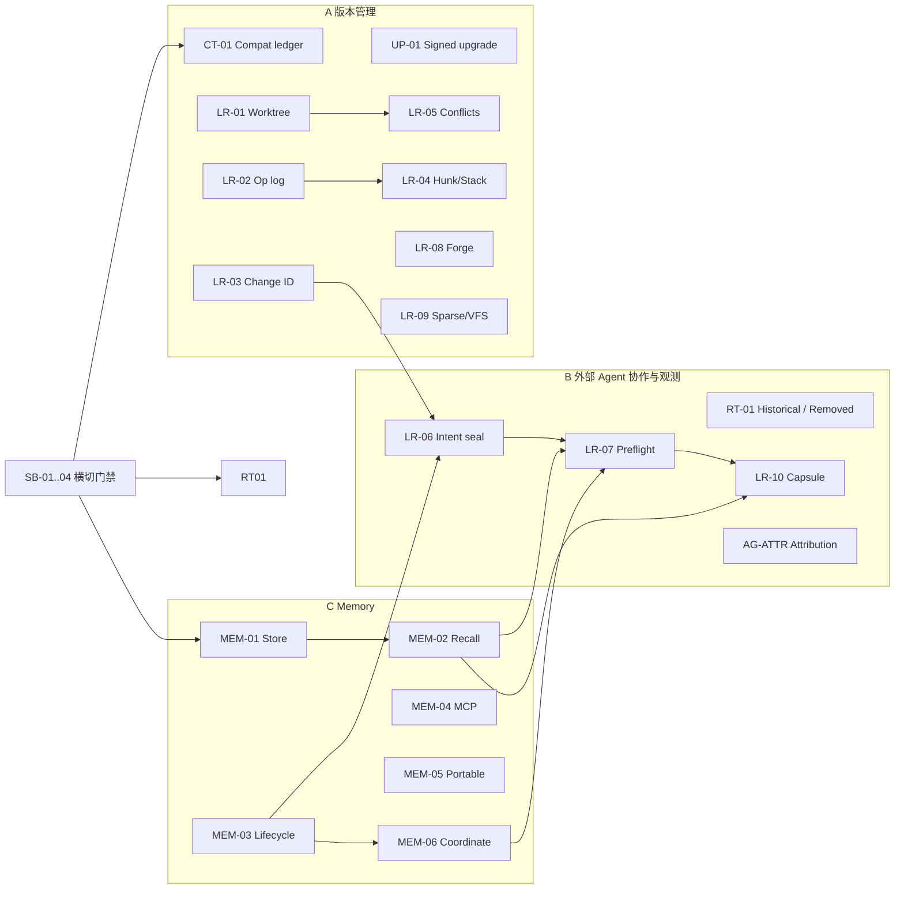

# Libra 长期功能规划

> **thinking 数据获取基线（2026-10-18决定；2026-10-19 CX-00交接快照，实时执行见 plan-status.md）：** [DATA-CAP-20261019](plan-20260904.md#thinking-data-baseline-20261019) 替代下方 2026-10-18 四 provider 计划的隐私剥离/native 来源保存前置。以 OpenCode macOS 13段/4617 bytes、2个自动 checkpoint 原值一致为已证基线；系统 OpenCode 默认 Opus 5.5 medium + summarized 的无 --model 实测另得到131 bytes正文。Codex CX-00 已于2026-10-19在 main 开工并完成本地source审计（Claude R2 PASS，首轮FAIL保留并已修复），其余28张CX及Claude 9/Pi 11/Hermes 10卡仍pending（正式complete仍0/59）；2026-10-18只修订计划和配置事实；获取的数据可普通保留并标 Unproven/Partial，不把空壳当通过。Codex source 审计与隔离hash-list已执行，四工具真实模型smoke均未执行；用户本次已授权Codex计划实施，没有native grant。当时Codex CX-00 source-qualified、下一卡CX-12（实时见plan-status）；另三工具下一卡CC-00 / PI-00 / HM-00；实现依原逐文件串行与 schema/cloud 数据正确性边界。旧 PASS/FAIL 与完成数保留历史；2026-10-18 16:39:27 UTC 本轮 fmt/strict、104/104 focused 与 Claude R2 实际 PASS 已登记于各计划；源数据获取/可读正文仍须未来真实测试，无版本发布。

## 文档职责与维护协议

本文是 Libra 不绑定具体发布日期和版本号的长期能力组合路线图。它回答「哪些能力值得长期投资、为什么、依赖什么、何时具备进入日期计划的条件」，不是 release 承诺、owner 清单或逐项实施任务表。具体设计、迁移、拆分、发布和回滚只进入按日期计划或后续 RFC/ADR。上次审计基线为 2026-09-23（第十三次）；本轮只更新允许的审计快照与路线图状态。

**本次改版：2026-10-15（第十四次）竞品审计。** 审计机为 Linux（Omarchy，`git 2.55.0`，`libra 0.30.49`），本轮以实际 `$LIBRA_REPO=/run/media/genedna/data/libra` / `$COMP_ROOT=/run/media/genedna/data/competition` 与 `SCRATCH=/run/media/genedna/data/competition/libra-competitor-audit-2026-10-15` 为准；第十三次审计机路径（`/media/eli/data/...`）与第十二次 macOS 路径（`/Volumes/Data`）只保留在历史记录。核心变化：Libra 推进至 `v0.30.49`；**Memory 由零实现进入实施**（plan-20260926：`DM-01/02/03/10/13` 已合入、`DM-11` locally-accepted，`libra memory` 公开命令面与 Episode 投影 / 新鲜度窗口落地）；**LR-09 由已验证推进为实施中**（plan-20260913 FastCDC Media 家族 `FL-00/01/07/02/06/03` done，v0.30.0 家族发布），**AG-ATTR 由候选推进为实施中**（Agent Capture 通用架构 ACF-01..20 与 Session Capture 收口，`src/internal/ai/capture/**` 合入）。快照为 42 个 Git 仓库（本机无 Libra 类型；`cursor/` 为唯一空一级目录），20 up-to-date / 11 fast-forward / 10 blocked-forced-update / 1 blocked-local-ahead。本轮无优先级（P 级）变化、无新增编号。

> **产品状态校正（2026-09-23，优先于下方历史审计快照）：** `plan-20260715`、`plan-20260824`、`plan-20260825` 保留为历史完成/发布证据；其 `libra code`、Web Code UI、内部 AgentRuntime、内建 provider/control/MCP/usage 等产品面已由 [`plan-20260920.md`](plan-20260920.md) 拆除，不得作为现行能力或重启前置。当前 B 类路线只保留外部 Agent 观测、traces、hooks、bridge、review/investigate 只读运行与可追溯协作；任何旧审计段落、图表或完成证据若仍用现在时描述 Code，均按本段解释为历史事实。通用 WIO 与测试并行度成果继续有效，但新工作必须另立基于当前架构的日期计划。

状态定义：

| 状态 | 含义 |
|---|---|
| 候选 | 有问题线索，但 Libra 缺口、架构适配或证据尚不足 |
| 已验证 | 已同时核对竞品证据与 Libra 当前源码/测试，确认问题和可执行缺口真实存在 |
| 已排期 | 已有按日期计划覆盖该项的明确范围，并从本文链接 |
| 实施中 | 日期计划已有已合入和未完成切片，长期完成判据仍未全部满足 |
| 已实现 | 当前可发布版本中的代码、测试、用户/兼容文档共同证明完成判据已满足 |
| 历史封存 | 曾满足完成判据并有发布证据，但对应产品面随后被正式拆除；保留证据，不得作为现行能力或直接重启 |
| 已替代 | 原问题仍有效，但由另一项或更合适的机制承接 |
| 不采纳 | 经审计确认不适合 Libra，保留编号与理由 |

只有当前 checkout 的代码、测试、兼容性与用户文档，以及可发布版本证据共同成立时，才能标记「已实现」。日期计划写完、竞品已有、存在 schema 或文档声明都不构成实现证明。编号一经引用不重编号。

## 规划原则

1. **三类分工清晰。** 版本管理回答「代码与历史如何正确」；外部 Agent 协作与观测回答「第三方 Agent 的工作如何被安全捕获、审计并与代码关联」；Memory 回答「跨会话/跨 Agent 如何记住并召回工程判断」。三者共享 SQLite、对象库、稳定错误码与 `--json`，但不互相替代事实源；Libra 当前不内建代码生成执行器。
2. **开发者价值优先于命令数量。** 不以 Git flag parity 或竞品功能清单长度衡量进展。
3. **Libra-native，不复制竞品实现。** 复用 Git 对象/pack 兼容、SQLite 可变状态、外部 Agent capture/bridge、sandbox、cloud；不复活已拆除的 AgentRuntime/Code UI。
4. **Git 互操作仍是底线。** 扩展元数据可以是 Libra 专有，但普通提交、对象传输和远端协作不能无故破坏 Git 兼容。
5. **所有 mutation 必须可观察、可恢复。** 进入 operation log；具备 preview、原子提交与失败恢复。
6. **机器接口先于交互外壳。** 先冻结 Rust API 与 `--json`/`--machine`；只有经独立产品决策才新增交互外壳，不以路线图条目暗中恢复 Web/TUI。
7. **逻辑身份与存储身份分离。** commit OID 是内容身份；change / intent / review / memory / capsule 使用稳定逻辑身份。
8. **共享数据必须经过安全发布。** 原始 prompt、tool call、transcript、私有路径不得因写入对象库就自动成为团队可读数据。
9. **先确定性、后智能化。** preflight、hunk identity、overlap、recall 先提供确定性基线；LLM 只作为带 provenance、可撤销的增强层。
10. **计划状态必须据代码更新。** 每次实施前重核 `src/`、`COMPATIBILITY.md`、命令文档与测试。

---

## 本次竞品审计快照

审计时间：**2026-10-15（第十四次）**。审计机：Linux（Omarchy），`git 2.55.0`，`libra 0.30.49`；Libra 主仓 `/run/media/genedna/data/libra`（HEAD `c5a138445aab2f81f4567b9789241adb25e63eff`，最新 tag `v0.30.49`，工作树 clean），竞品根 `/run/media/genedna/data/competition`。范围严格限定为竞品根下直接两层仓库（**42 个 Git 仓库**，本机无 Libra 类型；`cursor/` 为唯一空一级目录）。Git 仓库在 `git status --porcelain` 为空且有 upstream 时按本轮执行 `git fetch --prune` + `git merge --ff-only @{u}` 两步更新；本机无 Libra 类型竞品。本轮 20 个 up-to-date、11 个 fast-forward、10 个 `blocked-forced-update`（crabbuild/crab、dolthub/dolt、entireio/cli、EpicGames/lore、git-ai-project/git-ai、gitbutlerapp/gitbutler、go-git/go-billy、go-git/go-git、jj-vcs/jj、matrixorigin/Memoria；多数 forced update 发生在非默认分支，默认分支未合并，增量按「沿用」或本地 revision 只读核对）、1 个 `blocked-local-ahead`（diegoxtr/ctx-open）。`blocked-*` 只表示本地 revision 可读，**不**表示已更新到远端最新。仓库身份按规范化 remote 键匹配、目录名只作展示；集合变动见下附表。scratch 目录为 `/run/media/genedna/data/competition/libra-competitor-audit-2026-10-15`。
上次快照：2026-09-23（第十三次）；本轮对照其 revision 增量，并以当前 checkout 的 Libra 代码、测试、文档与发布 tag 为事实源。增量范围验证：全部 42 个上次 revision 均经 `git cat-file -e <rev>^{commit}` 存在且为本地 HEAD 祖先，无基线重置。

| 竞品（目录） | remote | 类型 | 归类 | 分支 | 上次 revision | 审计 revision | 更新结果 | 增量/覆盖 | 证据入口（≤80 字） |
|---|---|---|---|---|---|---|---|---|---|
| `crabbuild/compass` | crabbuild/compass | Git | 版本管理（相邻，本地恢复） | `main` | `5a9081f93` | `b204213c68` | **fast-forward** | 层2 / +73，主题 100%，diff 抽样 | CompassQL/只读结构查询；query 分页/预算加固（E1/E2，本轮） |
| `crabbuild/crab` | crabbuild/crab | Git | 版本管理（相邻，本地恢复） | `main` | `77a9dc868` | `77a9dc8682`（未证明远端最新） | **blocked-forced-update** | +0 / 沿用 | 大文件分块与对象存储（README 沿用）；forced-update 未合并 |
| `crabbuild/prolly` | crabbuild/prolly | Git | 版本管理（相邻，本地恢复） | `main` | `6ee959eae` | `6ee959eaed` | **up-to-date** | +0 / 沿用 | 不可变有序 KV/结构共享（README 沿用） |
| `crabbuild/silo` | crabbuild/silo | Git | 版本管理（相邻，本地恢复） | `main` | `7f71a06b0` | `7f71a06b05` | **up-to-date** | +0 / 沿用 | 对象版本账本（README 沿用，SB-03/LR-02/09 参考） |
| `crabbuild/trail` | crabbuild/trail | Git | 版本管理（相邻，本地恢复） | `main` | `9823ed755` | `9823ed7551` | **up-to-date** | +0 / 沿用 | Git 旁路 operation 账本（README 沿用，LR-01/02/07 参考） |
| `deepseek-ai/deepseek-harness` | deepseek-ai/deepseek-harness | Git | Agent 生成代码（相邻） | `master` | `c291e7961` | `571902028a` | **fast-forward** | 层3 / +4051，热区+关键词 100% | session 事件名与 `SESSION_FORMAT_VERSION=4` 保留（E2）；桌面/CUA 面不采纳 |
| `diegoxtr/ctx-open` | diegoxtr/ctx-open | Git | Memory（相邻） | `main` | `862e12b` | `862e12b1cd`（未证明远端最新） | **blocked-local-ahead** | +0 / 沿用 | 认知对象版本化（source-available 概念参考）；local-ahead 未合并 |
| `dolthub/dolt` | dolthub/dolt | Git | 版本管理（相邻） | `main` | `3ca268096` | `3ca2680964`（未证明远端最新） | **blocked-forced-update** | +0 / 沿用 | malformed adaptive value 报错（E2，沿用）；forced-update 未合并 |
| `entireio/cli` | entireio/cli | Git | 版本管理（相邻，本地恢复） | `main` | `9c06bfb1` | `9c06bfb136`（未证明远端最新） | **blocked-forced-update** | +0 / 沿用 | secret patterns fail-closed（E1，沿用）；forced-update 未合并 |
| `entireio/forgemark` | entireio/forgemark | Git | 版本管理（协作参考） | `main` | `47f57bf` | `d4853db88a` | **up-to-date** | 层1 / +18，主题 100% | redirect-refusal/凭据过期/错误 redaction（E2，本轮） |
| `EpicGames/lore` | epicgames/lore | Git | 版本管理 | `main` | `074eb0b0d` | `cb5b536be4`（未证明远端最新） | **blocked-forced-update** | 层2 / +157，主题 100%，diff 抽样 | JWT `typ` 白名单 `60a7ab4` + presigned 限界 `128e8be`（E2） |
| `facebook/sapling` | facebook/sapling | Git | 版本管理 | `main` | `85572b5c9` | `79071c2a3e` | **fast-forward** | 层3 / +1023，热区+关键词 100% | linked worktree 共享 store `713e475600f`（E2）；lz4 分配错误化（E1） |
| `getcursor/cursor` | getcursor/cursor | Git | Agent 生成代码（相邻） | `main` | `654b1b4` | `654b1b4775` | **up-to-date** | +0 / 沿用 | issue 信号源，无产品源码 |
| `git-ai-project/git-ai` | git-ai-project/git-ai | Git | Agent 生成代码（相邻） | `main` | `f8e39c2c8` | `f8e39c2c89`（未证明远端最新） | **blocked-forced-update** | +0 / 沿用 | 遥测/计费面（不采纳，沿用）；forced-update 未合并 |
| `gitbutlerapp/gitbutler` | gitbutlerapp/gitbutler | Git | 版本管理 | `master` | `32dd13413` | `32dd13413a`（未证明远端最新） | **blocked-forced-update** | +0 / 沿用 | 未提交区 ID/hunk mutation（E2，沿用）；forced-update 未合并 |
| `gitbutlerapp/grit` | gitbutlerapp/grit | Git | 版本管理 | `main` | `dfb079967` | `ffa5310c59` | **fast-forward** | 层3 / +1362，热区+关键词 100% | repack 丢 grace-protected 对象 `de8158cf2`（E2）；Rabin delta `a3171d1e9`（E2） |
| `git/git` | git/git | Git | 版本管理（参考基线） | `master` | `47ce80527c` | `6de20f6092` | **up-to-date** | 层2 / +174，主题 100%，diff 抽样 | pull NULL 段错误 `38bdda17dd`（E2）；curl 凭据剥离 `76524c2604`（E1） |
| `go-git/go-billy` | go-git/go-billy | Git | 版本管理（架构参考） | `main` | `7bd0594` | `7bd0594967`（未证明远端最新） | **blocked-forced-update** | +0 / 沿用 | FS 抽象与 capability（沿用）；forced-update 未合并 |
| `go-git/go-git` | go-git/go-git | Git | 版本管理（架构参考） | `main` | `29c4ef62f` | `29c4ef62fd`（未证明远端最新） | **blocked-forced-update** | +0 / 沿用 | 凭据作用域/URL 脱敏（E2，沿用）；forced-update 未合并 |
| `graphwisdom/perstate` | graphwisdom/perstate | Git | Memory | `master` | `95e27e3` | `95e27e3bb1` | **up-to-date** | +0 / 沿用 | push+rebase 重试非并发安全模型（沿用） |
| `jj-vcs/jj` | jj-vcs/jj | Git | 版本管理 | `main` | `c09b0c337` | `c09b0c337f`（未证明远端最新） | **blocked-forced-update** | +0 / 沿用 | 并发 stacked_table 写丢失修复（E2，沿用）；forced-update 未合并 |
| `letta-ai/agent-file` | letta-ai/agent-file | Git | Agent 生成代码 | `main` | `78212eb` | `78212eb571` | **up-to-date** | +0 / 沿用 | `.af` 可移植格式（沿用） |
| `letta-ai/letta-agent-sdk` | letta-ai/letta-agent-sdk | Git | Agent 生成代码 | `main` | `f45ddfe2` | `12535cac5c` | **fast-forward** | 层2 / +49，主题 100%，diff 抽样 | worker turn 跨可恢复错误保留 `4c77ad0`（E2） |
| `letta-ai/letta-code` | letta-ai/letta-code | Git | Agent 生成代码 | `main` | `1d506973` | `cc4654acc3` | **fast-forward** | 层3 / +341，热区+关键词 100% | always-on redaction `4b028fab`；memory writer 串行 `5c995a72`（E2） |
| `letta-ai/skills` | letta-ai/skills | Git | Agent 生成代码 | `main` | `b03323bfe` | `6785511e7d` | **up-to-date** | 层1 / +1，主题 100% | 提示词仓（§1.3 排除路径） |
| `letta-ai/trajectory` | letta-ai/trajectory | Git | Agent 生成代码 | `main` | `21ae92d` | `b8c508fd1e` | **up-to-date** | 层1 / +13，主题 100% | 导入会话与轨迹 schema 分离 `424d8c9`（E1） |
| `lorevcs/lore` | lorevcs/lore | Git | 版本管理（相邻） | `main` | `1fd2ea9` | `1fd2ea9dfb` | **up-to-date** | +0 / 沿用 | intent 记录（单人项目，沿用） |
| `MachineWisdomAI/fava-trails` | machinewisdomai/fava-trails | Git | Memory | `main` | `10f689f74` | `f1c89ae10d` | **fast-forward** | 层1 / +21，主题 100% | 跨进程 jj init 锁 `a28fa7a`；Trust Gate egress 声明纠正 `acac695`（E2） |
| `mainline-org/mainline` | mainline-org/mainline | Git | Agent 生成代码 | `main` | `5704305` | `79f4be3bc1` | **up-to-date** | 层1 / +2，主题 100% | hub 稳定唯一外部贡献 ID `014bb62`（E2） |
| `matrixorigin/Memoria` | matrixorigin/memoria | Git | Memory | `main` | `689f3f9ba` | `689f3f9bad`（未证明远端最新） | **blocked-forced-update** | +0 / 沿用 | MCP ping/存储兼容（E1，沿用）；forced-update 未合并 |
| `memorax-ai/memorax-code` | memorax-ai/memorax-code | Git | Memory（相邻） | `main` | `1525c20f` | `55981ea9e8` | **fast-forward** | 层3 / +233，热区+关键词 100% | 跨 worktree 共享基线 `9d367c0`（E2）；自动更新仍无验签 |
| `nervosys/Lit` | nervosys/lit | Git | 版本管理（相邻） | `master` | `a930e44` | `66b2c771e3` | **up-to-date** | 层2 / +33，主题 100%，diff 抽样 | malformed remote ref panic `2f4d122`（E1）；hv2-sandbox 隔离测试（E2） |
| `rekal-dev/rekal-cli` | rekal-dev/rekal-cli | Git | Memory | `main` | `4550e602e` | `4550e602ea` | **up-to-date** | +0 / 沿用 | 写前 secret 脱敏/home 匿名化（沿用） |
| `rohitg00/agentmemory` | rohitg00/agentmemory | Git | Memory | `main` | `e04ba88` | `36eb328e12` | **fast-forward** | 层2 / +82，主题 100%，diff 抽样 | 持久捕获/spool `60b88a2`；vector pending log `cd4ca4e`（E2） |
| `ruvnet/agentic-flow` | ruvnet/agentic-flow | Git | Memory | `main` | `d3735a3` | `a2f6c1cfa7` | **fast-forward** | 层1 / +13，主题 100% | SECURITY.md + Windows 修复；宣传材料（不采纳） |
| `sachinsharma9780/memweave` | sachinsharma9780/memweave | Git | Memory | `main` | `2ff82df` | `2ff82df714` | **up-to-date** | +0 / 沿用 | Markdown+SQLite 索引（沿用） |
| `sl4m3/ledgermind` | sl4m3/ledgermind | Git | Memory（反例） | `main` | `7e05e8db` | `cd68dfd801` | **up-to-date** | 层1 / +3，主题 100% | 仅文档/基准（宣传材料，沿用） |
| `sqliteai/sqlite-memory` | sqliteai/sqlite-memory | Git | Memory | `main` | `0f0aede` | `0f0aede814` | **up-to-date** | +0 / 沿用 | SQLite 混合检索（沿用） |
| `StepzeroLab/research-git` | stepzerolab/research-git | Git | Agent 生成代码（类型变化：Libra→Git） | `main` | `62bcdf5` | `62bcdf5f3a` | **up-to-date** | +0 / 沿用 | Feature Capsule/recall（LLM 承担，沿用） |
| `tobi/walgit` | tobi/walgit | Git |  | `main` | `80e9a20b2` | `80e9a20b29` | **up-to-date** | +0 / 沿用 | 退役前可达性守恒证明 `bf65c01`（E2，沿用） |
| `treeverse/lakeFS` | treeverse/lakefs | Git | 版本管理（相邻） | `master` | `4bb11638e` | `34567699ea` | **fast-forward** | 层1 / +12，主题 100% | GHSA-223c-qwgx-wwcg 内网 SSRF 阻断 `a6d4f1345`（E3）；License 改 BSL |
| `xai-org/grok-build` | xai-org/grok-build | Git | Agent 生成代码 | `main` | `37949780` | `2bdd1d6a63` | **up-to-date** | 层1 / +7，主题 100% | monorepo sync；本轮无新结论（E1） |

| 变动类型 | 仓库（目录） | 上次 revision / 当前 HEAD | 说明 |
|---|---|---|---|
| 本地缺失 | `Einsia/agent-git` | 531bfcec0 / — | 本地缺失（第 12 轮 531bfcec0；上游状态未验证）；网页型条目 AgentGit 本轮按 §7.8 单独更新，本地 clone 仍不在册 |
| 本地缺失 | `akitaonrails/ai-memory` | a200127c5 / — | 本地缺失（第 12 轮 a200127c5；上游状态未验证）；MEM-06 主要证据沿用在案 |
| 本地缺失 | `anomalyco/opencode` | bbd72fb8b0 / — | 本地缺失（第 12 轮 bbd72fb8b0；上游状态未验证）；SB-02 权限证据沿用在案 |
| 本地缺失 | `cursor/agent-trace` | 2754f07 / — | 本地缺失（第 12 轮 2754f07；上游状态未验证）；AG-ATTR 参照沿用在案 |
| 本地缺失 | `agenta-ai/agenta` | 53717db / — | 本地缺失（第 12 轮 53717db；上游状态未验证） |
| 本地缺失 | `entireio/cli-checkpoints` | 0204a02 / — | 本地缺失（第 12 轮 0204a02；上游状态未验证） |
| 本地缺失 | `entireio/git-sync` | 013012ac8 / — | 本地缺失（第 12 轮 013012ac8；上游状态未验证） |
| 空目录或普通目录 | `cursor/` | — / — | 空一级目录，不计入总数 |

待验证账本索引（E1；全量在 `$SCRATCH/pending.tsv`）：

| 关联编号 | repo@sha | 最小验证步骤 |
|---|---|---|
| SB-01 | sapling@4159be9d783 | 读 `eden/scm/lib/lz4-pyframe/src/lz4.rs` 分配失败路径与调用方错误处理 |
| SB-01 | git/git@506a21b312 | 读 `wrapper.c` writev_in_full 溢出守卫与 `t/` 覆盖归属 |
| SB-02 | git/git@76524c2604 | 读 `http.c` match_effective_url 与 redirect 后凭据剥离测试归属 |
| SB-01 | lit@2f4d122 | 读 `src/federation/peers.rs` want-list 校验并确认是否有回归测试 |
| MEM-01 | agentmemory@194b050 | 读 REST 认证默认值与路径收敛实现及测试归属 |
| AG-ATTR | trajectory@424d8c9 | 读 `CONVERSATIONS.md` 与 `src/adapters/**` 的 schema 分离边界 |

| 审计日期 | 仓库数 | 更新摘要 | 路线图结论 |
|---|---:|---|---|
| 2026-10-15（第十四次） | 42（42 Git + 0 Libra） | 20 up-to-date、11 fast-forward、10 blocked-forced-update、1 blocked-local-ahead；集合变动 8 行（本地缺失 7 沿用：agent-git/ai-memory/opencode/agent-trace/agenta/cli-checkpoints/git-sync；空目录 1：cursor/）；无基线重置（42/42 上次 revision 均为本地 HEAD 祖先） | **Libra 自身为主**：Memory 由零实现进入实施（plan-20260926 DM-01/02/03/10/13 已合入、DM-11 locally-accepted，`libra memory` 命令面/Episode 投影落地）；**LR-09、AG-ATTR 推进为实施中**（FastCDC Media 家族发布、ACF/SCAP 收口）；竞品侧 SB-01（grit 对象守恒、git/git NULL 段错误、lore presigned 限界）、SB-02（letta-code always-on redaction、lore JWT typ、lakeFS SSRF GHSA）、SB-04/MEM-01/02/03/05/06 补充判据；无优先级（P 级）变化、无新增编号 |
| 2026-09-23（第十三次） | 42（42 Git + 0 Libra） | 8 个 fast-forward、18 个 up-to-date、16 个 blocked（14 dirty、2 timeout）；集合变动 15 行（本地缺失 7：agent-git/ai-memory/opencode/agent-trace/agenta/cli-checkpoints/git-sync，本地恢复 6：crabbuild/*×5 + entireio/cli，类型变化 1：research-git Libra→Git，空目录 1：cursor/）；sapling/deepseek/memorax/ledgermind 上次 rev 不在本机历史 | **Libra 自身为主**：0.23.0 breaking 移除 web/worker/`libra code`/Code 执行面，**LR-02 / LR-03 的 operation v2 与 sidecar Change ID 随 0.23.x 正式发布**；Code 时代 MCP 子系统移除、由确定性 `permission/` 引擎 + `sandbox` + `run_admission` 承接，**SB-02 生产信任边界显著落地**。竞品侧 lore/go-git/letta-code 的安全与可靠性修复只补充既有 SB/MEM 判据；git-ai 全为遥测/计费面（不采纳）；Memory 仍零实现。无优先级（P 级）变化、无新增编号 |
| 2026-09-17（第十二次） | 44（39 Git + 5 Libra） | 15 个 fast-forward、15 个 up-to-date、14 个 blocked（10 forced-update、2 network、1 shallow、1 local-ahead）；集合变动 20 行（本地缺失 5：crabbuild/*，目录改名 6，首次纳入 3：agent-git/ai-memory/opencode，类型变化 1：research-git Git→Libra，本地恢复 5）；jj/gitbutler/dolt/git-ai 本机落后于第 11 轮 revision 且被 forced-update 阻塞（增量 0） | **LR-03 已排期→实施中**（sidecar Change ID 模块合入未发布）、**MEM-06 候选→已验证**（ai-memory v2.3.0 inbox/queue，E3）；SB-01 pkt-line 切片收口（plan-20260901 完成，v0.22.47）；LR-02 显著缩小（v2 restore/undo/redo 合入）；SB-02/SB-04/LR-01/LR-09/MEM-01 补充判据；上轮待验证账本 6 项全部关闭；无优先级（P 级）变化、无新增编号 |
| 2026-09-14（第十一次） | 41（41 Git + 0 Libra） | 14 个 fast-forward、21 个 up-to-date、6 个 `blocked-forced-update`（dolt、git-ai、git/git、gitbutler、go-billy、jj）；首次纳入 `crabbuild/*` 五仓 | Libra 已发布 `v0.22.19`；merge 主线、operation v2 foundation 与 FastCDC 相关差距缩小；竞品新增证据继续补强既有 SB-01..04、MEM-01 与 AG-ATTR，不新增编号、不改变优先级 |
| 2026-09-03（第十次） | 36（36 Git + 0 Libra） | 9 个 fast-forward（sapling、gitbutler、lore、go-git、dolt、git-ai、grok-build、letta-code、letta-agent-sdk、memorax-code、Memoria、ledgermind 中 9 个达 fast-forward，其余 up-to-date）、25 个已是最新、2 个 `blocked-forced-update`（git/git、jj）；集合变动 12 行（本地缺失 5、目录改名 4、首次纳入 walgit、基线重置 ledgermind、类型变化 research-git、空目录 cursor/） | **UP-01、RT-01 推进为「已实现」（Libra 自身证据驱动）；LR-02、SB-02、SB-04 推进为「实施中」；SB 表新增状态列。** 竞品侧安全/可靠性证据面加厚（jj 并发写丢失、dolt 带 GC 数据丢失、git/git UAF、letta shell 解析绕过、git-ai 迁移原子化、walgit 授权缺口）全部映射到既有 SB-01/SB-02/SB-03/SB-04/MEM-01 补充判据，无新增编号、无优先级升降 |
| 2026-08-25（第九次） | 40（35 Git + 5 Libra） | 15 个 fast-forward（13 Git：sapling、jj、gitbutler、lore、git/git、go-git、dolt、git-ai、grok-build、letta-code、letta-agent-sdk、memorax-code、agentmemory；2 Libra：entireio/cli、git-sync）、23 个已是最新、2 个 blocked（agenta `blocked-timeout`、agent-trace `blocked-network` 远端仍 404）；无新增/删除仓库 | 竞品侧无优先级变化（安全/可靠性证据面加厚：go-git 循环 delta 栈溢出、grok-build shell 写权限 fail-closed、lore 内容尺寸上限、git/git 溢出与 unchecked-returns 加固、entireio redaction fail-closed、memorax 数据隔离与 lineage）——全部为既有 SB/MEM/LR 的补充完成判据或竞品证据，无新增编号。**Libra 自身进展为主**：CT4-01 发布卡执行、FIX-05 B 段 waves 发布；`plan-20260715`（RT-01）关闭；新增 `plan-20260821`（UP-01）、`plan-20260822`（LR-02/LR-03）、`plan-20260825`（B Code provider）；**LR-02/LR-03 由已验证推进为已排期**；更正上版把 `plan-20260822` 误标为 UP-01 的链接 |
| 2026-08-22（第八次） | 40（35 Git + 5 Libra） | 1 个 fast-forward（letta-code）、38 个 up-to-date、1 个 `blocked-network`（agent-trace 远端 404）；新纳入 10 仓库（deepseek-harness、ctx-open、dolt、lorevcs/lore、memorax-code、Lit、rekal-cli、git-ai、lakeFS、cursor/cursor） | **RT-01 推进为实施中、UP-01 改判已排期、MEM-01/02 推进已排期**（均为 Libra 自身进展驱动）；竞品侧 rekal-cli 与 letta-code shared-memory skills 加强 MEM-* 证据；无优先级降级或新增编号 |
| 2026-08-09（第七次） | 30 | 9 个 fast-forward（Lore、Sapling、git/git、GitButler、jj、letta-code、letta-agent-sdk、grok-build、entireio/cli）、20 个已是最新、1 个 `blocked-dirty`（agenta） | **CT-01 由「已验证（下一个执行任务）」推进为「实施中」。** 版本管理侧证据面加厚；Memory 类证据面不变，MEM-01/MEM-02 维持已验证。 |
| 2026-08-07（第六次） | 30 | 2 个 fast-forward（Lore、Sapling）、27 个已是最新、1 个 `blocked-dirty`（agenta）；新纳入 `matrixorigin/Memoria`、`memweave`、`ledgermind`、`sqlite-memory`（4 个 Memory 参考） | **无优先级变化。** Memory 类证据面加厚；CT-01 仍是下一个执行任务，MEM-01/MEM-02 维持已验证。 |
| 2026-08-07（第五次） | 26 | 1 个 fast-forward（Lore）、24 个已是最新、1 个 `blocked-dirty`（agenta）；首次按三类重组；新纳入 `letta-ai/*`（5）与 `rohitg00/agentmemory` | **结构重组。** Memory 升格为第一类长期能力（`MEM-*`）；CT-01 仍是版本管理类下一个执行任务；MEM-01 为 Memory 类首个验证任务。 |
| 2026-08-02（第四次） | 20 | 9 个 fast-forward、10 个已是最新、1 个 blocked-dirty | 无优先级变化 |

**本次结论：** 本轮最重要的变化来自 Libra 自身：Memory 由零实现进入实施（plan-20260926 `DM-01/02/03/10/13` 已合入、`DM-11` locally-accepted，`src/internal/ai/memory/` 与 `libra memory` 公开命令面落地），**MEM-01/MEM-02 由已排期推进为实施中**；FastCDC Media 家族（plan-20260913 `FL-00/01/07/02/06/03`）随 v0.30.0 发布，**LR-09 由已验证推进为实施中**；Agent Capture 通用架构（plan-20260924 ACF-01..20、plan-20260925 SCAP）收口，**AG-ATTR 由候选推进为实施中**。BLAKE3 object format（plan-20260907，`B3-00..B3-17`，v0.23.68→v0.29.0）与 Publish/Worker 拆除后的 D1 面收敛属无编号横切交付。竞品侧本轮以可靠性/安全加固为主：grit 修复 repack 静默丢弃 grace-protected 不可达对象（数据丢失）、git/git 修复 `pull` 的 NULL commit 段错误与 curl 重定向后的凭据剥离、lore 增加 JWT `typ` 白名单与 presigned 限界、letta-code 增加 always-on secret redaction 与 memory writer 跨进程串行、lakeFS 以 GHSA-223c-qwgx-wwcg 修复内网 SSRF、agentmemory/fava/memorax 给出记忆耐久性/跨进程锁/跨 worktree 共享基线的可测形态；这些全部映射到既有 SB-01/02/03/04 与 MEM-01/02/03/05/06 的补充判据，无新增编号、无优先级（P 级）升降。网页型竞品（AgentGit、Delta、ERSC）全部 E0，不进矩阵；ERSC 为首次建档条目。

Top-5 最重要差距（两榜合成）：

| 排名 | 榜 | 关联编号 | 差距一句话 | S/D/X/U/C/E | 分 | 竞品证据 | Libra 证据 | 动作 |
|---|---|---|---|---:|---|---|---|
| 1 | A | SB-01 | 生产 panic/abort 与对象/维护路径的静默数据丢失面未清零 | 2/1/2/3/2/E4 | 8 | grit `de8158cf2`（repack 丢 grace-protected 不可达对象，E2）；git/git `38bdda17dd`（`pull` NULL commit 段错误，E2）；lore `128e8be`（presigned 传输限界，E2） | `src/internal/ai/observed_agents/registry.rs:400` `panic!`；`src/internal/ai/observed_agents/builtin/claude_code.rs:768` `expect`；`src/utils/storage/load_cost/pack.rs:15` 环检测 | 补充完成判据 ×3（聚合） |
| 2 | A | SB-02 | 权限引擎已落地，但凭据/URL/内网目标与发布门禁的跨源边界未收口 | 2/1/2/3/2/E4 | 8 | letta-code `4b028fab`（always-on secret redaction，E2）；lore `60a7ab4`（JWT `typ` 白名单，E2）；lakeFS `a6d4f1345` GHSA-223c-qwgx-wwcg（E3） | `src/internal/ai/permission/{rule,evaluate,approved}.rs`；`src/internal/ai/sandbox/{proxy,runtime}.rs`；`src/internal/ai/run_admission.rs` | 补充完成判据 ×3（聚合） |
| 3 | A | LR-09 | 对象退役/维护不得静默丢弃不可达对象；partial clone/promisor 与 materializing sparse 仍缺 | 1/2/2/2/1/E4 | 8 | grit `de8158cf2`（grace-protected 不可达对象，E2）；sapling `d12242459aa`（浅历史共享，E2） | plan-20260913 `FL-00/01/07/02/06/03` `done`；`src/utils/media/{chunker,manifest,transfer}.rs`；`src/internal/sparse/mod.rs:5` | 更新状态（已验证→实施中）+补充完成判据 ×1 |
| 4 | B | MEM-01 | 存储/投影/命令面已开始交付；写入上限、离线 spool 与 dead-letter 的耐久性判据待补 | 1/1/3/3/2/E4 | 8 | agentmemory `60b88a2`（durable capture/spool/dead-letter，E2）；letta-code `4b028fab`（E2） | `src/internal/ai/memory/{episode,projection,reader}.rs`；`src/cli.rs:452 Memory`；plan-20260926 `DM-01/02/03/10/13` | 更新状态（已排期→实施中）+补充完成判据 ×2 |
| 5 | B | MEM-02 | 召回面（recall/search）未交付；FTS5/BM25 已入迁移 schema | 1/1/3/2/2/E4 | 7 | agentmemory `cd4ca4e`（vector pending log 跨 force-kill，E2）；`9d70369`（召回保留与预算，E2） | `src/internal/ai/memory/projection.rs`；plan-20260926 `DM-04`/`DM-08` pending | 更新状态（已排期→实施中）+补充完成判据 ×2 |

能力差距矩阵（本轮完整覆盖 `ids.old` 的 24 个编号）：

| 编号 | 类别 A/B/C/SB | 状态（旧→新） | 最佳竞品参照 repo@sha path:line + 参照来源 | Libra 现状 file:line / test / 可复算命令 | 差距一句话 | 本轮变化 + 驱动方（Libra/竞品/双方） | 动作 | E |
|---|---|---|---|---|---|---|---|---|
| CT-01 | A | 实施中→实施中 | `gitbutlerapp/grit@a3171d1e9` Rabin delta 编码对齐 + `fd1498373` push 新 ref（E2） | `tests/command/t4_port_test.rs`（82 test）；`tests/compat-ledger` 34 toml；本轮核对 `find tests/compat-ledger -name '*.toml' \| wc -l` = 34 | 首个 t4 wave 后无新族 wave；S4 族 waves 与 S2 离线发现器未收口 | 不变（Libra 无新 wave；竞品补 Git 包/传输 parity 参照） | 保持 | E4 |
| UP-01 | A | 已实现→已实现 | `memorax-ai/memorax-code@1491fbb` 中断替换恢复（E2） | `src/internal/upgrade/trusted_keys.rs:37`；`docs/commands/upgrade.md`；tags v0.23.49..v0.30.49 持续经签名链发布 | 签名升级链持续兑现；CHANGELOG 0.22.1..0.22.10 文档债仍登记 | 不变（本轮核对 `libra tag \| sort -V \| tail -1` = v0.30.49） | 保持 | E4 |
| LR-01 | A | 实施中→实施中 | `facebook/sapling@713e475600f` linked worktree 共享 store（E2）；`memorax-ai/memorax-code@9d367c0` 按 Git common dir 共享基线（E2） | `src/command/worktree.rs:87`；`src/internal/workspace.rs:211 WorkspaceLease`；`worktree_isolation_test` | linked worktree 的共享/本地状态划分已有竞品可复算参照；parallel lanes、崩溃矩阵仍未成判据 | 扩大（竞品；Libra 无新 slice） | 补充完成判据 ×2 | E4 |
| LR-02 | A | 实施中→实施中 | `gitbutlerapp/grit@de8158cf2` 维护操作不得静默丢对象（E2，LR-09 共用） | `src/internal/operation/{view,snapshot,restore,undo,reconcile,doctor}.rs`；`op_test`/`restore_test`；`OL-15` `done/remote-pending`（plan-20260822） | v2 已发布；剩余远端兼容门禁与发布验收 | 不变（本轮核对 `ls src/internal/operation` = 14 项） | 保持 | E4 |
| LR-03 | A | 实施中→实施中 | `jj-vcs/jj` 本轮 blocked-forced-update（本地 rev 未变，沿用） | `src/internal/change/{identity,genealogy,store,resolve,builder,workflows}.rs`；`change_revision_provenance_test.rs`；`ChangeId`（`identity.rs:16`） | sidecar Change ID 已发布；重写谱系/immutable 边界未验收 | 不变（本轮核对 `ls src/internal/change` = 7 文件） | 保持 | E4 |
| LR-04 | A | 已验证→已验证 | `gitbutlerapp/gitbutler` 本轮 blocked-forced-update（本地 rev 未变，沿用） | `src/command/apply.rs`；`grep -rn 'HunkId\|hunk_assign' src tests` 无生产命中 | 无非交互 hunk 身份/assignment/stack mutation | 不变（本轮核对 `ls src/command/apply.rs`） | 保持 | E4 |
| LR-05 | A | 实施中→实施中 | `git/git@742d8eb897` rerere 不记录失败解析（E1，仅线索） | `src/command/merge.rs`；plan-20260903 `MG-01..21` 已交付、最终收口未完成 | versioned conflict object / modeless sequencer 仍无 | 不变 | 保持 | E4 |
| LR-06 | A | 已验证→已验证 | `mainline-org/mainline@014bb62` hub 稳定唯一外部贡献 ID（E2） | `src/internal/ai/agent_run/`；`grep -rn 'intent_pin\|IntentSeal' src` 仅测试名命中 | seal/pin/团队 publication 仍无 | 不变（竞品补互操作 ID 参照） | 保持 | E4 |
| LR-07 | A | 已验证→已验证 | `crabbuild/compass@c02f27c6` 有界 typed query（`c02f27c6`，E1）；`e3507eaa` 不返回未解析符号证据（E2） | `src/internal/ai/agent_run/context_pack.rs`；`src/internal/ai/agent_run/parallel.rs:310 write_scopes_overlap` | 缺开工前确定性 overlap receipt / intent projection；新增并行 scope overlap 原语不等于 pre-edit gate | 不变（Libra 新增并行运行重叠拒绝） | 保持 | E4 |
| LR-08 | A | 已验证→已验证 | `gitbutlerapp/grit@fd1498373` push 新 ref 语义（E2，CT-01 共用） | `grep -rn 'trait Forge\|pull_request\|check_runs' src` = 0 | 无 Forge/PR/CI 机器接口 | 不变 | 保持 | E4 |
| LR-09 | A | 已验证→实施中 | `gitbutlerapp/grit@de8158cf2` repack 不得丢 grace-protected 不可达对象（E2）；`facebook/sapling@d12242459aa` git 浅历史读取（E2） | `src/utils/media/{chunker,chunk_store,manifest,negotiate,transfer,page_cache}.rs`；`Cargo.toml:22 fastcdc`；`compat_fastcdc_feature_gate_guard`；`src/internal/sparse/mod.rs:5` skip-worktree | Media 家族已落地并发布（plan-20260913）；partial clone/promisor 与 materializing sparse 仍缺；对象退役守恒成新判据 | 缩小（Libra：FL 家族合入+发布，SW-07 skip-worktree） | 更新状态（已验证→实施中）+补充完成判据 ×2 | E4 |
| LR-10 | B | 已验证→已验证 | `StepzeroLab/research-git` 本轮无新增量（沿用） | `src/command/agent/{checkpoint,skill}.rs`；`grep -rni 'capsule' src` 仅 `src/internal/ai/capture/checkpoint.rs:1694` 注释 | capsule lifecycle / compare / ablation 仍无；`src/command/package.rs` 已随 0.23.x 拆除 | 不变（锚点迁移） | 更新锚点 | E4 |
| RT-01 | B | 历史封存→历史封存 | `deepseek-ai/deepseek-harness@a2dd724c60` session format status/migration 面（E1） | `src/internal/ai/agent_bridge/{ingress,methods}.rs`（自有 `session.open/event.append/session.flush/session.close`）；`src/cli.rs` Mega2 新命令面 | Code 面保持拆除；bridge 契约未变 | 不变（核对 deepseek 事件名与 `SESSION_FORMAT_VERSION=4` 仍存在） | 保持 | E4 |
| AG-ATTR | B | 候选→实施中 | `letta-ai/trajectory@424d8c9` 导入会话与轨迹 schema 分离（E1）；`git-ai-project/git-ai` 本轮 blocked（沿用） | `src/command/agent/import.rs`；`src/internal/ai/capture/**`（catalog/checkpoint/coordinator/pending/…）；plan-20260924 ACF-01..20 `done`/`complete`、plan-20260925 SCAP `done`/`complete` | 捕获/归一底座已合入并发布；行级归因（`grep -rn ai_edit_trace src sql` = 0）仍缺 | 缩小（Libra：ACF/SCAP 收口） | 更新状态（候选→实施中） | E4 |
| MEM-01 | C | 已排期→实施中 | `rohitg00/agentmemory@60b88a2` durable observation/spool/dead-letter（E2）；`letta-ai/letta-code@4b028fab` always-on redaction（E2） | `src/internal/ai/memory/{episode,projection,reader,derive_commit}.rs`；`src/cli.rs:452 Memory`；plan-20260926 `DM-01/02/03/10/13` `done`、`DM-11` locally-accepted | 存储/投影/公开命令已开始交付；写入上限、spool/dead-letter 耐久性判据待补 | 双方（Libra 缩小 + 竞品耐久性判据扩大） | 更新状态（已排期→实施中）+补充完成判据 ×2 | E4 |
| MEM-02 | C | 已排期→实施中 | `rohitg00/agentmemory@cd4ca4e` pending log + durable backlog 跨 force-kill（E2）；`@9d70369` 召回保留已存记忆与预算（E2） | `src/internal/ai/memory/projection.rs`；`grep -rn 'fts5\|bm25' src` 命中（`DM-10` schema 已合入）；`DM-04`/`DM-08` pending | 召回面（recall/search）未交付；FTS5/BM25 已入迁移 schema | 缩小（Libra：schema 已入） | 更新状态（已排期→实施中）+补充完成判据 ×2 | E4 |
| MEM-03 | C | 已验证→已验证 | `MachineWisdomAI/fava-trails@acac695` Trust Gate egress 声明纠正（E2） | `src/internal/ai/history.rs` erase/tombstone；`src/internal/obliteration/`；`src/internal/ai/memory/` 尚无巩固层 | 巩固/衰减/晋升门禁仍未实现；LLM Trust Gate egress 不得声称已 redact | 扩大（竞品反例） | 补充完成判据 ×1 | E4 |
| MEM-04 | C | 已验证→已验证 | `letta-ai/letta-code@a75111ea` storage-backed OAuth authorizer（E2） | `src/internal/ai/permission/`（Allow/Deny/Ask、approvals、inheritance）；`src/internal/ai/mcp` 已拆除 | Memory 机器面待随 `libra memory --json` 与 permission 引擎接线 | 不变（机器面重界定） | 补充缺口 | E4 |
| MEM-05 | C | 候选→候选 | `rohitg00/agentmemory@a5e036c` `MEMORY.md` 桥仅缺失时创建、内容不同即报错（E2） | `src/command/agent/skill.rs`；无 portable Memory export | 可移植导出/skill 投影仍缺 | 不变（竞品给出导出幂等边界） | 补充完成判据 ×1 | E4 |
| MEM-06 | C | 已验证→已验证 | `MachineWisdomAI/fava-trails@a28fa7a` 跨进程初始化锁（E2）；`letta-ai/letta-code@5c995a72` memory checkout writer 串行化（E2）；`memorax-ai/memorax-code@9d367c0` 跨 worktree 共享基线（E2） | `src/internal/workspace.rs:211 WorkspaceLease`；`src/internal/ai/agent_run/parallel.rs:310`；`src/internal/ai/memory/` 无 coordinator | 协调通道实现为零；竞品给出锁序/共享基线/冲突修复的可测形态 | 扩大（竞品） | 补充完成判据 ×2 | E4 |
| SB-01 | SB | 实施中→实施中 | `gitbutlerapp/grit@de8158cf2` gc 不得丢 grace-protected 对象（E2）；`git/git@38bdda17dd` `pull` NULL commit 不再段错误（E2）；`EpicGames/lore@128e8be` presigned 传输限界（E2） | `tests/compat/all_production_unwrap_guard.rs`；`src/internal/ai/observed_agents/registry.rs:400` `panic!`；`src/internal/ai/observed_agents/builtin/claude_code.rs:768` `expect`；`src/utils/storage/load_cost/pack.rs:15` 环检测 | 生产 panic/abort 面未清零；对象退役守恒、分配失败路径、外部输入界读须持续加界 | 双方（竞品加界 + Libra pkt-line 已收口） | 补充完成判据 ×3（聚合） | E4 |
| SB-02 | SB | 实施中→实施中 | `letta-ai/letta-code@4b028fab` always-on vault redaction（E2）；`EpicGames/lore@60a7ab4` 仅接受配置的 JWT `typ`（E2）；`treeverse/lakeFS@a6d4f1345` GHSA-223c-qwgx-wwcg 阻断内网 SSRF（E3） | `src/internal/ai/permission/{rule,evaluate,approved,inheritance}.rs`；`src/internal/ai/sandbox/{proxy,runtime}.rs`；`src/internal/ai/run_admission.rs` | 权限引擎已落地；凭据跨源作用域、URL/错误脱敏、内网目标拒绝与团队发布门禁仍未收口 | 双方（竞品加界 + Libra 引擎） | 补充完成判据 ×3（聚合） | E4 |
| SB-03 | SB | 已验证→已验证 | `git-ai-project/git-ai` 本轮 blocked（沿用，E2） | `src/utils/d1_client.rs:749` `ensure_object_index_table`、`:1220` `ensure_repositories_table`（逐语句，无账本）；消费方 `src/command/cloud/sync.rs:32`；`src/command/publish.rs` 与 `worker/` 已拆除 | wrangler 第二 runner 随 Publish/Worker 拆除消失；D1 `ensure_*` 仍逐语句无事务账本 | 缩小（Libra：第二 runner 消失） | 补充缺口（更新锚点） | E4 |
| SB-04 | SB | 实施中→实施中 | `letta-ai/letta-code@968e8c66` 子进程 OOM/SIGKILL 后宿主可恢复（E2）；`@bde8cd05` 锁发布期 worker 启动不失败（E2） | `src/internal/process_terminate.rs:12`；`tests/SERIAL_REGISTRY.tsv`；nextest CI | 测试隔离已落地；child scope/late-spawn kill/PID-reuse 抽象与中断清理未统一 | 扩大（竞品） | 补充完成判据 ×1 | E4 |

不做 Top-3（按 (S+D+X) 从「不采纳/延后」候选中取）：

| 排名 | 关联编号/来源 | 内容 | 理由 | E |
|---|---|---|---|---|
| 1 | 不采纳（letta-code） | 跨 MCP 信任边界继承父 secrets（`9c7dd3ca`） | 与规划原则 8 冲突：共享数据必须经过安全发布；Libra 不继承，改为显式授权 | E2 |
| 2 | 不采纳（agentmemory） | 自动导出/改写 Claude Code `MEMORY.md` 形态（`a5e036c`） | Libra 的 Memory 导出必须显式、幂等、不覆盖既有文件；该提交只作 MEM-05 判据 | E2 |
| 3 | 不采纳（deepseek-harness 桌面/CUA/浏览器产品面；letta-ai/trajectory Slack 会话 schema） | 桌面发布审批/CUA/网页终端与 Slack 会话归一 | 与 VCS/Agent 观测长期能力无关；trajectory 的 schema 分离只作 AG-ATTR 线索 | E1/E2 |

本轮竞品要点（更新增量审计）——6 类 × {发现数, 值得借鉴数, 进入 plan-long 数}：

| 类别 | 发现 | 值得借鉴 | 进入 plan-long |
|---|---:|---:|---:|
| security | 12 | 9 | 5 |
| reliability | 14 | 10 | 6 |
| bugfix | 6 | 3 | 0 |
| compat-migration | 6 | 3 | 2 |
| improvement | 7 | 4 | 2 |
| feature | 4 | 2 | 0 |

本轮进入 plan-long 的竞品要点（≤12 条；对应差距矩阵动作 ≠ 保持的行）：

- **SB-01** grit `de8158cf2`：repack/维护在移除旧 pack 前必须把仅存于其中的不可达对象先写成 loose，`gc.pruneExpire` 宽限期内不得静默删除（E2）。
- **SB-01** git/git `38bdda17dd`：`pull` 在 commit lookup 失败时必须返回而非解引用空指针（`t5520-pull.sh`），生产解析路径不得以段错误收场（E2）。
- **SB-01** lore `128e8be`：presigned 传输只允许 GET（HEAD/fallback 405）并对兑换施加传输上限（E2）。
- **SB-02** letta-code `4b028fab`：secret redaction 必须 always-on 覆盖 tool 返回与用户消息，而非仅在特定模式（E2）。
- **SB-02** lore `60a7ab4`：`[server.auth]` 必须可按配置校验 JWT `typ`（含 `at+jwt` 媒体类型归一），缺 typ/不匹配即拒绝（E2）。
- **SB-02** lakeFS `a6d4f1345`：GHSA-223c-qwgx-wwcg——hook 出站必须默认拒绝 loopback/私网/link-local，仅允许显式 `allowed_hosts`，且不继承 proxy 环境（E3）。
- **SB-04** letta-code `968e8c66`：子进程被 OOM/SIGKILL 终止后宿主必须可恢复并区分「可能 OOM」与真正 crash（E2）。
- **MEM-01** agentmemory `60b88a2` + `35813c5`：捕获必须持久接受、重启安全去重、离线 spool/dead-letter 有硬上限，且脱敏不得改写标识符（E2）。
- **MEM-02** agentmemory `cd4ca4e`：向量/索引写入须有 pending log + durable backlog，强制终止后不得丢已存向量（E2）。
- **MEM-03** fava-trails `acac695`：LLM Trust Gate 的 egress 必须如实描述为「选定字段」而非已 redact；不实声明即是隐私缺陷（E2）。
- **MEM-06** fava `a28fa7a` + letta-code `5c995a72` + memorax `9d367c0`：跨进程初始化/记忆写入必须以阻塞锁串行、锁在进程存活期不得被耗时抢占，linked worktree 按 Git common dir 共享基线（E2）。
- **LR-01** sapling `713e475600f`：linked worktree 的共享 store 与每工作树本地状态必须按 `GIT_COMMON_DIR` 显式划分（E2）。

Libra 自身（HEAD `c5a138445aab2f81f4567b9789241adb25e63eff`，`Cargo.toml` version `0.30.49`，审计日期 2026-10-15；自上次审计基线 `c590840cfe` 起 `libra log --oneline c590840cfe..HEAD` 共 722 条：docs(plan) 342 / feat 129 / fix 73 / test 48 / release 34 / merge 35 / other 16，已发布版本 = `v0.30.49`（本周期 v0.23.49..v0.30.49 共 78 个 tag，含 0.23.0 拆除收束、0.24.0 与 BLAKE3/FastCDC 大版本推进），未发布提交 = `libra log --oneline v0.30.49..HEAD` 共 16 条）：

- **Memory（MEM-01/02）进入实施**：plan-20260926（取代已退役的 plan-20260819）`DM-00/01/02/03/10/13` 已 `done`/`complete`（`603bad3` schema、`125657b` commit/change 派生、`c384bc7` 路径/搜索 schema、`e237365` 公开命令注册、`99c4bce` 新鲜度/horizon、`4721ab7` 只读子命令），`DM-11` `locally-accepted`；`src/internal/ai/memory/{episode,projection,reader,derive_commit}.rs`、`src/cli.rs:452 Memory`；`DM-04/05/06/07/08/12` pending。**MEM-01/02 已排期→实施中。**
- **LR-09 FastCDC Media 家族发布**：plan-20260913 `FL-00/01/07/02/06/03` `done`/`complete`（`ecb5563` 配方冻结、`30aab9e` 分页 manifest、`6e445c5` 协议切换、`71fa1a5` prior re-chunk 接线），v0.30.0 REL-FL-01/FL-06 家族发布；`FL-04` `in-progress`/`locally-accepted`、`FL-05` 待效果门；`Cargo.toml:22 fastcdc` + `compat_fastcdc_feature_gate_guard`；issue 490 `SW-07` skip-worktree 入口 `46440ba`/`9a874e4`（v0.30.30）。**LR-09 已验证→实施中。**
- **AG-ATTR 进入实施**：plan-20260924 ACF-01..20 与 FIX-ACF-01 `done`/`complete`（R91 PASS），plan-20260925 SCAP-01/02 `done`/`complete`（v0.23.55 `fa3849e`）；`src/internal/ai/capture/**` 与 `src/command/agent/import.rs` 合入；未发布 16 提交继续版本化 pending/coverage 校验（`b1443c9`、`9417d97`、`18b424d`、`c5a1384`）。行级归因仍缺（`grep -rn ai_edit_trace src sql` = 0）。**AG-ATTR 候选→实施中。**
- **BLAKE3 object format 横切收口（无编号）**：plan-20260907 `B3-00..B3-17` `done`/`complete`（`66a68f1` init 门与 Convert/reinit fail-closed、`7e415d1` 本地写、`b789fd9` fsck/索引摘要、`97a59b8` pack idx v2、`2ddc4c6` D1 object_format ensure-column、`0c9f3cb` cloud restore kind、`0148c93` 收口收束），v0.23.68→v0.29.0；`COMPATIBILITY.md` 增记 object_format 面。
- **CT-01 / LR-02 / LR-03 / UP-01 保持**：CT-01 账本仍为 34 toml（t4 12 + `_negative`），无新 wave；LR-02 `OL-15` `done/remote-pending`；LR-03 `src/internal/change/` 7 文件；UP-01 持续签名发布（v0.23.49..v0.30.49）。
- **Git parity / 安全面（HP 系列等）**：issues/480 `HP-01..16`（`37298f9` 当前仓库作 remote、`809fc48` push 到本地 Libra 仓库、`108f22f` fetch `--atomic`/`--prune-tags`、`73f418a` remote mirror）；SSH 主机键交互确认 `9dec40d`（#582，默认 `ask` 四值策略）；vault/GPG 导入与撤销 `8aed55e`/`029da3f`/`ada163f`/`568d8b3`/`cd61069`（v0.23.65）；属既有编号的兼容/安全面推进，不单独成行。
- **未发布（v0.30.49..HEAD，16 条）**：集中于 Agent capture 版本化 pending/coverage 与文档（`b1443c9`、`9417d97`、`18b424d`、`c5a1384` 等），未触及「兼容与迁移」「安全与隐私」门禁的公开行为变更；无 CHANGELOG `[Unreleased]` 段（0.30.49 已发布）。
- **日期计划对账**：磁盘 40 个 `plan-2026*.md`；本轮索引新增 4 行（`plan-20260904-cx00-probe.md`、`plan-20260926.md`、`plan-20260927-closeout.md`、`plan-20261013-coverage-schema.md`），状态列统一为四词。plan-20260926 文件头仍写「设计计划（草稿）；全部任务卡 pending」，与卡内 `Lifecycle` 及已合入提交矛盾，按卡内状态与提交证据为准（计划级文档债）。
- **stale facts 更正**：plan-20260819 已于 2026-10-07 正式退役（由 plan-20260926 `DM-00` 登记）；`src/command/package.rs` 已随 0.23.x 拆除，LR-10 锚点迁至 `src/command/agent/{checkpoint,skill}.rs`；`src/internal/ai/context_budget/*`、`intentspec` 已不在 HEAD，LR-06/07 锚点迁至 `src/internal/ai/agent_run/`；SB-03 的 wrangler 第二 runner 随 `src/command/publish.rs`/`worker/` 拆除消失，锚点改为 `src/utils/d1_client.rs:749`/`:1220` + `src/command/cloud/sync.rs:32`。

---

## 逐竞品分析：功能重叠、Libra 优势与差异化

本节以 **2026-10-15 第十四次审计快照**为比较基线，覆盖快照内 **42 个 Git 仓库**（本机无 Libra 类型；crabbuild/* 五仓与 entireio/cli 在本机在册，其下文各行沿用第 12–13 轮分析），并沿用关于本地缺失仓库（agent-git/ai-memory/opencode/agent-trace/agenta/cli-checkpoints/git-sync）的表述。同一组织的仓库按职责分别分析，避免把 SDK、格式、基础库和完整产品视为同等竞争者。竞品 revision、更新限制与证据入口沿用上方快照及差距矩阵；这里的分析是该基线上的产品判断，不代表重新完成远端更新或全量实现审计。

**比较口径：**「高重叠」表示争取同一核心开发工作流；「中重叠」表示覆盖其中一个环节；「低重叠」表示相邻数据领域、基础组件或生态接口。重叠程度包含长期目标，表中会明确区分 Libra 当前能力与规划。**现有优势**只指已有功能组合带来的适用性；**潜在优势**必须等相应 LR/MEM/SB 完成后才能成立。功能更多不等于性能、可靠性、安全性或用户体验更好，本节没有跨产品基准测试，因而不作这类排名。

Libra 比较基线可从 [外部 Agent 捕获与观测](../../commands/agent.md)、[operation 命令及恢复边界](../../commands/op.md)、[兼容性清单](../../../COMPATIBILITY.md)以及上方「Libra 自身」证据核对：Git 对象与远端互操作、worktree/lease、operation 基础、外部 Agent capture/traces/bridge 已构成可复用底座；完整快照恢复、稳定 Change ID、hunk/stack 编辑与 VCS-native Memory 仍须按各自完成判据验收。尤其不能把现有 session/history 当作 MEM-01/02 已实现，也不能把历史 Code runtime 当作现行比较基线。

### 版本管理、存储与代码理解（19 个仓库）

| 竞品 / 角色 | 核心功能与适用场景 | 与 Libra 的功能重叠 | Libra 优势或差异化空间 | 对方长处、Libra 缺口与取舍 |
|---|---|---|---|---|
| **Sapling**（`facebook/sapling`；直接对标） | Smartlog、提交栈与大仓工作区；EdenFS/VFS 面向大型仓库的按需访问。 | **高**：日常版本管理、worktree、提交组织；大仓物化对应 LR-09。 | **现有**：同一产品中提供源码版本管理与外部 Agent capture/traces，适合希望把 Agent 工作纳入仓库审计流程的团队。 | Libra 尚缺同等完整的 stack/VFS 工作流；借鉴可视历史、预取与工作区可靠性，推进 LR-01/04/09，并验证部署假设。 |
| **Jujutsu / jj**（`jj-vcs/jj`；直接对标） | operation DAG、稳定 Change ID、一等冲突与后代自动 rebase；强调可重写、可恢复的开发流程。 | **高**：LR-02/03/05 的核心对标；两者都需处理 Git 互操作。 | **现有**：外部 Agent 会话证据可与源码管理关联；**潜在**：让意图、记忆与变更身份共同演进。 | jj 是变更身份与恢复语义的重要参照；Libra 的 operation 基础不能等同于完整 undo/redo，须先完成 LR-02/03/05。不把 Git 互操作表述成 Libra 独占优势。 |
| **GitButler**（`gitbutlerapp/gitbutler`；直接对标） | 并行分支/workspace、hunk 归属、提交栈编辑与 Forge 协作；近期涉及 committed hunk mutation。 | **高**：并行 Agent 修改、局部变更组织与 stacked review，对应 LR-01/03/04/08。 | **现有**：源码操作可与外部 Agent 轨迹关联；**潜在**：把 hunk mutation 接入 operation 与 intent，供外部 Agent 稳定调用。 | Libra 缺稳定 hunk 身份、assignment 和完整 stack mutation；优先冻结机器接口及 ID 迁移契约，再完善交互体验。 |
| **Grit**（`gitbutlerapp/grit`；兼容性参考） | Git 实现及以上游测试套件治理兼容性的工程方法。 | **中**：Git 命令行为与 conformance，主要对应 CT-01。 | **现有**：Libra 的兼容账本已有分型与部分 wave 证据，同时服务其 VCS 与外部 Agent 协作面。 | Grit 的价值在可复算的兼容验证；Libra 仍需收尾 CT-01。采用净室场景与自有断言，不用功能数量代替兼容性证据。 |
| **EpicGames Lore**（`EpicGames/lore`；大仓对标） | 大二进制、sparse/virtual 工作区、批量物化与 replica 生命周期。 | **高（大仓场景）**：对象传输、merge、按需获取与 Media。 | **现有**：Git 互操作、源码命令与外部 Agent 轨迹关联同产品提供；FastCDC Media 已增加分块传输基础。 | Libra 的 whole-object hydrate 与默认关闭的 FastCDC 不等于完整虚拟工作区；推进 LR-09，并借鉴内容上限、路径验证与副本回收。 |
| **Git**（`git/git`；互操作基线） | 源码历史、分支、合并、对象与远端协议，是 Libra 兼容性契约的参照。 | **高**：日常源码管理与远端协作。 | **现有**：提供外部 Agent capture/traces/bridge 与命令级 operation 入口，减少证据关联环节的另行拼装。 | Libra 尚有兼容性与协议健壮性缺口，不能据 Rust 实现宣称更安全；CT-01、SB-01 先保证互操作与错误处理。 |
| **go-git**（`go-git/go-git`；嵌入式实现参考） | 可嵌入应用的 Git 实现；对象、协议、commit graph 等接口。 | **中**：Git 库能力与多协议实现，产品终端用户不完全相同。 | **现有**：Libra 同时提供完整 CLI 与外部 Agent 证据接口；这是产品范围差异，不是对 Go 库的性能优势。 | 借鉴缺口矩阵与对象解析负向测试；commitgraph 缺失父引用、循环 delta 等案例进入 CT-01/SB-01。 |
| **go-billy**（`go-git/go-billy`；文件系统基础库） | 文件系统抽象及 capability，为不同存储/测试后端提供统一接口。 | **低**：与 worktree I/O、存储适配和测试替身相邻。 | **现有**：Libra 的 worktree I/O 与仓库状态、lease、operation 有业务关联；双方不构成完整产品替代。 | 重点借鉴后端 capability 与 conformance；Libra 应显式区分原子替换、锁和同步能力，支撑 LR-01/02 与 SB-04。 |
| **Forgemark**（`entireio/forgemark`；协作格式参考） | Forge metadata 的表示与交换。 | **中（协作目标）**：review/Forge 元数据关联；Libra LR-08 尚缺机器接口。 | **潜在**：以稳定 Change ID 连接 review、intent 和提交重写，形成跨 Forge 的仓库内关联。 | 格式层可补互操作，但不能替代 PR/CI adapter；先完成 LR-03，再以 LR-08 验证一条端到端协作路径。 |
| **Dolt**（`dolthub/dolt`；数据版本相邻产品） | SQL 数据的版本、差异、分支与合并；prolly 结构支持数据存储。 | **低（用户任务）/中（底层机制）**：都管理历史与合并，但 Libra 主要管理源码。 | **现有**：源码 checkout、Git 远端与外部 Agent 改码证据关联是 Libra 的适用场景；不将 SQL 数据库能力视为待补齐清单。 | 学习引用自描述、GC 可达性及迁移正确性，纳入 SB-01/03；不扩展为通用 SQL 数据版本产品。 |
| **Lore VCS**（`lorevcs/lore`；意图记录相邻项目） | 围绕开发意图保留记录；与 EpicGames Lore 是不同项目。 | **中**：Libra 已有 intent/session/checkpoint 基础，长期对应 LR-06。 | **现有**：意图捕获可与既有 VCS 命令和外部 Agent 执行轨迹关联；**潜在**：seal、pin 与团队安全发布闭环。 | 单人项目的意图表达可提供场景参考，尚不足以证明生产成熟度；以 LR-06 的稳定身份、发布和撤销判据筛选。 |
| **Lit**（`nervosys/Lit`；相邻 VCS） | 项目以 agent-first VCS 和加密能力定位；已有审计指出密钥轮换声明与运行情况不一致。 | **中**：Agent/VCS 结合与供应链信任主题。 | **现有**：Libra 已有 UP-01 的签名升级发布证据及兼容账本，可用可验证流程说明能力。 | 不从对方加密宣传推导性能或安全结论，也不由其缺陷推导 Libra 整体安全领先；密码与迁移能力须有可运行测试，映射 UP-01/SB-01/03。 |
| **lakeFS**（`treeverse/lakeFS`；数据湖版本相邻产品） | 面向对象存储数据集的版本与分支管理，提供 S3 gateway 等访问面。 | **低（源码工作流）/中（存储）**：与 cloud、对象历史和发布授权相邻。 | **现有**：Libra 面向开发者本地源码与外部 Agent 改码证据，已有 Git 互操作入口；产品定位区别不代表数据湖能力更强。 | 借鉴对象发布与权限隔离；S3 gateway 授权绕过案例强化 SB-02/03，不据此新增数据湖产品线。 |
| **WalGit**（`tobi/walgit`；服务端托管参考） | 对象存储 WAL、lease 与 Git hosting；仓库写入和管理授权。 | **中**：remote/cloud、并发写入和恢复机制。 | **现有**：Libra 覆盖客户端源码管理与外部 Agent capture/bridge；**潜在**：将本地 operation 与远端发布的审计关联。 | hosting 与 Libra 只读 publish 不是同一能力；借鉴 WAL/lease 和独立 admin 权限，映射 SB-02/03、LR-08，托管成熟度仍需验证。 |
| **Compass**（`crabbuild/compass`；代码理解相邻产品） | README 描述本地符号/依赖知识图、影响分析、历史图差异、只读 CompassQL、MCP 与可视导出。 | **中**：服务开工前上下文与代码调查；Libra 的 session graph 不等同于源码结构图。 | **现有**：Libra 能承接分析后的代码修改、版本操作和执行记录；**潜在**：将结构证据接入 LR-07 preflight。 | 对方功能定位集中于确定性结构查询；本轮只补读 README，不认定全量实现已验证。先评估固定 revision 的只读结果接入，不新增图数据库真源。 |
| **Crab**（`crabbuild/crab`；大文件直接对标） | README 描述 Git pointer、内容去重分块、用户自管对象存储及 remote helper，适合模型、数据集、媒体与构建产物。 | **高（Media）**：大文件分块、去重、上传下载及对象存储；与 LR-09 相邻基础直接重叠。 | **现有**：Libra 将 Media、源码 VCS 与外部 Agent 证据关联放在同一产品中；减少工作流切换是其整合价值。 | Crab 的专门大文件入口及多云路径值得验证；Libra FastCDC 默认关闭，不能宣称吞吐、成本或 provider 覆盖领先。以 LR-09 验证重试、完整性与按需物化。 |
| **Prolly**（`crabbuild/prolly`；数据结构基础库） | README 描述不可变有序 KV、内容寻址、结构共享、diff/merge 与可插拔 Store；`prolly-vcs` 另属提案。 | **低（产品）/中（机制）**：与对象索引、快照与增量同步相邻。 | **现有**：Libra 提供仓库/CLI/外部 Agent 协作的应用语义；基础库本身不是完整替代品。 | 借鉴确定性编码与结构共享，评估格式、GC 和迁移成本；不把树级 merge 当源码 merge，也不将提案视为已交付 VCS，映射 LR-02/09、SB-01。 |
| **SILO**（`crabbuild/silo`；对象版本账本） | README 描述 S3 上的不可变对象历史、原子多文件会话、CAS refs、writer fencing、可恢复检查与 GC；payload 保持 whole-object。 | **中**：对象发布、快照、并发写入与恢复；与 Media 分块传输职责有别。 | **现有**：Libra 具备本地源码操作和外部 Agent 证据入口；**潜在**：形成从本地 mutation 到安全发布的连续证据链。 | 其服务商一致性前提和可恢复维护流程值得核验；不能把普通对象存储适配当作同等账本保证，借鉴 SB-03、LR-02/09。 |
| **Trail**（`crabbuild/trail`；Agent/VCS 交叉对标） | README 描述 Git 旁路的本地 operation DB、transcript/checkpoint/rewind、稳定 LineId、lane 协调、readiness 与 CLI/HTTP/MCP。 | **高**：operation、未提交工作、Agent 轨迹、并行工作区和行级归因，多项直接对应 LR-01/02/07、AG-ATTR。 | **现有**：Libra 自身承载源码 VCS 与外部 Agent capture/traces；**潜在**：统一这些流程的身份、恢复与发布契约。 | Trail 的未提交行身份、lane readiness 值得专项验证；本轮 README 不足以证明其完整保证。Libra 尚缺对应闭环，不能仅凭原生 VCS 定位宣称领先。 |

Crabbuild 五仓的功能定位补读入口均固定到本轮快照：[Compass README](https://github.com/crabbuild/compass/blob/5a9081f931ebb11e8c6556eea29ccea1d063a503/README.md)、[Crab README](https://github.com/crabbuild/crab/blob/77a9dc8682724f4e431b0d1ca57aaab8dfae64ba/README.md)、[Prolly README](https://github.com/crabbuild/prolly/blob/6ee959eaed2625bf086ae0c4d1a2b5934f7e3872/README.md)、[SILO README](https://github.com/crabbuild/silo/blob/7f71a06b0560fb1ef85c3aa57bcac365dbe9d7be/README.md)、[Trail README](https://github.com/crabbuild/trail/blob/9823ed7551a1c53bb1a2c1dc329d9faf30e6f460/README.md)。这些补读用于说明角色和重叠范围，不提高既有审计证据等级。

### Agent 生成代码与执行生态（11 个仓库）

| 竞品 / 角色 | 核心功能与适用场景 | 与 Libra 的功能重叠 | Libra 优势或差异化空间 | 对方长处、Libra 缺口与取舍 |
|---|---|---|---|---|
| **Git AI**（`git-ai-project/git-ai`；归因对标） | 行级 agent/model/prompt 归因、checkpoint 与相关统计。 | **高（归因目标）**：Libra 已有 Agent transcript 导入，行级归因仍属 AG-ATTR 候选。 | **现有**：Libra 同时管理源码操作和执行轨迹；**潜在**：将归因连接稳定 change/intent，保留重写谱系。 | 行级来源与跨工具格式是 Libra 的缺口；先只读互操作，再验证重写后的归因。迁移事务/去重经验纳入 SB-03，不扩展遥测重摄取产品面。 |
| **Grok Build**（`xai-org/grok-build`；外部 runtime 对标） | 隔离执行、ACP/headless、权限策略、子进程 scope 与故障注入。 | **高（边界与互操作）**：外部 runtime 的 capture/bridge、sandbox 边界及资源回收。 | **现有**：Libra 将外部执行事件接入自身仓库状态、worktree 与 operation 记录，但不内建替代 runtime。 | 子进程生命周期、shell fail-closed 与 ODB 工作复用值得借鉴；Libra 仍需收口 SB-02/04，不能由集成程度推导隔离保证更强。 |
| **Cursor**（`getcursor/cursor`；产品需求信号） | 本地仓库提供 issue 信号，可反映编辑器/Agent 用户的工作流问题；不含可审计的完整产品源码。 | **中（可确认的需求层）**：AI 改码、上下文与开发者反馈；无法据该仓库完成产品能力对等比较。 | **现有定位**：Libra 以仓库 CLI、外部 Agent capture/bridge 和可核对的本地源码为入口；是否优于编辑器体验尚无验证。 | 以 issue 提取可复现需求；补充产品级证据后再比较编辑体验、模型效果与规模，不推断闭源实现或虚构缺失能力。 |
| **Mainline**（`mainline-org/mainline`；意图协作对标） | intent seal、commit pin、确定性 preflight 与 hook 上下文预算。 | **高（长期目标）**：Libra intent/checkpoint 是基础，LR-06/07 尚缺 seal/pin/pre-edit gate。 | **现有**：Libra 同时控制源码操作与执行记录；**潜在**：用 Change ID 和 Memory 召回降低意图与实际修改脱节。 | 对方直接覆盖「开工前避免重复/冲突」；Libra 应先交付确定性 overlap receipt，不以 LLM 判断代替身份与范围校验。详见 [Mainline 差距分析](../gap/mainline.md)。 |
| **Research Git**（`StepzeroLab/research-git`；研究工作流对标） | Feature Capsule、recall/compose、实验 provenance 与 ablation；reapply 依赖 LLM 非确定性处理。 | **高（研究目标）**：Libra 有 artifact/skill/intent 捕获，LR-10 的 capsule lifecycle 尚缺。 | **现有**：Git 互操作与外部 Agent 证据底座已具备；**潜在**：让 capsule 复用具有确定性 preview、恢复和来源证明。 | 借鉴实验比较及可移除能力单元；Libra package 尚未注册为稳定命令，不能当交付证明。按 [Research Git 分析](../gap/research-git.md)推进 LR-10。 |
| **Letta Code**（`letta-ai/letta-code`；有状态 Agent 对标） | 有状态编码 harness、memory、hooks/permissions、skills 与工作区生命周期工具。 | **高（外部协作目标）**：hooks/capture/bridge/worktree 相邻；持久记忆召回对应尚未实现的 MEM-01/02。 | **现有**：Libra 以源码版本操作和外部 Agent 轨迹关联为共同入口；**潜在**：把记忆与 change/operation 的生命周期绑定。 | memory 写入限额、shell 解析和离开工作区的保护值得借鉴；先收口 SB-02/04 与 MEM-01/02，再谈跨会话体验优势。 |
| **Letta Agent SDK**（`letta-ai/letta-agent-sdk`；集成参考） | 程序化 Agent/session 使用、cloud sandbox 仓库 commit pin 与 dispose 资源释放。 | **中**：Libra bridge 与工作区资源生命周期。 | **现有**：Libra 直接提供源码仓库语义和 CLI bridge；SDK 更偏宿主应用集成。 | 借鉴精确 revision pin 和资源释放契约；Libra 的 bridge 不自动等于 SDK 生态覆盖，映射 LR-06、SB-04。 |
| **Trajectory**（`letta-ai/trajectory`；轨迹格式参考） | 将多个 runtime 的 transcript 归一为可分析记录。 | **中**：Libra capture/import 已有基础，跨格式归一仍属 AG-ATTR。 | **现有**：Libra 可将导入轨迹放入仓库与 session 上下文；**潜在**：关联具体变更及重写谱系。 | 归一 adapter 是互补入口；先验证只读导入、来源保留与重复导入幂等，不强制替换现有 capture schema。 |
| **Letta Skills**（`letta-ai/skills`；内容生态） | skills/提示词材料，提供技能组织与加载使用场景。 | **低（实现）/中（入口）**：Libra 已有 skill 注册、发现与外部事件捕获，Memory→skill 投影仍属 MEM-05。 | **现有**：Libra 能把外部宿主的 skill 使用事件纳入 capture/traces；功能优势不能由提示词数量衡量。 | 此仓主要是提示词，不是安全或检索实现证据；参考分层加载需求，MEM-05 再验证可移植子集。 |
| **Agent File**（`letta-ai/agent-file`；可移植格式） | `.af` Agent 状态交换格式。 | **中（导出目标）**：Libra 有 Agent/skill 基础，portable Memory export 尚缺。 | **潜在**：导出受控子集时携带仓库来源、逻辑身份与隐私边界。 | 格式可移植性是对方直接价值；Libra 需完成 MEM-05 往返测试和兼容范围文档，导入默认成为私有 draft。 |
| **DeepSeek Harness**（`deepseek-ai/deepseek-harness`；外部宿主及互操作参考） | session 事件、持久化接口与 handle 生命周期；为外部 Agent 宿主提供运行时集成面。 | **高（外部 bridge）**：Libra 保留 `libra agent bridge`，session 事件可进入 capture/traces；RT-01 内建 runtime 已封存。 | **现有**：Libra 提供 bridge 入站契约，并结合自身 VCS、SQLite 状态与 operation 记录；可作为跨 runtime 的仓库记录层，不内建替代执行器。 | 上游 breaking 变化要求持续契约测试；保持 session 事件适配，借鉴 handle 生命周期，保留 Libra operation 状态真源，映射 agent bridge/SB-04。 |

### Memory 与跨 Agent 记忆（11 个仓库）

本组多数功能与 Libra 的**规划**重叠。当前没有 MEM-01/02 实现证据，因此「VCS-native」在这里主要是差异化机会；已有 SQLite、对象库和 session 只能证明具备建设基础。

| 竞品 / 角色 | 核心功能与适用场景 | 与 Libra 的功能重叠 | Libra 优势或差异化空间 | 对方长处、Libra 缺口与取舍 |
|---|---|---|---|---|
| **ctx-open**（`diegoxtr/ctx-open`；认知对象概念参考） | 对工程认知对象进行版本化；source-available，沿用审计的概念参考边界。 | **中（规划）**：intent/decision 基础与 Memory 生命周期目标相邻。 | **潜在**：让认知对象与源码 change、operation 和证据引用共同演进。 | 参考对象身份与版本语义，映射 LR-06、MEM-01/03；不把概念文档视为实现成熟度或复制实现的依据。 |
| **Memorax Code**（`memorax-ai/memorax-code`；编码记忆相邻产品） | 编码记忆层、按仓隔离、turn lineage 与上下文压缩；npm 分发。 | **高（记忆目标）**：跨会话上下文与来源保留；Libra 目前仍以 history/capture 为基础。 | **现有**：UP-01 提供签名升级证据；**潜在**：记忆使用仓库原生身份、可恢复操作与显式晋升。 | 仓隔离、压缩保留来源和冲突 turn 拒写值得学习；MEM-01/03 待落地。query token 与无验签自动更新作为 SB-02/UP-01 反例，不等于整体产品比较结论。 |
| **Rekal CLI**（`rekal-dev/rekal-cli`；会话记忆对标） | commit 时捕获、写前 secret 脱敏/home 匿名化、本地索引与 embedding、仅 merged 工作的共享边界；`.rekal/` 为 gitignored DuckDB 本地库。 | **高（记忆目标）**：Libra 已有轨迹捕获，缺记忆检索与共享晋升。 | **潜在**：通过类型化证据引用连接源码、记忆和 operation，复用统一写入器与隐私门禁。 | 对方提供会话到记忆的具体链路；Libra 应先交付 MEM-01/02，再补 MEM-03。不得沿用「`.rekal/` 原文全量入 Git」的旧误述。 |
| **Agentmemory**（`rohitg00/agentmemory`；Memory 主对标） | 四层记忆、BM25/vector/graph 混合检索、hook 捕获、预算注入、遗忘与跨 Agent MCP。 | **高（规划）**：覆盖 MEM-01..04 的主要用户任务；Libra 当前缺检索与巩固层。 | **潜在**：将记忆来源与源码变更、意图和可恢复操作绑定；以本地确定性召回提供基础路径。 | 功能链路是 Libra 主要缺口参照；先实现有界 FTS5/BM25 与 citation，再评估向量/图，不追逐工具数量。 |
| **Fava Trails**（`MachineWisdomAI/fava-trails`；共享记忆对标） | jj 后端共享记忆、draft/Trust Gate/晋升、op_restore 与结构化冲突。 | **高（规划）**：记忆版本化、晋升和多 Agent 协调，映射 MEM-01/03/06。 | **潜在**：直接复用 Libra 仓库、worktree/lease 与 operation，连接代码修改和记忆晋升。 | 对方已有 VCS-backed 方向，故「使用 VCS 存记忆」并非 Libra 独有；应以跨代码/记忆的一致性证明差异，避免单仓全局锁和单一 LLM Trust Gate。 |
| **Agentic Flow**（`ruvnet/agentic-flow`；编排需求参考） | 多 Agent 编排、共享记忆与 trajectory 的需求信号；本轮以宣传性材料为主，submodule 未更新。 | **中（需求层）**：Agent 编排、共享上下文与协调目标。 | **现有**：Libra 有可核对的外部 Agent capture/worktree 基础；**潜在**：用有界协调记录连接工作所有权与代码写入。 | 未验证的性能/QuantumDAG 指标不纳入比较；MEM-06 只吸收 claim/handoff/冲突声明等可测场景。 |
| **Perstate**（`graphwisdom/perstate`；状态持久化参考） | branch-as-identity、人格与状态持久化，使用 Git 同步。 | **中（规划）**：长期 Agent 身份与记忆状态；不等同于源码工作区隔离。 | **现有基础**：Libra 已有 workspace lease；**潜在**：协调条目采用 CAS、TTL 与来源身份。 | push+rebase 重试不能提供并发安全保证；借鉴使用场景，以 MEM-03/06 的冲突与过期判据验证，不能把 lease 当已完成 Memory 协调。 |
| **Memoria**（`matrixorigin/Memoria`；记忆版本对标） | 记忆 snapshot/branch/merge/rollback 与 MCP；本轮含 MatrixOne 兼容修复。 | **高（规划）**：版本化记忆、恢复与跨 Agent 访问。 | **潜在**：把记忆与源码/operation 放入关联生命周期，减少平行状态的对账。 | 「Git for memory」定位已有同类探索；Libra 需通过 MEM-01/03/04 证明晋升、恢复、隔离和召回，不把 SQLite 选型本身当优势。 |
| **Memweave**（`sachinsharma9780/memweave`；本地检索参考） | Markdown + SQLite 索引、零外部服务的 recall 基线。 | **高（首切片目标）**：本地可解释检索，直接对应 MEM-01/02。 | **潜在**：在本地检索之外加入源码来源、历史重写关联与团队晋升。 | 离线和 SQLite 都不是 Libra 独有；对方的简单本地路径值得借鉴，Libra 应先交付可用召回，再增加生命周期复杂度。 |
| **LedgerMind**（`sl4m3/ledgermind`；宣传材料/反例） | 自演进记忆管理的产品叙述；本轮源码已移除，当前可读内容为文档/品牌。 | **中（概念）**：自动巩固与遗忘目标相邻，无法核验运行行为。 | **潜在**：采用可审计晋升、确定性规则与 tombstone 形成可验证替代路径。 | 无法比较召回质量、性能或实现完整度；MEM-03 只吸收「自主变异必须可追溯、可撤销」的风险问题，不据宣传增加能力编号。 |
| **SQLite Memory**（`sqliteai/sqlite-memory`；存储/召回参考） | Markdown + SQLite 混合检索与离线同步；submodule 未更新，验证范围受限。 | **高（首切片目标）**：本地存储、混合召回与可移植数据，对应 MEM-01/02/05。 | **潜在**：结合仓库来源、白名单晋升和 operation 恢复；本地 SQLite 架构本身不是独有差异。 | 借鉴索引可重建与离线体验，核验同步边界；Libra 先保证无 embedding 配置仍可召回，再评估导出与同步。 |

### 本地恢复的历史参照（5 个仓库）

下表 5 个参照在第 10–11 轮曾本地缺失；本机当前在册者仅 `entireio/cli`（Git 类型），`agenta-ai/agenta`、`entireio/cli-checkpoints`、`entireio/git-sync`、`cursor/agent-trace` 在本机仍缺失，其分析沿用历史证据。

| 历史参照 / revision | 功能与 Libra 重叠 | Libra 优势或差异化空间 | 缺口、证据限制与后续方向 |
|---|---|---|---|
| **Entire CLI**（`entireio/cli`；`7d16639e`） | session↔commit 链接、多 Agent review 与工作区歧义处理；与 Libra capture/traces/bridge **高重叠**。 | **现有**：Libra 自身提供 VCS 与外部 Agent 证据入口；**潜在**：以稳定 change/intent 关联跨会话证据。 | 沿用历史分析；seal/pin、完整 rewind 仍需 LR-02/06，不声称对方当前能力弱于 Libra。 |
| **Entire Checkpoints**（`entireio/cli-checkpoints`；`0204a02`） | refs checkpoint、rewind/resume；与 Libra checkpoint/operation **高重叠**。 | **潜在**：用统一恢复视图覆盖源码、工作区和 Agent 上下文，减少状态错配。 | Libra 现有 checkpoint 不等于完整工作区恢复；LR-02 需验证未提交改动、并发 workspace 与崩溃路径，竞品实现沿用历史证据。 |
| **Entire Git Sync**（`entireio/git-sync`；`3ee99835`） | pack relay/同步；与 Libra remote/cloud **中重叠**。 | **现有**：Libra 提供客户端源码工作流及自身协议/存储实现，具备端到端集成入口。 | 不以 relay 替代自身 remote/cloud；恢复可读 revision 后再核验认证、重试、幂等和传输能力，映射 SB-01/03、LR-09。 |
| **Agenta**（`agenta-ai/agenta`；`53717db`） | prompt/workflow 版本化；与 Libra intent/artifact/研究工作流 **中重叠**，不属源码 VCS 同类产品。 | **现有**：Libra 管理实际代码修改及对应执行轨迹；**潜在**：把实验结论连接 capsule 与变更历史。 | 仅参考实验谱系、评估结果和版本关联，不扩展成 prompt 应用平台；见 [Agenta 分析](../gap/libra-improvements-from-agenta-versioning.md)，映射 LR-10。 |
| **Agent Trace**（`cursor/agent-trace`；`2754f07`） | 文件/行级 AI 归因互操作格式；与 AG-ATTR **高重叠（目标）**。 | **现有**：Libra 有原生轨迹导入；**潜在**：把外部归因作为有来源的只读仓库证据。 | RFC 与当前实现未复核；先按 [Agent Trace 分析](../gap/agent-trace.md)验证只读适配，不写入默认 commit 语义或宣称兼容完成。 |

### 对 Libra 产品投资的含义

| 竞争主题 | 可成立的 Libra 价值 | 必须补齐的证明 | 路线图落点 |
|---|---|---|---|
| **版本管理与外部 Agent 可追溯协作** | 已有 VCS、worktree、operation、外部 capture/traces 与 bridge，用户能关联代码修改和外部执行来源。 | 完整恢复、稳定身份、并行 mutation、授权与来源闭环；不依赖已拆除的内建 Web runtime。 | CT-01、LR-01..05、AG-ATTR、SB-01/02/04 |
| **开工前减少重复劳动与冲突** | intent/checkpoint、bridge 可作为输入基础；Compass 的结构证据和 Mainline 的确定性 gate 提供互补参照。 | 有界检索、精确 revision、overlap receipt 与误报/漏报基线；目前属于待交付价值。 | LR-06/07、MEM-01/02/06 |
| **跨 Agent 的仓库原生记忆** | 潜在价值是代码、意图、记忆共用可追溯身份与生命周期；Fava Trails、Rekal、Memoria 表明 VCS-backed 并非独有概念。 | 先交付本地存储/召回，再证明晋升不泄漏、遗忘可解释、重写后来源仍有效；不能用架构设计替代可用体验。 | MEM-01..06、LR-03/06、SB-02/03 |
| **源码与大文件共同协作** | 已有 Git 互操作、对象存储及 FastCDC Media 基础，适合同时涉及源码与媒体/模型产物的项目。 | 对照 Lore/Crab 验证传输完整性、重试、容量与成本，再推进 sparse/partial clone/VFS；目前无性能领先证据。 | LR-09、SB-01/03 |
| **开放格式与可靠交付** | 已有 bridge、原生轨迹导入、兼容账本和签名升级证据，可支撑生态接入。 | 格式往返、幂等、版本迁移和负向测试；Forge/PR/CI 与可移植 Memory 仍有明显缺口。 | CT-01、UP-01、LR-08、AG-ATTR、MEM-05 |

维护本节时，每个新增仓库都应补齐上述比较维度；每次将「潜在优势」改为「现有优势」须链接代码、测试、文档和发布证据。竞品功能宣告只有在完成实现核验后，才能用于调整差距等级与执行优先级。

---
## 三类能力总览

| 类 | 最要完成（按执行优先） | 既有/新增编号 |
|---|---|---|
| **A. 版本管理** | CT-01 收尾 -> LR-01 收尾 -> LR-02 -> LR-03 -> LR-04/LR-05 -> LR-08 -> LR-09（UP-01 已实现） | CT-01, UP-01, LR-01..05, LR-08, LR-09 |
| **B. 外部 Agent 协作与观测** | 工程安全 SB-02/SB-04 收口 -> LR-06 -> LR-07 -> LR-10 -> 归因/trajectory -> capture/bridge（plan-20260713/0818/0902/0904/0905/0911/0916）；RT-01 仅作历史封存 | LR-06, LR-07, LR-10, AG-ATTR；横切 SB；RT-01（历史封存） |
| **C. Memory** | MEM-01 存储与隐私 → MEM-02 混合召回 → MEM-03 巩固/晋升 → MEM-04 MCP 面 → MEM-05 可移植导出 → MEM-06 并行协调 | MEM-01..MEM-06 |

横切工程门禁 **SB-01..SB-04** 适用于三类，不单独占一类名额。

---

## A. 版本管理

### 竞品角色

| 竞品 | Libra 应学的问题 | 不应照搬 |
|---|---|---|
| Jujutsu | operation DAG、稳定 Change ID、一等冲突、descendant rebase | 放弃 Git 默认互操作 |
| GitButler | 并行 workspace、hunk 归属、change-keyed Forge、diff-anchored 元数据 | 复制其 UI 产品形态 |
| Sapling | Smartlog、提交栈、EdenFS/VFS | 绑定 Facebook 内部部署假设 |
| Lore | 大二进制、sparse/virtual、batch materialization、replica lifecycle | 另起一套对象格式 |
| Grit + git/git | 外部兼容证据账本、conformance 测试模式 | 逐字 vendor GPLv2 `t*.sh` |
| go-git / go-billy | 缺口矩阵、多后端 conformance、FS capability | 用 Go 实现替换 Libra |
| git-sync / forgemark | pack relay、Forge metadata | 替代 Libra remote/cloud |

### A 类最要完成的任务

| ID | 任务 | 优先级 | 状态 | 一句话缺口 |
|---|---|---:|---|---|
| **CT-01** | 上游 Git 套件驱动的兼容性证据账本 | P0 | 实施中 | 首个 t4 wave 与 FIX-01..05 B 段 waves 已合入并发布；**DEFER-09 已由 plan-20260825 TA-01/02 + plan-20260827 NP-00 承接关闭**（更正：非「转 blocked」）；测试并行度已落地（`a8218ac` nextest、`b6959e5`/`315132a` 序列注册）；剩余 S4 族 waves 与 S2 离线发现器（DEP-01 + SB-04 前置）；机制归 [`../gap/grit-gap.md`](../gap/grit-gap.md) GGT-00A。本轮核对 `tests/compat-ledger` 34 toml（t4 12 + `_negative`），无新族 wave；竞品 grit `a3171d1e9`（Rabin delta）/`fd1498373`（push 新 ref）补 Git 包/传输 parity 参照（E2） |
| **UP-01** | 官方签名自动升级链 | P0 | 已实现 | 四证据齐备：代码 `895589d`（手动 `libra upgrade`）+ `2ea10cc`/`a0cb725`/`4bb5672`/`fc9c203`；测试 `upgrade_auto_test`（31 fn）等；文档 `docs/commands/upgrade.md`、`COMPATIBILITY.md:118`、`docs/error-codes.md LBR-UPGRADE-001`、`release-signing-auto-upgrade.md`（D1–D10）；tags v0.22.1/2/6..10（D10 首签 v0.22.7，closeout `00bc815`）；本周期 v0.23.49..v0.30.49 持续经签名链发布。残留 DEFER-02..06 与 CHANGELOG 0.22.1..0.22.10 条目文档债 |
| **LR-01** | 完整多工作区隔离与并行 Agent 工作区 | P0 | 实施中 | W1–W2/lease/list\|show/doctor（`run_worktree_doctor`、`begin_repair_operation`）已合入；缺 parallel lanes、崩溃矩阵完整性、capture/export ownership 复核；**本轮新增判据**：linked worktree 的共享 store 与每工作树本地状态按 `GIT_COMMON_DIR` 显式划分（sapling `713e475600f`、memorax `9d367c0`，E2） |
| **LR-02** | 全命令 Operation Log、完整快照与 Undo/Redo | P0 | 实施中 | v1 已发布；v2 `RepoViewV2`/`WorkspaceSnapshotV2`、crash-safe restore/undo/redo/doctor 与多 worktree reconcile **已随 0.23.x 正式发布**（PR #503 收口）；[`plan-20260822.md`](plan-20260822.md) M2/M3/M6 已关；OL-14（Web 图）已取消；OL-15A runtime cutover 与 OL-15 v1 retirement 已在 PR #503 落地，等待远端兼容门禁与发布验收 |
| **LR-03** | 稳定 Change ID 与历史重写谱系 | P0 | 实施中 | sidecar 模块 `src/internal/change/`（identity/genealogy/store/resolve/builder/workflows）+ `change_revision_provenance_test.rs` 已随 `9da06b4` 合入并随 v0.23.0 发布；ADR-OL-04 sidecar-only（`plan-20260822.md:123`） |
| **LR-04** | 非交互 Hunk API、归属与 Stack 编辑 | P0 | 已验证 | 有只读 hunk；无稳定 ID、assignment、mutation；gitbutler 本轮把未提交区 ID `zz`→`@` 并支持 committed hunk mutation（Agent 面向 ID 契约变更，E1 线索） |
| **LR-05** | 一等冲突对象与 Modeless Sequencer | P1 | 实施中 | merge 主路径、rename/D-F/octopus/mergetool/签名已随 `plan-20260903` 交付；versioned conflict object / descendant rebase 仍无 |
| **LR-08** | Forge/PR/CI 与 Stacked Review | P1 | 已验证 | 无 Forge trait、PR/CI 状态、stack mapping |
| **LR-09** | Materializing Sparse、Partial Clone、VFS Hydration | P2 | 实施中 | Media 家族已落地并发布（plan-20260913 `FL-00/01/07/02/06/03` done，v0.30.0；`FL-04` in-progress、`FL-05` 待效果门）；sparse-view 只读；hydrate 为 whole-object；无 promisor/VFS；FastCDC media transport 已合入（`ca997dd`，feature `fastcdc` 默认 OFF，`COMPATIBILITY.md:116 media`）；对象退役无守恒证明。进展（2026-09-20，issues/490 SW-01..07）：skip-worktree 索引位（v3 扩展标志读写、保留、尊重）、`update-index --skip-worktree` 设置入口与 `ls-files -t/-v` 的 `S` 标记已交付（v0.30.30，D10 部分重开）；materializing sparse-checkout 命令、模式匹配与工作树物化仍延后（D10 RFC） |

### A 类完成判据（摘要）

- **CT-01**：按命令族可复算的证据账本入库；`direct`/`adapted`/`declined`/`blocked` 分型；净室边界不被突破；首批 wave 有回归。**当前进度**：首个 t4 wave 与 FIX-01..05 B 段 waves（CT1-01..CT3-06、CTF-P01..P05）已合入；**CT4-01 发布卡已执行**；DEFER-09 已关闭；测试并行度已落地（`a8218ac`）；剩余 S4 族 waves 与 S2 离线发现器待推进。
- **UP-01**：非空 `PRODUCTION_TRUSTED_KEYS`、发布签名 job、官方 install 验签；未签名包 fail closed。**已实现**（v0.22.10 四证据齐备）。
- **LR-01**：linked worktree 的 HEAD/index/sequencer/lease 崩溃与并行矩阵通过；`worktree doctor` 可诊断/修复（doctor/repair 已合入）。**本轮新增**：① linked worktree 的共享 store 与每工作树本地状态必须按 `GIT_COMMON_DIR` 显式划分，不得相互覆盖（sapling `713e475600f` 引入 `$GIT_COMMON_DIR/sl/store/` 共享与 `$GIT_DIR/sl/` 本地划分并加 `test-worktree-git.t`，E2）；② 跨 worktree 共享的启动锁/基线必须按 Git common dir 归类，独立 clone 保持隔离（memorax `9d367c0`，E2）。
- **LR-02**：生产 mutation 默认进 operation log；snapshot 含恢复所需状态；`op restore` 可验证；restore/undo 不得覆盖已被 worktree checkout 且 ref 不一致的 ref（GitButler `95527608ec` 拒绝此类 oplog 恢复，防数据丢失）；oplog/snapshot 合并并发 head 后必须保留最新已保存状态、不得丢失新写入（jj `0a9b86970` stacked_table 并发写丢失修复，E2）。
- **LR-03**：rewrite 后 review/intent/Forge 仍能锚定同一 change。本轮补充：genealogy 判定须尊重 immutable heads/untracked remote tags，不得把不可变引用纳入可重写集（jj `efe0cf178`，E2）。
- **LR-04**：Agent 可非交互完成 hunk 归属与 stack 编辑，且进 operation log。
- **LR-05**：冲突可作为可版本化对象存在；modeless 继续工作；推送冲突有显式策略。
- **LR-08**：至少一个 Forge 的 PR/CI/stack 状态可从 Libra 机器接口读写。
- **LR-09**：materializing sparse + partial clone 在大仓基准下正确；失败可诊断。**本轮新增**：① 维护/repack 移除旧 pack 前，仅存于其中的不可达对象必须先写成 loose，`gc.pruneExpire` 宽限期内不得静默删除（grit `de8158cf2` 要求先写 loose 再删旧 pack 并加 `maintenance_git_compat.rs`，E2）；② 浅历史/共享存储的读取必须从 common dir 解析，不得按 worktree 本地路径猜测（sapling `d12242459aa`「git: read shallow history from the common dir」，E2）。

### CT-01 分阶段契约（摘要）

CT-01 的可执行切片与任务卡在 [`plan-20260729.md`](plan-20260729.md)；机制与净室边界在 [`../gap/grit-gap.md`](../gap/grit-gap.md) 的 `GGT-00A`。本文只固定阶段名与准入关系，避免与日期计划漂移。

| 阶段 | 含义 | 本日期计划是否承接 |
|---|---|---|
| **S0** | 范围裁定与合规边界（无生产行为变更） | 是（CT0-*） |
| **S1** | **预先计划的** test-oracle / 兼容前提修复（不是「唯一」可改 Libra 行为的阶段） | 是（前两项：`config` 裸读、`update-ref` 值操作数；`.libraignore` 抑制随 S2 延后） |
| **S2** | 离线 gap 发现器（代码入库、上游语料不入库）；五分列统计随本阶段 | 否（DEFER；前置 DEP-01 许可 + **SB-04**） |
| **S3** | 兼容证据账本 schema 与守卫 | 是（CT2-*） |
| **S4** | 逐族 clean-room wave；**可经评审的 `CTF-0n` 修复迁移暴露的实现缺陷**，wave 在全绿前不得准出 | 是（t4 首个 wave：CT3-*） |
| **S5** | CI 落点与证据面（非默认阻断门） | 否（后续日期计划） |

S4 不要求 S1 全部候选项先发布：每个 wave 只以其候选集实际触及的 S1 项为行为前置。不得把 Grit/上游通过率当作完成判据；排除项必须带 `reason` / `category` / `owner` / `review_date`（实施面见 S3）。

### A 类详细规格入口

- CT-01 阶段契约见上表；任务卡、ADR、净室门与发布模型以 [`plan-20260729.md`](plan-20260729.md) 为准。
- UP-01 / LR-01..LR-05 / LR-08 / LR-09 的细规格以对应日期计划与当前代码复核为准；本文总览只保留状态与一句话缺口。
- 日期计划：[`plan-20260708.md`](plan-20260708.md)、[`plan-20260714.md`](plan-20260714.md)、[`plan-20260729.md`](plan-20260729.md)、[`plan-20260821.md`](plan-20260821.md)（UP-01）、[`plan-20260822.md`](plan-20260822.md)（LR-02/LR-03）；[`plan-20260825.md`](plan-20260825.md) 的 Code provider 轴仅作历史封存，其测试并行度轴由 [`plan-20260827.md`](plan-20260827.md) 承接完成。

---

## B. 外部 Agent 协作与观测

### 竞品角色

| 竞品 | Libra 应学的问题 | 不应照搬 |
|---|---|---|
| Entire CLI + checkpoints | session↔commit 链接、refs checkpoint、rewind/resume、multi-agent review、worktree ambiguity | 复制其云端产品与默认 branch 策略 |
| Mainline | sealed intent、commit pin、确定性 preflight、hook 上下文预算 | 「near-100% pin」宣传指标 |
| Grok Build | 外部 hermetic runtime、ACP/headless 边界、ProcessScope 子进程回收、fault injection、进程级 git ODB 门控（status/diff 串行 + 快照复用） | 复制其 runtime、TUI 或品牌外壳为 VCS 能力 |
| Letta Code / SDK | 外部宿主的有状态 harness、hooks/permissions、subagent、skill 加载、`EnterWorktree`/`ExitWorktree` 工作区生命周期工具 | 把 Libra 变成通用 chatbot 或内建执行器平台 |
| research-git | Feature Capsule、recall/compose、ablation/provenance | 实验 DSL 绑定单一 Agent |
| agent-trace | 文件/行级 AI 归因互操作 | 未冻结 RFC 前当完成标准 |
| trajectory | 多 runtime transcript 归一为可验证记录 | 强制替换 Libra 既有 capture schema |
| Agenta | prompt/workflow 版本化（相邻） | 当作源码 VCS 对标；且本轮 dirty |

### B 类最要完成的任务

| ID | 任务 | 优先级 | 状态 | 一句话缺口 |
|---|---|---:|---|---|
| **SB-02** | 统一外部 Agent ingress / bridge / sandbox 信任边界 | P1 | 实施中 | 确定性权限引擎已落地（`src/internal/ai/permission/` Allow/Deny/Ask + wildcard + 持久 approvals + `sandbox`/`run_admission` fail-closed）；SBX-01..05 的共享 SandboxManager transform 已合入；其中历史 macOS Seatbelt OpenCode 内容导出已因取消收束安全风险退役，当前 macOS fail-closed 且 metadata-only，Linux Required bwrap 是唯一内容导出路径（见 `plan-20260830` 顶部后继说明）；剩余外部入口授权、跨源凭据作用域、URL 脱敏、写重定向 fail-closed 与团队发布门禁。**本轮新增判据**：always-on secret redaction（letta-code `4b028fab`）、JWT `typ` 白名单（lore `60a7ab4`）、内网目标默认拒绝（lakeFS `a6d4f1345`，GHSA-223c-qwgx-wwcg，E3） |
| **SB-04** | 测试与子进程资源生命周期隔离 | P1/P2 | 实施中 | nextest CI 与序列注册已落地（`a8218ac`、`315132a`）；child scope（ProcessScope 同类：closed-scope / late-spawn kill / PID-reuse 防护）、shutdown 后调用语义与阻塞任务后台化未统一。**本轮新增判据**：子进程被 OOM/SIGKILL 终止后宿主必须可恢复并区分「可能 OOM」与真正 crash（letta-code `968e8c66`，E2） |
| **LR-06** | Intent Seal、Intent-Commit Pin、安全团队发布 | P1 | 已验证 | 本地 Intent/Decision/checkpoint 有；seal/pin/白名单 publication 无 |
| **LR-07** | 开工前意图检索与语义冲突 Preflight | P1 | 已验证 | 缺团队 intent projection、确定性 overlap receipt、pre-edit gate |
| **RT-01** | AgentRuntime / Code UI 历史产品线 | P1 | **历史封存** | [`plan-20260715.md`](plan-20260715.md) 与 [`plan-20260824.md`](plan-20260824.md) 的完成/发布证据保留；公开 `libra code`、Web UI、内部 runtime 及 Code 专属 DEFER 已由 [`plan-20260920.md`](plan-20260920.md) 拆除或墓碑化，不得重启 |
| **LR-10** | Feature/Research Capsule 与实验谱系 | P2 | 已验证 | `src/command/package.rs` 已随 0.23.x 拆除；`src/command/agent/{checkpoint,skill}.rs` 有 artifact/skill 捕获；无 capsule lifecycle / compare / ablation |
| **AG-ATTR** | Agent 代码归因与 transcript 归一 | P2 | 实施中 | capture/归一底座（plan-20260924 ACF-01..20、plan-20260925 SCAP）已合入并发布（`src/internal/ai/capture/**`、`src/command/agent/import.rs`）；行级归因（`ai_edit_trace`）仍缺；先只读导出，不改 Git 对象默认语义；竞品 trajectory `424d8c9` 给出「导入会话 vs 轨迹 schema」分离参照（E1） |

### B 类完成判据（摘要）

- **SB-02 / SB-04**：见下文「工程安全基线」；外部 Agent 入口、bridge 或后续 mutation host 不得绕过。
- **LR-06**：intent 可 seal；与 commit/change 稳定 pin；团队发布经白名单与 redaction；可撤销/tombstone。**本轮新增**：对外贡献/hub 导出的 ID 必须稳定且唯一，重复运行不得改 ID（mainline `014bb62`，E2）。
- **LR-07**：开工前确定性 overlap receipt；可注入有界上下文；误报/漏报有可测基线。
- **RT-01**：历史完成判据曾由 plan-20260715/0824 满足；其后产品面由 plan-20260920 完整拆除。当前状态是**历史封存**，不再有 runtime/TUI/Web 完成判据或可重启 DEFER。
- **LR-10**：capsule 可捕获、召回、在今日代码上安全 reapply/remove，并带 provenance。
- **AG-ATTR**：至少一种外部 transcript/归因格式可导入为只读证据；默认不污染 Git 历史。**当前进度**：capture/归一底座（ACF/SCAP）已合入并发布（`v0.23.55`）；行级归因仍缺（`grep -rn ai_edit_trace src sql` = 0），状态为实施中。

### B 类与 Memory 的边界

- 外部 Agent **session / checkpoint / transcript** 属于 B（观测与执行轨迹）。
- 从轨迹中**巩固出的长期事实、技能、决策偏好**属于 C（Memory）。
- Intent seal（LR-06）发布到团队前，应走 Memory 的晋升/Trust 门禁（MEM-03），避免原始 transcript 直接共享。

---

## C. Memory

### 竞品角色

| 竞品 | Libra 应学的问题 | 不应照搬 |
|---|---|---|
| **agentmemory** | 四层巩固、混合检索（BM25+vector+graph）、hook 自动捕获、token 预算注入、隐私过滤、跨 Agent MCP、遗忘/矛盾解决 | 54 工具堆砌；默认外部 embedding SaaS；与 VCS 脱节的平行数据库 |
| **fava-trails** | draft→Trust Gate→原子晋升、op_log/op_restore、结构化冲突、doctor | 单仓全局锁；把 LLM Trust Gate 当唯一安全边界 |
| **Letta agent-file / MemFS / skills** | 可移植 Agent 状态（`.af`）、git 跟踪的 memory blocks、skill 分层加载 | 把 harness 自改造成产品主线 |
| **perstate** | branch-as-identity、人格/状态持久化场景 | shell 自动 pull/push 当并发安全模型 |
| **agentic-flow** | 编排侧对共享记忆/trajectory 的需求信号 | 宣传性 QuantumDAG；不可移植封装 |
| **Memoria** | 记忆的 snapshot/branch/merge/rollback 与 MCP 面 | 「Git for memory」宣传口径；平行 DB 默认同步 |
| **memweave** | Markdown 文件 + SQLite 索引、零外部服务、recall 基线 | 单机库形态不替代 Libra VCS-native 边界 |
| **ledgermind** | 自演进记忆管理（反例：自主变异不可审计） | 无监督自主改写当默认行为 |
| **sqlite-memory** | Markdown + SQLite 混合检索、离线同步 | 默认上传托管服务 |
| **rekal-cli**（新纳入，Apache-2.0） | git-native 会话记忆全链路：commit 时自动捕获、`.rekal/` 即存储、仅 merged 共享、写入前 secret 脱敏 + home 匿名化、本地背景索引/embedding | 单仓 git-hook 捕获不含对象库/SQLite 双层与 Trust Gate；复制其「raw 会话全量入 git」形态 |
| **ctx-open** / **memorax-code**（新纳入，相邻） | 认知对象版本化（ctx-open，source-available 许可只作概念参考）；npm 记忆层产品形态（memorax-code） | 作为 Memory 主线证据；不复制实现 |

### 为什么现在升格

旧版将 Memory 竞品标为「不新增 LR」。第五次审计后变更理由：

1. agentmemory / Letta MemFS 证明「编码 Agent 的长期记忆」已是独立产品面，不再只是 VCS 的附属注释。
2. Libra 已有 session/checkpoint/skill/intent 捕获，但**没有**可检索的巩固层与跨 Agent 共享召回——LR-07 preflight 会持续缺燃料。
3. Libra 的差异化应是 **VCS-native Memory**：记忆对象、晋升与遗忘进入 SQLite/对象库/operation log，而不是再挂一个与仓库无关的记忆 SaaS。

### C 类最要完成的任务

| ID | 任务 | 优先级 | 状态 | 主要竞品证据 |
|---|---|---:|---|---|
| **MEM-01** | VCS-native Memory 存储与隐私基线 | P0 | 实施中 | agentmemory 管道；fava-trails draft 隔离；**rekal-cli `.rekal/` 本地 DuckDB + 写入前 secret 脱敏/home 匿名化**（更正：`.rekal/` 为 gitignored 本地库，非「入 git」）；letta-code `9047f71c` memory 限额 pre-commit 强制（E2）；plan-20260926（取代已退役的 plan-20260819）：`DM-01/02/03/10/13` done、`DM-11` locally-accepted（`src/internal/ai/memory/`）；agentmemory `60b88a2` durable spool（E2） |
| **MEM-02** | 混合召回与会话注入（有界 token） | P0 | 实施中 | agentmemory BM25+vector+graph + provenance；SessionStart 注入；plan-20260926：`DM-10` 路径/搜索 schema done；`DM-04` recall/`DM-08` FTS5 pending；agentmemory `cd4ca4e` pending log（E2） |
| **MEM-03** | 巩固、衰减、遗忘与团队晋升门禁 | P1 | 已验证 | agentmemory 四层 + decay；fava-trails Trust Gate；rekal-cli「仅 merged 工作才随 push 共享」作为晋升边界证据；memorax-code `80123b9` 拒绝 turn ID 冲突写记忆（E2，账本关闭）；Memoria `a2e1e25` 跨 schema 恢复保全数据（E2）；fava-trails `acac695` Trust Gate egress 声明纠正（E2） |
| **MEM-04** | 经鉴权的 Memory MCP / 机器接口 | P1 | 已验证 | agentmemory 54 tools（规模作反例）；letta-code `a75111ea` storage-backed OAuth authorizer（E2）；MCP 子系统已随 0.23.x 拆除，机器面改由 `libra memory --json` + permission 引擎承接；须服从 SB-02 |
| **MEM-05** | 可移植导出（`.af` / MemFS 子集）与 skill 投影 | P2 | 候选 | Letta agent-file、skills、MemFS；agentmemory `a5e036c` `MEMORY.md` 桥仅缺失时创建、内容不同即报错（E2） |
| **MEM-06** | 并行多 Agent 协调 Memory（协调通道） | P1 | 已验证 | ai-memory `74bd791c` 跨项目 agent inbox/queue + 启动通知（E3，随 v2.3.0 发布）；并行工作区需求；Libra worktree/lease 基础；复用 MEM-01/03；fava-trails `a28fa7a` 跨进程 jj init 锁、letta-code `5c995a72` memory writer 串行化、memorax-code `9d367c0` 跨 worktree 共享基线（E2） |

### MEM-01：VCS-native Memory 存储与隐私基线

**开发者问题：** Agent 每天产生大量 tool 观察与决策，但重启或换 Agent 后只能靠 `MEMORY.md` 或口头重述；且原始 transcript 含秘密，不能直接当团队记忆。

**目标能力：**

- 以 Libra 仓库为边界，持久化 Memory 记录（逻辑 ID、来源 session/checkpoint、时间、层级、内容摘要、可选 embedding 引用）。
- 写入前强制隐私过滤（密钥、token、`<private>`、凭证路径）；过滤失败则拒绝入库。
- 原始观察与巩固后的事实分层存储；原始层默认私有。
- 所有写入可审计，并可选进入 operation log（至少晋升/删除/遗忘必须）。

**非目标：** 替换云端向量数据库产品；默认上传第三方 embedding；无鉴权的全局共享记忆。

**完成判据：**

- 本地单仓可记录、列出、删除 Memory；秘密探针不出现在存储与日志。
- 与现有 `agent session/checkpoint` 可链接，不复制第二套 session 真源。
- schema/migration 有 forward + 测试；损坏数据 fail loud。
- Memory 存储路径锚定绝对化，不得用 cwd-relative 存数据（agentmemory `e04ba88` 曾因 engine 无 cwd 导致「数据全丢」）。
- 多仓 / worker 级 Memory 数据隔离（memorax-code `5498144` 把 repo-memory worker DB 按仓隔离）。
- redaction 失败路径 fail-closed 为全量脱敏，不泄漏私密（本轮以 `letta-ai/letta-code@1d506973` 的权限／memory 边界测试作为 E2 参照）。
- Memory 写入有可配置上限（单文件字符数、目录深度）且在提交入口强制，超限写入被拒绝（letta-code `9047f71c` pre-commit 强制 memory 限额，E2）。
- 载荷转义/脱敏的修复必须带「防 no-op 回归」验证：同一修复在全部受支持实现（shell/awk/平台）上行为一致，且以负向测试证明转义确实发生（ai-memory `2be13836` 转义修复在 BusyBox awk 上曾是 no-op，`c83076b3` 修复修复并以三 awk 实现回归 `b129a684`，E2）。
- 捕获必须持久接受、重启安全去重；离线 spool 与 dead-letter 队列必须有硬上限，不得无界增长（agentmemory `60b88a2`，E2）。
- 脱敏必须 always-on 且不得因正则边界误改标识符（letta-code `4b028fab` 对 tool 返回与用户消息 always-on redact；agentmemory `35813c5` 为正则加词界，E2）。

### MEM-02：混合召回与会话注入

**开发者问题：** 全量塞进上下文既贵又噪声；纯关键词漏语义；纯向量丢文件名/符号。

**目标能力：**

- 确定性基线：路径/符号/BM25（或等价）检索，不依赖外部模型即可工作。
- 可选向量通道与实体图通道；融合排序（如 RRF）并做 session 去重。
- 外部 Agent hook/import/bridge 的受控上下文出口（若启用）按 token 预算提供 top-K；预算可配置且有硬上限，且不得借此重建内建执行器。
- `--json` 返回命中、分数分量、来源 citation（可追溯到 observation/session）。

**完成判据：**

- 无 embedding 配置时召回仍可用且可测。
- 注入不超过预算；citation 可人工核验。
- 与 LR-07 preflight 共享同一检索服务，不各写各的。
- 向量/索引写入必须有 pending log + durable backlog；强制终止/force-kill 后不得丢已保存向量（agentmemory `cd4ca4e`，E2）。
- 召回必须保留已保存记忆并服从 token 预算，不得因预算裁剪掉已确认事实（agentmemory `9d70369`，E2）。

### MEM-03：巩固、衰减、遗忘与团队晋升

**开发者问题：** 原始观察不能当真理；过时记忆会误导；团队共享需要显式晋升而非默认同步。

**目标能力：**

- 四层或等价模型：working → episodic → semantic → procedural（命名可 Libra-native，语义对齐）。
- 巩固任务可本地、可调度；矛盾检测与 supersession 有确定性规则，LLM 仅增强。
- 衰减/遗忘 API：TTL、重要性、显式 `forget`；遗忘写 tombstone，不假装跨 clone 物理擦除。
- 团队晋升：draft → review/Trust Gate（可插拔，默认确定性规则 + 可选 LLM）→ 白名单 publication；复用 LR-06 安全发布边界。

**完成判据：**

- 巩固与遗忘有单测 + 集成测；晋升失败不泄漏私有原文。
- doctor 可报告记忆健康（膨胀、矛盾、过期）。
- 巩固 / compaction 必须保留 turn lineage 与 provenance 证据，不因压缩丢失溯源（memorax-code `039f2ec`/`1af0359`）。
- LLM Trust Gate 的 egress 必须如实描述为「选定字段」；不得声称已 redact 而实际外传原文（fava-trails `acac695`，E2）。

### MEM-04：经鉴权的 Memory MCP / 机器接口

**开发者问题：** 多 Agent（Claude/Codex/Cursor/…）需要同一记忆面，但开放 MCP 无认证不可接受。

**目标能力：**

- 小而稳定的 Memory tool 面（search/get/put/forget/promote 量级），不是几十个平铺工具。
- 默认 loopback；非 loopback 必须认证 + fail-closed authorizer（SB-02）。
- principal 不来自模型自报；mutation 声明 approval。

**完成判据：**

- deny-all / 角色 authorizer 覆盖全部 Memory tools。
- 与 `libra agent` CLI 同源服务。

### MEM-05：可移植导出与 skill 投影

**开发者问题：** 用户希望带走 Agent 人格/技能子集，或与 Letta 等生态交换，但不想绑定单一 vendor。

**目标能力：**

- 可选导出 Memory/技能子集为开放格式（评估 `.af` 子集或 Libra 自有包）；导入为新私有 draft。
- skill 注册表与仓库内 `.agents/skills` / 捕获 skill 事件投影对齐（已有 `libra agent skill` 基础）。

**非目标：** 完整兼容 Letta 云；自动双向 sync 任意 GitHub memory repo。

**完成判据：** 至少一条导出→清空→导入→召回仍命中的往返测试；文档明确兼容范围。导出必须显式、幂等：仅当目标文件缺失时创建；内容不同返回错误而非覆盖既有文件（agentmemory `a5e036c`，E2）。

### MEM-06：并行多 Agent 协调 Memory（协调通道）

**开发者问题：** 多个 Agent 在同一仓库并行执行开发工作时，缺一个共享、有界、可审计、可过期的通道来协调**所有权（谁改什么）**、**移交（做完交给谁）**、**冲突声明（哪里撞了）**与**同步点**；靠猜测、共享文件或 merge 后撞冲突都会造成重复劳动、覆盖与延迟发现。完整设计见 [`tracing/memory.md`](../tracing/memory.md) §19。

**目标能力：**

- 新增保留 namespace `coordination` 与 `MemoryCoordinator` Module（`claim`/`release`/`handoff`/`progress`/`conflict_declare`/`sync_point`），复用 `MemoryWriter` 单一 seam（§4.2.1）。
- 所有权声明用 cell CAS 保证**单写者赢**；协调条目带短 TTL 自动过期，不毒化后续工作。
- `CoordinationView` 在 SessionStart 注入（活跃声明、待处理移交、未解冲突、同步点），TurnEnd 经 Working 缓冲回写。
- 协调条目默认 ephemeral，仅达到晋升门槛（sync-point 复用、handoff 稳定）才经 consolidation + Trust Gate 巩固为持久 note。

**非目标：** 实时消息总线 / agent IM；分布式锁替代（写入冲突仍由 ref CAS / 冲突检测兜底）；默认进入 `default` 持久团队知识；复制 mainline intent-team publication。

**依赖：** MEM-01（存储/隐私）、MEM-03（Trust Gate / 巩固）；与 LR-01 worktree/lease 与 SB-02 授权边界相容。

**完成判据：**

- 单写者赢：并发 `claim` 同一 cell 恰一成功，释放后可重 claim。
- 移交闭环：A handoff → B（或 `any`）在 SessionStart 注入，B ack 后 A 释放。
- 过期不毒化：TTL 过期条目从 `CoordinationView` 排除，历史可审计、不阻塞新 claim。
- 冲突声明触发 `contradicts` 链接并进入隔离；`SecretLike`/`Confidential` 不进协调通道，actor 不信任自报。
- 协调条目从 `refs/libra/memory/*` 可重建；`MemoryCoordinator` 不绕过 `MemoryWriter`。
- 并发初始化/记忆写入必须以跨进程阻塞锁串行；锁在进程存活期不得因耗时被抢占（fava-trails `a28fa7a`；letta-code `5c995a72`，E2）。
- linked worktree 按 Git common dir 共享启动锁与基线，独立 clone 保持隔离；post-turn 冲突必须可后台修复并留状态（memorax `9d367c0`；letta-code `02c5437c`，E2）。

---

## 工程安全基线（横切）

以下不占用三类产品名额，但是 A/B/C 进入实施与发布前的门禁。

| ID | 主题 | 优先级 | 状态 | 阻断范围 |
|---|---|---:|---|---|
| SB-01 | 消除生产路径可触发 panic | P1 | 实施中 | 网络协议、仓库打开、全部 CLI |
| SB-02 | 统一外部 Agent、bridge、review/investigate、sandbox 信任边界 | P1 | 实施中 | agent hooks/import/bridge、review/investigate、sandbox、automation、未来 Memory host |
| SB-03 | D1 schema 迁移原子性与单一事实源 | P1 | 已验证 | cloud 与未来 D1 消费者；已删除的 Publish/Worker 仅作历史反例 |
| SB-04 | 测试进程共享状态与资源生命周期隔离 | P1/P2 | 实施中 | CI、并行测试、Agent child 回收 |

要点（完整修复要求仍以代码审计为准）：

- **SB-01**：pkt-line / DB / HEAD / ToolRegistry 全面 fallible；生产 `unwrap`/`expect`/`panic!` CI 守卫；pack/delta 路径须环检测 + 深度上限 + 溢出防护（go-git `e258d68a` 循环 delta 栈溢出、git/git pack/delta `size_t` 宽化 `d50ac11724`/`58f35eea9b`）、对象/内容尺寸上限（lore `07b75f6`/`fd6d075`）、未检查返回值须显式处理（git/git Coverity 批次）、协议 v2 服务端解析须防 NULL 解引用（git/git `serve` NULL-deref 崩溃修复）；编码/引用外部对象时对「不在索引内的引用」显式报错，禁止静默写零值或 nil 解引用（go-git `2ef9e4b0`，E2）；带外引用值须在节点内自描述，防被 GC 误回收（dolt `01dea76505`，E2）。Libra 的 `src/utils/storage/load_cost/pack.rs:15` 已有 `MAX_DELTA_DEPTH` + 环检测 + `MAX_VALIDATED_DELTA_BYTES` + `checked_add`，写/`index-pack` 路径须保持同级别防护。**pkt-line 切片已收口**（plan-20260901 完成，v0.22.47：`read_pkt_line` 返回 `Result`、`PktFrameError` 下界/上界、`LBR-NET-002` 文档化）。**本轮新增**（聚合 ≤3）：① 维护/repack 移除旧 pack 前，仅存其中的不可达对象必须先写成 loose，宽限期内不得静默删除（grit `de8158cf2`，E2）；② 生产解析路径不得以段错误/NULL 解引用收场（git/git `38bdda17dd` `pull` commit lookup 失败即返回 + `t5520-pull.sh`，E2；lore `128e8be` presigned 仅 GET + 传输上限，E2）；③ 并行 pack fsck 必须把损坏对象计入报告而非静默通过（grit `8454a8afc`，E2）。
- **SB-02**：非 loopback 强制认证；authorizer fail closed；shell `env_clear`；写权限对「无法提取目标的写重定向」（`> $OUT`）fail-closed（grok-build `shell_access.rs` `unextracted_write_redirect`）；shell 命令解析遇「不可解析片段」（如尾缀 `&&`/`||`）必须 fail-closed 拒绝而非放行（letta-code `3785e254`，E2）；破坏性操作的授权档位须独立于写权限（walgit `527c7d1` 仓库删除 require_admin，E2）；认证 token 不得接受来自 URL query string（memorax-code `request.ts` 反例，E2）；secret 集中管理面（letta-code `letta secret` `70955190`）；mutating tool 真审批；apply_patch TOCTOU 收敛。**本轮权限引擎落地**：Code 时代 MCP 子系统移除，`src/internal/ai/permission/{rule,evaluate,approved,runtime_cache}.rs` 构成 Allow/Deny/Ask + wildcard(findLast) + 持久 approvals + pre-filter 的确定性权限引擎；`sandbox/{proxy,runtime}.rs`（`LoopbackOnlyProxy`、`env_clear`）、`run_admission.rs`（fail-closed）、`command_safety.rs`（shell 分类）落地。**本轮补充**（聚合 ≤3）：① secret redaction 必须 always-on 覆盖 tool 返回与用户消息，不得依赖特定模式（letta-code `4b028fab`，E2）；② `[server.auth]` 必须可按配置校验 JWT `typ`（含媒体类型归一），缺 typ/不匹配即拒绝；鉴权失败须返回 permission_denied 而非 internal（lore `60a7ab4`/`a214335`，E2）；③ hook/出站请求默认拒绝 loopback/私网/link-local，仅允许显式 allowlist 且不继承 proxy 环境（lakeFS `a6d4f1345`，GHSA-223c-qwgx-wwcg，E3）。SBX-01..05 已合入（plan-20260830）；剩余为跨源凭据作用域、URL 脱敏、写重定向 fail-closed 与团队发布门禁。
- **SB-03**：D1 迁移单一事实源；禁止逐语句半迁移窗口。迁移脚本必须逐脚本原子提交（崩溃后不得留下「半迁移永久失败」状态），且去重约束升级须先迁移存量数据（git-ai `1bc9d49e2`，E2）——`src/utils/d1_client.rs:749`/`:1220` 的 `ensure_*` 逐语句执行正是其反面；wrangler 第二套 runner 已随 `src/command/publish.rs`/`worker/` 拆除消失（消费方 `src/command/cloud/sync.rs:32`）；退役/清理类维护操作须先证明守恒再执行（walgit `bf65c01`，E2，同 LR-09）。
- **SB-04**：统一 env/CWD/DB/child/server fixture；对齐 Grok `ProcessScope` 的 closed-scope / late-spawn kill / PID-reuse 防护；中断/取消时清理阻塞子任务与流（letta-code `ff0e2158`/`356d54fb`/`46c23664`、`d490443f` silent stream 恢复）；连接/子进程断开不得在持锁状态下触发同步回调重入自死锁，断开后 pending 请求须显式失败并可诊断（sapling `bf0537023d6`，E2）。**本轮新增**：① 子进程被 OOM/SIGKILL 终止后宿主必须可恢复并区分「可能 OOM」与真正 crash（letta-code `968e8c66`，E2）；② 锁/worker 发布期间启动失败必须可重试、不得因瞬时锁竞争永久失败（letta-code `bde8cd05`，E2）。nextest CI 与序列注册已落地（`a8218ac`、`315132a`）；child scope 抽象仍缺。

---

## 实施顺序

### 下一个执行任务（全局）

1. **CT-01 收尾**（版本管理）：CT4-01 发布卡已执行（v0.21.21）；DEFER-09 已承接关闭；剩余 CT 后续 S4 族 waves 与 S2 离线发现器（DEP-01 + SB-04 前置）。
2. ~~**UP-01**（版本管理）~~：**已实现**（v0.22.10，四证据齐备）；残留 DEFER-02..06 与 CHANGELOG 文档债按各自条件处置，不再占据执行队列。
3. **LR-02/LR-03**（版本管理）：按 [`plan-20260822.md`](plan-20260822.md) 执行；v2 `RepoViewV2`/`WorkspaceSnapshotV2`、crash-safe restore/undo/redo、多 worktree reconcile（OL-13）与 sidecar Change ID **已随 0.23.x 正式发布**（plan-20260822 closeout `795eba8`）；OL-14 已取消，OL-15A runtime cutover 与 OL-15 v1 retirement 已由 PR #503 收口，剩余为远端兼容证据、发布验收与计划记账。
4. ~~**RT-01 收尾**（历史 Code 产品线）~~：**历史封存**——plan-20260715/0824 的完成与发布证据保留；产品面已由 plan-20260920 拆除，全部 Code 专属 DEFER 已关闭或墓碑化，不再进入执行队列。
5. **SB-01/SB-02/SB-04 收口**（横切）：SB-01 的 pkt-line 切片已随 plan-20260901 完成收口（v0.22.47），剩余生产 panic 面清零（`observed_agents/registry.rs:400`、`claude_code.rs:768`）与对象退役守恒；**SB-02 的确定性权限引擎（`permission/`+`sandbox`+`run_admission`）已落地**，剩余跨源凭据作用域、URL 脱敏、内网目标拒绝（lakeFS GHSA-223c-qwgx-wwcg）与团队发布门禁；SB-04 的 child scope 抽象与 OOM/SIGKILL 恢复是下一批日期计划候选。
6. ~~**B 类 Code provider / 凭据 UX**~~：**历史封存**——plan-20260825 的 PS 完成证据保留，产品轴已随 plan-20260920 拆除；TA 测试并行度成果继续有效，通用测试 DEFER 须另立计划。
7. **MEM-01/MEM-02**（Memory）：按 [`plan-20260926.md`](plan-20260926.md)（取代已退役的 plan-20260819）继续 `DM-04..09/12`；不得在 SB-02 完成前开放非 loopback Memory 机器面。
8. ~~deepseek-harness bridge（plan-20260818）按其任务卡排期执行~~：Libra 侧已完成（LB-01..LB-07，`v0.21.1`）；本轮复核 deepseek 上游 session 事件面未变，bridge 无需变更；TypeScript `@libra-tools/dsh-bundle` 在兄弟仓 `REL-TS-01`。M2 不得再抢 `agent bridge` 面。

### 阶段零：工程安全

SB-01 → SB-02 → SB-03 → SB-04（可部分并行；负向门禁见旧审计：禁止新 panic、禁止无认证远程 MCP、禁止第二套 D1 runner、禁止散落测试 env mutation）。

### 阶段一：版本管理安全并发

LR-01 收尾 → LR-02 → LR-03。

### 阶段二：版本管理变更组织

LR-04 → LR-05；并行推进 LR-08 设计。

### 阶段三：外部 Agent 意图与协作

LR-06 -> LR-07（RT-01 / plan-20260715 已历史封存，永久不是本阶段前置）；Memory MEM-01/MEM-02（plan-20260819 M2 切片）向 LR-07 供数；deepseek-harness bridge（plan-20260818）作为外部宿主面独立演进。

### 阶段四：Memory 巩固与规模

MEM-03 → MEM-04；LR-09（plan-20260913 `FL-04/05` 收口）；LR-10；MEM-05 / AG-ATTR 按需；MEM-06（并行协调）依赖 MEM-01/03，可与 LR-01 worktree/lease 并行推进设计。

---

## 跨功能验收门禁

### 数据正确性

- refs/HEAD/index/sequencer/worktree/memory 晋升 mutation 要么完整成功要么可验证回滚。
- SHA-1 与 SHA-256；不硬编码 OID 长度。
- side projection 可从真源重建。

### 安全与隐私

- 外部 Agent、Forge、Memory 导入、远端 intent 均不可信。
- 进终端/prompt/对象库/SQLite/日志/MCP/publication 前：cap、validation、redaction、provenance、authorization。
- 不宣称无法证明的跨 clone 物理擦除。

### 机器接口

- 新公共命令稳定 `--json`/`--machine`；新错误稳定 `LBR-*` 并同步 `docs/error-codes.md`。
- 列表有界；检索有 token/超时上限。

### 兼容与迁移

- Git 默认行为变更有显式窗口；新元数据丢失时降级或 fail loud。
- `COMPATIBILITY.md`、命令文档、`tests/INDEX.md`、compat 测试同步。

### 性能

- 热路径不因 Memory/intent 默认全历史扫描。
- 大 transcript/embedding/VFS 流式或内容引用；承接 plan-20260713 DEFER-DR-02 的存储重构约束。

---

## 不进入本长期优先队列的项

- 以「更接近 100% Git flag parity」为唯一理由的长尾 flag（submodule 全家桶、octopus、reftable 互操作等）——登记在兼容文档与 CT-01 账本 `declined`，不自动提级。
- 复制 Agenta 的 prompt/workflow 应用版本平台。
- 复制 Grok/Letta 的完整产品外壳或自修改 harness 哲学。
- 把 fava-trails 单仓锁或 agentmemory / Memoria / ledgermind 的平行 DB 当 Libra 并发/存储模型。
- 逐字迁移 Grit/Git GPLv2 测试资产（CT-01 净室边界）。
- 未冻结的 agent-trace RFC 直接写进默认 commit 元数据。
- 不把跨 MCP 信任边界继承父 secrets 当能力（letta-code `9c7dd3ca`）：secret 传播必须显式授权，与规划原则 8 不相容。
- 不复制 agentmemory 的 Claude Code `MEMORY.md` 自动导出/改写形态（`a5e036c`）：Libra 侧只采纳「仅缺失时创建、内容不同即报错」的幂等边界。
- 不把 deepseek-harness 桌面发布审批/CUA/网页终端等产品面纳入路线图。
- 不把 trajectory 的 Slack 会话 schema 当 Libra 产品面（只作 AG-ATTR 的 schema 分离线索）。

---

## 日期计划索引

| 日期计划 | 主要归属 | 当前状态 | 说明 |
|---|---|---|---|
| [`plan-20261019-agent-mcp-server.md`](plan-20261019-agent-mcp-server.md) | B（外部 Agent 标准 MCP 接入） | 实施中 | 41 卡（MC-01..MC-08、MC-10..MC-41、MC-43；MC-09 已撤销，MC-42 已并入 MC-06）。MC-01 `done` / `complete`（`v0.30.68`，tag `e418297`；main `e4d843d` 的 base.yml 39427673509 attempt 2 与 codeql 39427673357 成功）；MC-22 `done`（0.30.69）；MC-16 `done` / `complete`（`v0.30.71`）；MC-19 `done` / `complete`（`v0.30.72`）；MC-29 `in-progress`（本地门绿，发布候选 `0.30.79`，D 组未绿；`v0.30.76` 的 P1 已前滚）；其余 pending。`libra agent mcp` 标准 MCP 入口（stdio 供 WorkBuddy；loopback HTTP 经 HTTPS 终端供 Grok Bot 客户端工具——不是 Grok 模型），bridge 对外契约不变、只服务 DeepSeek Harness；计划级 review：Codex R64 PASS（R66 差异确认 PASS）。 |
| [`plan-20261019-worktree-layout.md`](plan-20261019-worktree-layout.md) | 横切（worktree 默认目录与任务生命周期） | 实施中 | WD-01..08 与 WD-02G 已授权；正式 0/9，`cc8f437` CI 8/8、本地 cargo 10538/0/26 ignored、nextest 10518/10518（1 flaky、1 leaky）通过；用户指定只发布旧版 0.30.66，Worktree 家族发布冻结；旧数据不迁移。 |
| [`plan-20260926.md`](plan-20260926.md) | C（MEM-01/02） | 实施中 | 取代 plan-20260819：`DM-00/01/02/03/10/13` `done`/`complete`、`DM-11` locally-accepted，`libra memory` 命令面/Episode 投影/新鲜度窗口已合入；`DM-04..09/12` 待办；文件头状态与卡内状态不一致，以卡与提交为准 |
| [`plan-20261013-coverage-schema.md`](plan-20261013-coverage-schema.md) | B（OpenCode coverage schema-v2 前置） | 实施中 | COV2-05/09 执行中：signed+DCO push 已记录（`b1443c9`）；COV source 16/26，最终事实复核与 signed 交付待本次 main |
| [`plan-20260927-closeout.md`](plan-20260927-closeout.md) | 横切（plan-20260927 收尾） | 实施中 | 临时跟踪计划：核心六命令模块拆分已实现、全量 8274/8274 绿、`v0.30.8` 已发布；剩余 gap 修复逐项验收，不 bump/不发新版 |
| [CX-00 历史探测（并入主计划）](plan-20260904.md#cx00-probe-20261010) | B（CX-00 codex-cli probe 记录） | 已完成 | 2026-10-10 记录的 probe 数据（版本普查/隔离 `CODEX_HOME`），只读事实记录、无实现任务；不 bump 版本 |
| [`plan-20261015.md`](plan-20261015.md) | B（外部Agent traces）+ 横切（Mega2 Agent 历史检索） | 实施中；Mega2 MTR-10 in-progress，Libra LTR-00 locally-accepted | 2026-10-19：handoff `976091c` 已在远端 main；本地两笔 2026-10-16 计划文档提交与最新上游已进入同一合并候选树；提交与推送须核实际 ref。Mega2 G-13 已退出，FIX-MTR-03 和 FIX-MTR-01 各自发布，FIX-MTR-04 不发布；旧 B8 FAIL、8/8 STOP 及 FIX-MTR-03 AC-1 未勾选保持历史。Mega2 MTR-87 `v0.42.55` Docker D 成功；MTR-10 四条 focused VER 已在 Docker 测试服务下通过，完整 C/双审/发布仍待。Libra formal 0/26，LTR-01 不开工；合并不等于功能验收或发布。 |
| [`plan-20261001-mega-browser-noninteractive.md`](plan-20261001-mega-browser-noninteractive.md) | 横切（Mega2 browser 非交互操作） | 已完成 | MN-01..MN-12 全部 `done`/`complete`，真实 live 12/12、`DEP-MN-03` 已交付；原基线全量 8839/8839 与 R19/R20/R22 评审结果保持为历史证据。PR #609 于 2026-10-04 14:27 UTC 以原 head `adb9b59` 合并；PR #612 run `37230096807` / `37231625328` 暴露的 Linux Clippy 与 sandbox gate 问题已修复；run `37233480909` 的 sandbox gates 通过，但 Clippy 与 bridge 编译发现测试 wrapper 在生产 Linux 构建中 unused，已改为 `cfg(test)`，待新 CI 验收真实 bridge E2E。无 LR 编号；详见计划正文|
| [`plan-20260925.md`](plan-20260925.md) | B（Session Capture 决策中层） | 已完成 | SCAP-02 / SCAP-01 `done`/`complete`（`v0.23.55` / `fa3849e`；D 组全绿）。2026-09-28 最终合并树的本地门为 8241/8241 passed；本轮不 bump 版本。下一卡为 B3-00 |
| [`plan-20260927.md`](plan-20260927.md) | 横切（命令实现模块拆分） | 实施中 | 计划评审未放行；13 张 CM + 9 张 FIX 共 22 张独立卡；2026-09-26 用户指示六个 WIP 工作树及计划分支直接并入 `main`，集成不等于验收或 D 发布；CM-01/04 与 FIX-CM-WT-MOVE blocked，CM-06/10 in-progress，其余 17 张 pending，Acceptance 均空。FIX-CM-01 发布后其它卡才可进入 C/T-5。worktree 链为 CM-04 → FIX-CM-WT-MOVE → CM-05 → CM-13；DEP-CM-WT-COMPAT 尚无 patch 兼容证明，不预设 minor。Cloud 链为 CM-03/CM-13 → LIVE-GATE → RECOVERY-AUTH → RECOVERY-CLEANUP → REPO-SCOPE → LIVE-SAFETY → CM-10 → CM-11；恢复认证与受限执行独立发布。22 项 G-03 EX 均未生效，R14 Codex/Claude FAIL，R15 Claude FAIL（13 项 P1），R16 Claude FAIL（14 项 P1），R17 待同版双评审与字面 Claude PASS。真实 L3 只在受保护 release-SHA CI dispatch；live workflow 283278914 disabled_manually，DEP-CM-05.vars-ready 4/4 已通过，premerge/postrelease 未通过，七项 secret 迁移、恢复环境及三个独立首写证据未完成。用户已确认仅 `libra-testing` D1 数据库与 `libra-action` R2 桶专用测试，同一 D1 account 的其它库属别的项目；账号级 D1 建删库/远端整库导入禁止，备份在 fresh local D1 演练；用户担任 CI 外私钥保管人；用户已决定 Cloud live 环境不设独立审批人，`genedna` 可兼任调度与 grant owner；写前身份、备份和签名清单门仍强制。S21 预算按修订卡的 300 分钟窗口核验，旧 120 分钟假设作废。DEFER-CM-OP-01/WT-01/CLOUD-STATUS 未交付；旧版 PASS 不放行本版。 |
| [`plan-20260923.md`](plan-20260923.md) | Cross-cutting CLI completion | 已排期 | Cover implemented Git-compatible and Libra-only capabilities; static acceptance before opt-in dynamic completion. CP-00..20 pending; capability inventory may add bounded cards. No implementation claimed. |
| [`plan-20260708.md`](plan-20260708.md) | A（LR-04/05/09 相邻基础） | 已完成 | 主线记为历史完成，活跃残留另行排期；不关闭对应 LR |
| [`plan-20260713.md`](plan-20260713.md) | B（LR-06/07/10 捕获前置） | 已完成 | 不覆盖 seal/preflight/capsule |
| [`plan-20260714.md`](plan-20260714.md) | A（UP-01、LR-01）+ 横切 | 已完成 | Part A 已迁移至 plan-long UP-01（已实现）；Part C W1–W4 已勾选、Part D 残留由 LR-01/LR-02 承接 |
| [`plan-20260715.md`](plan-20260715.md) | B（历史：RT-01） | 已完成 | 历史封存；W0–W6、W5-01 与 WIO 完成/发布证据保留；Code 产品面由 plan-20260920 拆除。DEFER-01..08 已交付后拆除或直接墓碑化，DEFER-09/10 已完成关闭；不得重开 Code 任务卡 |
| [`plan-20260729.md`](plan-20260729.md) | A（CT-01） | 实施中 | 首个 t4 wave（含 `t4_port_test.rs`）与 FIX-01..05 B 段 waves（CT1-01..CT3-06、CTF-P01..P05）已合入；**CT4-01 发布卡已执行**（v0.21.21）；DEFER-09 已由 plan-20260825 TA-01/02 + plan-20260827 NP-00 承接关闭；不覆盖 S2 离线发现器、S5 CI 落点与其余族 wave |
| [`plan-20260818.md`](plan-20260818.md) | B（deepseek-harness bridge） | 已完成 | `libra agent bridge --stdio` 唯一标准入站面；LB-01..LB-07 全部合入，protocol v1 的 20 个 method 自 `v0.21.1` 起全部实现（`v0.21.0` 首发）；不覆盖 MCP/旧工具服务器恢复，TypeScript 侧 `@libra-tools/dsh-bundle` 归兄弟仓 `REL-TS-01` |
| [`plan-20260819.md`](plan-20260819.md) | C（MEM-01/02） | 已完成 | 已退役（2026-10-07，由 plan-20260926 DM-00 登记；全部 M2 卡退役、未实施）；M2 研发历程记忆首个纵向切片（MemoryNote/MemoryEvent、MemoryWriter、FTS5/BM25、`libra memory` 命令面）；实现未开始；不覆盖 MCP 面、向量检索、团队同步与 MEM-03..06 |
| [`plan-20260821.md`](plan-20260821.md) | A（UP-01） | 已完成 | 客户端与发布 CI 侧全部落地（trust table、generation floor、`release.yml` OIDC publish、install 验签）；closeout `00bc815`（2026-09-01）；D10 首签随 v0.22.7、v0.22.8 收全绿 run；残留 DEFER-02..06 与 CHANGELOG 0.22.1..0.22.10 文档债 |
| [`plan-20260822.md`](plan-20260822.md) | A（LR-02/LR-03） | 已完成 | OL-01..13、CH-01..04 全部 `done/complete`（closeout `795eba8` #509）；**OL-14（Web 图）已取消**；OL-15A `done/complete`、OL-15 `done/remote-pending`（v1 runtime retirement 已实现，等待 compat-offline-core）；LR-02/LR-03 已随 0.23.x 发布，剩余发布验收与计划记账 |
| [`plan-20260824.md`](plan-20260824.md) | B（历史：RT-01 延后项收口） | 已完成 | 历史封存；DF-01..DF-09 的完成/评审/发布证据保留；其 fix bridge、Code SSE、skill activation 消费面与 Code 专属 DEFER 已由 plan-20260920 拆除或墓碑化 |
| [`plan-20260825.md`](plan-20260825.md) | B（历史：Code provider）+ 横切测试 | 已完成 | 历史封存；PS provider/凭据/provenance 产品轴的完成证据保留但产品面已拆除；TA-03/06/07 的测试并行度成果仍有效并由 plan-20260827 承接，通用测试 DEFER 只可另立计划 |
| [`plan-20260827.md`](plan-20260827.md) | 横切（SB-04 测试并行度与序列注册） | 已完成 | NP-00..05 六卡全部 complete（nextest 离线 CI face `a8218ac`、串行注册 `315132a`、TA-03/06/07 承接）；D 组 CI 证据环境受阻部分按 backfill 窗口记录 |
| [`plan-20260830.md`](plan-20260830.md) | 横切（SB-02 sandbox export） | 已完成 | 历史；SBX-01..05 五卡的共享 SandboxManager transform 与当时 locally-accepted 证据保留；原 macOS Seatbelt OpenCode 内容导出已由后续取消收束安全审计退役，当前 macOS fail-closed/metadata-only，Linux Required bwrap 为唯一内容导出路径（以该计划顶部后继说明为准）；ER-13 历史门绿（2026-09-01）；DEFER-SBX-06 发布步延后 |
| [`plan-20260901.md`](plan-20260901.md) | 横切（SB-01 pkt-line fail-closed） | 已完成 | 原PKT01..14及FIX-PKT01..05全部done/complete；十六实际发布C/D完整，家族02/03/04由05覆盖，最新v0.22.47。所有卡D后新的无过滤默认全量10221/10221（231 binaries、零失败/重试）和原113具名门及FIX05四新增门通过，Codex/Claude最终PASS；同步/异步协议与CLI分类、SSH诊断/BatchMode、push ng净化、空仓库尾部帧校验及五恢复修复全部交付。失败历史与全部DEFER条目/具名P2如计划，不冒称历史SIGKILL根因已查明或已本地安装。 |
| [`plan-20260902.md`](plan-20260902.md) | B（OpenCode ordinary capture / safe partial） | macOS范围完成（66/66） | v0.30.52已发布并安装；库存66/68，两原延期不变、六native卡withdrawn非PASS，SourceA未证；详见父计划最终C收口记录。 |
| [`plan-20260903.md`](plan-20260903.md) | A（LR-05 merge） | 实施中 | MG-01..MG-21 已有代码、测试与发布提交；最终计划收口与 deferred 差异仍待完成 |
| [`plan-20260904.md`](plan-20260904.md) | B（RG基础 / Codex capture） | 已排期 | DATA-CAP-20261019：CX-00 source-qualified/Claude R2 PASS已signed main交接；CX-12语料locally-accepted/Claude PASS，当前下一卡CX-15，其余27张CX pending；thinking 原文及 encrypted_content 普通保留，native 缺证不阻塞获取；旧 R5 为历史；本次修订实际审查见计划 |
| [`plan-20260905.md`](plan-20260905.md) | B（Claude hooks/reasoning） | 已排期 | DATA-CAP-20261019：9卡 pending；CC-00/04 审 event/实际 envelope 与 thinking 设置；CC-07/05 保留正文及 signature/data；native 认证不作前置，旧 R5 为历史；本次修订实际审查见计划 |
| [`plan-20260906.md`](plan-20260906.md) | 横切（安全扫描） | 已排期 | 设计计划，任务卡尚未完成 |
| [`plan-20260907.md`](plan-20260907.md) | 横切（BLAKE3 object format） | 已完成 | B3-00..B3-17 全部 `done`/`complete`（`v0.23.68`→`v0.29.0`）；最终 Codex/Claude R40 双 PASS；`DEP-B3-05` 已满足 |
| [`plan-20260910.md`](plan-20260910.md) | 横切（数据库迁移作用域） | 已排期 | 设计计划，任务卡尚未执行 |
| [`plan-20260911.md`](plan-20260911.md) | B（Pi hook/capture boundary） | 已排期 | DATA-CAP-20261019：11卡 pending；PI-00 先核系统版本/模型；PI-08 保留 thinking/thoughtSignature；云围栏与 identity/schema 顺序不变，旧 R5 为历史；本次修订实际审查见计划 |
| [`plan-20261018-hermes-capture.md`](plan-20261018-hermes-capture.md) | B（Hermes capture） | 已排期 | DATA-CAP-20261019：10卡 pending；HM-00 选含 thinking 的 export/文件/一致只读 SQLite；HM-08 最小 live 桥不要求新沙箱；真实非空数据门待验，旧 R5 为历史；本次修订实际审查见计划 |
| [`plan-20261018-grok-capture.md`](plan-20261018-grok-capture.md) | B（Grok capture） | GK-01 可开工 | 2026-10-19：用户取消上游 commit SHA 检查。GK-01..05 按本机 1.0.62 字段矩阵 GO。GK-00 locally-accepted，Acceptance 空。 |
| [`plan-20260912.md`](plan-20260912.md) | B（memory boundary） | 已排期 | 设计计划，任务卡尚未执行 |
| [`plan-20260913.md`](plan-20260913.md) | A（LR-09 FastCDC Media） | 实施中 | FL-00/01/07/02/06/03 `done`/`complete`、FL-04 `in-progress`/`locally-accepted`、FL-05 待效果门；v0.30.0 家族发布（原「设计计划、FL-00 可开工」表述已过时，按计划头部状态更新） |
| [`plan-20260916.md`](plan-20260916.md) | B（Mega agent capture-push） | 已排期 | `DEP-ACF-CAP` 的 ACF 侧必要条件已由 ACF-09（`Lifecycle=done`、`Acceptance=complete`）交接；此为必要而非充分条件。CAP-01..03 仍为 `pending`，仅可 zero-raw-persistence 重核；CAP-04..07 为 `blocked` / 空，须独立 security/privacy RFC。 |
| [`plan-20260917.md`](plan-20260917.md) | 横切（cargo-test 进程内剥落） | 已排期 | 收口与 nextest 分组无关的 `--lib` 串行锁对齐 + `command_test` 高并行 spawn；禁止改 nextest 成员 |
| [`plan-20260918.md`](plan-20260918.md) | 横切（`add` 命令收口） | 已完成 | 合并原 issues/469、484、489、491-494 及 490/476/470 的 add 卡。23/25 卡 `done`/`complete`；WT-06/WT-07 因 DEP-AD-11（[`issues/476.md`](issues/476.md) 全部 `pending`）按依赖失败策略保持 `blocked`。`add -p` 仍由 477 Phase 4 交付 |
| [`plan-20260920.md`](plan-20260920.md) | 横切（拆除 `libra code` / Publish / Worker） | 已完成 | RC-00..RC-36 全部 `done/complete`（closeout `1e74d0c`）；公开 Code/Publish 表面已随 0.23.0 删除，内部 SCC、leftover、Code UI 测试面与 `worker/` 已删除，三份 RT-01/Code provider 计划转为历史封存 |
| [`plan-20260919.md`](plan-20260919.md) | 横切（global 配置迁到 XDG） | 实施中 | 用户 2026-09-19 裁决：global config DB + 全域 vault unseal key 迁到 `<XDG_CONFIG_HOME\|~/.config>/libra`（macOS 同）；旧库首次使用自动迁移并保留备份；`~/.libra` 仍为 `LIBRA_HOME`；四个 `independent` 卡、`patch` 发布。**进度**：GCX-01 `done`（2026-09-19，`v0.23.1`）；GCX-02（首次使用自动迁移）/ GCX-03（全域 vault key 随迁）/ GCX-04（用户级 hooks 路径对齐）于 2026-09-22 完成实现+测试+文档，三卡 `locally-accepted`，版本 bump 与发布未执行。版本面本轮重核为**三处**（`web/package.json` 已随 `web/` 拆除）；DEP-GCX-01（`../libra-backend`）与 DEP-GCX-03（`.env.test`/`.env.live-test`）在本机均不满足 |
| [`plan-20260921.md`](plan-20260921.md) | 横切（GnuPG HOME 密钥导入仓库 vault） | 已完成 | 2026-09-21 由 `plan-20260919-gpg-import.md` 改名；R29 同版双 `PASS`。**2026-09-24 收口：** 15/15 卡 `done`/`complete`；按操作者裁决 decision (ii)，家族面（导入/签名/验证/redaction）与管理面（`export-gpg-key`、`remove-gpg-key`、`list --gpg-keys`、版本化生成键名）合并发布为 **`v0.23.65`**（run `35993926394` 8/8 success、CDN gate PASS、安装冒烟 PASS）；`../libra-backend` 五页已同步（`cf` `1bb46c0`）。遗留：本仓 vault 签名未恢复（未签名发布，操作者裁决）。 |
| [`plan-20260924.md`](plan-20260924.md) | B（Agent Capture 通用架構前置） | 已完成 | 2026-10-03 14:56:26 UTC：ACF-01..20 与 FIX-ACF-01 `done`/`complete`；R91 `VERDICT: PASS`；ACF-09 已交接 `DEP-ACF-MIRROR`／ACF 侧 `DEP-ACF-CAP`／`DEP-ACF-DM06`。CAP-04..07 仍受独立 RFC `blocked`；DM-05 仍 `pending`。 |
| （待建）Memory 后续日期计划 | C（MEM-03..06） | 未建 | 待用户独立编写；M2 切片落地后按证据再议 |

---

### 独立待排项（不计入 plan-20260927 的 22 卡）

| ID | 当前风险与归属 | 启动及验收触发 | 责任 |
|---|---|---|---|
| `DEFER-CM-OP-01` | 既有 Operation doctor 以错误文本判断成功，物理回滚中途失败后可能误报修复并推进 pointer/heads/Failed；undo/redo/revert 的早期状态检查也可能遮蔽 Running journal；`switch` branch-attach 与 repo-wide refs restore 的锁序竞态可能使 linked 文件/HEAD 与恢复快照不一致。这些是独立的安全/正确性 P1，FIX-CM-01 仅修 pinned scope，本计划不声称修复这些行为 | 仓库维护者/单一发布者应另立高优先级安全计划或 issue，覆盖类型化恢复结果、部分回滚防重放、switch/restore 锁序与跨工作树竞态、真实 CLI 失败/可重试用例与文档；若本计划任一卡 focused/C/D 或最终全量因此失败，立即按 ER-10 建依赖 FIX，或完成独立安全修复并在本卡树重跑全绿，不得以 DEFER 放行红灯 | 仓库维护者／单一发布者（`CM-Publisher` `/root` 负责本轮路由） |
| `DEFER-CM-WT-01` | 既有 `worktree doctor --adopt/--clear-approved-project` 在确认后写 `approved_permission`，CLI 却归 ReadOnly，缺写锁与 Operation 审计；CM-13 仅迁移结构和既有 repair 审计，不声称修复此缺口 | 仓库维护者/单一发布者另立 ER-10 行为 FIX 或安全 issue，核命令分类、锁、Operation 行与真实 CLI 成功/失败/无确认零写回归；如本计划具名门或全量因此红，先立依赖 FIX 并重跑绿 | 仓库维护者／单一发布者（`CM-Publisher` `/root` 负责本轮路由） |
| `DEFER-CM-CLOUD-STATUS` | `cloud.rs` 既有约 130–150 行本地 status 收集/呈现暂留 root；CM-11 迁出 restore 后仍以 root <5,000 行为验收 | status 职责增长、root 再超预算，或修改反复跨 sync/restore 时重做职责审计并另立卡；不依赖真实 Cloud 资源 | 后续日期计划负责人 |

## 已替代 / 不采纳 / 已实现摘要

### 已替代

- 无整项替代。旧表述「Memory 竞品不新增 LR」被本版 **MEM-*** 升格替代；原「相邻参考」判断对实现细节仍有效。

### 不采纳

- 不把 Agenta 当源码 VCS 对标（本轮工作区 clean、可更新，但其本地 revision 前移过程非本审计执行，仍不作强证据）。
- 不把 Grok portable agent definition / TUI 复制为新 VCS LR（可作 SB-02/SB-04 证据）。
- 不采用 Grok hook 通用 fail-open。
- 不采用 Grit 二元 skip 元数据与「绝不修改测试」原文策略；CT-01 用分型账本。
- 不逐字 vendor GPLv2 测试。
- 不采纳未经限定的竞品宣传指标作为完成判据（含 Lit 的「agent-first VCS / 后量子密码」口径、agentic-flow 宣传指标）。
- 不复制 ctx-open（source-available 许可）的认知对象实现，也不复制 dolt 的 SQL 数据版本面为 Libra 能力（相邻参考）。
- 不把 rekal-cli 的「raw 会话全量入 git」当 Libra 存储形态--Libra 保存有界摘要 + 类型化证据引用（M2 计划口径）；rekal 的「仅 merged 才共享、写入前脱敏」作为 MEM-01/03 边界证据。
- 不把 Grok 进程级 git ODB 门控（`git_odb.rs`/`git_gate.rs`）当作 Libra 的并发模型照搬——Libra 的 SQLite 状态与对象库访问路径不同；其「相同 in-flight 工作 join + 短快照复用 + 超时不取消」可作 SB-04 资源生命周期与 LR-01 并行工作区性能的参考。
- 不把 Letta `EnterWorktree`/`ExitWorktree` 的「跨 Agent 锁释放 + 拒绝未合入改动删除」直接复制为 Libra 的 worktree 语义——Libra 已有 `worktree doctor`/lease 模型；其「离开前释放锁、删除前拒绝未合入改动」是 LR-01 完成判据的补充证据。
- 不把 MEM-06 协调通道实现为实时消息总线 / agent IM / 分布式锁替代：它只协调工作所有权（CAS 单写者赢），真正写入冲突仍由 ref CAS / 冲突检测兜底；不承诺实时投递，也不替代 mainline intent-team publication。
- 不把 git-ai 的 `reingest` 遥测 daemon / usage 计费重摄取当 Libra 能力（Libra 已有 `usage` 统计，遥测 daemon 与重摄取 DB 与 VCS 长期能力无关；第十次审计复核：本轮 +107 提交中 `src/token_usage` 70 文件、`src/daemon` 45 文件，均为该面）；其 claude hook 工具名大小写、zizmor CI 门禁为低价值参考，不纳入。
- 不采纳 memorax-code 的 8h 轮询 npm 自动更新并替换进程形态（`ca6c46d`/`fed82ea`/`073c006`，本轮 `1491fbb`/`45a6215` 仅补崩溃恢复，仍无验签证据）：Libra 升级必须走 UP-01 签名 stable 通道，禁止无验签的运行中自更新。
- 不采纳 ai-memory 在首次 `run` 时自动安装 harness hooks + MCP 的形态（`da8d07dc`，默认开启 boot-time 回填 `c380278e`）：运行时静默改写用户 harness 配置属供应链暴露；Libra 的 hook/skill 安装必须显式确认并走 SB-02 边界。其 hook 载荷转义的跨实现回归方法（`2be13836`/`c83076b3`/`b129a684`）与跨项目 inbox/queue（`74bd791c`）分别作为 MEM-01 判据与 MEM-06 证据吸收。
- 不采纳 deepseek-harness 删除 ApiProxy / SQLite persistence backend 的形态作为 Libra operation 存储参照（`4553c9d957`/`4f00a8b82a`）：Libra operation log 以 SQLite 为真源（规划原则 1/5），其 handle-based seam 只作接口设计参考。

### 已实现

- 无 LR-01..LR-10 / MEM-01..MEM-06 满足全部长期完成判据。部分现行基础（worktree、operation、Agent capture、sparse-view）据实记录在总览；Code Web-only UI 仅保留历史完成证据，不计入现行基础。
- **横切已交付（无编号）**：BLAKE3 object format（plan-20260907 `B3-00..B3-17`，v0.23.68→v0.29.0 收口）与 FastCDC Media 家族（plan-20260913 `FL-00/01/07/02/06/03`，v0.30.0）已交付；不计入 LR/MEM 编号状态。
- **MEM-01/MEM-02 部分落地（实施中）**：plan-20260926 `DM-01/02/03/10/13` 已合入、`DM-11` locally-accepted，`libra memory` 命令面与 Episode 投影已发布；未满足全部长期完成判据。
- **AG-ATTR 部分落地（实施中）**：Capture 通用架构（ACF）与 Session Capture（SCAP）已收口并随 v0.23.55 发布；行级归因仍缺。
- **CT-01 部分落地**：首个 t4 wave（含 `t4_port_test.rs`）与 FIX-01..05 B 段 waves、**CT4-01 发布卡**均已合入/执行；仍余 S4 族 waves 与 S2 离线发现器，故 CT-01 仍为「实施中」，不标「已实现」。
- **RT-01 历史完成、现已封存**：plan-20260715/0824 的 Checkpoint、评审与 v0.21.x/v0.22.0 发布证据保持有效；plan-20260920 后公开 `libra code`、Web UI、内部 runtime 与专属 DEFER 均已拆除或墓碑化，不得作为现行能力、依赖或重启入口。
- **UP-01 已实现**（第十次审计登记）：代码（手动 `libra upgrade` `895589d`；fail-closed Ed25519 安装验签 `2ea10cc`；OIDC broker/publish `a0cb725`；generation floor `4bb5672`；trust root `fc9c203`）+ 测试（`upgrade_auto_test` 31 fn、`upgrade_publish_contract_test`、`install_smoke_test`）+ 文档（`docs/commands/upgrade.md`、`COMPATIBILITY.md:118`、`docs/error-codes.md LBR-UPGRADE-001`、`release-signing-auto-upgrade.md` D1–D10）+ 已发布 tags v0.22.1/2/6..10（D10 首签 v0.22.7）。文档债：CHANGELOG 缺 0.22.1..0.22.10 条目，不阻断但须补；残留 DEFER-02..06。

---

## 路线图维护

- 每次竞品审计：同步可安全更新的直接两层仓库；按 **版本管理 / Agent 生成代码 / Memory** 三类归表；dirty/失败按实际 revision 记录。
- **每次竞品更新后，先审计 revision 增量中的新功能、改进、Bug 与安全修复，再分析整体能力**；不得只读最新 commit，也不得只凭 commit message 下结论。
- **审计机切换（Linux 发行版 ↔ macOS）或路径迁移时，快照必须记录机器事实、路径与集合变动**。
- **仓库身份按规范化 remote 键匹配，目录名只作展示**。
- **每编号每轮新增完成判据 ≤2、竞品证据 ≤1；验证性修复（Libra 已有同类防护且有测试）只进汇报账本，不进本文**。
- 每季度或重大架构变更后重核代码与文档；不得复制上次「当前基础」文字代替复核。
- 编号不重编；废弃用「已替代/不采纳」。
- 新候选必须同时给出竞品 revision、Libra 缺口、价值、风险、依赖与最小切入点。
- 进入日期计划时只更新总览状态与链接；完成只以可发布代码+测试+文档为准。
- 日期计划推进（如 CT-01 的 `plan-20260729.md` 首个 wave 合入）时，须据当前 checkout 复核并把对应 LR/CT 状态从「已验证/已排期」推进为「实施中」，不得停留在旧状态；反向亦然：竞品变化只能改竞品证据、完成判据与候选，不得单独改变编号状态（例外见本文状态迁移规则）。

**Final whole-plan test receipts (2026-10-18T00:34:08.737337+00:00):** actual macOS full nextest exit0: `Summary [1787.572s] 10262 tests run: 10262 passed (2 slow), 23 skipped`; raw SHA256 `25691bc3823476f278ce0b4fa06dc6098eee7a1708518de72931446b7d80c72b`. Doc-tests actual exit0:12 passed,3 ignored,0failed; stdout SHA256 `4f70cf7d926efa7b5eb156da63f4529456426560f801cf36f974fcd29e431089`. All2057 tracked physical input SHA/modes remained unchanged during those tests. User04/05 dirty vs signed-tree projection qualification remains explicit.

The original combined final-quality-r1 receipt remains pass=false: its last diff check exited2 for extra EOF blank lines in only plan-status.md and plan-20261013-coverage-schema.md, while fmt/strict/full/doc-tests were actual exit0. This original failure is preserved, never overwritten. Only the four owned status documents now receive factual receipts/completion wording and EOF whitespace cleanup; runtime/tests/config/version/website bytes remain unchanged. Focused five-reader guards, fmt/strict/diff, sole Claude review and signed main delivery must independently close this status-only delta; their actual results are recorded separately. This follows layered document verification, without claiming a full rerun after a whitespace/factual-only change or claiming original diff success.

Final macOS card delivery66of66=100percent; inventory66of68=97.06percent with2original defers unchanged. Six native-only withdrawals are NOTPASS; SourceA unproven/three fields unarchived and Linux functional UNRUN remain unchanged. Current new main status commit CI is not precredited.
